# 47：L6.5 - 深入了解 PyTorch API 🧠

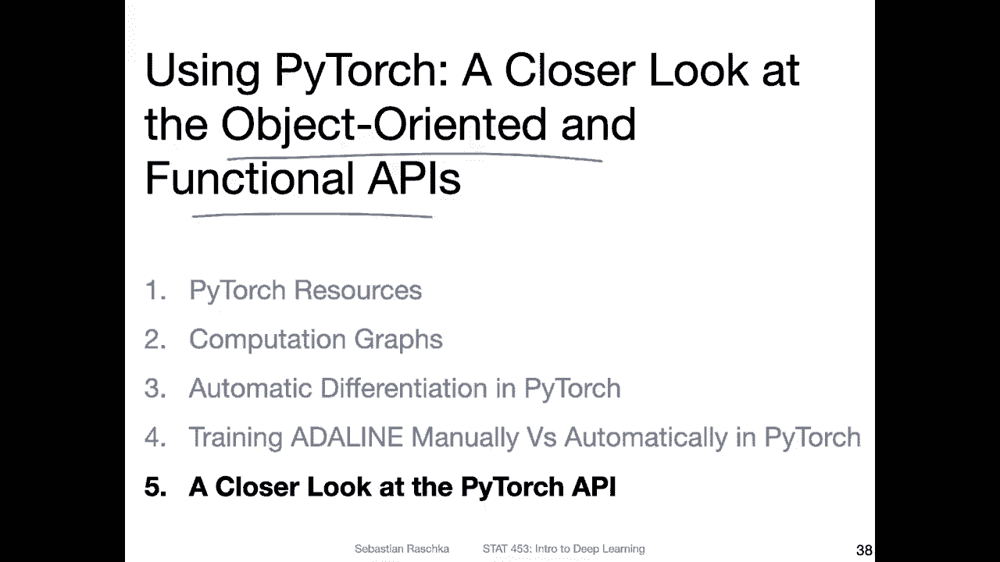

在本节课中，我们将深入学习 PyTorch 的 API，特别是讨论面向对象 API 和函数式 API 之间的细微差别，这将在未来的课程中变得非常有用。

## 概述

我们将以一个多层感知机为例，介绍在 PyTorch 中定义和训练神经网络的标准流程。虽然我们尚未详细讨论其工作原理，但你可以将其视为一个多层神经网络。在 PyTorch 中构建网络时，我们通常遵循一个通用模板。

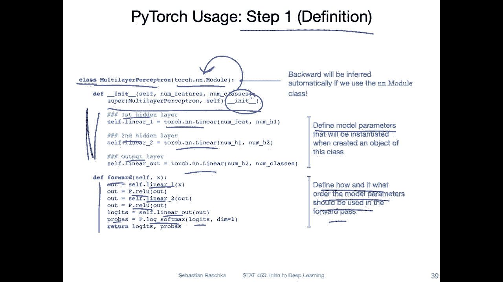

## 1. 定义模型类

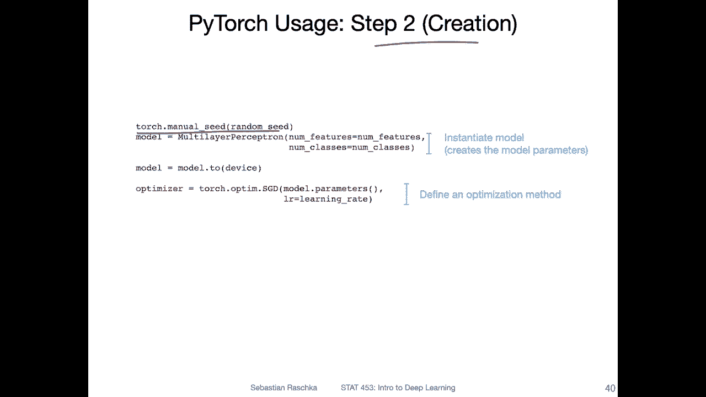

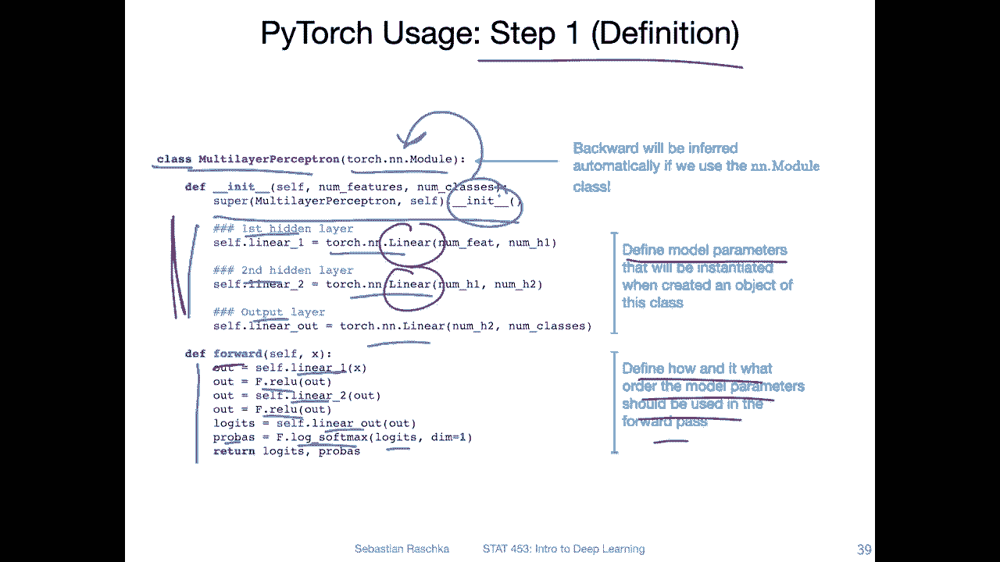

首先，我们通过定义一个继承自 `torch.nn.Module` 的类来设置网络。这为我们自动提供了一些便利功能。

以下是定义模型类的步骤：

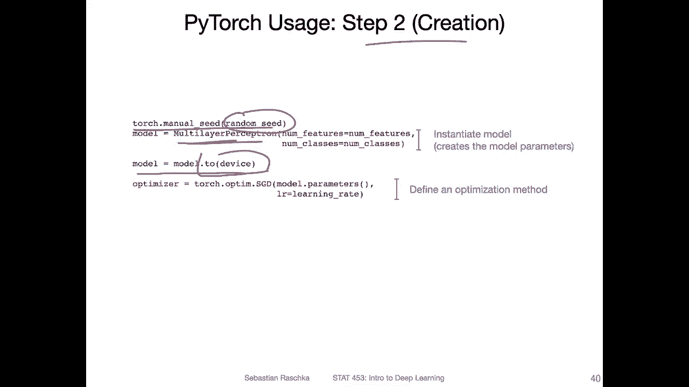

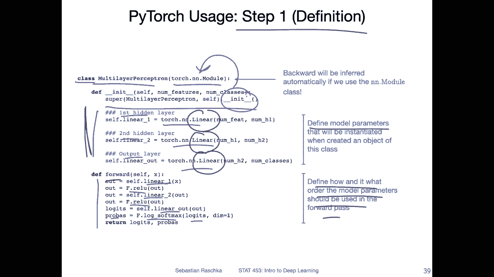

```python
import torch.nn as nn

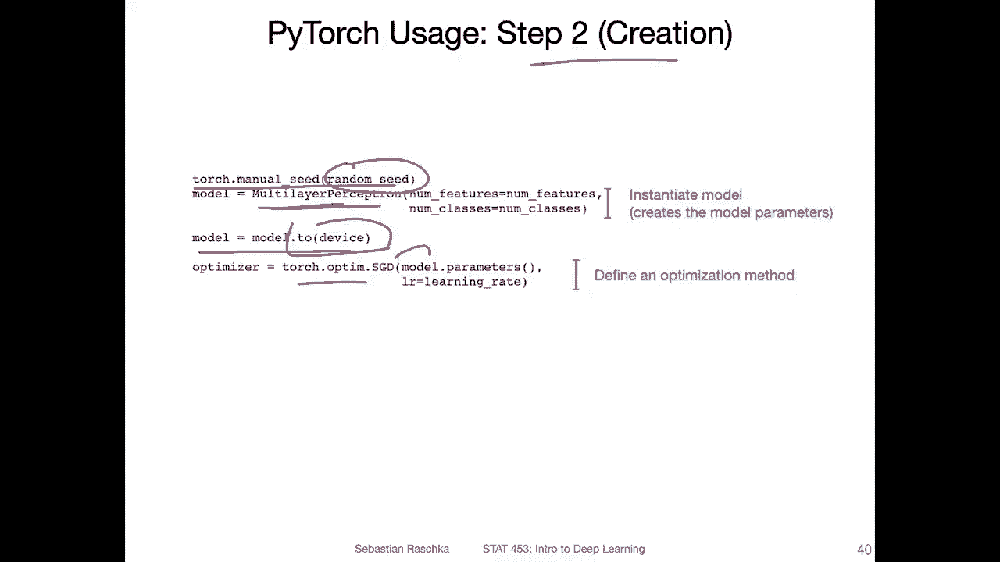

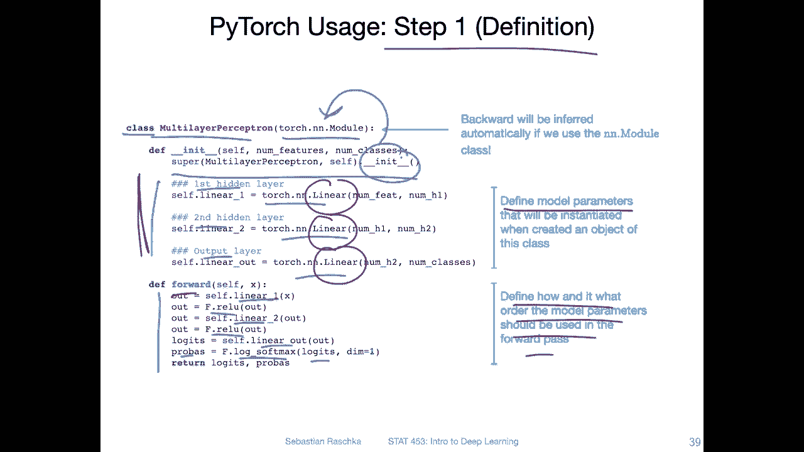

class MultiLayerPerceptron(nn.Module):
    def __init__(self, input_size, hidden_size, num_classes):
        super().__init__()
        # 定义需要更新的模型参数（层）
        self.layer_1 = nn.Linear(input_size, hidden_size)
        self.layer_2 = nn.Linear(hidden_size, hidden_size)
        self.layer_out = nn.Linear(hidden_size, num_classes)
        self.relu = nn.ReLU()

    def forward(self, x):
        # 定义前向传播的计算顺序
        x = self.relu(self.layer_1(x))
        x = self.relu(self.layer_2(x))
        x = self.layer_out(x)
        return x
```

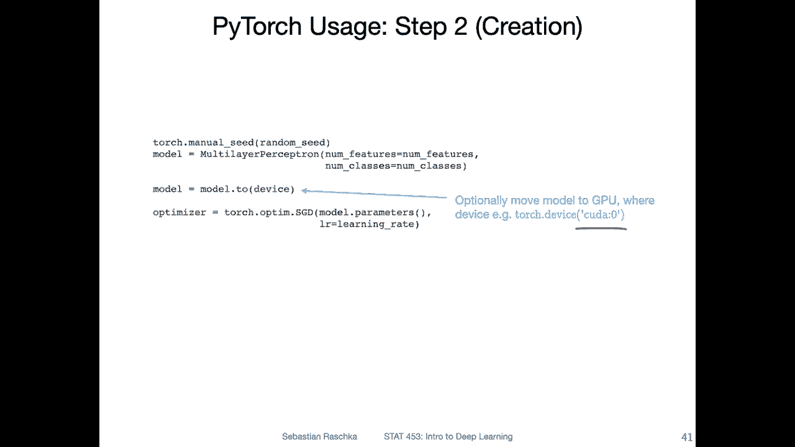

在 `__init__` 方法中，我们定义模型的参数（例如，全连接层）。在 `forward` 方法中，我们定义这些参数的使用顺序和计算方式。这就是模型定义的基本框架。

## 2. 实例化模型与设置

定义好模型类后，下一步是实例化模型并进行相关设置。

以下是实例化模型与设置的步骤：

1.  **设置随机种子**：为了确保代码的可复现性，通常在初始化模型前设置一个固定的随机种子。
2.  **初始化模型**：创建模型类的实例。
3.  **指定设备**：将模型移动到 GPU（如果可用）可以显著加速训练。只需一行代码即可实现。
4.  **设置优化器**：优化器（如随机梯度下降）负责在训练过程中更新模型参数。我们需要告诉优化器哪些参数需要更新。

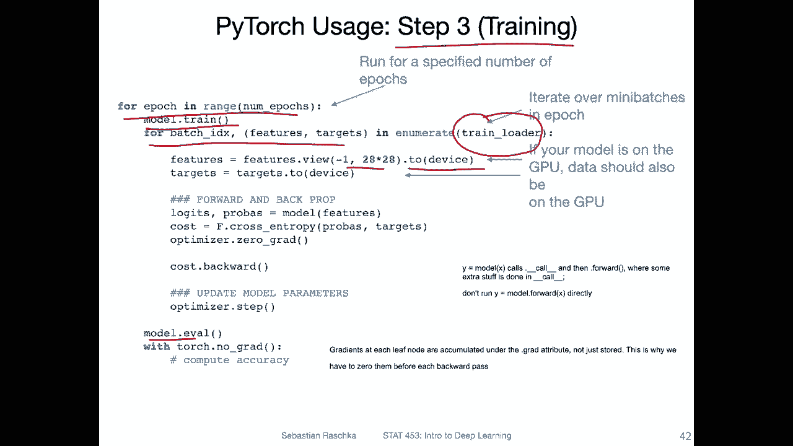

```python
import torch

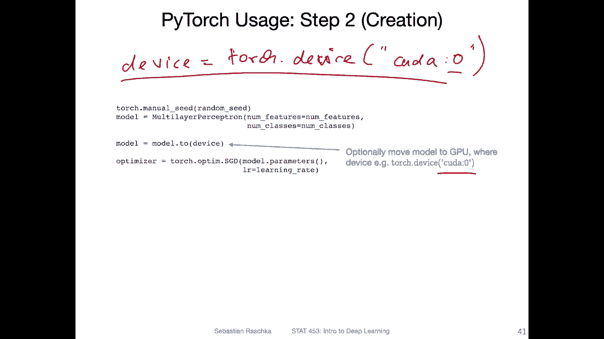

# 设置随机种子以确保可复现性
torch.manual_seed(123)

# 实例化模型
model = MultiLayerPerceptron(input_size=784, hidden_size=128, num_classes=10)

# 指定运行设备（CPU 或 GPU）
device = torch.device('cuda' if torch.cuda.is_available() else 'cpu')
model.to(device)

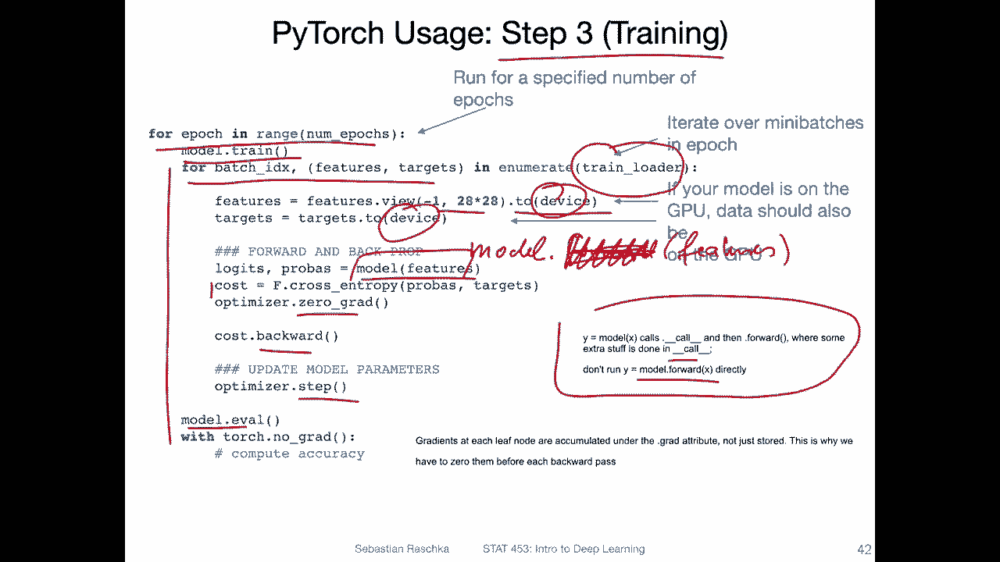

# 设置优化器，传入需要更新的模型参数
optimizer = torch.optim.SGD(model.parameters(), lr=0.01)
```

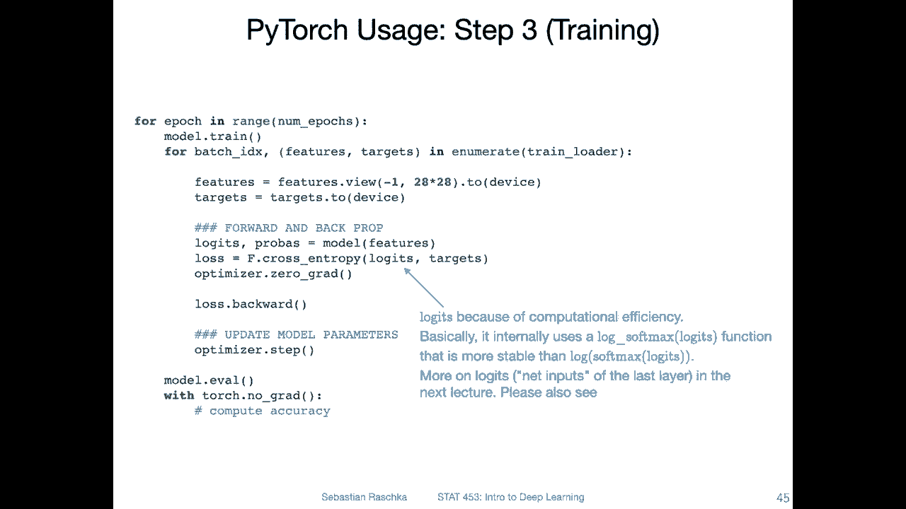

## 3. 训练循环

模型和优化器设置完成后，我们进入训练循环。这一步与之前介绍 Adaline 算法时的概念非常相似。

以下是训练循环的核心步骤：

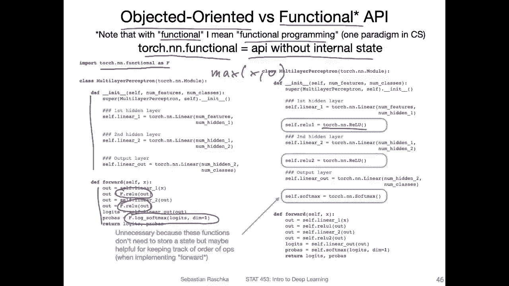

1.  **设置模型为训练模式**：使用 `model.train()`。这是一个好习惯，因为某些层（如批归一化、Dropout）在训练和评估阶段的行为不同。
2.  **遍历数据批次**：在每个训练周期（epoch）中，遍历训练数据的小批次（mini-batch）。
3.  **前向传播**：将数据输入模型，计算预测输出。
4.  **计算损失**：使用损失函数（如交叉熵损失）比较预测输出与真实标签。
5.  **梯度清零**：在反向传播前，将优化器中累积的梯度清零。
6.  **反向传播**：计算损失相对于模型参数的梯度。
7.  **参数更新**：优化器根据计算出的梯度更新模型参数。

```python
# 假设我们有一些训练数据 `features` 和标签 `labels`
num_epochs = 10
criterion = nn.CrossEntropyLoss() # 损失函数

for epoch in range(num_epochs):
    model.train() # 设置为训练模式

    # 这里假设我们按批次遍历数据
    for batch_features, batch_labels in train_loader:
        # 将数据移动到与模型相同的设备
        batch_features = batch_features.to(device)
        batch_labels = batch_labels.to(device)

        # 前向传播
        outputs = model(batch_features)

        # 计算损失
        loss = criterion(outputs, batch_labels)

        # 反向传播与优化
        optimizer.zero_grad() # 梯度清零
        loss.backward()       # 反向传播，计算梯度
        optimizer.step()      # 更新参数
```

理解这个流程至关重要，但在实际项目中，你通常不需要从头开始编写所有代码，而是基于现有模板进行修改。

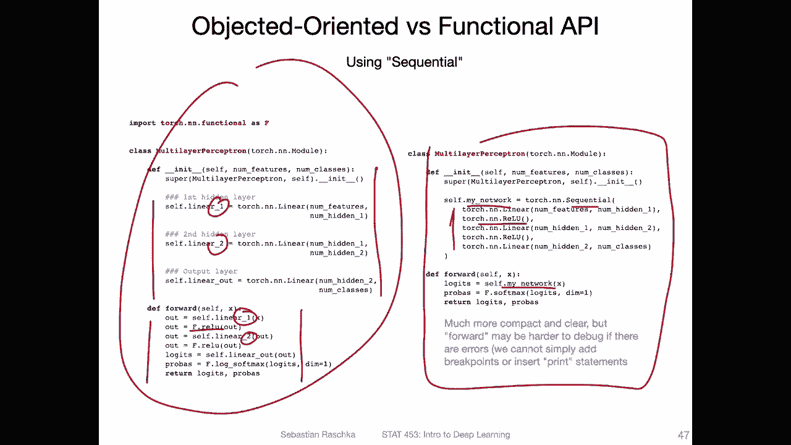

## 4. 面向对象 API 与函数式 API

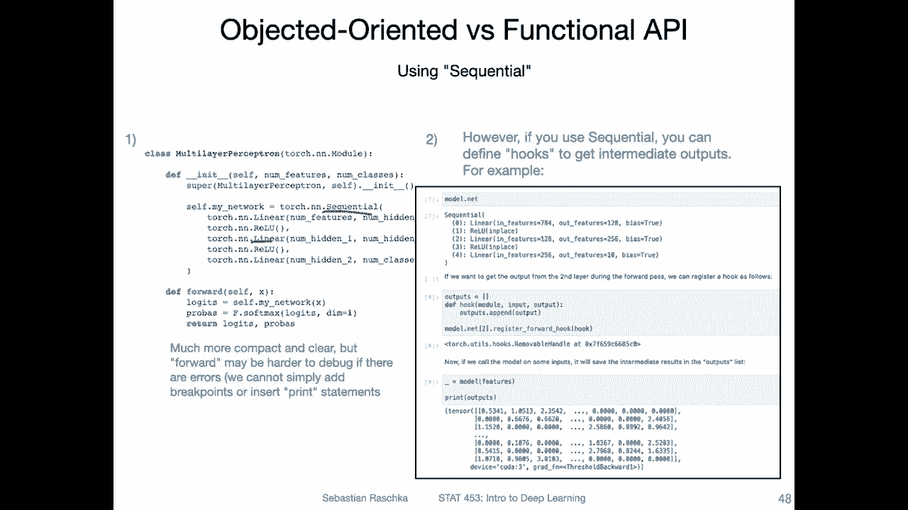

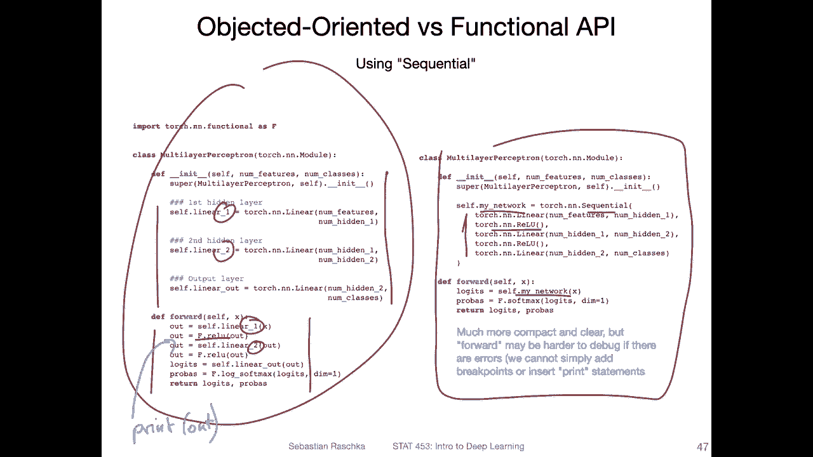

PyTorch 提供了两种主要的 API 风格：面向对象 API 和函数式 API，你可以混合使用它们。

**函数式 API** 指的是没有内部状态的函数。例如，ReLU 激活函数只是一个简单的数学运算（`max(0, x)`），它本身没有需要学习的参数。因此，使用函数式 API 更为合适。

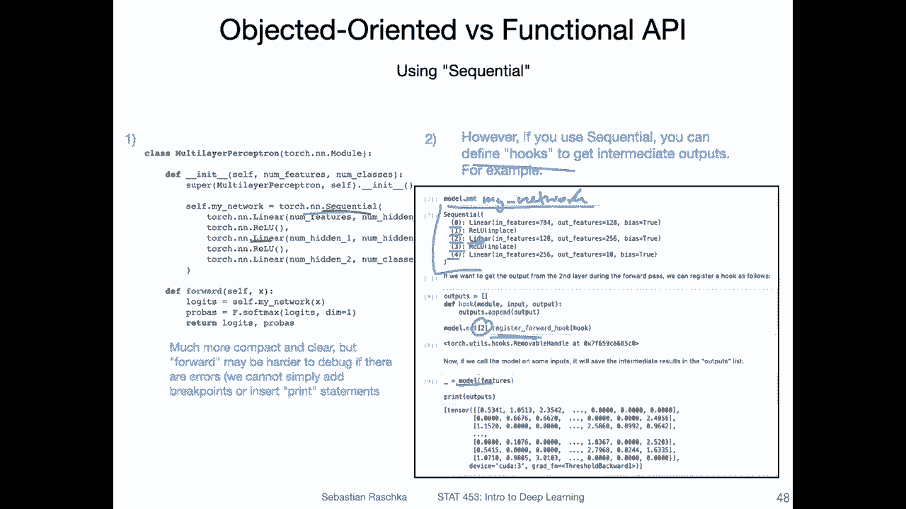

**面向对象 API** 通常用于包含需要学习参数的组件（如线性层）。然而，PyTorch 也提供了 `nn.Sequential` 容器，它允许我们以更简洁的面向对象方式定义网络。

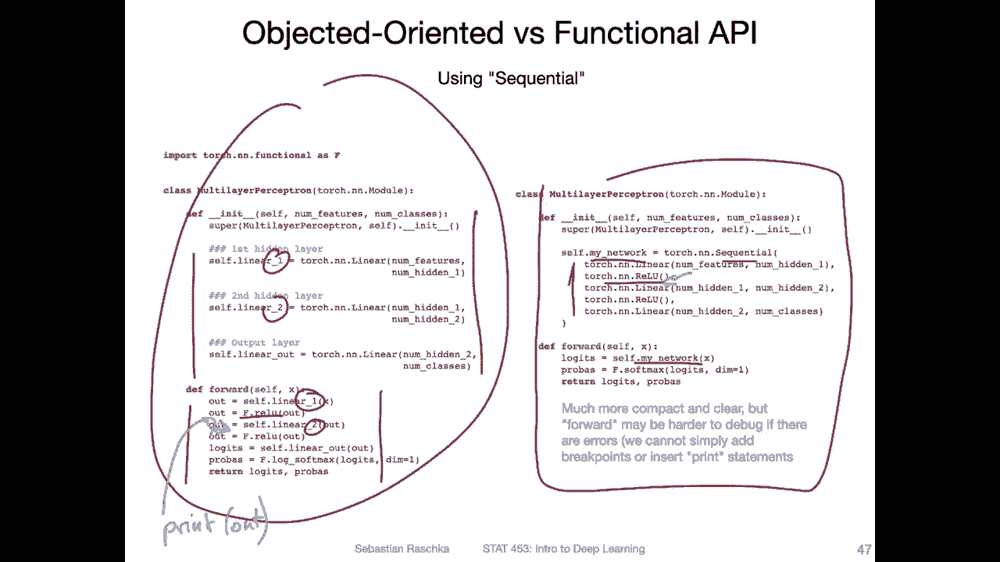

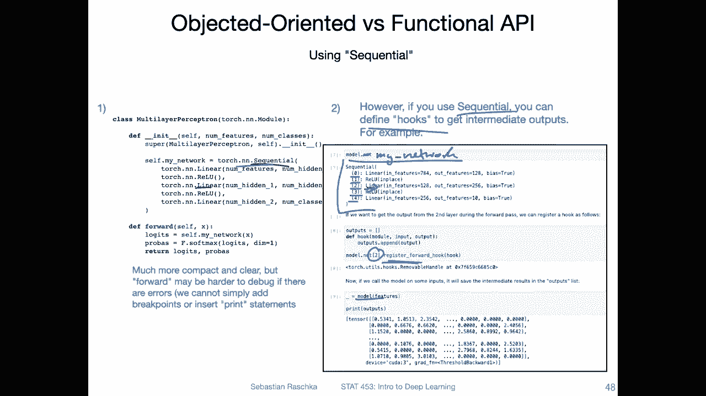

以下是两种风格的对比示例：

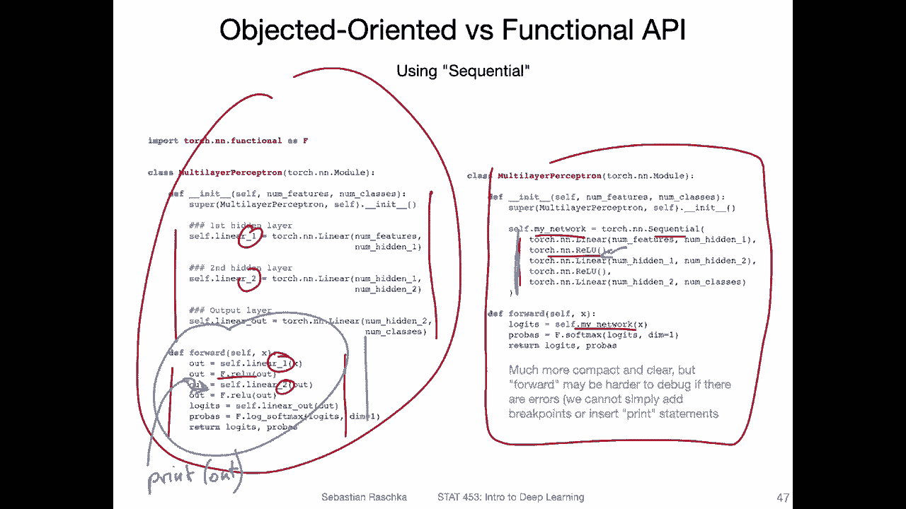

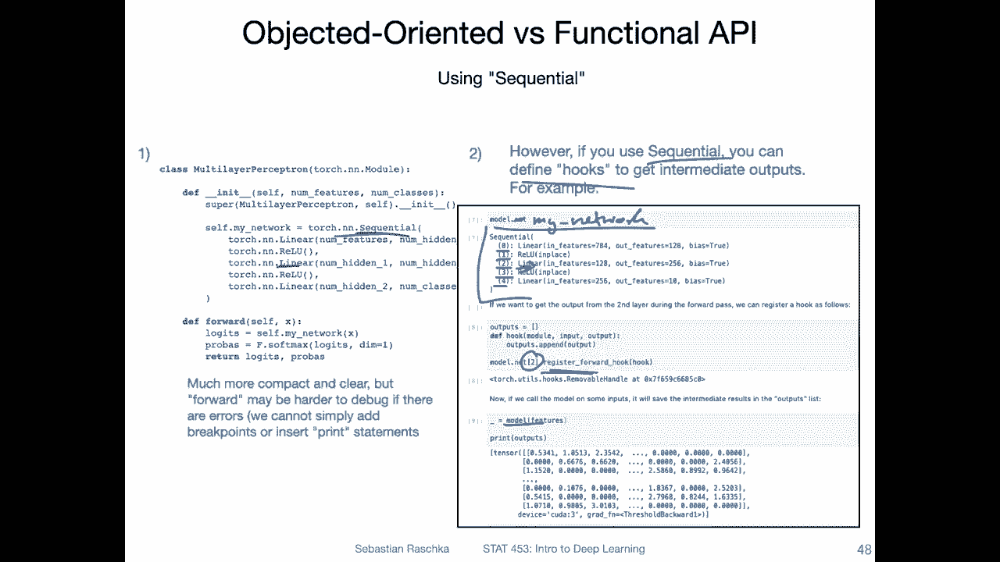

```python
# 方式一：混合使用（在 __init__ 中定义参数，在 forward 中调用函数式 API）
class Net1(nn.Module):
    def __init__(self):
        super().__init__()
        self.fc1 = nn.Linear(10, 5)
        self.fc2 = nn.Linear(5, 2)
    def forward(self, x):
        x = torch.relu(self.fc1(x)) # 使用 torch.relu (函数式)
        x = self.fc2(x)
        return x

# 方式二：使用 nn.Sequential (面向对象，更紧凑)
class Net2(nn.Module):
    def __init__(self):
        super().__init__()
        self.net = nn.Sequential(
            nn.Linear(10, 5),
            nn.ReLU(),          # 使用 nn.ReLU() 模块
            nn.Linear(5, 2)
        )
    def forward(self, x):
        return self.net(x)
```

`nn.Sequential` 的优点是定义顺序清晰，不易出错，特别适合层数很多的网络。缺点是如果需要获取中间层的输出进行调试，不如第一种方式直接插入 `print` 语句方便，而需要用到“钩子”（hook）机制。你可以根据项目需求和个人偏好选择使用哪种风格。

## 5. 开发风格建议

最后，分享一些 PyTorch 开发的最佳实践：

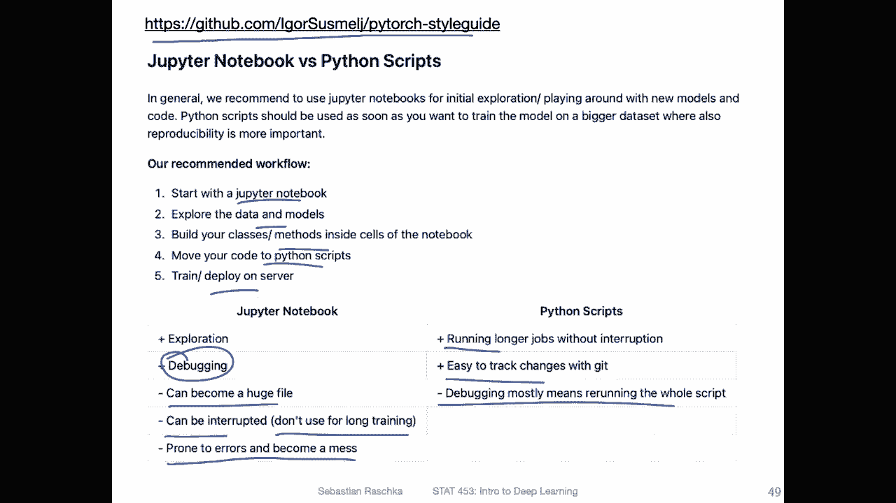

*   **Jupyter Notebook 与 Python 脚本**：建议在探索性分析和初步编码时使用 Jupyter Notebook，因为它便于展示中间结果和图表。对于更复杂、需要长时间运行或部署的项目，建议使用 Python 脚本，因为它们更稳健，且与版本控制工具（如 Git）和集成开发环境（如 VS Code, PyCharm）的调试功能配合得更好。
*   **命名规范**：遵循常见的 Python 命名约定有助于保持代码清晰。
    *   包、模块、函数、变量：使用小写字母和下划线（`snake_case`）。
    *   类：使用大写字母开头的单词（`CamelCase`）。
    *   常量：使用全大写字母和下划线（`UPPER_CASE`）。

随着课程的深入，我们将在需要时逐步介绍 PyTorch 的更多特性，例如在处理卷积神经网络时。

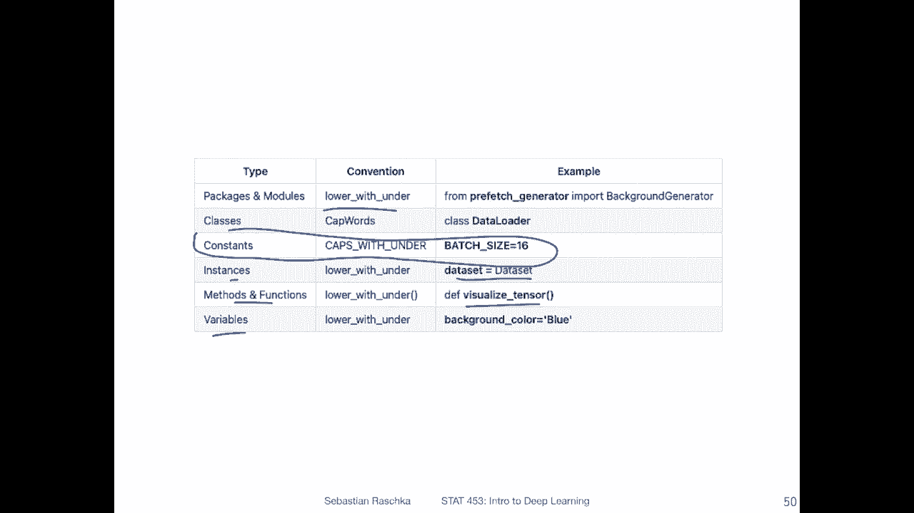

## 总结

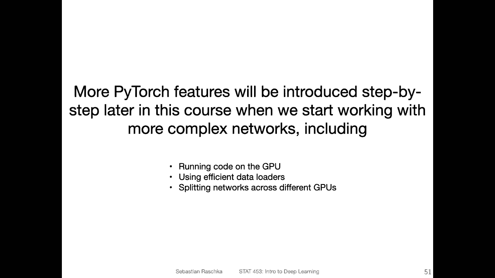

本节课我们一起学习了 PyTorch 的核心 API 使用流程。我们介绍了如何通过继承 `nn.Module` 来定义模型，在 `__init__` 中初始化参数，在 `forward` 中定义前向传播。我们了解了实例化模型、设置设备与优化器、以及编写训练循环的步骤。我们还探讨了面向对象 API 与函数式 API（包括 `nn.Sequential`）的区别与选择。最后，我们简要讨论了 Jupyter Notebook 与 Python 脚本的使用场景以及代码命名规范。这个通用的 PyTorch 框架将是我们后续构建更复杂神经网络的基础。