# 48：L7.0 - GPU 资源与 Google Colab 使用教程 🚀

在本节课中，我们将学习如何利用免费的云端 GPU 资源来加速深度学习模型的训练，特别是通过 Google Colab 平台。这对于完成课后作业和课程项目非常有帮助。

## 📖 概述

我们将首先介绍一些可用的云端计算资源，然后重点演示如何在 Google Colab 中设置和使用 GPU，包括如何安装包、加载数据以及将模型和数据转移到 GPU 上进行训练。

## 🌐 可用的云端 GPU 资源

上一节我们介绍了课程目标，本节中我们来看看有哪些可用的免费云端 GPU 资源。

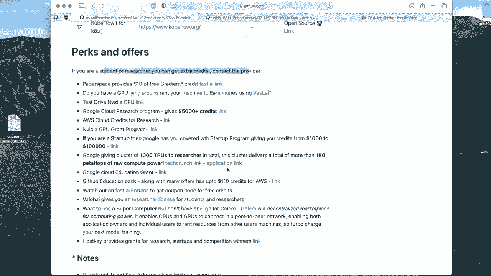

我发现了一个名为“Deep learning in the cloud”的优秀 GitHub 仓库。该仓库的贡献者和维护者整理了一份非常棒的列表，列出了所有可用于在云端训练深度神经网络的不同工具。它们中的大多数都支持 GPU，这正是其核心价值所在。

以下是该列表中一些最受欢迎且免费的服务选项：
*   **Google Colaboratory**：提供免费的 GPU 和 TPU 资源，运行时间有限制。
*   **Kaggle Kernels**：同样提供免费的 GPU 资源，适合数据科学竞赛和项目。
*   **其他选项**：列表中还包括一些提供初始信用额度（例如 300 美元）或固定运行时间（例如 3 小时）的服务。

对于在校学生，还有一些额外的特别优惠，值得关注。

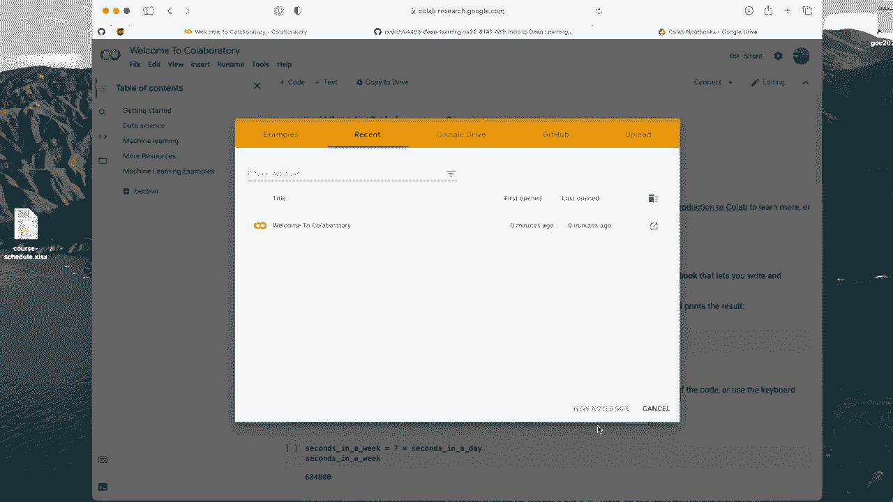

## 🛠️ 使用 Google Colab

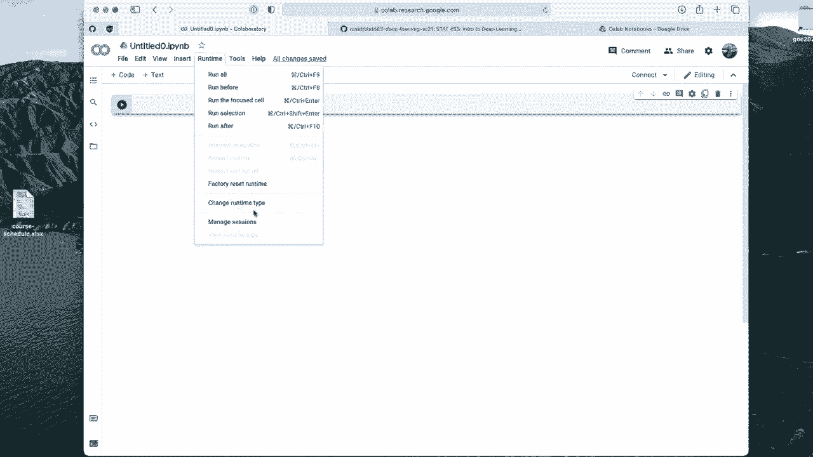

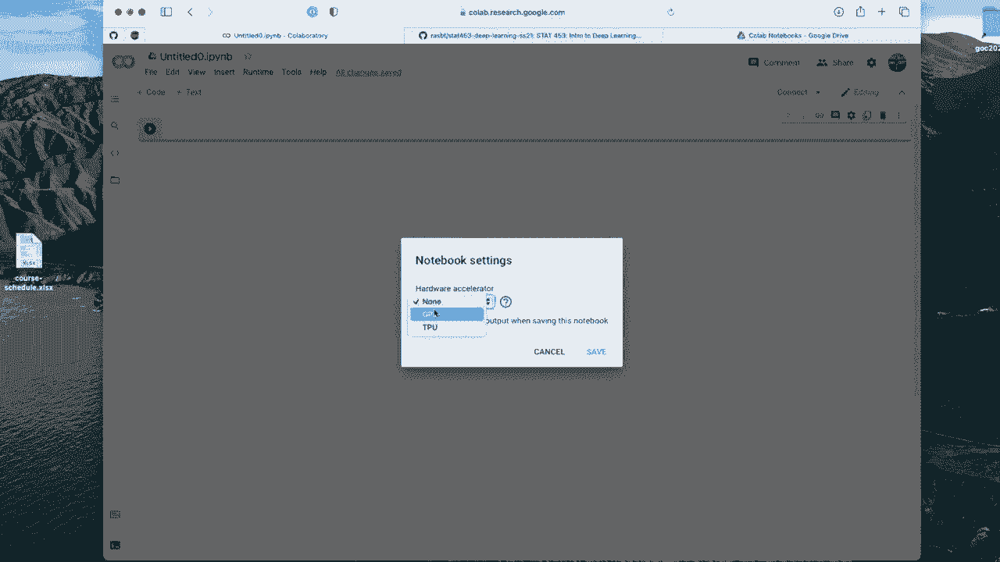

上一节我们了解了可用的资源，本节中我们来看看如何具体使用 Google Colab。

为了简化操作，我将引导你完成使用 Google Colab 进行项目的全过程。

首先，点击链接打开一个新的 Colab 笔记本环境。这是一个基于笔记本的环境，易于使用，并且可以直接在界面中查看代码运行结果。不过，当代码变得复杂时，拥有 Python 脚本的云端环境可能更合适。你可以探索列表并选择最适合你课程项目的环境，没有强制要求。

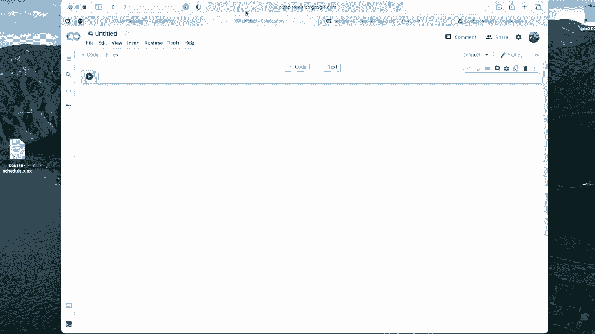

### 启用 GPU

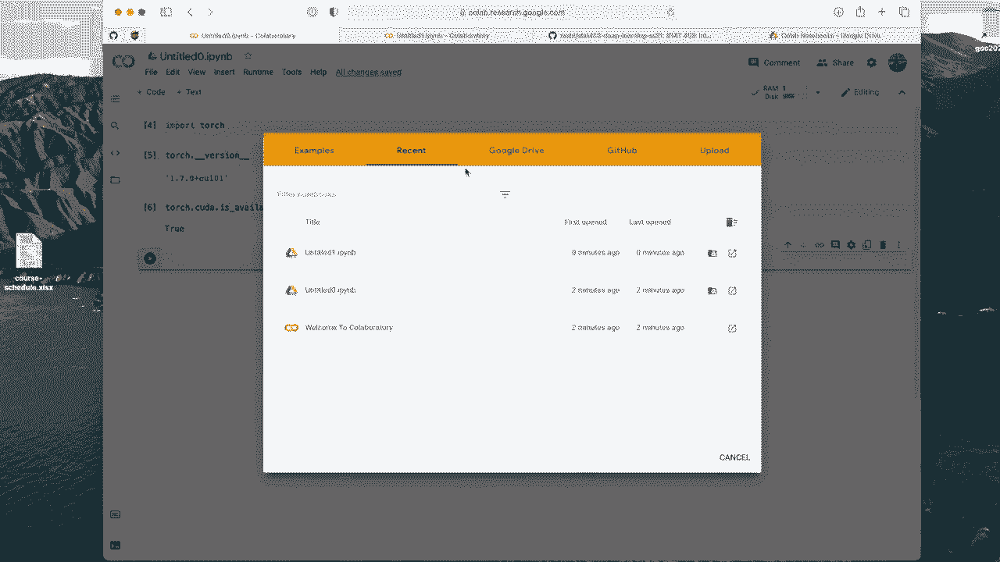

一个重要的步骤是启用 GPU 支持。为此，你需要转到“运行时”菜单，选择“更改运行时类型”，然后在“硬件加速器”下拉菜单中选择“GPU”。你也可以选择 TPU，但对于本课程，我推荐使用 GPU。

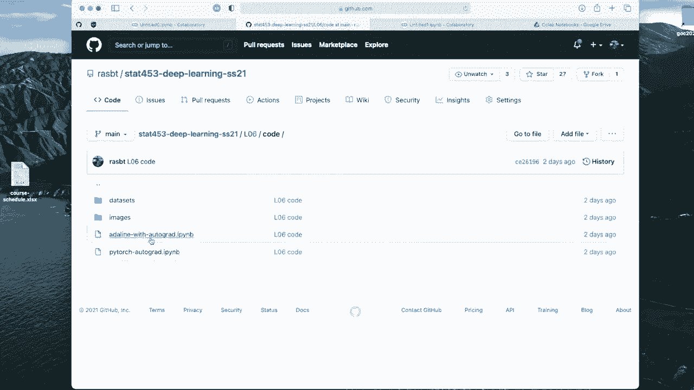

选择完成后，我们可以检查 PyTorch 是否可用，并确认 GPU 已被识别。

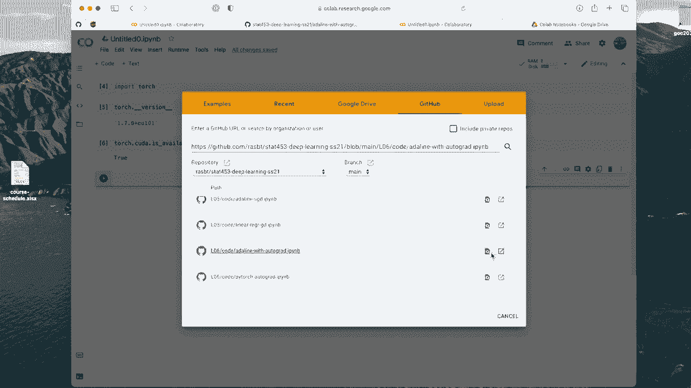

```python
import torch
print(torch.__version__)
print(torch.cuda.is_available())
```

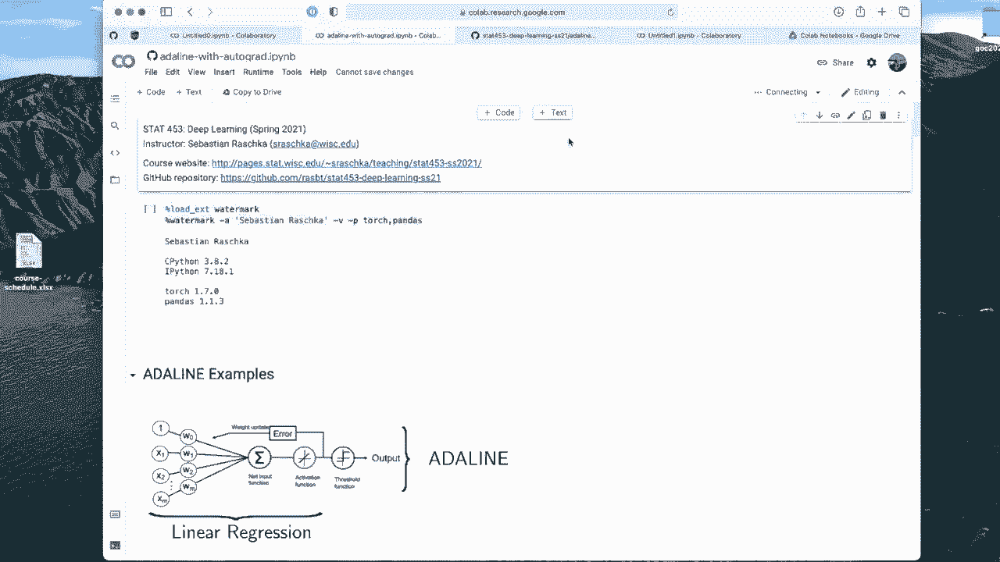

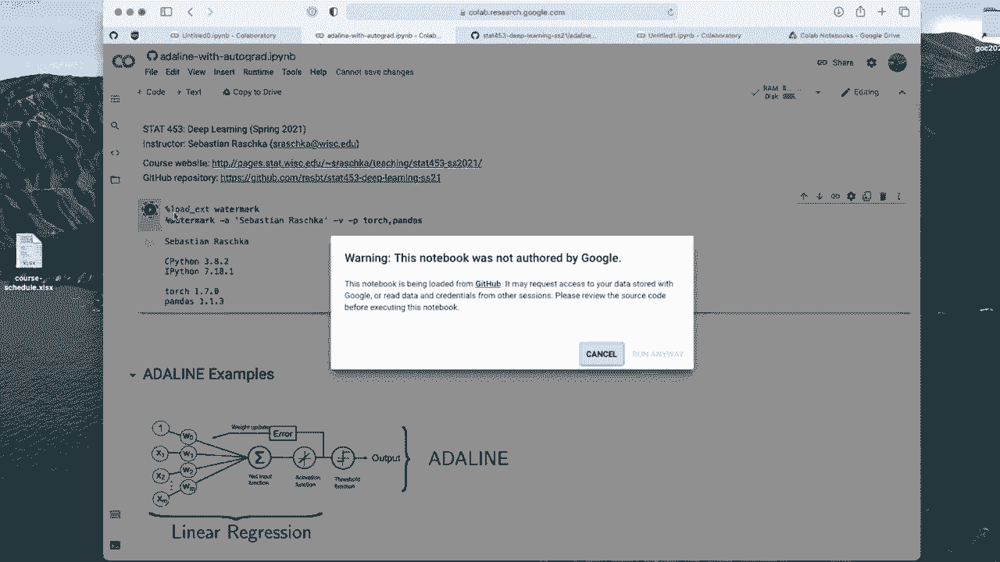

如果 `torch.cuda.is_available()` 返回 `False`，请确保你已在运行时设置中正确选择了 GPU。

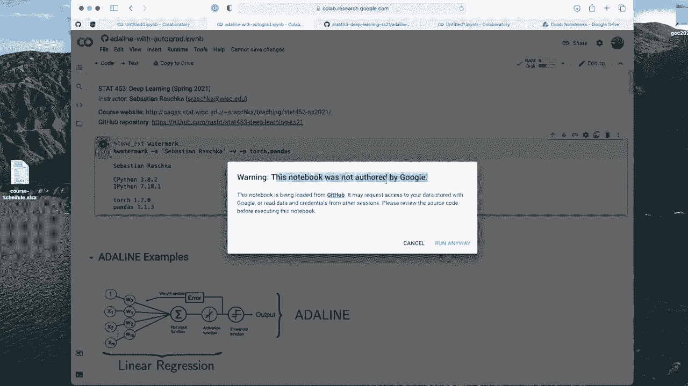

### 打开和运行笔记本

我们可以在 Colab 中直接打开 GitHub 上的笔记本。例如，你可以导航到课程仓库，找到相应的笔记本文件（如关于自动求导和 PyTorch 的笔记本），然后使用“在 Colab 中打开”功能。

打开笔记本后，再次确保运行时类型设置为 GPU，然后就可以运行代码了。

### 安装缺失的包

Colab 预装了许多 Python 包，但并非全部。如果遇到“ModuleNotFoundError”（例如找不到 `watermark` 包），我们需要手动安装。

我们可以使用感叹号 `!` 来执行终端命令：

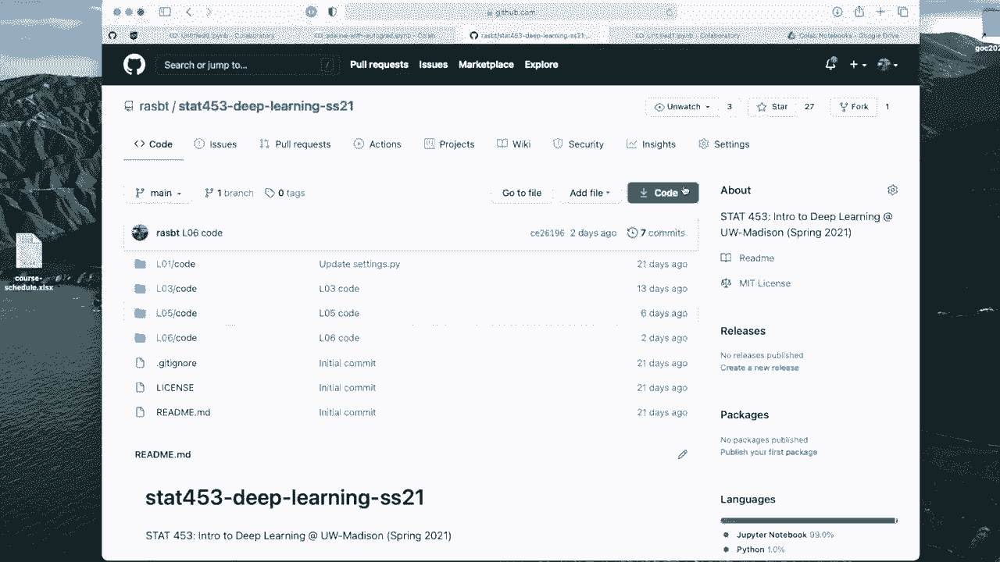

```bash
!pip install watermark
```

安装成功后，相应的代码单元格就可以正常运行了。

### 加载数据

直接从 GitHub 打开笔记本时，笔记本可能无法访问仓库中的数据集文件。有几种方法可以解决这个问题。

**方法一：直接使用原始数据链接**
如果数据集是托管在网上的单个文件（如 CSV），你可以直接使用其 URL 进行加载。

**方法二：挂载 Google 云端硬盘（推荐）**
更通用的方法是挂载你的 Google Drive，这样你就可以访问存储在 Drive 上的任何数据文件。

以下是挂载 Google Drive 的代码：

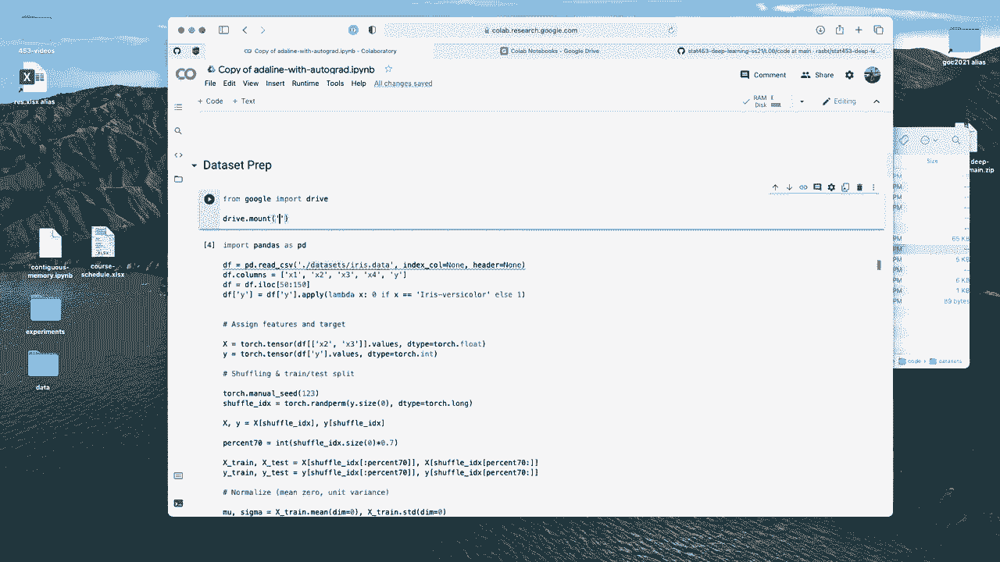

```python
from google.colab import drive
drive.mount('/content/drive')
```

执行这段代码后，系统会提示你授权访问。按照链接完成授权，并将返回的验证码粘贴到输入框中即可。

挂载后，你的 Drive 内容会出现在 `/content/drive/MyDrive/` 目录下。假设你的数据集在 Drive 的 `Colab Notebooks/datasets/` 文件夹中，加载路径应类似：

```python
file_path = '/content/drive/MyDrive/Colab Notebooks/datasets/iris.csv'
```

**方法三：复制数据到本地环境（针对大型数据集）**
为了获得更快的 I/O 速度，特别是处理大型数据集（如图像集）时，建议将数据从 Drive 复制到 Colab 虚拟机本身的本地存储中。

你可以使用以下命令复制整个文件夹或压缩包：

```bash
# 复制文件夹
!cp -r /content/drive/MyDrive/Colab\ Notebooks/datasets /content/

# 或者，更高效的方式是处理压缩包
!cp /content/drive/MyDrive/Colab\ Notebooks/datasets.zip /content/
!unzip /content/datasets.zip -d /content/datasets
```

这样，数据就位于 Colab 实例的本地路径（如 `/content/datasets/`），数据加载器的读取速度会更快。

### 在 GPU 上运行模型

最后，要让模型在 GPU 上训练，需要将模型和张量数据都转移到 GPU 设备上。

首先，定义设备：

```python
device = torch.device("cuda:0" if torch.cuda.is_available() else "cpu")
```

然后，将模型转移到该设备：

```python
model = YourModel()
model.to(device)
```

同样，在训练时，也需要将每个批次的输入数据和标签转移到 GPU：

```python
inputs, labels = inputs.to(device), labels.to(device)
```

在后续的代码示例中，我会设置一个全局标志来自动处理设备转移，你只需要在脚本开头指定一次即可。

## 📝 总结

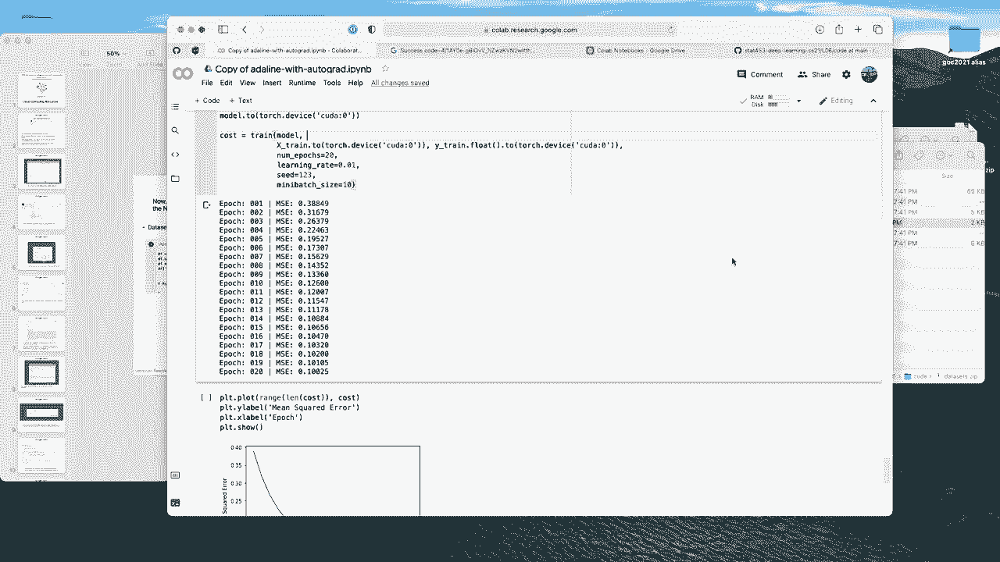

本节课中我们一起学习了如何寻找并使用免费的云端 GPU 资源，重点掌握了 Google Colab 的基本工作流程：如何启用 GPU、安装包、通过挂载 Google Drive 或复制到本地来管理数据集，以及如何将 PyTorch 模型和数据转移到 GPU 上进行加速训练。希望本教程对你有所帮助。