# 53：L8.3 - Logistic 回归损失导数和训练 🧮

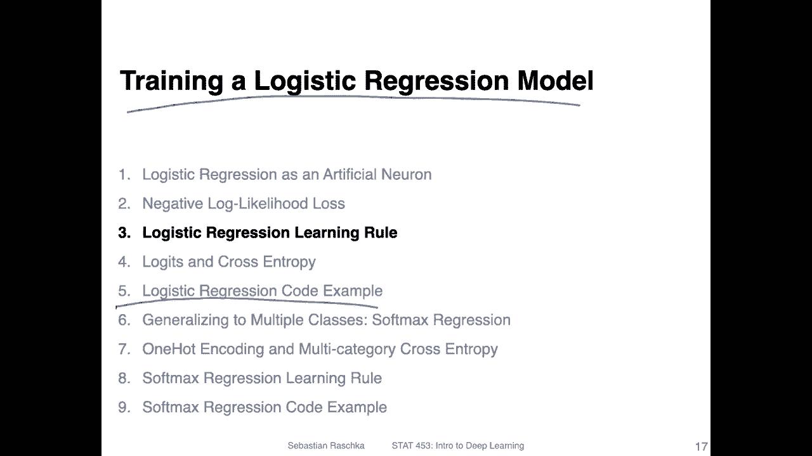

在本节课中，我们将学习如何训练一个逻辑回归模型。具体来说，我们将计算损失函数相对于逻辑回归模型中权重和偏置参数的梯度，以便后续使用梯度下降法来更新模型参数。在后续的视频中，我们将看到如何在代码中实现这一过程，完成实际的模型训练。

---

## 逻辑 Sigmoid 函数及其导数 📈

上一节我们介绍了逻辑回归模型的基本概念，本节中我们来看看其核心激活函数——逻辑 Sigmoid 函数及其导数。

逻辑 Sigmoid 函数的形状如下图所示，其输入（净输入 `z`）在 x 轴，输出（激活值 `a`）在 y 轴，呈现 S 形曲线。观察函数图像，我们可以直观地理解其导数的特性：在函数两端相对平坦的区域，梯度接近于 0；而在中间最陡峭的部分，梯度达到最大。


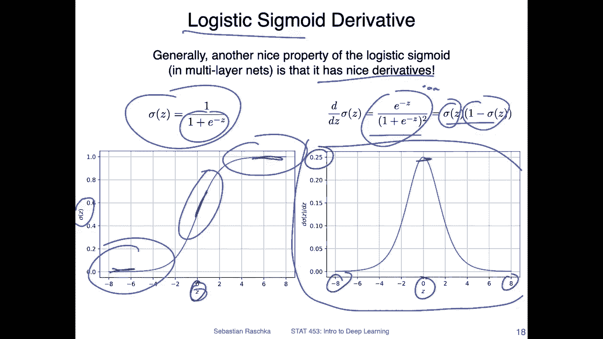

逻辑 Sigmoid 函数 `σ(z)` 的公式为：
```
σ(z) = 1 / (1 + e^{-z})
```

其导数 `σ'(z)` 可以通过微积分规则计算得出，结果非常简洁：
```
σ'(z) = σ(z) * (1 - σ(z))
```

这个导数函数的特点是：当输入 `z` 为 0 时，导数值最大，为 0.25；当输入 `z` 的绝对值很大（正或负）时，导数值趋近于 0。这种特性在构建多层神经网络时可能会带来梯度消失的问题，但这将在后续课程中讨论。

---

## 负对数似然损失函数 📉

理解了激活函数的导数后，我们接下来分析逻辑回归使用的损失函数——负对数似然损失。

该损失函数 `L` 的公式如下，它根据真实标签 `y` 的不同取值（0 或 1）分为两部分：
```
L = -[y * log(a) + (1 - y) * log(1 - a)]
```
其中，`a` 是模型预测的类别 1 的概率（即 `σ(z)`）。

以下是损失函数在不同情况下的表现：

*   当真实标签 `y = 1` 时，损失函数简化为 `L = -log(a)`。我们希望模型预测的概率 `a` 越高（接近 1），损失 `L` 就越低（接近 0）。如果模型预测的概率 `a` 很低（接近 0），损失 `L` 会急剧增大至无穷大。
*   当真实标签 `y = 0` 时，损失函数简化为 `L = -log(1 - a)`。我们希望模型预测的概率 `a` 越低（接近 0），损失 `L` 就越低（接近 0）。如果模型预测的概率 `a` 很高（接近 1），损失 `L` 同样会急剧增大。


该损失函数的核心思想是：对错误的预测施加巨大的惩罚（损失值趋近无穷），从而驱使模型学习做出正确的预测。

---

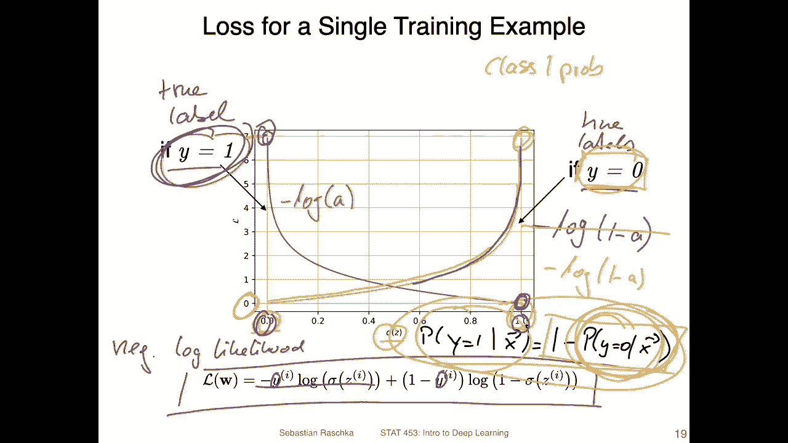

## 梯度计算与参数更新规则 🔄

现在，我们来看如何计算梯度并更新参数。这与我们之前训练线性回归和 Adaline 模型时使用的梯度下降法原理相同。

我们需要计算损失函数 `L` 相对于权重 `w_j` 的偏导数。根据链式法则，这可以分解为三个部分的乘积：
1.  损失 `L` 对激活输出 `a` 的导数。
2.  激活函数 `a` 对其输入 `z` 的导数（即 Sigmoid 函数的导数）。
3.  净输入 `z` 对权重 `w_j` 的导数（结果为输入特征 `x_j`）。

将这三部分相乘后，一个巧妙的现象发生了：公式得到了极大的简化。最终，权重 `w_j` 的梯度更新公式为：
```
Δw_j = η * (a^{(i)} - y^{(i)}) * x_j^{(i)}
```
其中，`η` 是学习率，`(i)` 表示第 `i` 个训练样本。

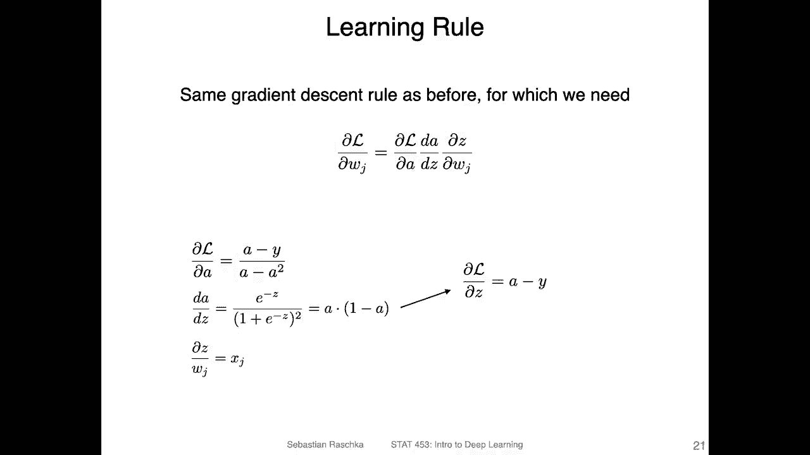

这个公式看起来与 Adaline 和线性回归的更新规则**完全一样**！这正是逻辑 Sigmoid 函数导数“友好”特性的体现。唯一的区别在于，这里的预测值 `a` 是通过非线性 Sigmoid 函数 `σ(z)` 计算得到的，而 Adaline 中则是线性恒等函数。


因此，我们可以复用之前 Adaline 的随机梯度下降学习规则框架，只需改变预测值 `a` 的计算方式即可。

---

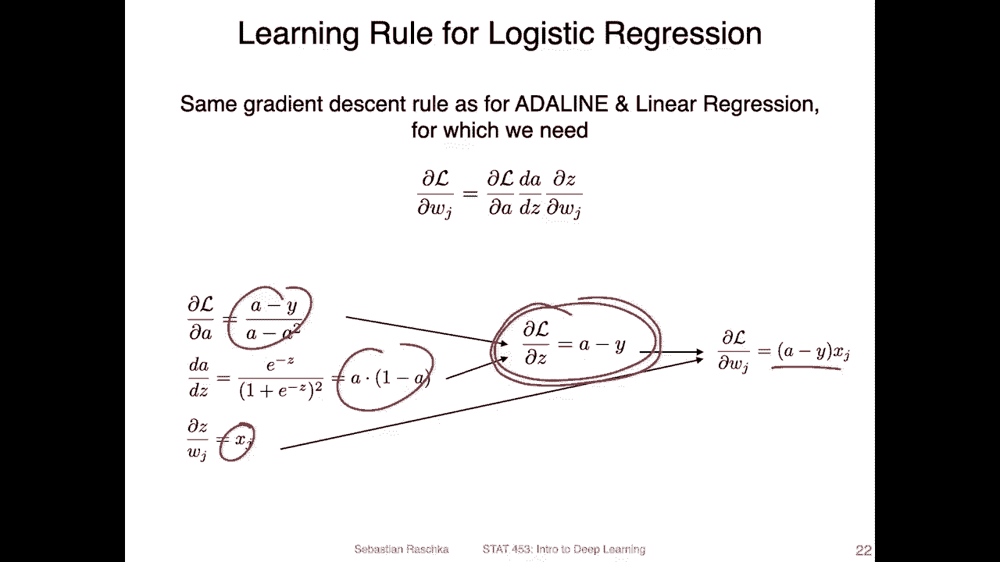

## 训练流程与预测推断 🎯

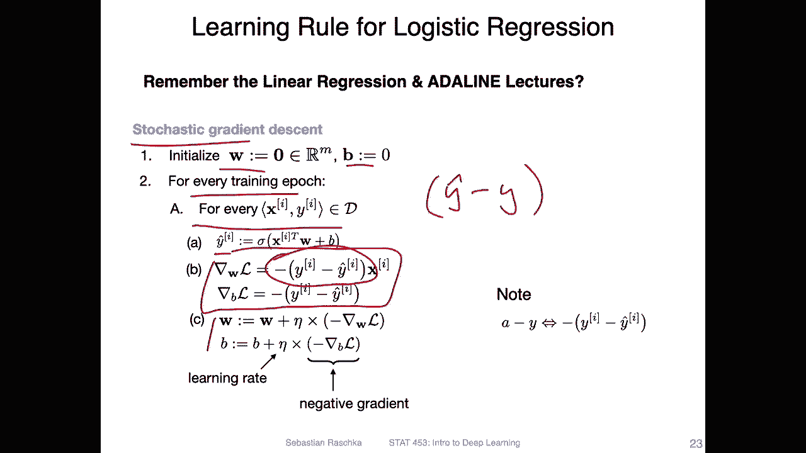

让我们将整个逻辑回归的训练和预测过程梳理一遍。

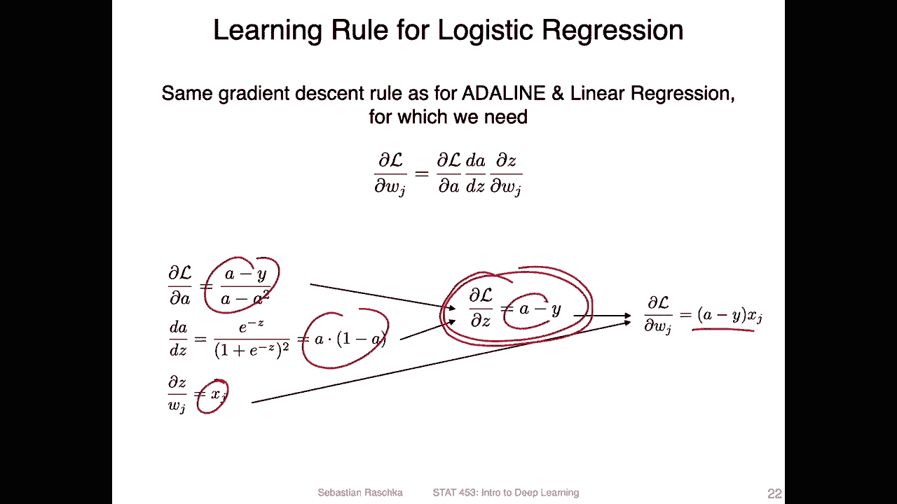

下图展示了逻辑回归的计算图。训练阶段（左半部分）：输入特征 `x` 和真实标签 `y`，通过前向传播计算预测概率 `a`，然后计算负对数似然损失 `L`，接着通过反向传播计算损失相对于权重和偏置的梯度，最后使用梯度下降法更新参数。

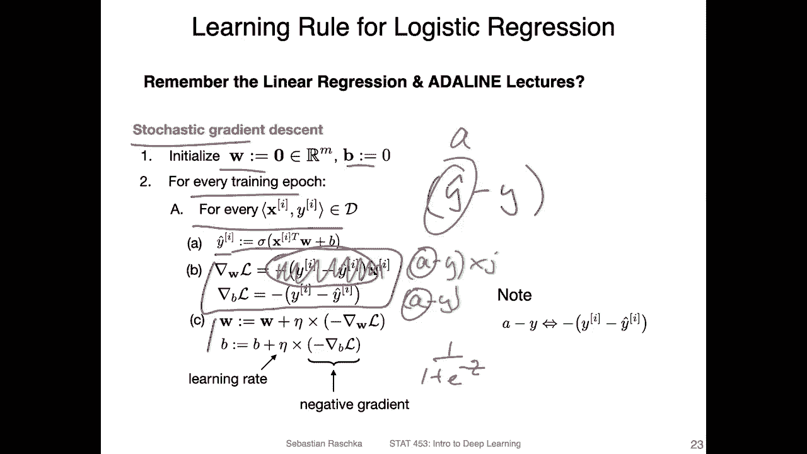


训练完成后，进入预测阶段（右半部分）。我们可以使用一个阈值函数将连续的概率值 `a` 转换为离散的类别标签 `ŷ`。通常的规则是：
```
如果 a > 0.5，则 ŷ = 1；否则 ŷ = 0。
```

由于 Sigmoid 函数在 `z=0` 时输出 `a=0.5`，我们还可以进行一个更高效的计算优化：在预测时，可以直接比较净输入 `z` 与 0 的大小，而无需完整计算 Sigmoid 函数。
```
如果 z > 0，则 ŷ = 1；否则 ŷ = 0。
```

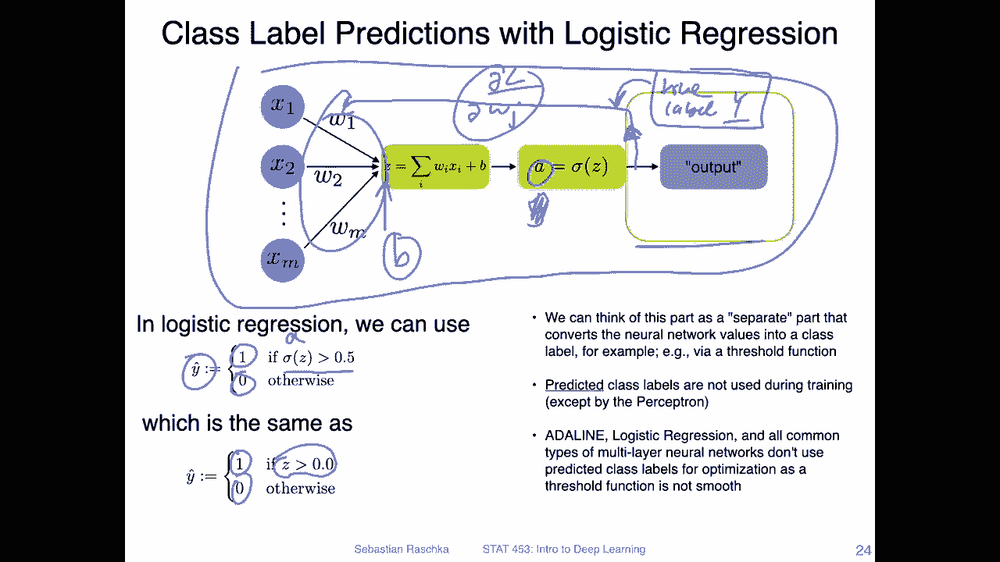

---


## 总结与预告 📚

本节课中我们一起学习了逻辑回归模型训练的核心数学原理。我们回顾了逻辑 Sigmoid 函数及其简洁的导数形式，分析了负对数似然损失函数如何对错误预测进行惩罚，并推导出了与线性模型形式一致的梯度更新公式。我们还梳理了从训练到预测的完整流程。

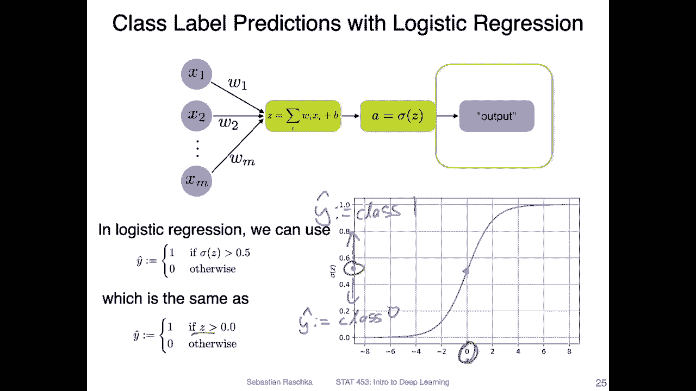

在接下来的视频中，我们将简要介绍“对数几率”和“交叉熵”这两个与逻辑回归相关的术语，然后通过一个具体的代码示例，将本节课的所有理论付诸实践，实现完整的前向传播、梯度计算和参数更新过程。代码实践将帮助大家更好地理解和巩固这些概念。

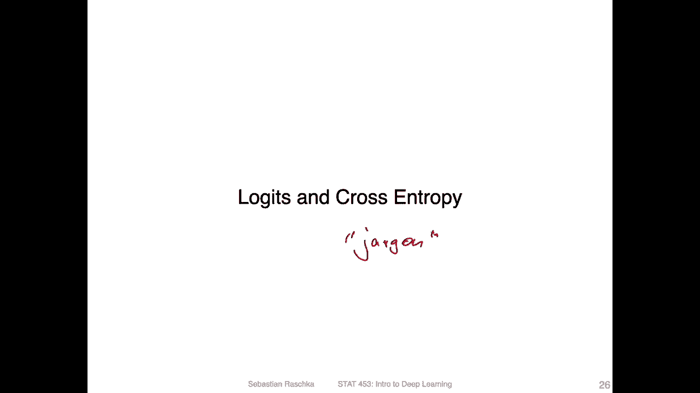

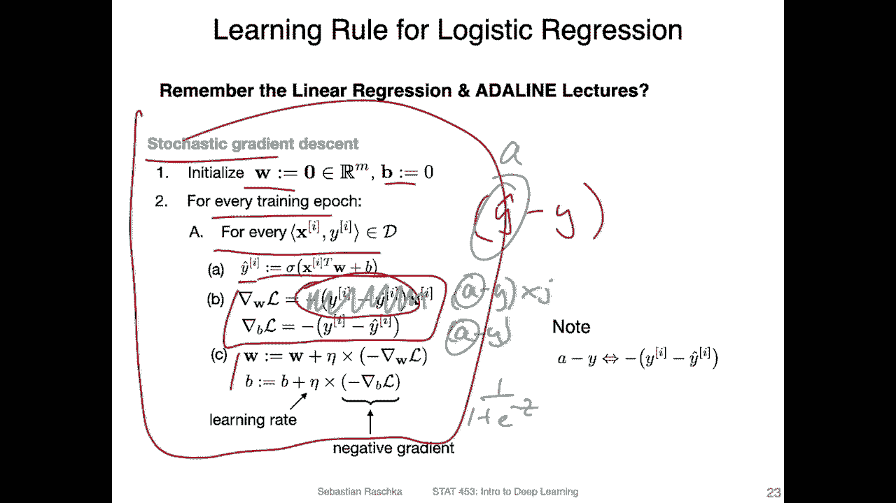

