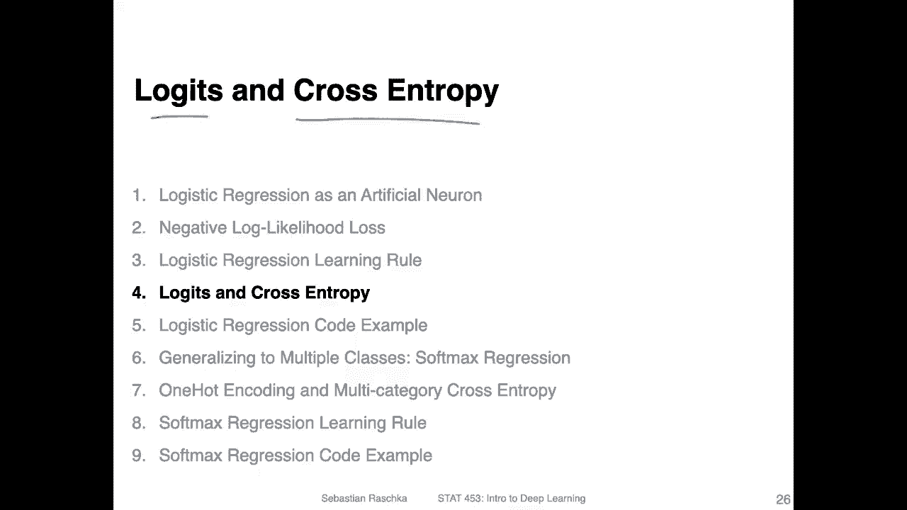
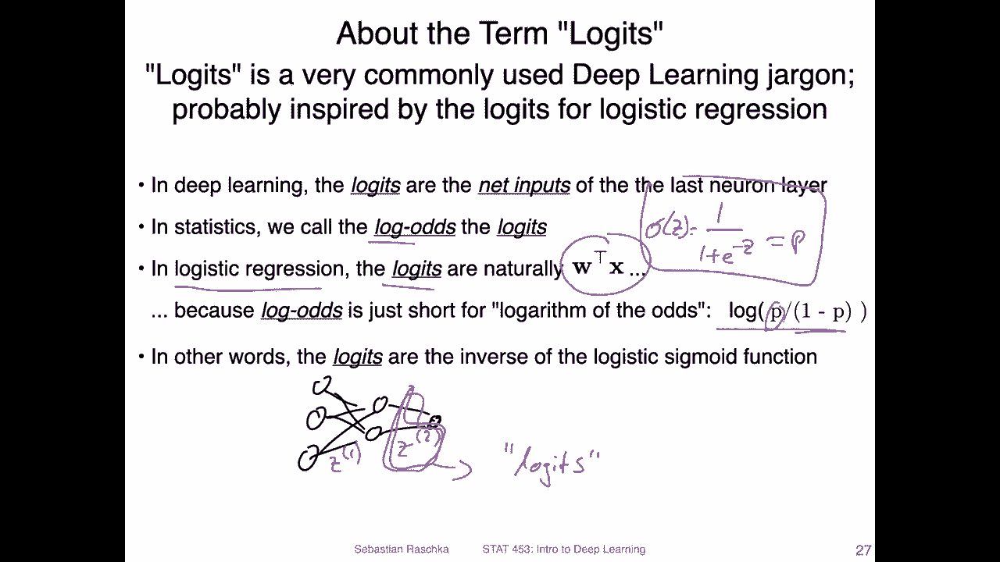
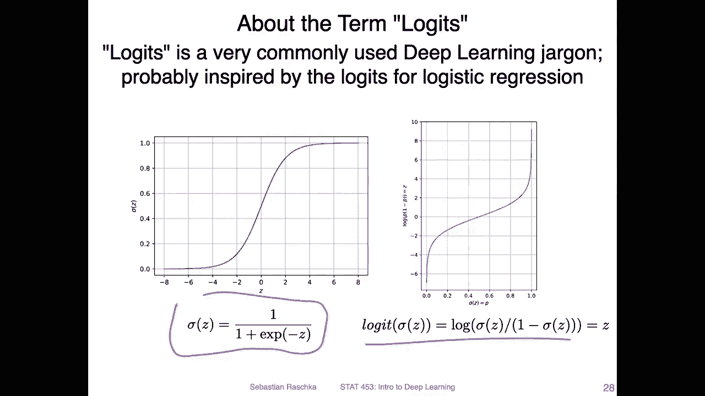
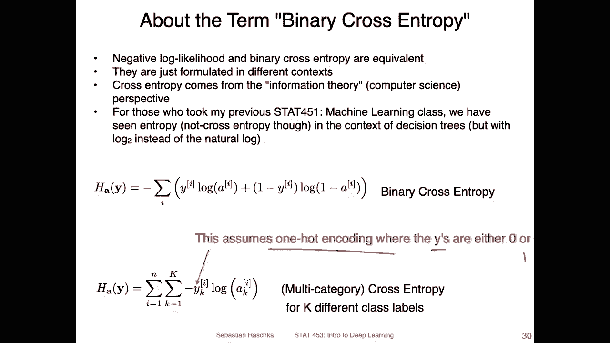
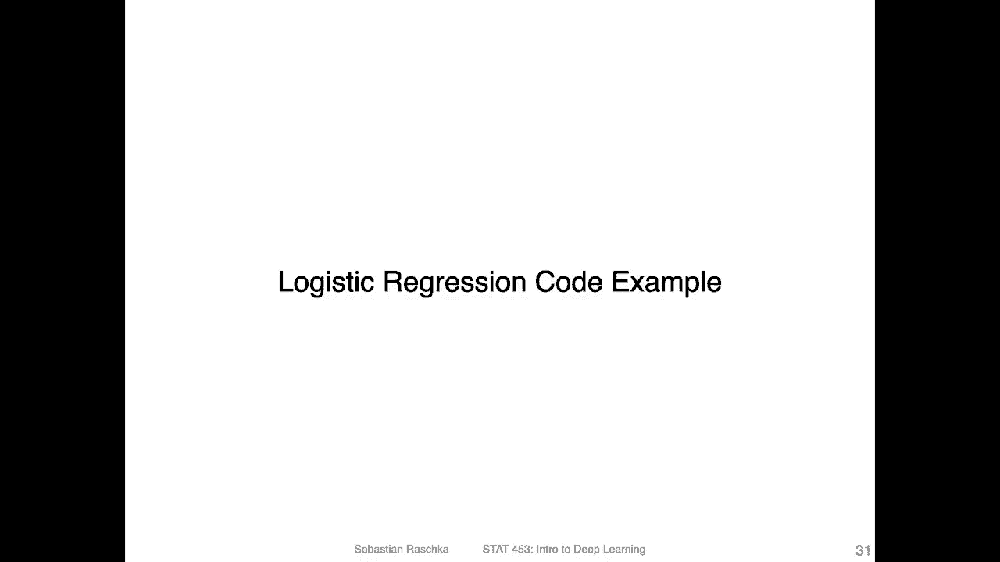

# 54：L8.4 - Logits 与交叉熵 🧠

在本节课中，我们将学习深度学习文献中两个常见的术语：**Logits** 和 **交叉熵**。我们将阐明它们与之前讨论的逻辑回归概念之间的关系，并解释它们在深度学习中的具体含义。

---

## Logits：网络净输入

上一节我们介绍了逻辑回归，本节中我们来看看 **Logits** 这个术语。在深度学习中，当我们构建多层神经网络时，例如一个简单的全连接多层感知机，网络在最终输出层之前会计算净输入。

在深度学习中，通常将输出层之前的这些净输入值称为 **Logits**。在统计学的逻辑回归背景下，Logits 特指几率（odds）的对数，其公式为：

**公式：** `logit(p) = ln(p / (1 - p))`

这个函数实际上是逻辑斯蒂（Sigmoid）函数的反函数。然而在深度学习的通用语境下，无论最后一层是否使用Sigmoid激活函数，我们都习惯性地将最后一层的净输入称为Logits。

以下是Logits与Sigmoid函数关系的图示说明：

---

## 交叉熵：负对数似然的别名

理解了Logits后，我们再来看看损失函数。在之前的课程中，我们为逻辑回归推导了**负对数似然**损失函数。在深度学习和信息论领域，这个函数有一个更常用的名字：**交叉熵**。

具体来说，二分类问题中的负对数似然损失，完全等同于**二元交叉熵**损失。它们只是在不同学科背景下（统计学 vs. 信息论/计算机科学）对同一概念的不同称呼。

对于多分类问题，这个概念可以推广为**多类别交叉熵**，它是二元交叉熵的自然扩展。为了使其适用于多类，我们通常使用**独热编码**来表示类别标签。

以下是交叉熵与负对数似然等价性的图示说明：

为了更清晰地总结这两个概念，以下是关键点列表：

*   **Logits**：在深度学习中，通常指代神经网络最后一层（输出层之前）的净输入值。
*   **交叉熵**：在深度学习语境下，通常指代用于训练分类模型的损失函数，在二分类情况下等同于负对数似然。

---

## 总结与预告

本节课中我们一起学习了深度学习中的两个核心术语：**Logits** 和 **交叉熵**。我们明确了Logits即网络最后一层的净输入，而交叉熵则是我们熟悉的负对数似然损失在深度学习领域的常用名称。

在接下来的课程中，我们将通过一个逻辑回归的代码示例来巩固这些概念，并进一步探讨多类别交叉熵及其在多项式逻辑回归中的应用。