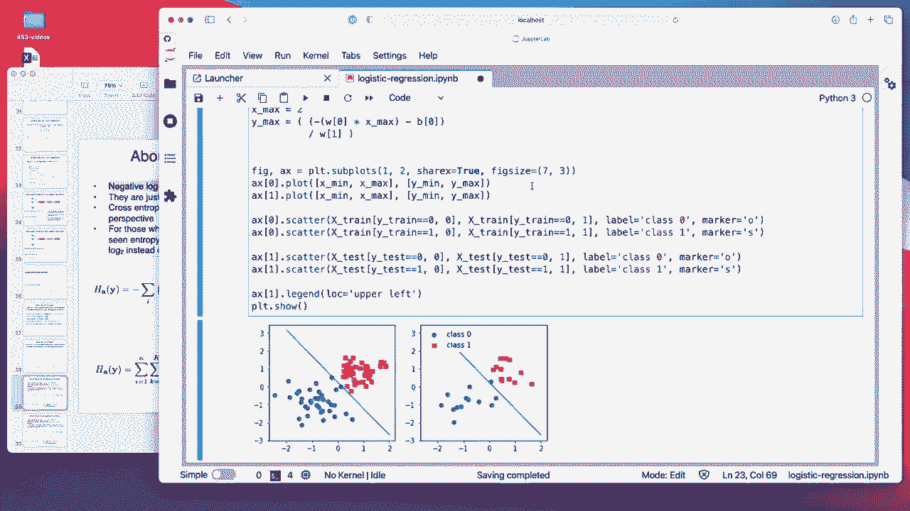

# 55：L8.5 - PyTorch 中的逻辑回归 - 代码示例 📝


在本节课中，我们将通过一个完整的代码示例，来回顾并实践之前四节视频中讨论的逻辑回归核心概念。我们将从零开始实现一个逻辑回归模型，然后使用 PyTorch 的高级 API 来实现相同的功能，以加深对算法原理和实际应用的理解。


---


## 概述与准备工作

在开始编写代码之前，我们需要导入必要的库并准备一个简单的二分类数据集。这个数据集与我们作业中使用的类似，非常适合用于演示。


以下是导入库和加载数据的代码：


```python
import numpy as np
import matplotlib.pyplot as plt
import torch
import torch.nn as nn
# 加载一个简单的二分类玩具数据集
# 这里使用 numpy 生成数据，实际中可以从文件加载
X_train, y_train = ... # 训练数据
X_test, y_test = ...   # 测试数据
```


---


## 从零开始实现逻辑回归 🔨


上一节我们讨论了逻辑回归的数学原理，本节中我们来看看如何用代码实现它。我们将手动实现前向传播、反向传播（梯度计算）和参数更新。


以下是我们将实现的 `LogisticRegression` 类的核心方法：


*   **`__init__`**: 初始化权重和偏置，这里我们将权重初始化为零向量。
*   **`forward`**: 计算净输入 `z` 和经过 Sigmoid 激活后的概率 `a`。
*   **`backward`**: 根据损失函数计算关于权重和偏置的梯度。
*   **`predict`**: 根据概率进行阈值判断（如 >0.5 为类别1），得到预测标签。
*   **`train`**: 整合上述步骤，执行多轮训练。


以下是 `LogisticRegression` 类的关键代码框架：


```python
class LogisticRegression:
    def __init__(self, num_features):
        self.weights = torch.zeros(1, num_features)
        self.bias = torch.zeros(1)

    def forward(self, x):
        # 计算净输入 z = w*x + b
        z = torch.mm(x, self.weights.t()) + self.bias
        # 应用Sigmoid激活函数得到概率 a = σ(z)
        a = self._sigmoid(z)
        return a

    def backward(self, x, a, y):
        # 计算损失关于输出的梯度：∂L/∂a = (a - y)
        grad_a = a - y
        # 计算损失关于权重的梯度：∂L/∂w = (∂L/∂a) * (∂a/∂z) * x^T ≈ (a - y) * x^T
        grad_w = torch.mm(grad_a.t(), x)
        # 计算损失关于偏置的梯度：∂L/∂b = sum(a - y)
        grad_b = torch.sum(grad_a)
        return grad_w, grad_b

    def _sigmoid(self, z):
        return 1. / (1. + torch.exp(-z))

    def predict(self, x):
        # 获取概率
        a = self.forward(x)
        # 应用阈值函数
        y_pred = (a > 0.5).float()
        return y_pred
```


训练循环的代码如下，它整合了前向传播、损失计算、反向传播和参数更新：


```python
def train(model, X, y, epochs=30, lr=0.1):
    cost_list = []
    for epoch in range(epochs):
        # 1. 前向传播，计算输出概率 a
        a = model.forward(X)
        # 2. 计算损失（负对数似然）
        cost = -torch.sum(y * torch.log(a) + (1 - y) * torch.log(1 - a))
        cost_list.append(cost.item())
        # 3. 反向传播，计算梯度
        grad_w, grad_b = model.backward(X, a, y)
        # 4. 更新参数：w = w - lr * ∂L/∂w
        model.weights -= lr * grad_w
        model.bias -= lr * grad_b
    return cost_list
```


运行这个从零开始的模型，我们可以看到它在训练集上快速收敛，并绘制出损失下降曲线和决策边界。


---


## 使用 PyTorch 模块 API 实现逻辑回归 ⚙️


手动实现有助于理解原理，但在实际项目中，我们更常使用深度学习框架提供的高级API。上一节我们手动计算了梯度，本节中我们来看看如何利用 PyTorch 的自动微分功能来简化这一过程。


使用 PyTorch 的 `nn.Module` 可以极大地简化代码。我们只需要定义网络结构，梯度计算和参数更新将由框架自动处理。


以下是使用 PyTorch API 实现的等效逻辑回归模型：


```python
class LogisticRegressionPyTorch(nn.Module):
    def __init__(self, num_features):
        super().__init__()
        # 定义一个线性层：y = xA^T + b
        self.linear = nn.Linear(num_features, 1)
        # 为了与手动实现对比，将权重和偏置初始化为0
        self.linear.weight.data.fill_(0.0)
        self.linear.bias.data.fill_(0.0)

    def forward(self, x):
        # 线性层输出后接Sigmoid激活函数
        logits = self.linear(x)
        outputs = torch.sigmoid(logits)
        return outputs
```


使用 PyTorch 进行训练的流程更加简洁和标准化：


```python
# 初始化模型、损失函数和优化器
model = LogisticRegressionPyTorch(num_features)
criterion = nn.BCELoss(reduction='sum')  # 二元交叉熵损失，等价于负对数似然
optimizer = torch.optim.SGD(model.parameters(), lr=0.1)
# 训练循环
for epoch in range(epochs):
    # 前向传播
    outputs = model(X_train_tensor)
    # 计算损失
    loss = criterion(outputs, y_train_tensor)
    # 反向传播和优化
    optimizer.zero_grad()  # 清空过往梯度
    loss.backward()        # 自动计算梯度
    optimizer.step()       # 更新参数
```


运行 PyTorch 版本的模型，我们会发现其学习到的权重和偏置与手动实现的版本完全相同，这验证了我们手动实现的正确性，并且测试准确率也保持一致。


---


## 总结


本节课中我们一起学习了逻辑回归的两种代码实现方式。


*   我们首先**从零开始**实现了逻辑回归模型，手动编写了前向传播、梯度计算（反向传播）和参数更新的代码。这个过程帮助我们深入理解了逻辑回归的**核心公式**，例如梯度 `∂L/∂w = (a - y) * x^T`。
*   接着，我们使用了 **PyTorch 的高级模块 API** 来构建相同的模型。利用 `nn.Linear`、`nn.BCELoss` 和 `torch.optim.SGD`，我们以更简洁、更高效的方式完成了模型的构建和训练，并且依赖 PyTorch 的自动微分机制自动计算梯度。




通过对比两种方法，我们不仅巩固了理论知识，也掌握了在实际项目中使用专业工具进行开发的技能。在接下来的课程中，我们将把这些概念推广到多类别分类问题，即 Softmax 回归。