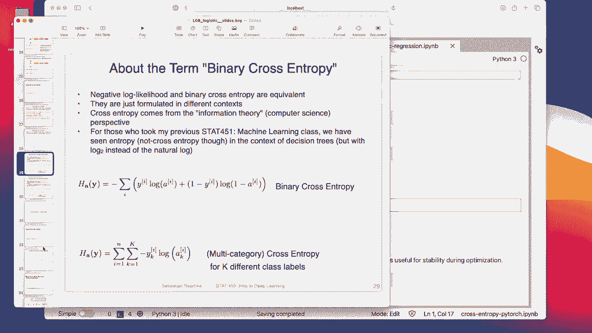

# 58：L8.7.2 - OneHot 编码与多类别交叉熵代码示例 🧮


在本节课中，我们将通过一个 PyTorch 代码示例，详细讲解 OneHot 编码和多类别交叉熵损失的计算过程。我们将从基础概念入手，逐步实现并解释代码中的关键步骤。

## 概述


我们将首先介绍如何手动实现 OneHot 编码，然后计算 Softmax 激活值，最后使用交叉熵损失函数评估模型预测。过程中会对比手动实现与 PyTorch 内置函数的使用方法。


## OneHot 编码实现


上一节我们介绍了多类别分类的基本概念，本节中我们来看看如何在代码中实现 OneHot 编码。PyTorch 提供了一个 `scatter` 函数来实现此功能，虽然其用法有些特殊，但我们可以将其封装为一个便捷函数。


以下是 OneHot 编码函数的实现代码：


```python
def one_hot_encoding(labels, num_classes):
    # 此函数使用 scatter 方法将类别标签转换为 OneHot 编码矩阵
    # labels: 包含类别索引的张量
    # num_classes: 总的类别数量
    return torch.zeros(labels.size(0), num_classes).scatter_(1, labels.unsqueeze(1), 1)
```


需要注意的是，在实际训练 Softmax 回归或多层感知机模型时，PyTorch 的损失函数通常会内部处理 OneHot 编码，因此我们通常不需要手动调用此函数。但了解其原理是有益的。


让我们用一个具体例子来演示。假设我们有四个训练样本，其类别标签分别为 0, 1, 2, 2，且总共有三个类别（0, 1, 2）。


```python
labels = torch.tensor([0, 1, 2, 2])
num_classes = 3
one_hot = one_hot_encoding(labels, num_classes)
```


执行后，`one_hot` 是一个 4x3 的矩阵。每一行代表一个样本，其中数字 1 的位置指示了该样本所属的类别。


## Softmax 激活函数计算


得到 OneHot 编码后，我们需要计算模型的净输入（net inputs）并通过 Softmax 函数将其转换为概率分布。


假设我们有一个任意生成的净输入矩阵 `Z`，其形状为 (4, 3)，对应四个样本和三个类别。


Softmax 函数的公式如下：


**公式：** `softmax(z_i) = exp(z_i) / sum(exp(z_j)) for j in all classes`


以下是 Softmax 函数的代码实现：


```python
def softmax(z):
    # 计算 Softmax 激活值
    # z: 净输入张量
    exp_z = torch.exp(z - torch.max(z, dim=1, keepdim=True).values) # 数值稳定版本
    return exp_z / torch.sum(exp_z, dim=1, keepdim=True)
```


同样，PyTorch 内置了更高效、更优化的 `torch.nn.Softmax` 函数，但此处的实现有助于理解其原理。


应用 Softmax 后，我们得到一个概率矩阵，其中每一行的所有值之和为 1。


## 获取预测类别并计算损失


接下来，我们需要从 Softmax 输出中获取预测的类别标签，并计算交叉熵损失。


我们使用 `argmax` 函数来获取每一行中概率最大的索引，即预测的类别。


```python
predictions = torch.argmax(softmax_activations, dim=1)
```


现在，我们可以将预测结果与真实标签进行比较。在本例中，有一个预测是错误的。


交叉熵损失的公式包含两个求和：一个是对所有训练样本求和，另一个是对所有类别求和（但在 OneHot 编码下，只有正确类别的项为非零）。


对于单个样本，其损失计算为：`loss_i = -log(p_correct_class)`


以下是手动计算每个样本损失的过程：


```python
# 计算每个样本的交叉熵损失
loss_per_sample = -torch.sum(one_hot * torch.log(softmax_activations + 1e-8), dim=1)
```


这里，`one_hot * torch.log(softmax_activations)` 操作会选取出正确类别对应的预测概率的对数值。


## 使用 PyTorch 内置损失函数


在实践中最推荐使用 PyTorch 内置的 `torch.nn.CrossEntropyLoss`。它计算更高效，数值稳定性也更好。


需要特别注意两个函数的输入要求：
*   `torch.nn.NLLLoss`（负对数似然损失）期望输入是 **log(Softmax) 之后的值**。
*   `torch.nn.CrossEntropyLoss` 期望输入是 **原始的净输入（net inputs）**，它会在内部组合 Softmax 和 Log 操作。


以下是使用 `CrossEntropyLoss` 的示例：


```python
import torch.nn as nn
# 创建损失函数实例，默认 reduction='mean' 会计算所有样本损失的平均值
loss_fn = nn.CrossEntropyLoss(reduction='none') # 设置为 ‘none‘ 以获取每个样本的损失
losses = loss_fn(net_inputs, labels) # net_inputs 是原始净输入，labels 是类别索引（非OneHot）
# 如果想使用默认的均值损失，可以这样写
loss_fn_mean = nn.CrossEntropyLoss() # 默认 reduction='mean'
total_loss = loss_fn_mean(net_inputs, labels)
```


使用 `reduction='mean'`（计算平均值）通常比 `reduction='sum'`（计算总和）更有利于训练稳定性和学习率的选择。


## 总结


本节课中我们一起学习了：
1.  如何手动实现 OneHot 编码。
2.  Softmax 函数的原理与代码实现。
3.  如何从 Softmax 输出中获取预测类别。
4.  交叉熵损失的手动计算方式及其含义。
5.  如何正确使用 PyTorch 内置的 `CrossEntropyLoss` 函数，并注意其输入要求。




理解这些基础组件的运作方式，对于后续实现和调试更复杂的模型（如 Softmax 回归、多层感知机和卷积神经网络）至关重要。在接下来的课程中，我们将学习如何计算 Softmax 回归的梯度。