# 61：深度学习新闻 #5，2021 年 2 月 27 日 📰

在本节课中，我们将回顾2021年2月底深度学习领域的一些重要新闻。我们将重点关注如何让深度学习模型的训练变得更高效，包括联邦学习、隐私保护以及如何在单GPU上训练大型模型等核心话题。

## 🤝 联邦学习与隐私保护

上一节我们讨论了深度学习面临的计算挑战。本节中我们来看看如何通过联邦学习来分散计算，以应对这些挑战。

联邦学习是一种在多个设备上分散计算的学习过程。苹果公司的研究人员发表了一篇题为《Federated evaluation and tuning for on-device personalization: system design and applications》的论文，介绍了他们的设备端机器学习系统。

联邦学习并非全新概念，许多公司和人员都在使用它。通常，其他公司的做法是利用联邦学习来调优一个全局神经网络模型。例如，服务器上有一个深度神经网络模型（如图像分类器），这个全局模型可以从个体用户那里学习。用户通过智能手机访问服务器上的模型，并通过标注数据为其提供训练数据。这种方式通常维护一个全局模型。

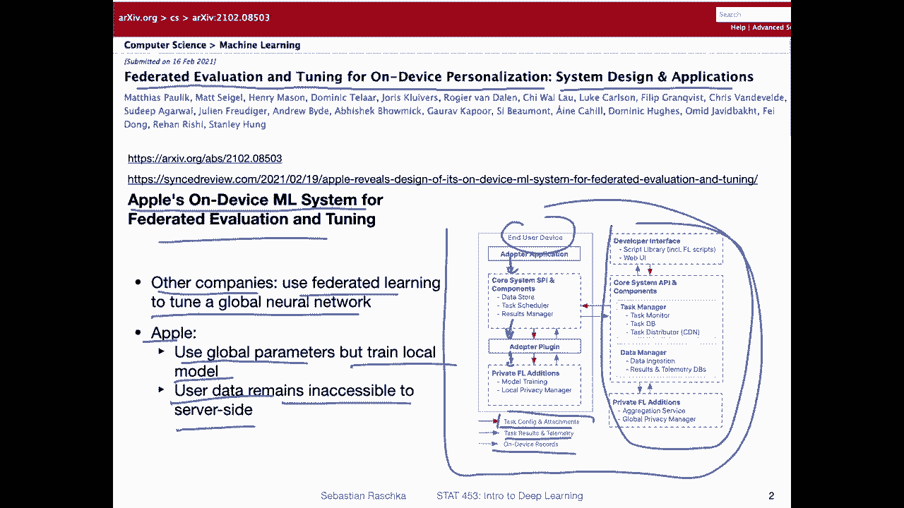

然而，苹果在这篇论文中描述的系统采用了不同的方法。该系统存在全局参数，但模型是在本地进行训练的。所有用户数据对服务器端都是不可访问的。这意味着他们专注于保护用户隐私，不向服务器发送任何用户数据，所有训练都在本地完成。用户可能会从全局模型获得一些参数，但最终会在自己的设备（例如手机）上获得一个个性化模型，而无需与服务器共享个人数据。

以下是该系统工作原理的示意图：

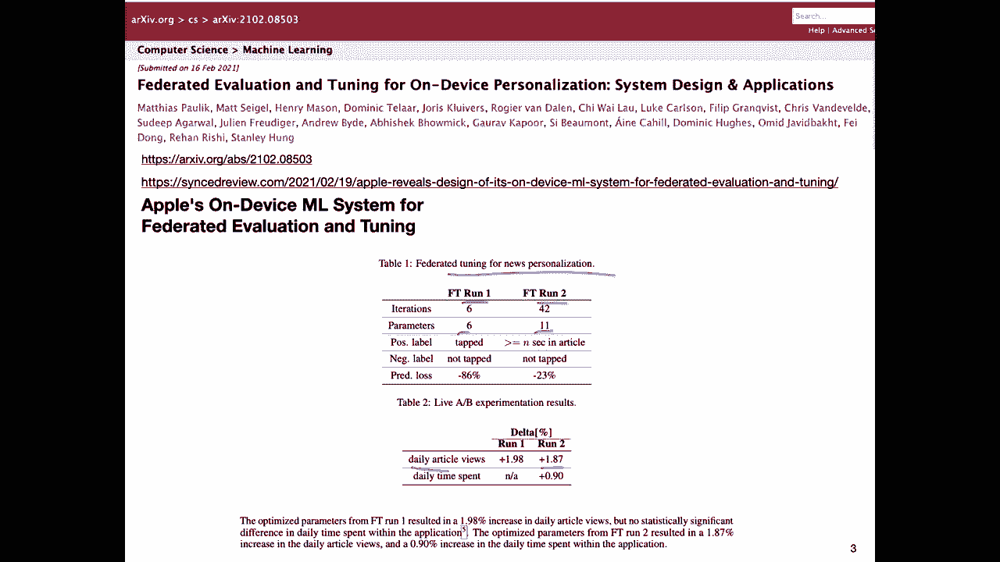

图中展示了三种类型的信息共享：
*   红色箭头代表任务配置和附件信息。
*   绿色箭头代表任务结果和遥测数据。
*   蓝色箭头代表设备端记录。

左侧方框代表终端用户设备。可以看到，蓝色的设备端记录（即用户数据）从未真正离开设备。右侧是开发者界面，开发者可以访问任务配置和任务结果，以评估模型学习效果，但无法访问任何用户数据，从而避免了隐私问题。

上图展示了该系统如何用于新闻个性化调优。他们有不同的模型（例如运行一和运行二），涉及不同的参数和指标。通过A/B测试结果，他们只能访问诸如改进百分比等信息（例如，运行二使每日文章浏览量增加了1.87%），而无需知道用户阅读了哪些类型的文章。

## 🔒 差分隐私

上一节我们对比了联邦学习的两种根本性不同方法：一种是在服务器上维护一个全局模型并发送用户数据，从隐私角度看可能存在问题；另一种是在设备上进行训练，用户数据永不离开设备，显得更友好。然而，如果采取一些预防措施，第一种使用全局模型的方法实际上并不那么糟糕。

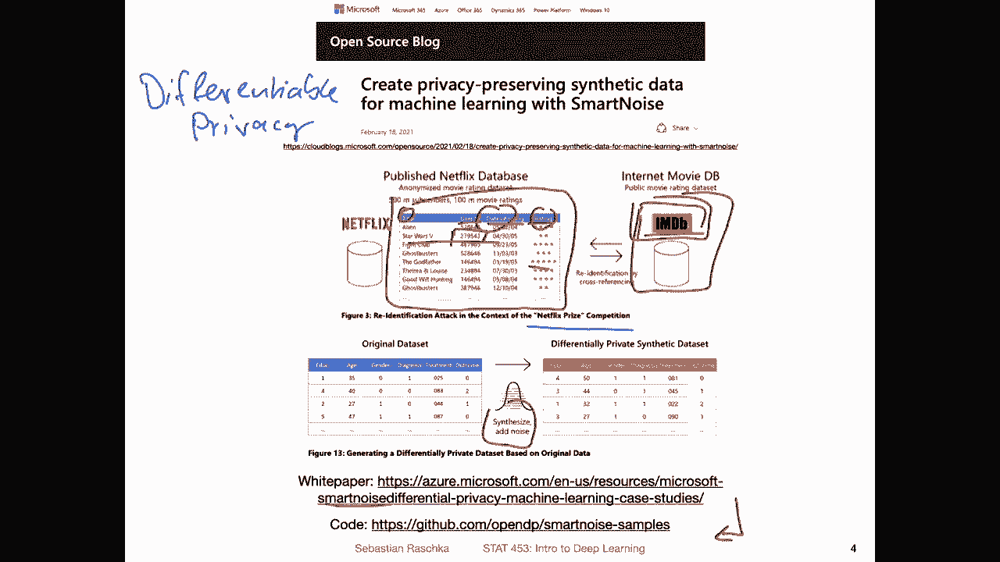

有一个研究领域叫做**差分隐私**。这个领域致力于开发方法，通过向数据集中添加噪声，使得无法从数据中识别出具体个人。微软发布了一篇相关文章，但这只是一个广泛的领域，许多人都在进行研究。

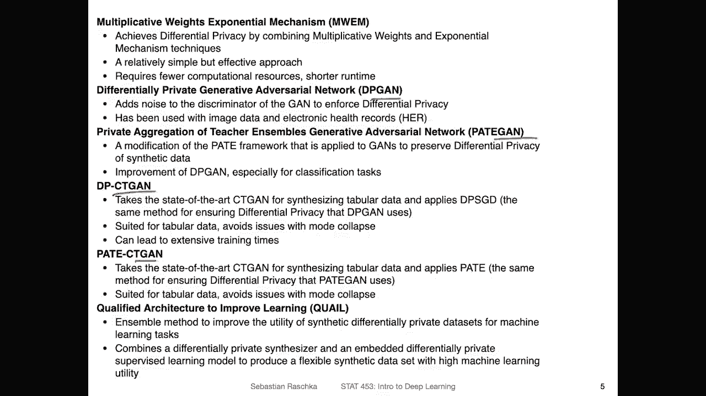

为了说明问题，回顾一下Netflix的百万美元竞赛。Netflix在Kaggle上分享了一个数据集，包含电影标题、用户ID、评分日期和评分本身。用户ID并非真实身份，但研究人员通过结合IMDb电影评论数据库，利用评分日期和评分本身进行匹配，成功识别出了数据集中的部分用户。这构成了重大的隐私侵犯。

差分隐私就是处理这个问题，旨在保持数据集的效用（使其仍可使用），同时避免识别个体。其核心方法本质上是向数据集中添加或合成噪声，使数据集具有大致相同的统计特征。例如，平均评分可能不变，但对于特定用户，某些评分会比真实情况略高或略低，这样就不容易通过IMDb明确识别用户。

微软发布了一个名为 **SmartNoise** 的工具集，包含Python API等，使差分隐私技术更易于在实践中使用。还有一个GitHub示例仓库可供参考。

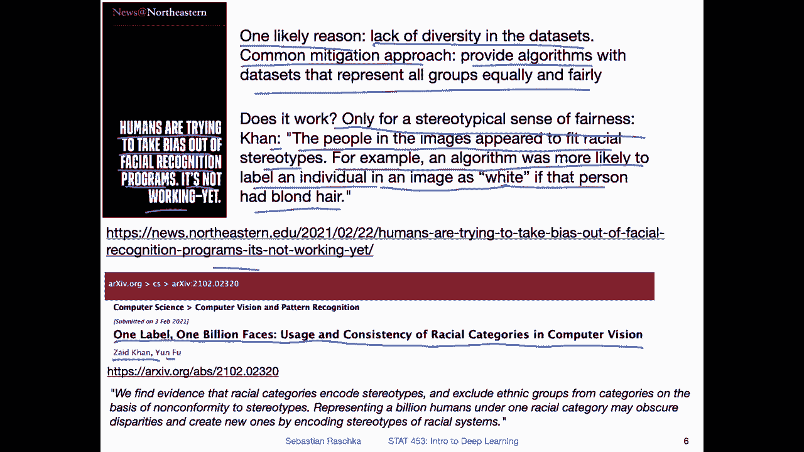

从SmartNoise实现的技​​术列表中可以发现，许多技术都涉及**GANs（生成对抗网络）**。GANs用于学习训练数据分布并从中生成新样本。有趣的是，目前许多差分隐私技术似乎都采用了生成对抗网络，至少SmartNoise方法中实现的技术是如此。

## ⚖️ 数据偏见与公平性

本周还有一篇题为《Hundreds of AI tools have been built to catch covid. None of them helped.》的文章，提到面部识别程序中的偏见问题。一个可能的原因是数据集中缺乏多样性。常见的缓解方法是向算法提供代表所有群体且公平的数据集。

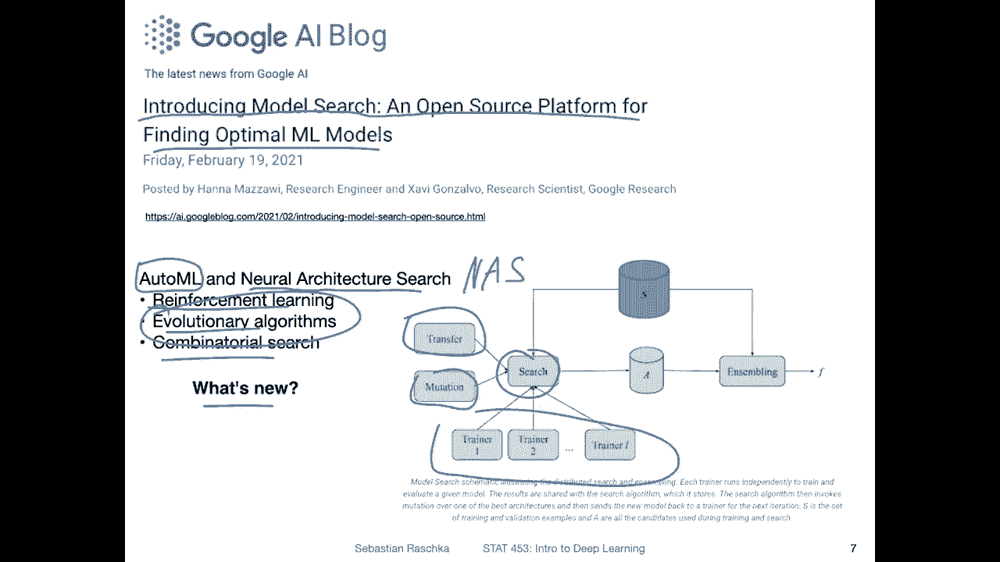

然而，一篇名为《1 Label, 1 Billion Faces: Usage and Consistency of Racial Categories in Computer Vision》的论文研究了这个问题。他们发现，使用更多样化的数据集可能只在非常刻板的公平意义上起作用，实际上并不能真正解决问题。例如，算法更可能将金发的人标记为白人。因此，仅仅使数据更多样化并不能真正解决偏见问题，刻板印象仍然存在。需要更多工作来开发更公平的系统。

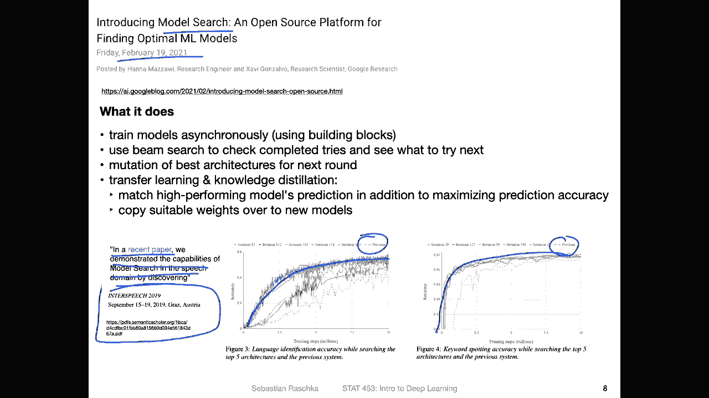

## 🤖 自动化机器学习

另一个有趣但不相关的话题是**AutoML（自动化机器学习）**。AutoML旨在为给定问题自动寻找良好的机器学习算法、超参数设置，有时还包括预处理步骤。传统上，人类需要尝试不同的算法、超参数和数据归一化步骤，而AutoML则自动化这一过程，减少人力。

AutoML的一个特定分支是**神经架构搜索**，这是针对神经网络的，有时缩写为NAS。本周有一篇题为《Introducing Model Search: An Open Source Platform for Finding Optimal Machine Learning Models》的文章。虽然已有一些其他AutoML开源平台，但这个方法略有不同。以往的方法通常基于强化学习、进化算法或组合搜索，而该方法似乎是这些方法的结合。

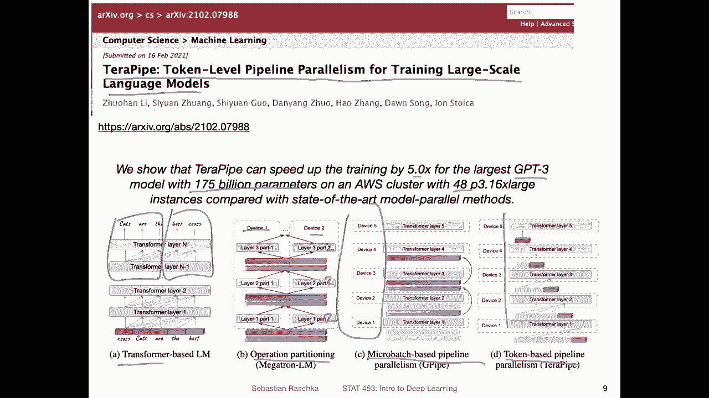

该方法异步训练多个模型，然后进行波束搜索，查看结果并考虑最佳模型，对其进行微小改动（类似于进化算法），还涉及知识蒸馏和加权迁移。他们将表现良好的模型的权重迁移到想要探索的新模型中，而不是从头开始训练。

结果显示该方法表现相当不错。虚线代表以前的方法，新方法（模型搜索）表现更好。虽然其构建模块并非全新，但组合方式使其成为一个性能优异的系统。如果你想在实践中使用表现良好的方法，这可能是一个不错的选择。

不过需要注意的是，神经架构搜索本身计算成本非常高，因为训练单个深度神经网络已经很昂贵，而这种方法需要异步训练多个模型，对于没有数百或数千个GPU的用户来说是另一个计算挑战。

## 🚀 大规模模型训练与单GPU技巧

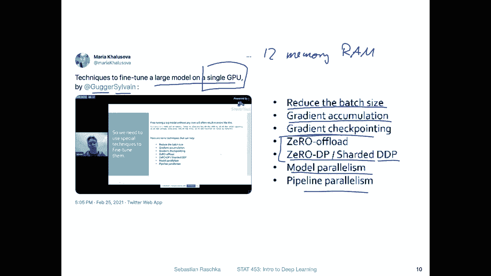

现在让我们进入真正有趣的部分：在单GPU上训练大规模模型。我看到了Fast AI的Zilvane Guar（注：应为Sylvain Gugger）的演讲截图，总结了在单GPU上实现大规模模型训练的主要方法。

以下是一些核心方法：

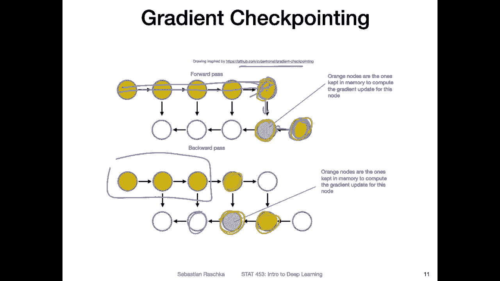

**1. 减小批次大小**
这是最简单的方法。减小输入批次大小意味着更小的矩阵乘法，有助于缓解内存限制。GPU通常有固定的内存大小（常见卡在12到20GB之间），对于大型模型来说可能成为瓶颈，尤其是全连接层（如PyTorch中的线性层）。

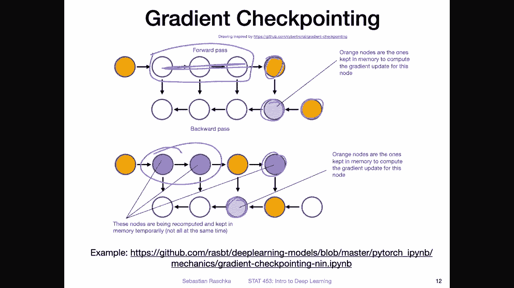

**2. 梯度累积**
这与批次大小相关。如果批次非常小，更新会非常嘈杂。梯度累积是一种在多次反向传播中累积梯度，然后再进行更新的方法。这样允许使用更小的迷你批次。

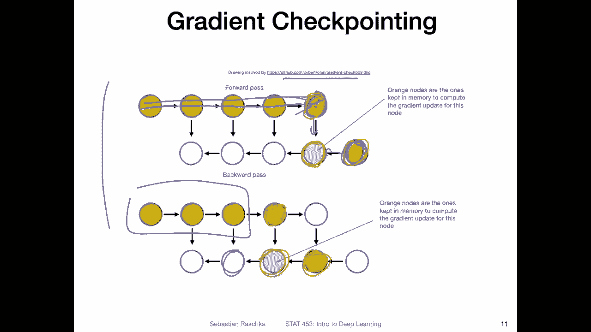

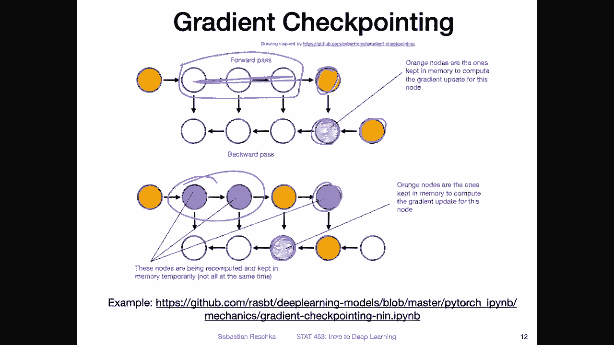

**3. 梯度检查点**
我为此制作了一个简图。在传统训练中，前向传播的所有中间计算结果（用于反向传播）都保存在内存中。梯度检查点的工作方式是：计算前向传播，然后删除这些中间信息，只在需要更新特定节点时重新计算它们。这会在内存和计算效率之间进行权衡：训练速度变慢，但有助于处理内存限制。

以下是传统方法与梯度检查点方法的对比示意图：

*传统方法：所有橙色节点始终保存在内存中。*

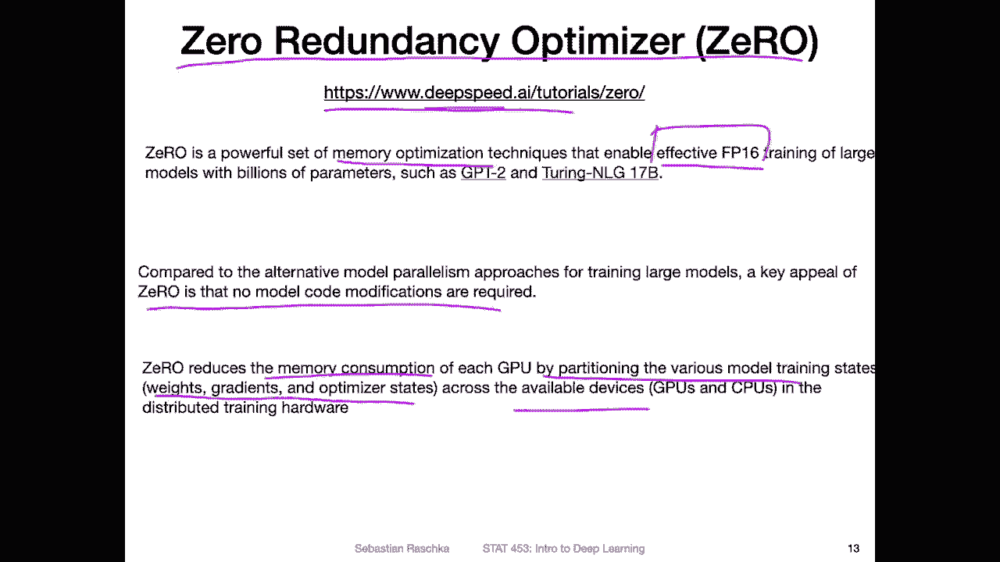

*梯度检查点：只将部分橙色节点保存在内存中，需要时重新计算蓝色节点。*

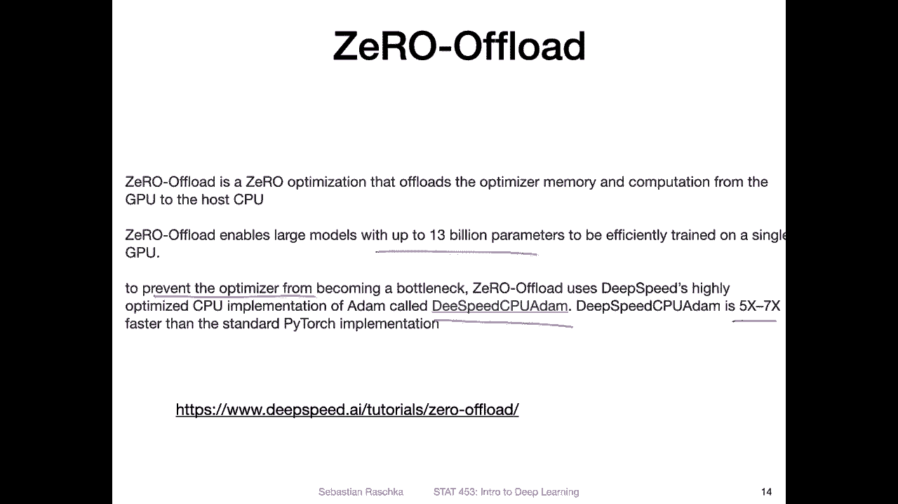

**4. ZeRO（零冗余优化器）**
这是微软DeepSpeed库开发的一种技术。它本质上是一种内存优化技术，使用16位浮点运算。其优点在于，与一些其他提高训练效率的方法不同，ZeRO不需要对模型代码进行重大修改，更像是一个模型包装器。它还将不同的状态（权重、梯度和优化器状态）分区到可用的GPU和CPU上。因此，它需要多个GPU。

**5. 模型并行与流水线并行**
这些是相关的方法，将模型的不同部分放在不同的GPU上。如果你有一个参数众多的模型，无法放入单个GPU，可以简单地将模型拆分到不同的GPU上。

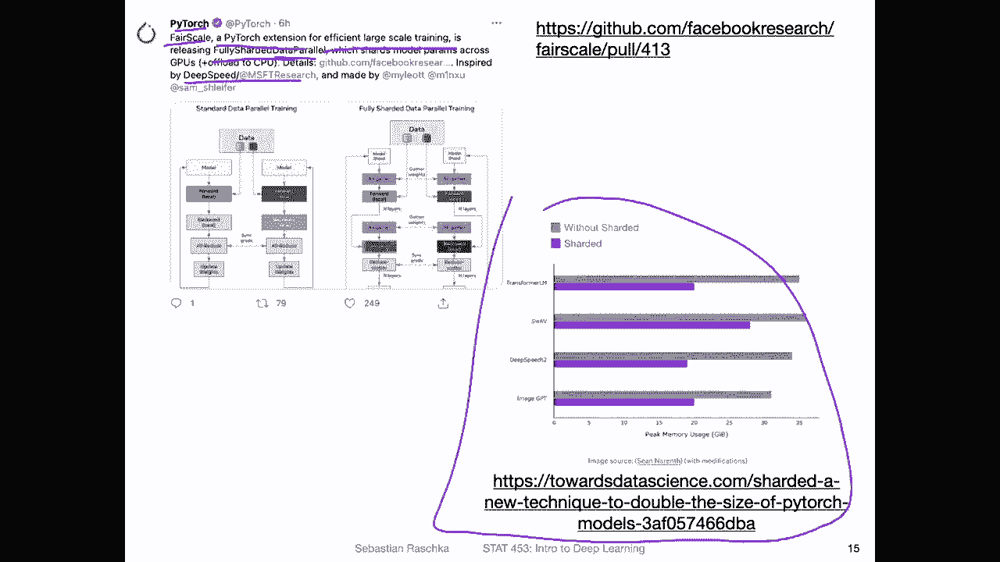

Facebook AI Research开发的PyTorch扩展库**FairScale**，也提供了高效的**流水线并行**实现。它使用PyTorch的顺序API，可以非常方便地将模型的不同层自动分配到不同设备上。例如，如果你有层A、B、C、D，可以将它们全部放入顺序流水线，并指定如何平衡地分布在两个GPU上。

## 📝 总结

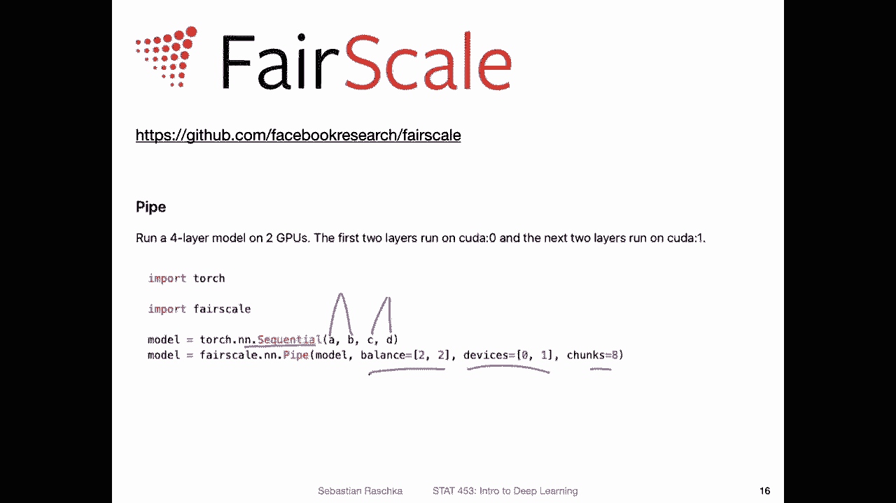

本节课中我们一起学习了2021年2月底深度学习领域的多项进展。我们探讨了联邦学习如何通过分散计算来提高效率，并比较了不同隐私保护方法的优劣。我们还了解了数据偏见问题的复杂性，以及自动化机器学习（尤其是神经架构搜索）的进展。最后，我们重点学习了在资源有限（特别是单GPU）情况下训练大型模型的一系列实用技巧，包括减小批次大小、梯度累积、梯度检查点、ZeRO优化器以及模型/流水线并行等。这些技术对于在实际环境中高效地进行深度学习研究和应用至关重要。