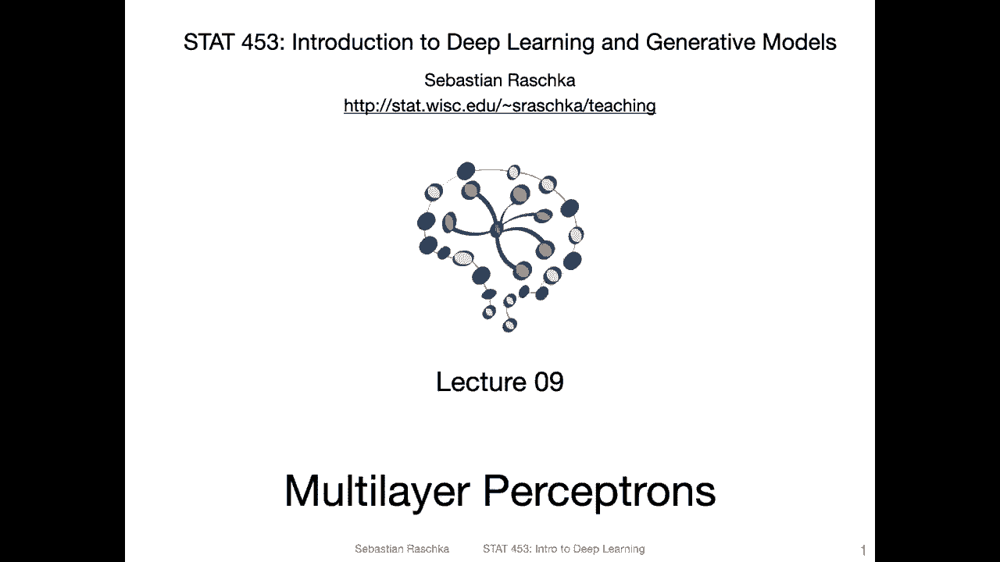
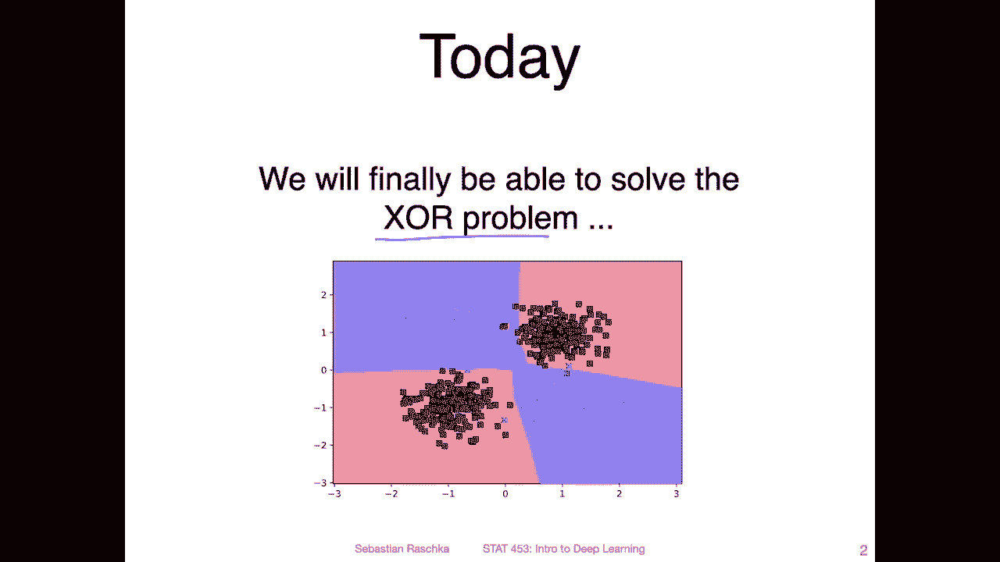
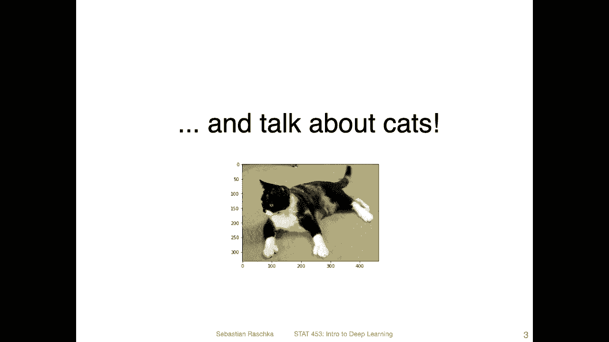
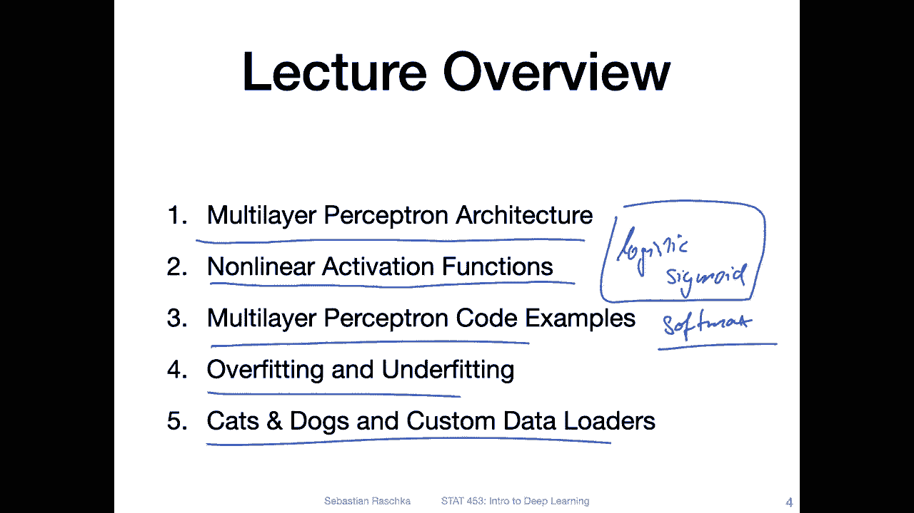

# 62：L9.0 - 多层感知器 🧠

## 概述

在本节课中，我们将要学习多层感知器的基本概念、架构及其应用。我们将从解决经典的异或问题开始，进而探讨如何将其应用于更实际的图像分类任务，例如区分猫和狗。课程将涵盖非线性激活函数、模型实现、以及过拟合与欠拟合等核心主题。

---

## 多层感知器架构

上一节我们介绍了课程的整体安排，本节中我们来看看多层感知器的基本架构。

多层感知器是一种前馈人工神经网络，它包含一个输入层、一个或多个隐藏层以及一个输出层。与单层感知器不同，多层感知器通过引入隐藏层和非线性激活函数，能够学习更复杂的模式。

其核心思想是，每一层的神经元接收前一层神经元的输出，进行加权求和并加上偏置，然后通过一个非线性激活函数产生该层的输出。这个过程可以形式化地表示为：

**公式：**
对于第 \( l \) 层中的第 \( j \) 个神经元，其输入 \( z_j^{(l)} \) 和输出 \( a_j^{(l)} \) 计算如下：
\[
z_j^{(l)} = \sum_{i} w_{ji}^{(l)} a_i^{(l-1)} + b_j^{(l)}
\]
\[
a_j^{(l)} = \phi(z_j^{(l)})
\]
其中，\( w_{ji}^{(l)} \) 是权重，\( b_j^{(l)} \) 是偏置，\( \phi \) 是非线性激活函数。

正是这种层级结构和非线性变换，使得多层感知器能够解决像异或这样的线性不可分问题。

---



## 非线性激活函数

了解了基本架构后，我们需要深入理解其核心组件之一：非线性激活函数。激活函数决定了神经元是否应该被激活，并将输入信号转换为输出信号。

以下是几种常见的非线性激活函数：

1.  **Sigmoid 函数**
    *   它将输入压缩到 (0, 1) 区间。公式为：\( \sigma(z) = \frac{1}{1 + e^{-z}} \)
    *   常用于输出层进行二分类，但作为隐藏层激活函数时可能面临梯度消失问题。

2.  **Tanh 函数**
    *   双曲正切函数，将输入压缩到 (-1, 1) 区间。公式为：\( \tanh(z) = \frac{e^{z} - e^{-z}}{e^{z} + e^{-z}} \)
    *   其输出以零为中心，通常比 Sigmoid 函数表现更好。

3.  **ReLU 函数**
    *   整流线性单元，是目前最常用的激活函数。公式为：\( \text{ReLU}(z) = \max(0, z) \)
    *   它计算简单，能有效缓解梯度消失问题，但可能导致“神经元死亡”。



选择合适的激活函数对网络的训练效率和最终性能至关重要。

---

## 代码实现示例



理论需要实践来巩固。本节我们将通过一个简单的代码示例，展示如何在 PyTorch 中实现一个多层感知器。

以下是一个用于二分类任务的双层感知器示例：

```python
import torch
import torch.nn as nn

class SimpleMLP(nn.Module):
    def __init__(self, input_size, hidden_size, output_size):
        super(SimpleMLP, self).__init__()
        self.fc1 = nn.Linear(input_size, hidden_size)  # 第一层：输入层 -> 隐藏层
        self.relu = nn.ReLU()                           # 激活函数
        self.fc2 = nn.Linear(hidden_size, output_size) # 第二层：隐藏层 -> 输出层
        self.sigmoid = nn.Sigmoid()                    # 输出层激活函数

    def forward(self, x):
        out = self.fc1(x)
        out = self.relu(out)
        out = self.fc2(out)
        out = self.sigmoid(out)
        return out

# 实例化模型
model = SimpleMLP(input_size=10, hidden_size=5, output_size=1)
```

这段代码定义了一个包含一个隐藏层的神经网络。`nn.Linear` 定义了线性变换层，`nn.ReLU` 和 `nn.Sigmoid` 是激活函数。在 `forward` 方法中，我们明确了数据从输入到输出的流动路径。

---

## 过拟合与欠拟合

成功实现模型后，我们必须关注模型在数据上的表现。这里的关键概念是过拟合与欠拟合。

*   **欠拟合**：指模型过于简单，无法捕捉数据中的基本规律。表现为在训练集和测试集上的性能都很差。
*   **过拟合**：指模型过于复杂，不仅学习了数据中的规律，还学习了噪声和随机波动。表现为在训练集上性能很好，但在测试集上性能显著下降。

为了评估和改善模型的拟合情况，我们可以采取以下策略：

以下是几种常见的策略：
1.  **划分数据集**：将数据分为训练集、验证集和测试集。
2.  **观察学习曲线**：绘制模型在训练集和验证集上的损失/准确率随训练轮次变化的曲线。
3.  **使用正则化**：如 L1/L2 正则化、Dropout 等，为模型增加约束，防止其变得过于复杂。
4.  **获取更多数据**：更多的数据有助于模型学习更通用的模式。

理解并处理过拟合与欠拟合是构建高效机器学习模型的核心技能。

---

## 应用：猫狗图像分类

现在，让我们将所学知识应用于一个实际场景：使用多层感知器对猫和狗的图片进行分类。

虽然对于图像数据，卷积神经网络通常是更优的选择，但多层感知器是一个很好的起点。这个过程会涉及数据加载和预处理。

以下是实现自定义数据加载的关键步骤：
1.  **组织数据**：将猫和狗的图片分别放入名为“cat”和“dog”的文件夹中。
2.  **使用 `torchvision.datasets.ImageFolder`**：这个工具能自动根据文件夹结构创建带标签的数据集。
3.  **定义数据变换**：包括调整图片大小、转换为张量、归一化等。
4.  **创建 DataLoader**：用于批量加载数据，并支持打乱顺序和多线程加载。

通过自定义数据加载器，你可以轻松地将自己的数据集集成到 PyTorch 训练流程中，这对于你的个人项目至关重要。

---

## 总结

本节课中我们一起学习了多层感知器。我们从其基本架构和解决异或问题的能力讲起，深入探讨了不同的非线性激活函数及其作用。随后，我们通过 PyTorch 代码实现了简单的多层感知器，并讨论了机器学习中至关重要的过拟合与欠拟合问题及其应对策略。最后，我们将理论应用于实践，学习了如何构建自定义数据加载器来处理猫狗分类任务。



多层感知器是深度学习的基础，理解它为学习更复杂的网络结构，如卷积神经网络和循环神经网络，奠定了坚实的基础。