# 64：L9.2 - 非线性激活函数 🧠

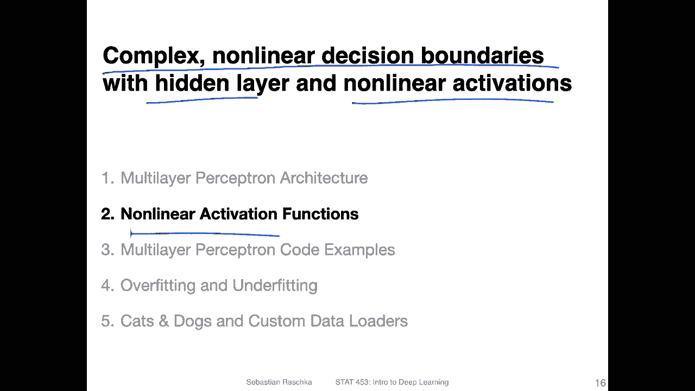

在本节课中，我们将要学习神经网络中的非线性激活函数。我们将了解为什么需要它们，它们如何与隐藏层协同工作以创建复杂的非线性决策边界，并介绍几种常见的激活函数及其特性。

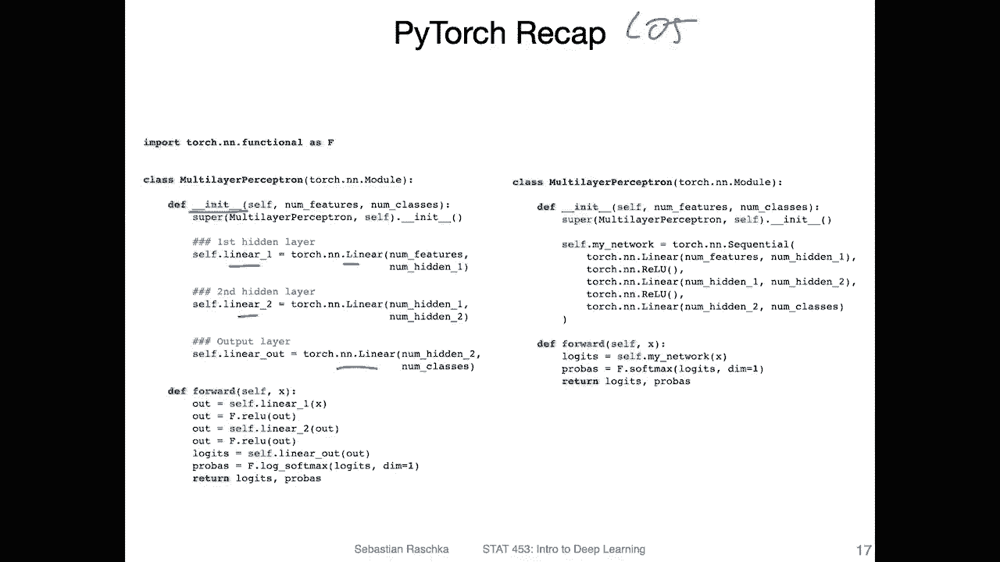

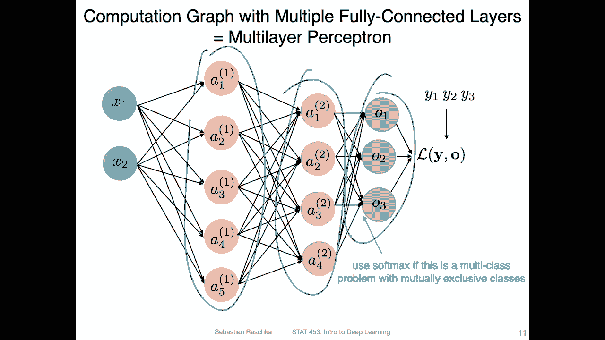

---

## PyTorch API 简要回顾

在深入探讨非线性激活函数之前，让我们简要回顾一下PyTorch的API，以便更好地理解如何在代码中构建多层感知机。

上一节我们介绍了神经网络的基本结构，本节中我们来看看如何在PyTorch中实现它。以下是两种常见的构建网络方式。

**常规方式（自定义类）**：
```python
class MLP(nn.Module):
    def __init__(self):
        super().__init__()
        self.linear1 = nn.Linear(...)  # 第一个隐藏层
        self.linear2 = nn.Linear(...)  # 第二个隐藏层
        self.out = nn.Linear(...)      # 输出层

    def forward(self, x):
        x = self.linear1(x)
        x = F.relu(x)                 # 非线性激活
        x = self.linear2(x)
        x = F.relu(x)                 # 非线性激活
        x = self.out(x)
        return F.log_softmax(x, dim=1) # 输出log概率
```
这种方式在`__init__`中定义层，在`forward`方法中显式定义数据流。

**Sequential API方式（更简洁）**：
```python
model = nn.Sequential(
    nn.Linear(...),  # 第一个隐藏层
    nn.ReLU(),       # 非线性激活
    nn.Linear(...),  # 第二个隐藏层
    nn.ReLU(),       # 非线性激活
    nn.Linear(...)   # 输出层
)
# 注意：使用CrossEntropyLoss损失函数时，它内部已包含Softmax，因此网络输出层通常不需要显式添加Softmax。
```
`nn.Sequential`容器按顺序执行定义的层，使代码更紧凑、易读且不易出错。两种方式构建的网络功能是相同的。

---

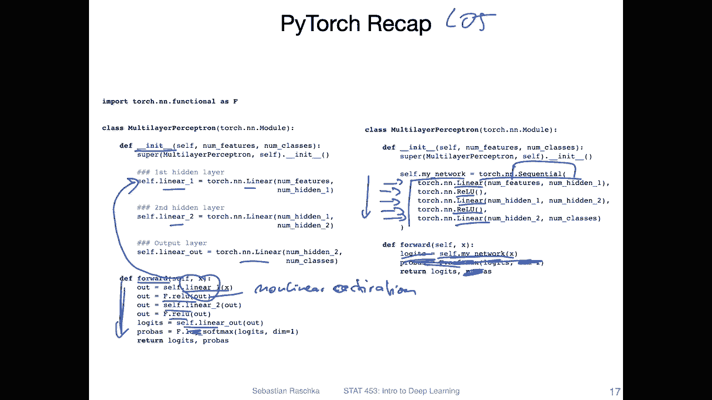

## 为什么需要非线性激活函数？🔑

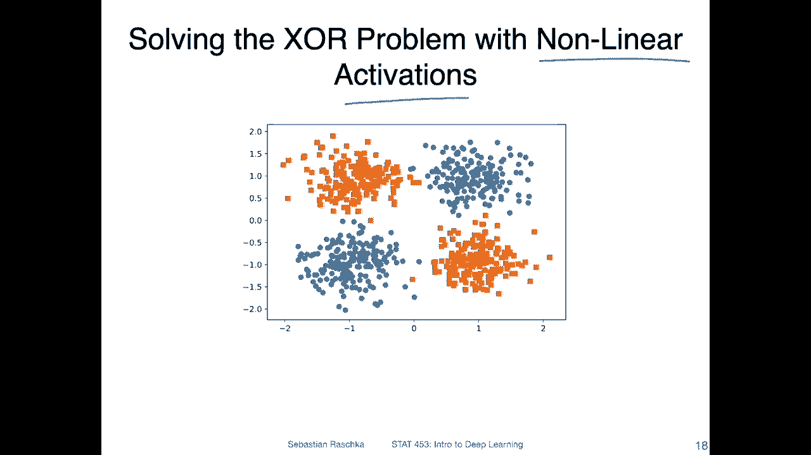

现在，让我们回到核心问题：为什么神经网络需要非线性激活函数？

为了理解这一点，我们来看一个简单的“异或”（XOR）分类问题。下图展示了一个简单的二维数据集，包含两个类别（橙色方块和蓝色圆点），它们的分布构成了一个非线性的分类问题。


如果我们使用一个带有一个隐藏层但**使用线性激活函数**的多层感知机（MLP）来尝试解决这个问题，结果会如何？

*   即使有隐藏层，模型也只能产生一个**线性的决策边界**（如图中左侧的直线），无法正确分类所有数据点。

这个现象揭示了两个关键点：
1.  **单独的隐藏层**（使用线性激活）不足以产生非线性决策边界。
2.  **单独的非线性激活函数**（如逻辑回归中的Sigmoid，但没有隐藏层）也只能产生线性边界。

**结论是**：要建模复杂的非线性关系，我们**必须同时使用隐藏层和非线性激活函数**。只有它们的组合才能让神经网络学习到像右侧那样的**非线性决策边界**，从而解决XOR这类问题。

这是因为，如果没有非线性激活函数，多个线性层的堆叠本质上等价于一个单一的线性变换：`f(f(x))` 仍然是线性的。非线性激活函数在层与层之间引入了“弯曲”，使得网络能够组合出复杂的函数。

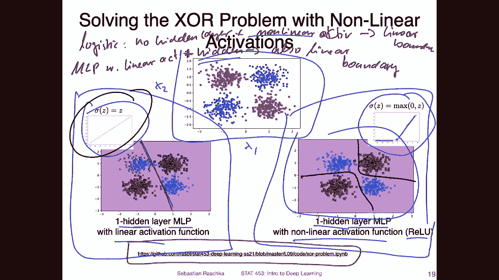

---

## 常见的非线性激活函数 📈

理解了必要性后，我们来具体看看几种历史上和当前流行的非线性激活函数。

以下是几种经典激活函数的对比：

*   **Sigmoid (Logistic)**: `σ(x) = 1 / (1 + e^{-x})`
    *   **特点**：将输入压缩到(0, 1)区间，输出可视为概率。
    *   **问题**：在两端饱和区域梯度非常小（“梯度消失”），不利于深层网络训练；输出不以0为中心。

*   **Tanh (Hyperbolic Tangent)**: `tanh(x) = (e^{x} - e^{-x}) / (e^{x} + e^{-x})`
    *   **特点**：输出范围(-1, 1)，以0为中心。梯度比Sigmoid更陡峭一些。
    *   **优点**：相比Sigmoid，通常能使收敛更快。
    *   **问题**：同样存在梯度饱和问题。

*   **ReLU (Rectified Linear Unit)**: `ReLU(x) = max(0, x)`
    *   **特点**：计算简单高效。当输入为正时，梯度恒为1，缓解了梯度消失问题。
    *   **问题**：可能导致“神经元死亡”（Dead ReLU），即输入始终为负的神经元梯度永远为0，无法更新。

---

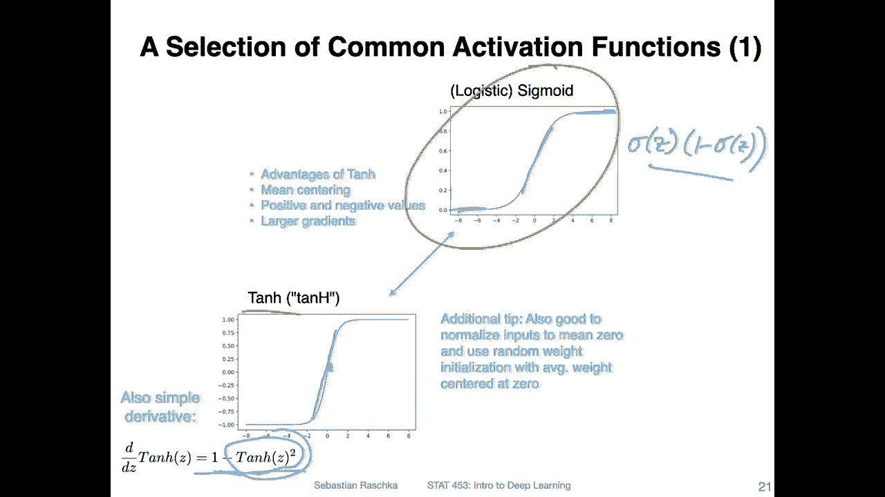

## ReLU的变体与现代激活函数 🚀

由于ReLU的广泛使用及其存在的一些问题，研究者提出了多种改进版本。

以下是ReLU家族的一些重要成员：

*   **Leaky ReLU**: `f(x) = max(αx, x)`，其中α是一个小的正数（如0.01）。
    *   **改进**：为负输入提供了一个小的斜率α，避免了梯度为零的情况，理论上可以防止“神经元死亡”。

*   **Parametric ReLU (PReLU)**: 形式与Leaky ReLU相同，但斜率α作为一个参数，**可以通过训练学习**，而不是预先固定。

*   **Exponential Linear Unit (ELU)**: `f(x) = x if x>0 else α(e^x - 1)`
    *   **改进**：对负值的处理更平滑，输出均值更接近0，可能带来更快的收敛速度和更好的泛化性能。

*   **SELU (Scaled ELU)**: 经过精心缩放（scale）的ELU。在特定条件下，它能够使网络在训练中保持“自归一化”属性，有助于深层网络的稳定训练。

**实践建议**：对于大多数初学者和一般任务，**ReLU**是一个强大且默认的好选择。如果遇到疑似“神经元死亡”或训练不稳定的问题，可以尝试**Leaky ReLU**或**ELU**。这些变体之间的性能差异通常不大，但有时能带来提升。

---

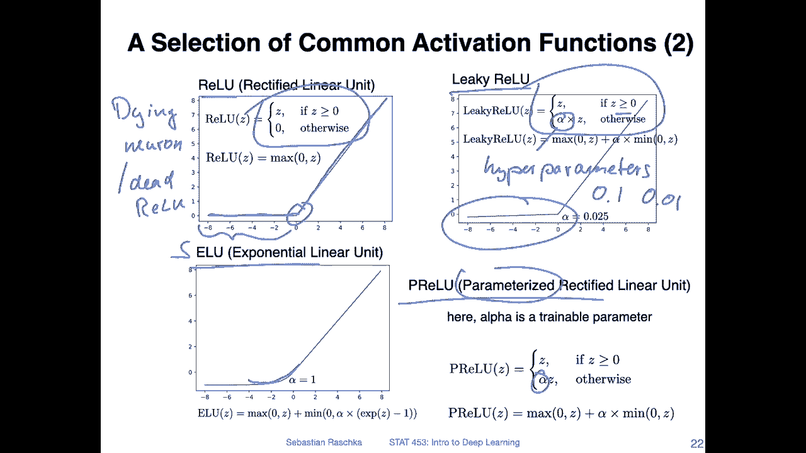

## 前沿视角：平滑激活函数与对抗鲁棒性 🛡️

激活函数的选择不仅影响普通训练，还与模型的**对抗鲁棒性**（抵抗恶意干扰的能力）密切相关。

最近的研究表明，广泛使用的ReLU由于其**非平滑性**（在x=0处不可导），可能会削弱对抗训练的效果。而使用ReLU的**平滑近似**（如Softplus函数：`f(x) = log(1 + e^x)`）进行“平滑对抗训练”，可以在不损失太多标准准确率的情况下，显著提升模型的对抗鲁棒性。


这意味着，在某些对安全性要求高的场景下，将ReLU替换为更平滑的变体可能是一个简单而有效的改进策略。

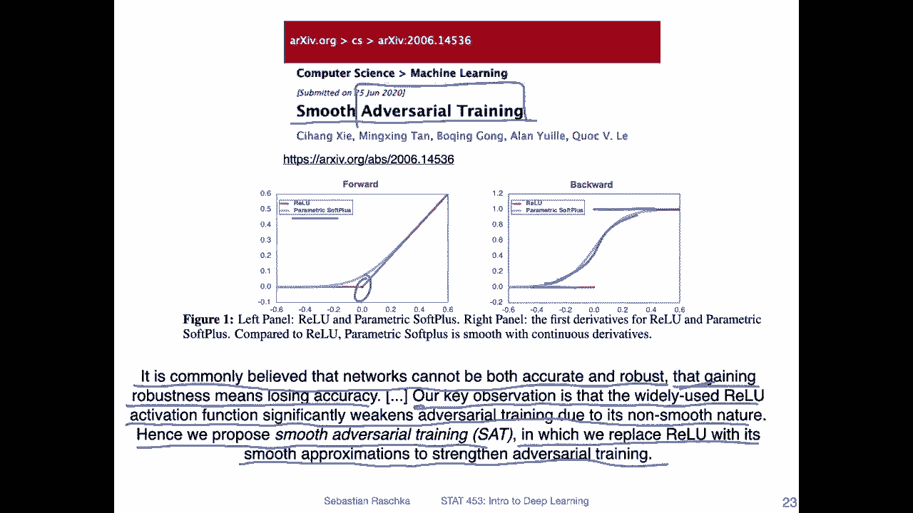

---

## 总结 🎯

本节课中我们一起学习了非线性激活函数的核心知识：

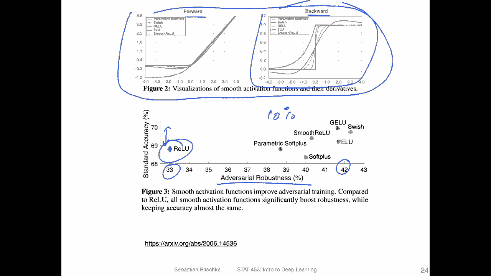

1.  **必要性**：非线性激活函数与隐藏层结合，是神经网络能够学习复杂非线性模式的**关键**。
2.  **发展历程**：从传统的Sigmoid、Tanh，到现代默认的ReLU及其众多变体（Leaky ReLU， PReLU， ELU， SELU）。
3.  **核心特性**：我们关注激活函数的形状、输出范围、梯度行为（是否易饱和）以及对训练动态的影响。
4.  **实践选择**：**ReLU**是通用的强大起点。可根据具体问题尝试其变体以优化性能或稳定性。
5.  **前沿联系**：激活函数的平滑性被发现与模型的**对抗鲁棒性**有关，平滑的近似版本可能在此方面更具优势。


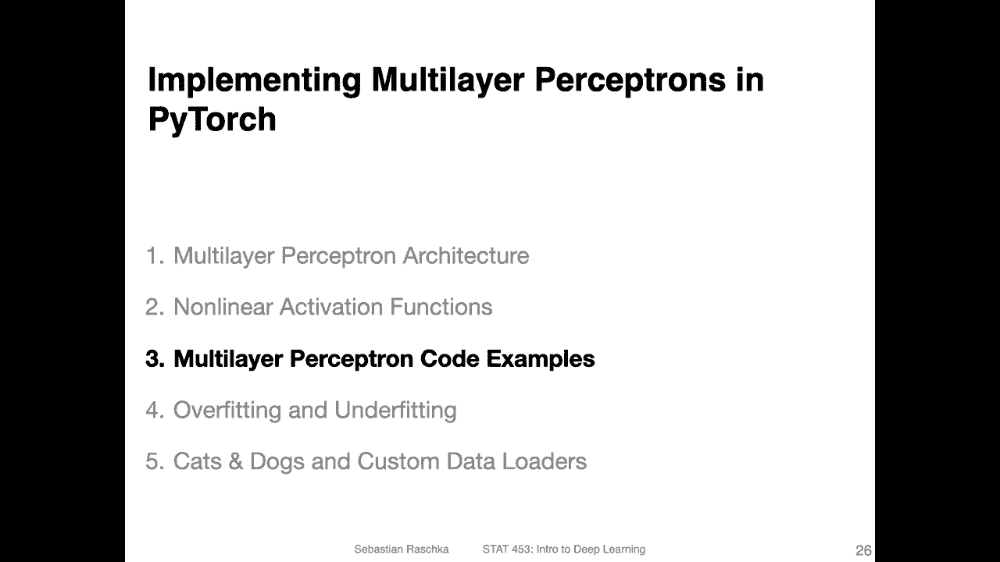

记住，激活函数为神经网络注入了“非线性”的灵魂，是使其从线性模型跃升为强大函数逼近器的核心组件之一。