# 68：L9.4- 过拟合和欠拟合 🧠

在本节课中，我们将学习机器学习中的两个核心概念：**过拟合**和**欠拟合**。我们将探讨模型过于简单或过于复杂时会出现的问题，并了解如何通过模型容量、偏差和方差等概念来理解这些现象。课程最后，我们还会介绍一个有趣的新发现——“双下降”现象。

---

## 模型表现与错误案例

我们已经见识了像逻辑回归这样的简单模型，以及像多层感知机这样更复杂的模型。现在是讨论**过拟合**和**欠拟合**的好时机。具体来说，我们将探讨模型过于简单（如逻辑回归）和模型对数据拟合得“太好”（如具有过多特征的多层感知机）所带来的问题。

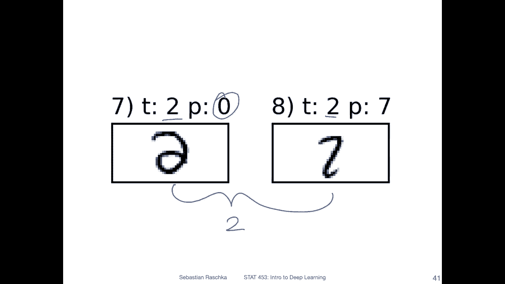

首先，我们来看一个关于手写数字识别的小测验。以下是MNIST数据集中的一些图像，请判断它们代表什么数字。

实际上，这些图像的识别存在一定模糊性。例如，一个真实标签为“8”的图像，模型可能预测为“4”。另一个真实标签为“2”的图像，可能被误认为“7”。这些案例表明，即使是人类，有时也难以100%准确判断，这也意味着模型在该数据集上达到100%准确率几乎是不可能的。

下图展示了一个在MNIST上训练的多层感知机的一些失败预测案例。这个模型使用了Sigmoid激活函数和均方误差损失，准确率约为93%。但这里的重点不是准确率，而是**可视化错误预测**的价值。通过查看模型预测错误的样本，我们有时能发现数据本身存在错误标签等问题，从而获得对数据的额外洞察。

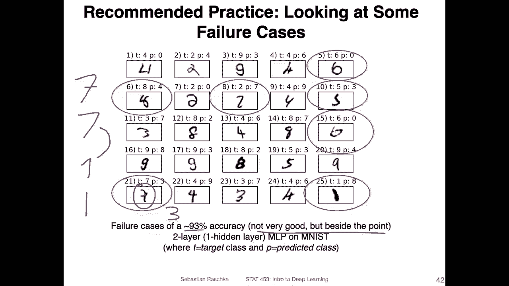

---

## 📈 理解过拟合与欠拟合

上一节我们看到了模型可能犯的错误，本节中我们来深入理解其背后的核心概念。

**过拟合**指的是模型记住了训练集中某些过于特定、无法推广到测试集的细节。
**欠拟合**则是指模型不够复杂，无法捕捉数据中的基本趋势。

为了量化这些概念，我们引入**模型容量**。模型容量可以粗略地理解为模型的参数数量或拟合复杂数据集的能力。例如，拥有更多隐藏层或更宽隐藏层的模型，其容量通常更大。

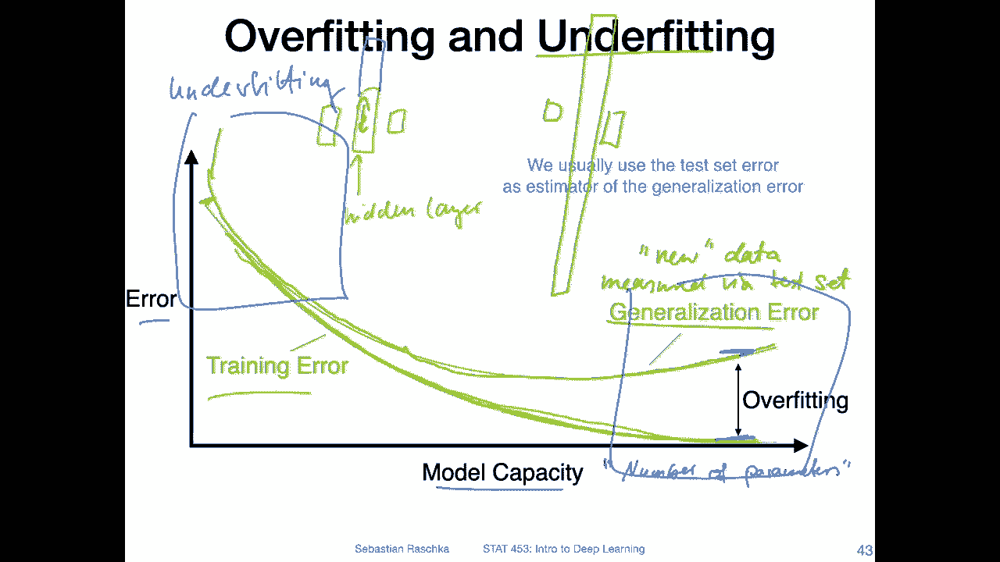

我们可以绘制误差随模型容量变化的曲线来观察：
*   **训练误差**（橙色曲线）：通常随着模型容量增加而下降。
*   **泛化误差/测试误差**（蓝色曲线）：在模型容量较小时，由于模型太简单，误差较高。随着容量增加，误差下降。但当容量过大时，模型开始过拟合，测试误差会再次上升。

**欠拟合**通常发生在曲线左侧，即模型容量过低、训练和测试误差都很高的区域。
**过拟合**通常发生在曲线右侧，即训练误差很低但测试误差很高的区域。过拟合的程度通常可以通过**训练误差与测试误差之间的差距**来评估。

---

## 🎯 偏差与方差分解

在实践中，你可能会听到“模型具有高偏差”或“模型具有高方差”的说法。这与过拟合和欠拟合密切相关。这里我们简要介绍**偏差-方差分解**的概念。

假设我们有一个回归模型，其预测值为 `\hat{\theta}`，真实值为 `\theta`。我们使用均方误差进行评估。设想我们拥有大量不同的训练集，在每个训练集上训练模型后，对同一个数据点进行预测。

*   **偏差**：所有模型预测值的平均值 `E[\hat{\theta}]` 与真实值 `\theta` 之间的差距。它衡量了模型的**系统性误差**，即预测平均偏离目标多远。
*   **方差**：各个模型的预测值 `\hat{\theta}` 围绕其平均值 `E[\hat{\theta}]` 的离散程度。它衡量了模型预测的**稳定性**。

一个形象的比喻是射箭：
*   **高偏差**：所有箭都射偏了（但可能扎堆）。
*   **高方差**：箭的落点非常分散（但平均落点可能在靶心附近）。

通常：
*   **高偏差、低方差**的模型往往**欠拟合**（模型太简单，预测不准但稳定）。
*   **低偏差、高方差**的模型往往**过拟合**（模型复杂，在训练集上预测准，但对数据变动敏感，不稳定）。

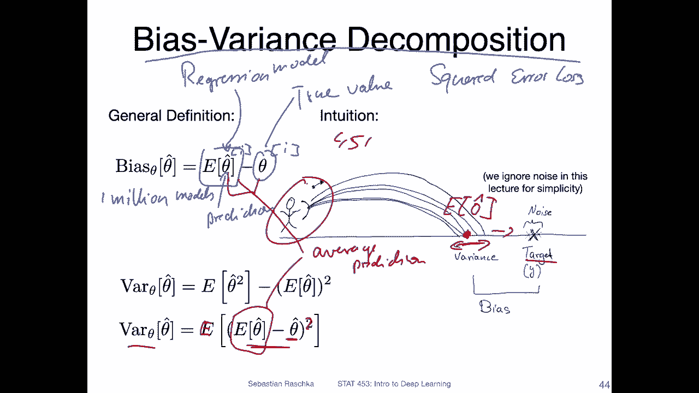

下图总结了这些关系。随着模型容量增加，偏差下降，方差上升。欠拟合区域对应高偏差，过拟合区域对应高方差。

---

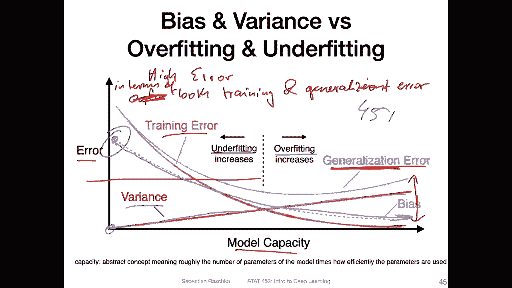

## 🔧 模型评估实践

对于深度学习，由于数据集通常很大，我们最常用的是**保留法**，即将数据分为三部分：
1.  **训练集**：用于训练模型。
2.  **验证集**：用于在训练过程中调整超参数、监控模型性能并防止过拟合（例如早停法）。
3.  **测试集**：用于在模型训练和调优完成后，提供最终的、无偏的性能评估。

核心原则是：**测试集在整个流程中只使用一次**，以确保评估的公正性。在后续的代码示例中，我们将使用这种方法。

---

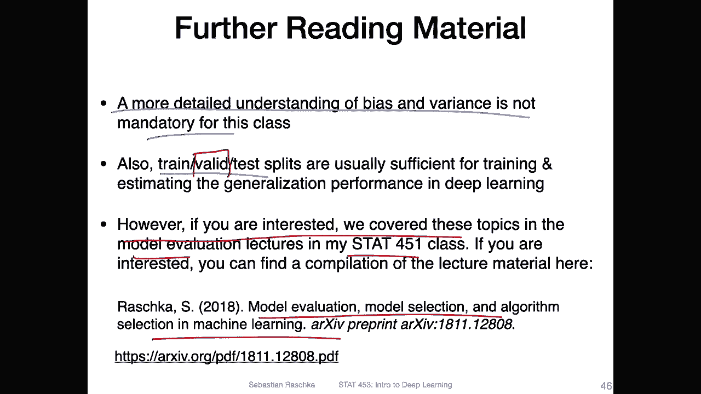

## 📊 数据规模与模型性能

深度学习的一个特点是**在大型数据集上表现尤为出色**。下图对比了传统机器学习方法（如决策树、SVM）和深度学习模型的泛化误差随训练数据规模变化的趋势。

*   在数据量较小时，传统方法往往表现更好。
*   随着数据量增加，两种方法的性能都会提升，但深度学习模型的误差下降曲线通常更为陡峭，显示出其**从海量数据中学习强大表征的能力**。

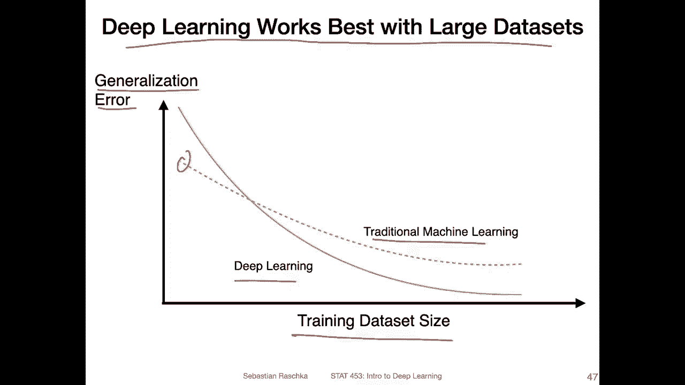

因此，如果你的模型性能不佳，在调整超参数收效甚微时，**获取更多数据**可能是一个有效的策略。

---

## 🤔 有趣的现象：双下降

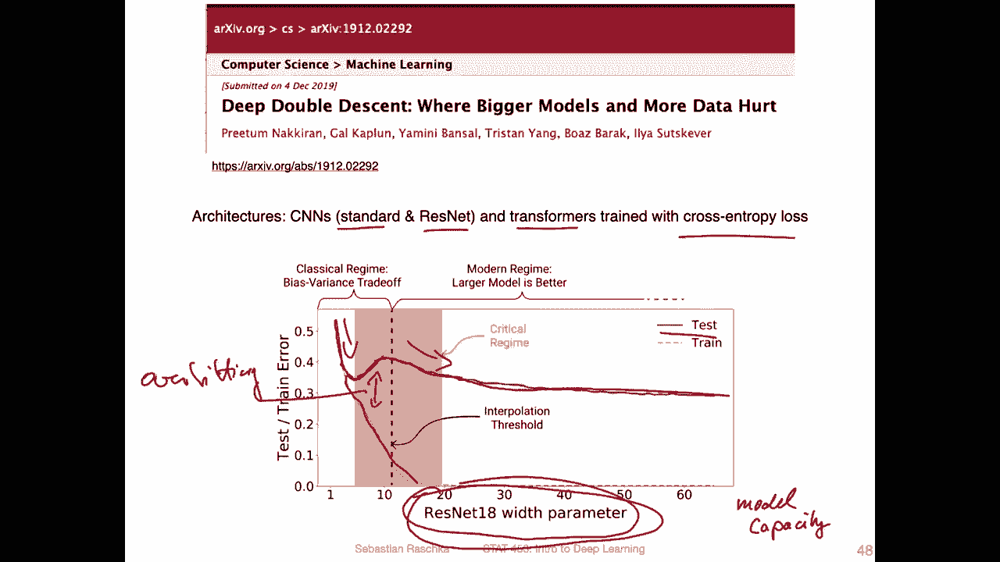

传统的认知是，随着模型容量增加，测试误差会先下降后上升（即过拟合）。但2019年底的一篇论文提出了**“双下降”**现象。

研究者发现，在CNN、ResNet等模型中，当模型容量持续增加时，测试误差会出现**先下降，后上升，然后再下降**的情况。第一个下降是预期中的，中间的上升对应经典过拟合区，而随后的再次下降则令人意外。

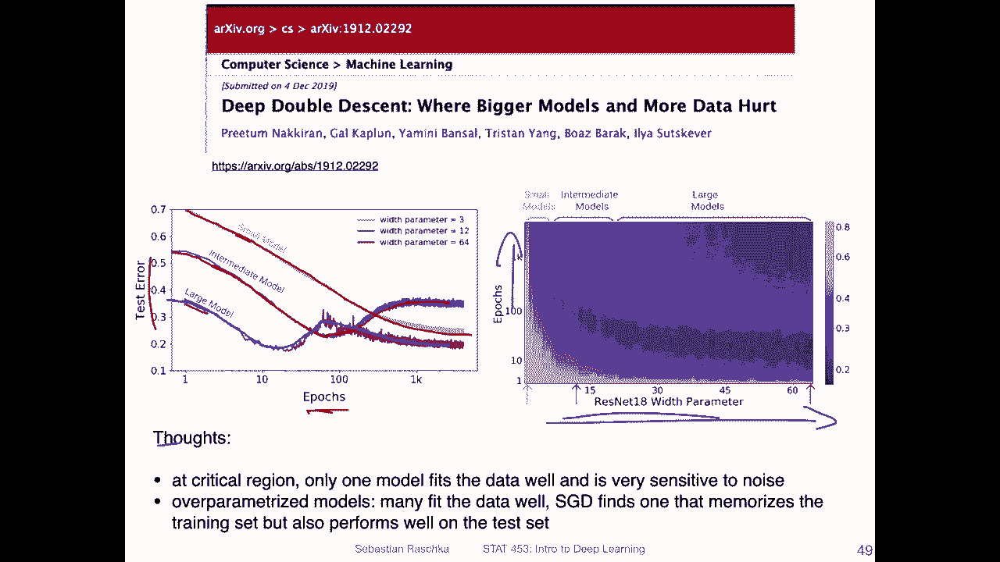

这种现象也出现在**训练周期**上。对于中等复杂度的模型，训练过久会导致测试误差先降后升（此时需要早停）。但对于非常大的模型，测试误差在上升之后会再次下降。

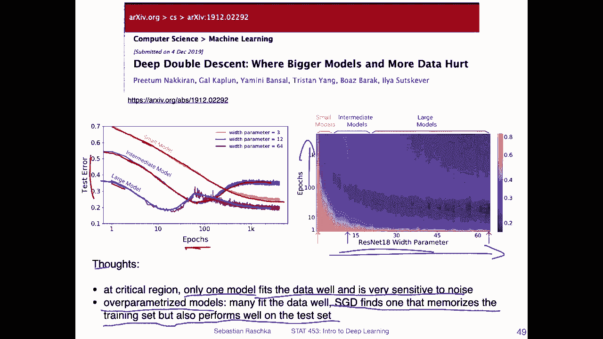

一种理论解释是：在临界区域（第一次上升处），可能只有一个特定的权重组合能很好拟合数据，但这个解对噪声非常敏感，难以稳定找到。而在**过参数化区域**（模型极大），存在许多能很好拟合训练集的权重子集，随机梯度下降算法更有可能找到其中一个**同时也能在测试集上表现良好**的解。

尽管原因尚未完全明晰，但“双下降”现象已被多个实验独立观察到。它挑战了我们对模型容量与泛化能力的传统理解。

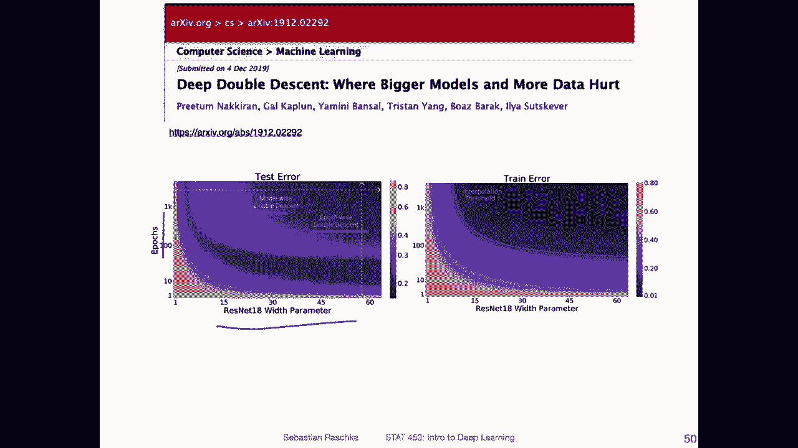

---

## 🎓 课程总结

本节课中，我们一起学习了机器学习中的核心挑战：

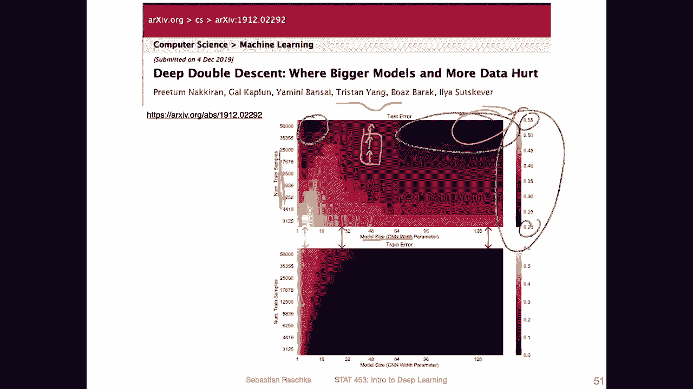

1.  **过拟合与欠拟合**：理解了模型过于复杂和过于简单时出现的问题，以及如何通过训练/测试误差曲线进行识别。
2.  **偏差与方差**：从理论角度了解了模型误差的分解，以及它们与过拟合（高方差）、欠拟合（高偏差）的关联。
3.  **评估方法**：掌握了在深度学习中常用的训练集、验证集、测试集三分割的保留法。
4.  **数据规模的重要性**：认识到深度学习模型性能随数据量增长而显著提升的特点。
5.  **前沿洞察**：初步了解了“双下降”这一有趣的研究现象，它揭示了超大模型可能具备意想不到的泛化优势。

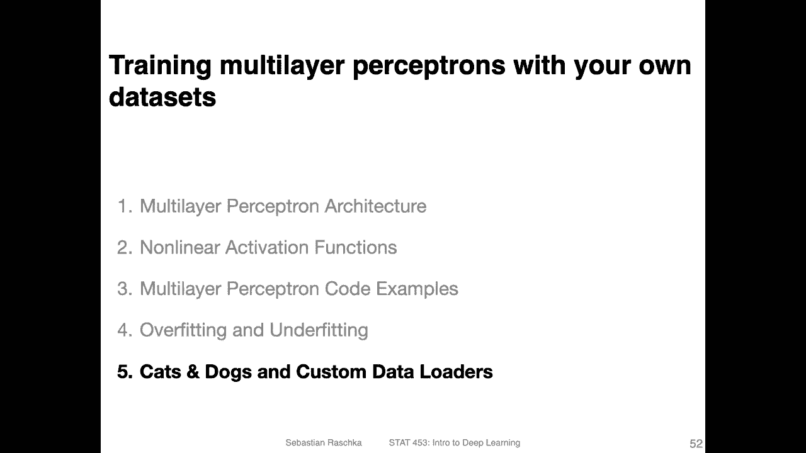

理解这些概念是构建有效机器学习模型的基础。在接下来的课程中，我们将学习如何将多层感知机应用于自定义数据集。