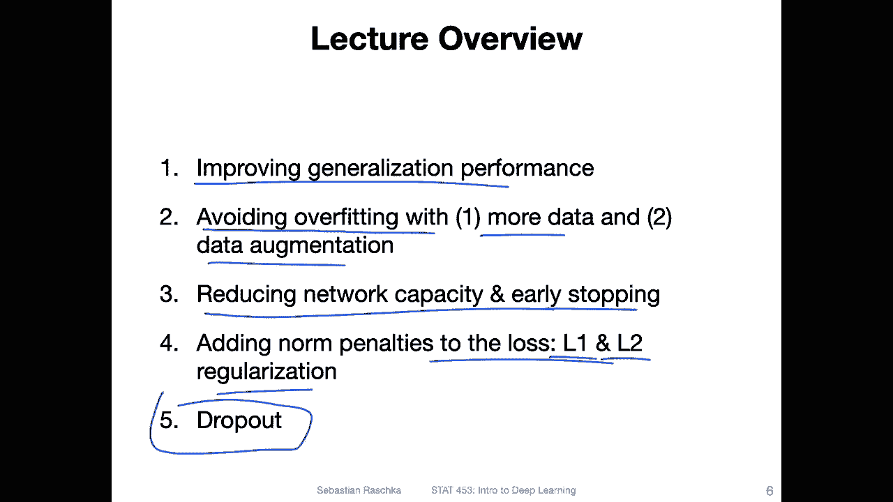

# 72：L10.0 - 神经网络的正则化方法 🧠

在本节课中，我们将学习如何通过正则化技术来改善神经网络的训练效果，核心目标是减少过拟合。我们将探讨多种方法，包括数据增强、模型复杂度控制、经典的L2正则化以及目前深度学习中最常用的Dropout技术。

---

## 概述 📋

上一讲我们介绍了多层感知机，现在你已经能够训练深度神经网络了。这自然引出了如何让神经网络训练得更好、如何得到更优模型的问题。上一讲我们简要提到了过拟合问题，本节课将介绍一些应对过拟合的技术。

首先，我们将讨论如何通过数据增强来扩充训练数据点。结合自定义数据模型，我们可以方便地修改图像数据，例如随机旋转图像，从而廉价地生成新的训练样本，帮助模型对数据集中的微小扰动变得更加鲁棒。

接着，我们将介绍一系列被称为“正则化”的技术。正则化旨在减少过拟合，使模型对数据集的微小扰动不那么敏感。其中一个技术是“早停”，即在训练早期停止。然而，考虑到上一讲解释的“双下降”现象，在实践中可能不再推荐此方法。

我们还将介绍L2正则化，你可能在其他统计学课程中听说过L1和L2正则化，其核心思想是收缩权重。我们将展示如何将这一概念应用于神经网络。

最后，我们将介绍目前最常用和流行的神经网络正则化技术之一——Dropout。在Dropout中，我们随机丢弃神经网络隐藏层中的单元，这有助于防止网络过度依赖特定的神经元，从而使网络更加鲁棒。

当然，还有许多其他技术可以改善神经网络训练，例如不同的权重初始化方案、批归一化以及选择不同的优化器等。我们将在后续课程中讨论这些。本节课介绍的技术主要影响神经网络的结构或权重。

---

## 过拟合与偏差-方差分解 📊

本节课的一个主要目标是减少过拟合。在上一讲中，我们简要提到了偏差-方差分解。例如，想象一个回归问题，我们有一个连续目标变量 **Y** 和一些输入特征 **X**。模型预测为 **Ŷ**。

数据背后可能存在一个真实的底层函数 **f(x)**，但在实践中，我们只能访问从一个分布中采样的训练数据集，并且通常存在一些噪声。我们训练模型的目标通常是在训练集上获得低误差或高准确率。

然而，训练集中通常也存在噪声，不能完全代表或捕捉真实的底层数据。我们学到的模型可能过于复杂、过于灵活，导致方差过高。如果我们从同一真实函数分布中收集一个略有不同的数据集，使用相同算法可能会得到非常不同的模型。我们可以将其视为具有较大的方差。

如果我们有无限多个这样的模型并对它们取平均，应该得到接近真实函数 **f(x)** 的结果。但每个模型本身都具有高方差。

本节课将学习可以降低这种方差的技术。例如，与其学习一个复杂的模型（如之前展示的红线），我们可能学习一个更简单的模型，它具有更低的方法。当然，我们也不希望将模型简化得太多，否则它可能无法很好地拟合训练数据。我们需要找到一个平衡点，在减少方差以降低过拟合的同时，避免使模型过于简单。

---

## 正则化：定义与目标 🎯

正则化是一个广义术语，指添加信息或修改目标函数以防止过拟合的过程。例如，L2正则化通常就是我们在损失函数中添加的一个约束项。

广义上说，正则化是指对学习过程进行修改以防止过拟合。有许多不同的技术可以实现正则化效果，其共同目标是减少过拟合。

常用的技术包括早停、L1和L2正则化。在深度学习背景下，L1正则化不那么常用，L2正则化更常见一些，但最常用的技术通常是Dropout，我们将在今天讨论它。

传统的正则化定义是为了解决不适定问题或防止过拟合而添加信息的过程。在机器学习和深度学习领域，这个术语的含义有所演变和调整。有时，人们也将任何旨在降低模型泛化误差（而非训练误差）的学习算法修改都称为正则化。本节课我们主要关注如何降低泛化误差。

---

## 课程大纲与核心主题 📝

以下是本节课将涵盖的五个主要主题：

1.  **改善泛化性能的技术概述**：我们将进行一个简短的头脑风暴，列出一些可能对你有用的方法。虽然本课程无法涵盖所有技术，但了解它们可能对你的课程项目有所帮助。
2.  **通过数据避免过拟合**：第一种方法是添加更多数据。第二种方法是修改现有数据，这通常也非常有效。
3.  **降低模型复杂度**：这包括减少网络容量和使用早停技术。早停意味着当我们观察到验证集性能良好，而继续训练会使性能变差时，提前停止训练过程。
4.  **经典的正则化技术**：我们将讨论经典的L2正则化，并简要提及L1正则化（尽管它不那么常用）。这些方法主要通过修改损失函数，添加惩罚项来实现。
5.  **Dropout方法**：这可能是目前深度学习中最常用的方法之一。它本质上是一种随机丢弃神经元的技术，我们将看到它如何帮助提升神经网络训练性能和泛化性能。

---

## 总结 🏁

本节课我们一起学习了神经网络的正则化方法。我们从过拟合问题和偏差-方差分解入手，理解了正则化的核心目标。我们概述了多种改善泛化的技术，重点探讨了通过数据增强和修改数据来避免过拟合。我们还学习了通过降低模型复杂度（如早停）和修改损失函数（如L2正则化）来进行正则化。最后，我们深入介绍了目前最流行的正则化技术之一——Dropout，它通过随机丢弃神经元来增强网络的鲁棒性。掌握这些技术将帮助你训练出泛化能力更强的神经网络模型。