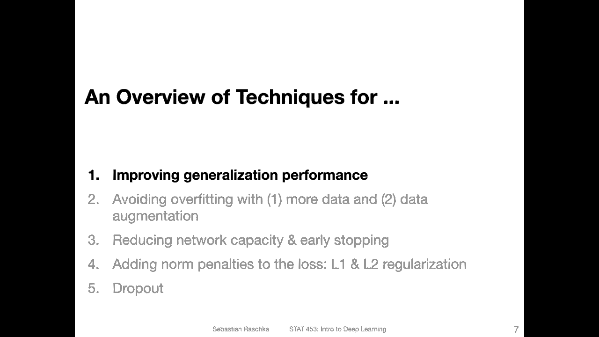
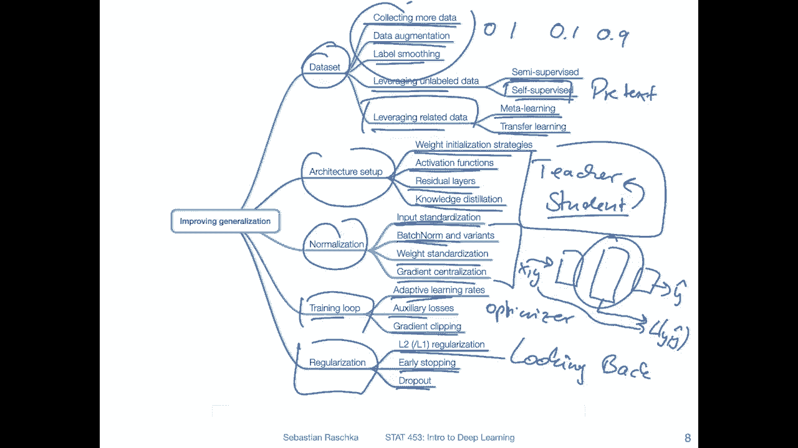
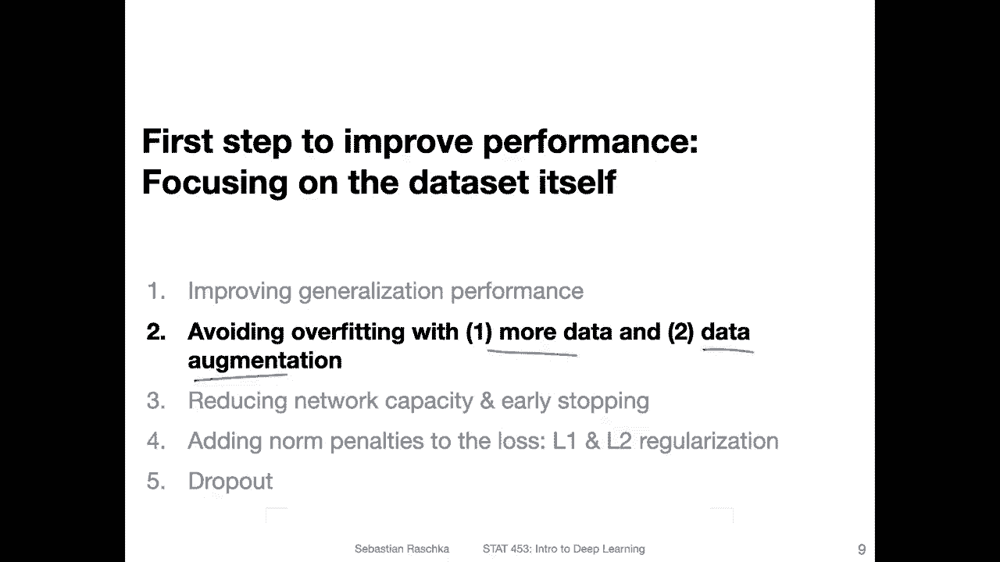

# 73：L10.1 - 减少过拟合的技术 🛡️



在本节课中，我们将学习一系列用于提升模型泛化性能、减少过拟合的技术。我们将从宏观视角了解这些技术，并对其中的核心方法进行简要介绍。

上一节我们讨论了过拟合的概念，本节中我们来看看有哪些具体的技术可以帮助我们应对它。

## 数据相关技术 📊

以下技术主要涉及对数据集的特征、标签进行修改，或利用新的、不同的数据集。

*   **收集更多数据**：如果条件允许，收集更多数据通常是提升模型性能最有效的方法之一。更多数据通常有助于模型学习更通用的模式。
*   **数据增强**：通过修改输入特征来人工扩展数据集。例如，对图像进行旋转、裁剪、翻转等操作，以创建新的训练样本。
*   **标签平滑**：防止分类器变得过于自信。具体做法是，不使用硬性的0或1标签，而是使用更“软”的版本，例如将标签0替换为0.1，将标签1替换为0.9。这在生成对抗网络和某些分类任务中被证明是有效的。
*   **利用未标注数据**：
    *   **半监督学习**：在已标注数据上训练分类器，然后将其应用于未标注数据。对于那些分类器预测置信度很高的未标注样本，可以考虑将其预测标签视为真实标签，从而扩大训练集。
    *   **自监督学习**：通过设计一个“前置任务”来利用未标注数据。例如，将一张图像分割成若干小块，然后训练一个网络来预测这些小块的正确排列顺序。这个任务本身不需要人工标注。
*   **利用相关数据**：
    *   **元学习**：从多个小数据集中学习如何学习，这在少样本学习场景中很常见。另一种定义是学习元数据（关于数据的数据）。
    *   **迁移学习**：在一个大型相关数据集（例如，用于诊断其他肺部疾病的X光图像）上预训练一个模型，然后将该模型微调以适应目标任务的小型数据集（例如，COVID-19胸部X光图像）。这是一种非常实用的技术。

## 架构与初始化相关技术 🏗️

以下技术涉及如何设计和构建深度神经网络架构。

*   **权重初始化策略**：采用合适的策略初始化网络权重，对训练过程的稳定性和收敛速度至关重要。
*   **激活函数选择**：例如，ReLU激活函数有助于缓解梯度消失问题。
*   **残差层/跳跃连接**：通过在网络中添加跨层连接，可以缓解梯度消失和爆炸问题，并帮助训练更深的网络。
*   **知识蒸馏**：首先训练一个大型的“教师”网络，然后训练一个较小的“学生”网络来学习模仿教师网络的预测。学生网络可以在教师网络生成的大量（甚至是无限的）预测上进行训练。

## 归一化相关技术 ⚖️

以下技术涉及对网络内部不同部分的数据进行标准化处理。

*   **输入标准化**：对输入特征进行标准化处理，使其均值为0，方差为1。
*   **批量归一化**：不仅标准化网络输入，还对隐藏层的激活值进行归一化，以稳定训练过程。此外还有组归一化、实例归一化、层归一化等变体。
*   **权重标准化**：对网络权重进行标准化的技术。
*   **梯度中心化**：对梯度进行归一化，使其均值为0，有助于稳定训练。

## 训练过程相关技术 🔄

以下技术涉及对训练循环、优化器等过程进行修改。

*   **优化器选择**：使用自适应学习率优化器（如Adam）等高级优化算法。
*   **辅助损失函数**：在网络的中间层添加额外的损失函数。例如，Inception网络就采用了这种方法。公式可以表示为：
    `总损失 = 主输出损失 + Σ (辅助输出损失)`
    这有助于确保深层网络中的中间层也能得到良好训练。
*   **梯度裁剪**：为避免梯度爆炸，当梯度值超过某个阈值时，将其裁剪到该最大值。

## 本课重点技术 🎯

最后，我们将重点介绍本课程中会详细讲解的几种技术，它们也是实践中非常流行的方法。

*   **L1与L2正则化**：通过在损失函数中添加对权重大小的惩罚项，促使网络权重变小，从而降低模型复杂度，减少对噪声的敏感度。L2正则化公式为：
    `损失 = 原始损失 + λ * Σ (权重²)`
*   **早停法**：在训练过程中持续监控模型在验证集上的性能，一旦性能不再提升甚至开始下降，就停止训练，以防止过拟合。
*   **Dropout**：在训练过程中随机“丢弃”（即暂时禁用）网络中的一部分神经元单元。这相当于向网络中添加噪声，是一种有效的正则化手段。在代码中通常体现为一个Dropout层：
    ```python
    torch.nn.Dropout(p=0.5)  # 以50%的概率丢弃神经元
    ```





本节课中我们一起学习了减少过拟合、提升模型泛化能力的多种技术路线图。我们从数据、架构、归一化和训练过程四个维度进行了梳理，并重点指出了L1/L2正则化、早停法和Dropout等核心方法。理解这些技术的原理和应用场景，将帮助你构建更强大、更稳健的机器学习模型。在接下来的视频中，我们将首先深入探讨如何通过数据增强来扩大数据集。