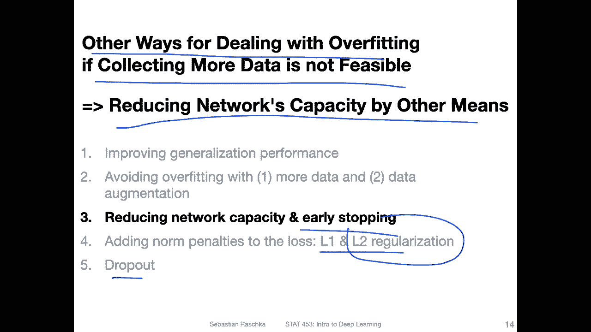
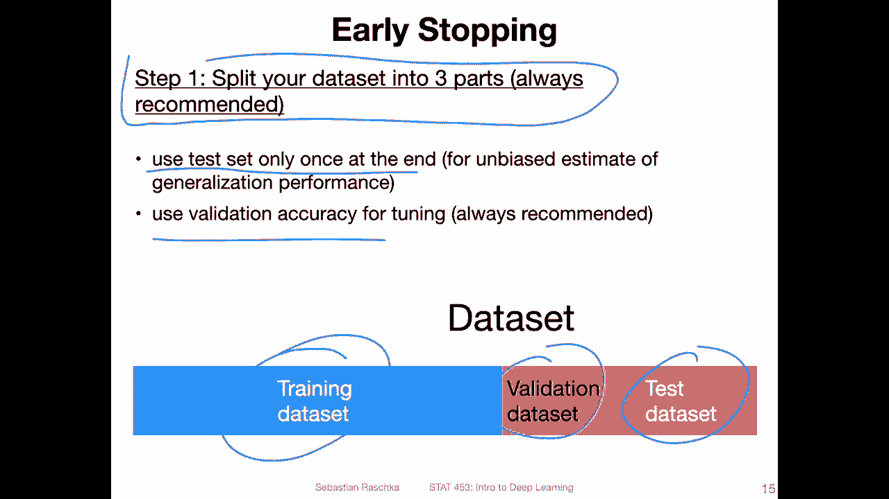
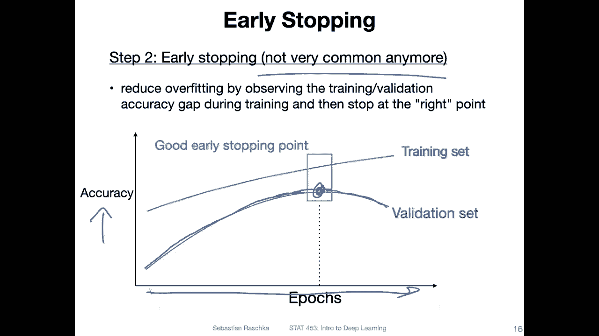
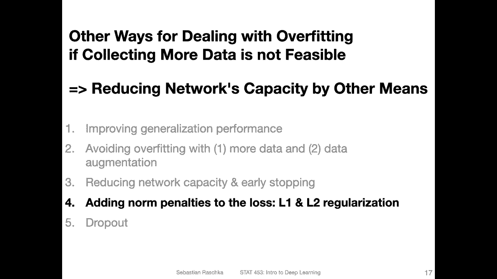

# 75：L10.3 - 提前停止 🛑

在本节课中，我们将要学习一种用于处理模型过拟合的技术——提前停止。我们将了解其基本原理、如何实施，以及它在实际应用中的考量。

上一节我们介绍了过拟合的概念以及数据增强等方法。本节中我们来看看另一种策略：提前停止。

## 概述

提前停止是一种通过监控模型在验证集上的表现来决定何时终止训练的技术。其核心思想是，在模型开始对训练数据过拟合之前停止训练，从而获得泛化能力更好的模型。

## 数据集划分策略

实施提前停止需要一个验证集。以下是推荐的数据集划分方法：

*   **训练集**：用于模型训练的主要数据集。
*   **验证集**：用于模型调优和决定提前停止的时机。这是模型在训练过程中未见过的数据。
*   **测试集**：仅在最终模型确定后，用于评估其最终性能。理想情况下只使用一次。

验证集本质上用于模型调优，而提前停止正是调优过程的一部分。

## 提前停止的工作原理

上周我们观察了模型在训练过程中，训练集和验证集上的准确率与损失变化。为了简化说明，这里展示一个理想化的示意图。

提前停止的方法是观察训练集和验证集的性能曲线，并从中推断出停止训练的最佳时机。

验证集用于估计模型的泛化性能。你可能会发现，验证集准确率起初会上升，这意味着泛化性能在提升。但到达某个点后，验证集性能开始下降。这表明继续训练可能会使性能变差。因此，提前停止训练有时能获得更好的模型性能。

## 实践建议与总结

在实际应用中，提前停止已不再是首选的主流方法。通常建议先尝试L2正则化或更有效的Dropout技术来提升泛化性能。如果使用了这些技术后，发现提前停止仍有帮助，再考虑将其纳入流程。尽管如此，提前停止仍然是一项值得了解的有用技术。

本节课中我们一起学习了提前停止技术。我们了解了其依赖于验证集监控的核心思想，以及它在实际工作流中的定位。下一节，我们将介绍L2正则化，这是一种通过惩罚模型复杂度来防止过拟合的方法。

