# 76：L10.4 - 神经网络的 L2 正则化 🧠

在本节课中，我们将要学习如何通过 L2 正则化来防止神经网络模型过拟合。我们将了解其核心思想、数学原理、几何解释以及在 PyTorch 中的实现方法。

---

## 📌 核心思想：惩罚模型复杂度

上一节我们介绍了模型过拟合的问题，本节中我们来看看如何通过惩罚模型的复杂度来缓解它。

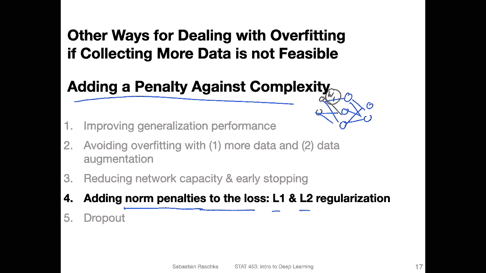

我们可以向损失函数中添加一个惩罚项，这通常被称为正则化。有两种常见的形式：L1 范数和 L2 范数。

想象一个多层感知机，它有一个包含 3 个单元的隐藏层和 2 个输出单元，以及 2 个输入特征。网络是全连接的。

如果其中某个权重（例如 W1）非常大，那么即使只有一个特征拥有大权重，它也会对网络产生巨大影响。当存在许多输入时，一个过大的权重可能会压倒所有其他特征，导致模型对输入中的微小变化非常敏感，从而产生噪声或高方差。

通过添加一个惩罚项来抑制大权重，使权重保持较小且更均匀，可以帮助防止网络输出的剧烈波动。

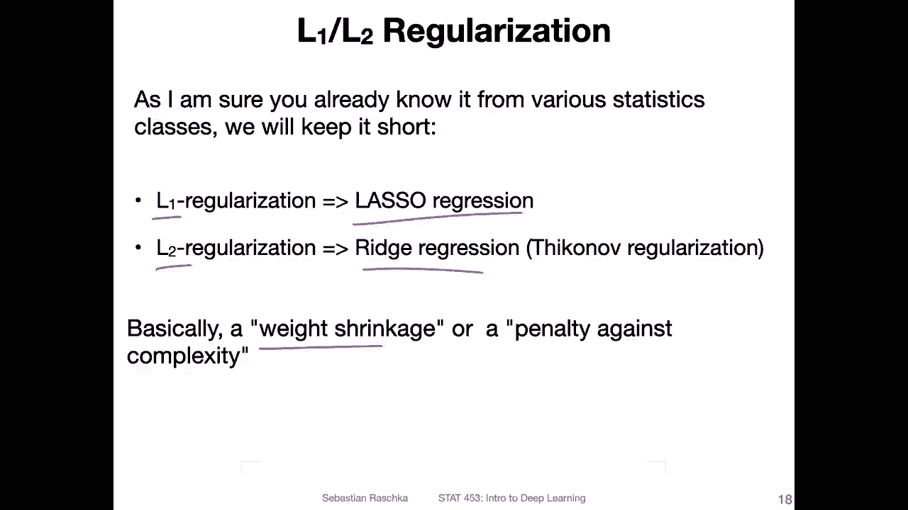

---

## 📐 L2 正则化的数学形式

以下是 L2 正则化的核心公式。我们首先以逻辑回归为例进行说明，其思想可以很容易地推广到神经网络。

对于一个逻辑回归模型，其损失函数（如二元交叉熵）为：

**原始损失**：`J(w) = (1/n) * Σ L(y_i, ŷ_i)`

添加 L2 正则化项后，总损失变为：

**正则化损失**：`J_reg(w) = (1/n) * Σ L(y_i, ŷ_i) + (λ / n) * Σ w_j²`

*   `Σ w_j²` 是所有权重平方的和，这就是 L2 范数惩罚。
*   `λ` 是一个超参数，称为**正则化强度**。`λ` 越大，对权重的惩罚就越强。
*   `n` 是样本数量，用于归一化。

L1 正则化的概念与此类似，只是惩罚项使用的是权重的绝对值之和 `Σ |w_j|`。

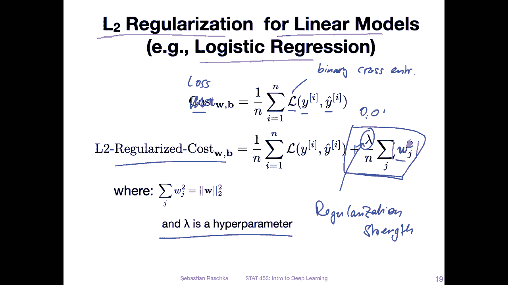

---

## 🧩 几何解释：约束优化

我们可以从几何角度理解 L2 正则化。

假设一个简单的线性回归模型有两个权重（忽略偏置项）。损失函数（如均方误差）形成一个曲面，其中心谷底是损失最小值，即我们想要找到的最佳权重组合。

L2 正则化项 `λ * Σ w_j²` 在权重空间中表现为一个圆（或球体），圆心在原点。这个圆代表了惩罚项的大小：权重离原点越远，惩罚越大。

因此，训练过程变成了一个**带约束的优化问题**。优化算法（如梯度下降）需要同时最小化原始损失和正则化惩罚。最终找到的权重解会是原始损失曲面和正则化圆环之间的一个折中点，即权重既不会太大，又能较好地拟合数据。

---

## 🖼️ 对模型的影响：简化决策边界

在实践中，L2 正则化的效果是使模型的决策边界变得更加平滑和简单。

对于一个具有复杂决策边界的多层感知机，施加 L2 正则化后，其决策边界可能会变得更平滑。如果正则化强度 `λ` 设置得非常大，模型甚至可能退化为一个接近线性的简单模型。

因此，选择合适的 `λ` 值至关重要，它需要在模型复杂度和拟合能力之间取得良好平衡。

---

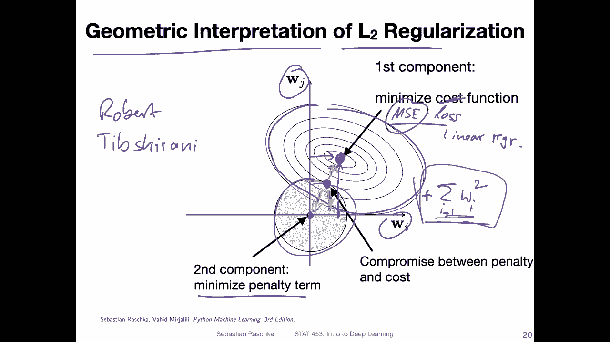

## 🔗 推广到神经网络：弗罗贝尼乌斯范数

之前我们讨论了在广义线性模型（如逻辑回归）中如何应用 L2 正则化。那么如何将其推广到具有多层权重矩阵的神经网络呢？

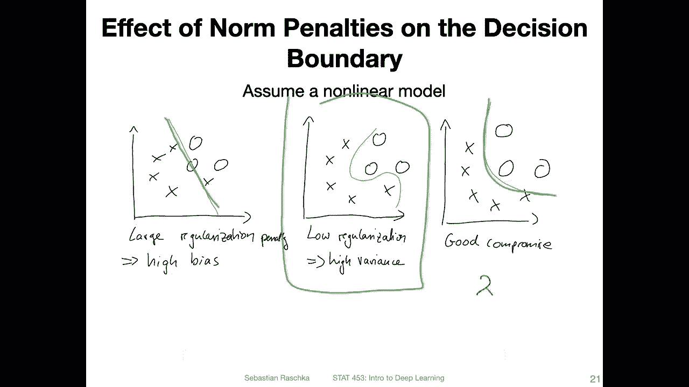

方法非常简单，我们使用**弗罗贝尼乌斯范数**。对于神经网络的某一层权重矩阵 `W^[l]`，其 L2 正则化项是该矩阵所有元素平方的和。

对于整个神经网络，总的正则化损失函数为：

`J_reg = (1/n) * Σ L(y_i, ŷ_i) + (λ / n) * Σ_l ||W^[l]||_F²`

其中，`||W^[l]||_F²` 表示第 `l` 层权重矩阵的弗罗贝尼乌斯范数的平方。你可以为每一层设置不同的 `λ`，但通常对所有层使用相同的值。

---

## ⚙️ 训练与梯度计算

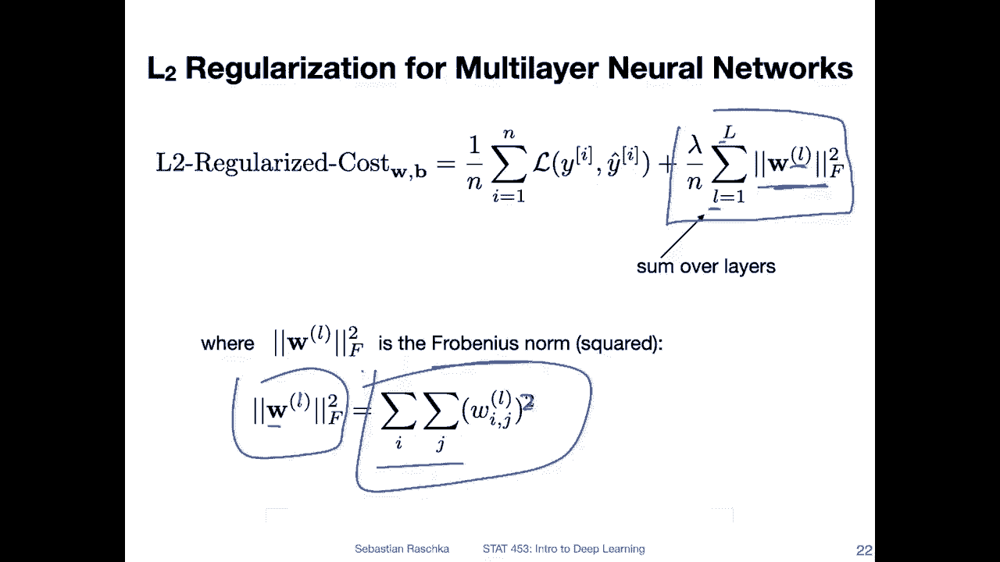

既然我们修改了损失函数，那么在使用梯度下降法训练时该如何操作呢？这实际上非常直接。

根据求导的加法法则，正则化损失对权重的梯度等于原始损失梯度与正则化项梯度之和。

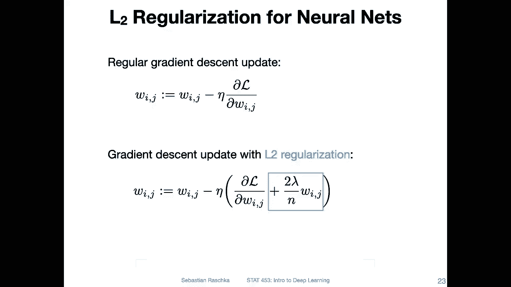

对于权重 `w_ij`，正则化项的梯度计算如下：

`∂/∂w_ij [ (λ / n) * Σ w_j² ] = (2λ / n) * w_ij`

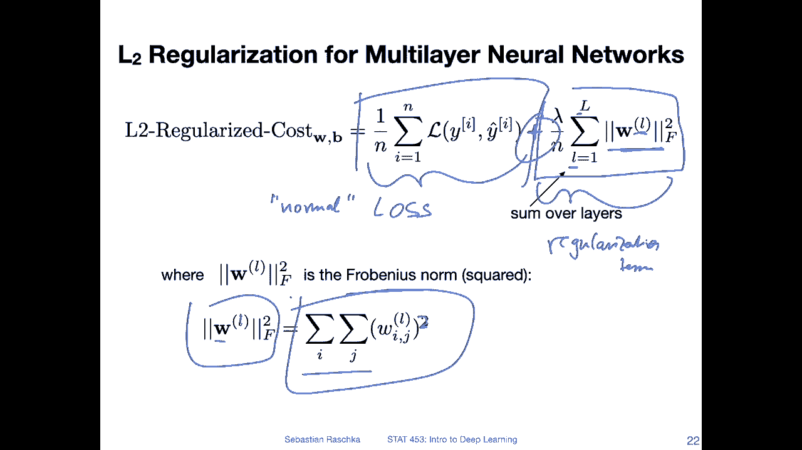

因此，在权重更新时，我们不仅会按照原始损失梯度的方向调整权重，还会额外施加一个将权重向零缩小的力，这就是“权重衰减”名称的由来。

---

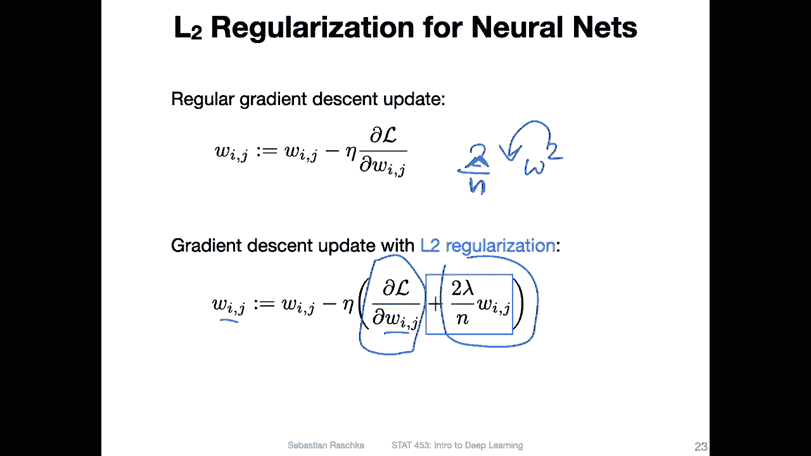

## 💻 在 PyTorch 中的实现

在 PyTorch 中实现 L2 正则化非常简便。主要有两种方式：

**方法一：手动添加到损失函数**

在训练循环中，遍历模型的所有参数，筛选出权重（通常忽略偏置项），计算其平方和并加到损失中。

```python
l2_lambda = 0.01
l2_reg = torch.tensor(0.)
for name, param in model.named_parameters():
    if ‘weight‘ in name:
        l2_reg += torch.norm(param, p=2) # 计算L2范数的平方
loss = original_loss + l2_lambda * l2_reg
```

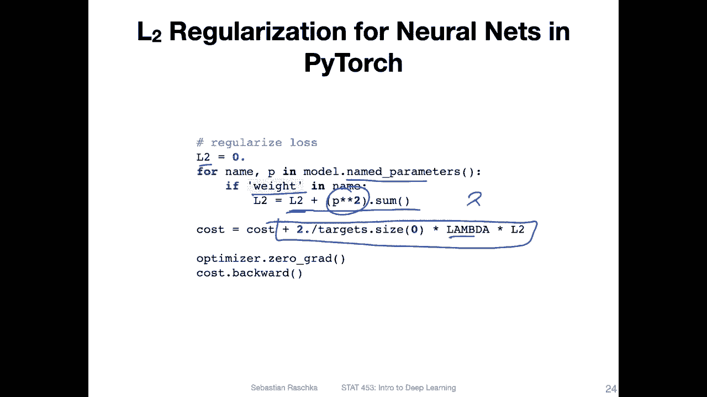

**方法二：使用优化器的 `weight_decay` 参数（推荐）**

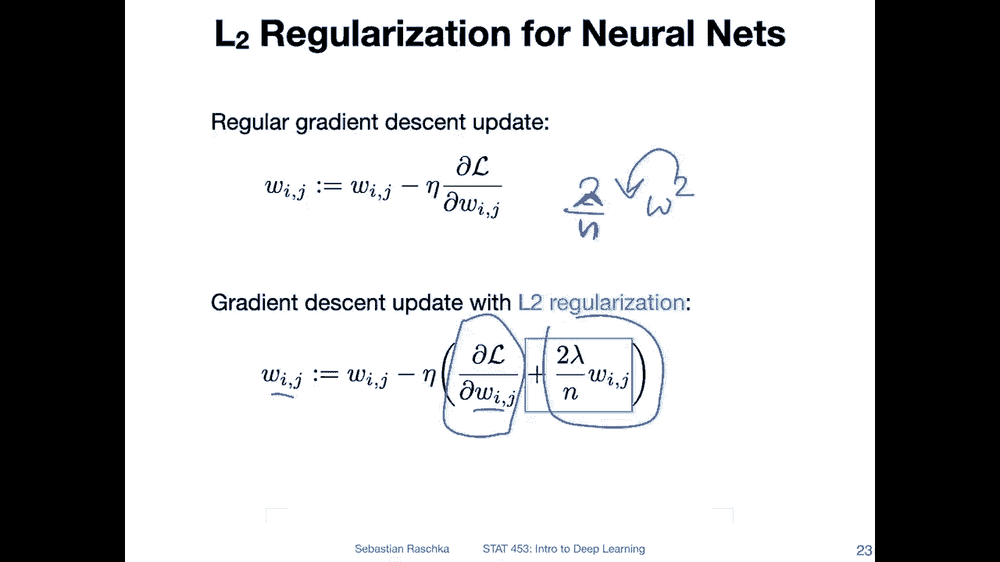

这是更简单且常用的方法。在定义优化器（如 SGD 或 Adam）时，直接指定 `weight_decay` 参数，其值即为正则化强度 `λ`。

```python
optimizer = torch.optim.SGD(model.parameters(), lr=0.01, weight_decay=0.01)
```
优化器会在内部自动完成 L2 正则化的梯度计算和权重更新。

---

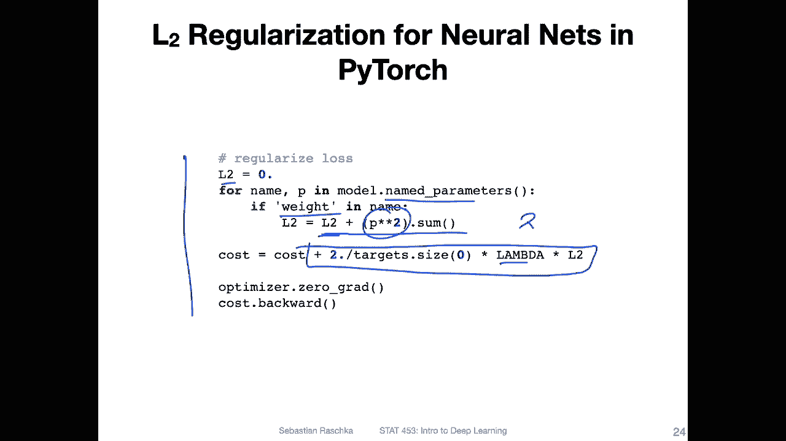

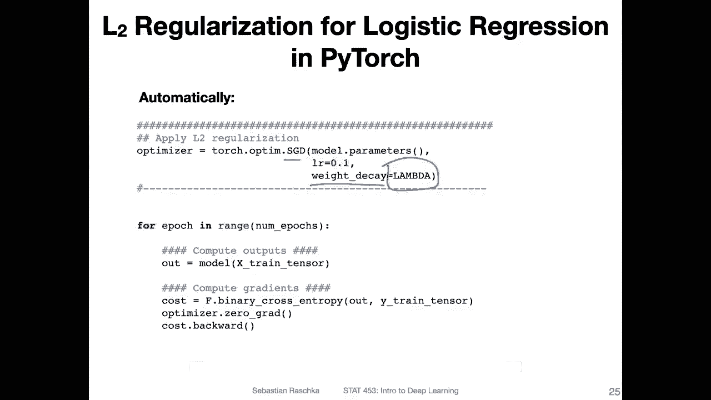

## 📝 总结

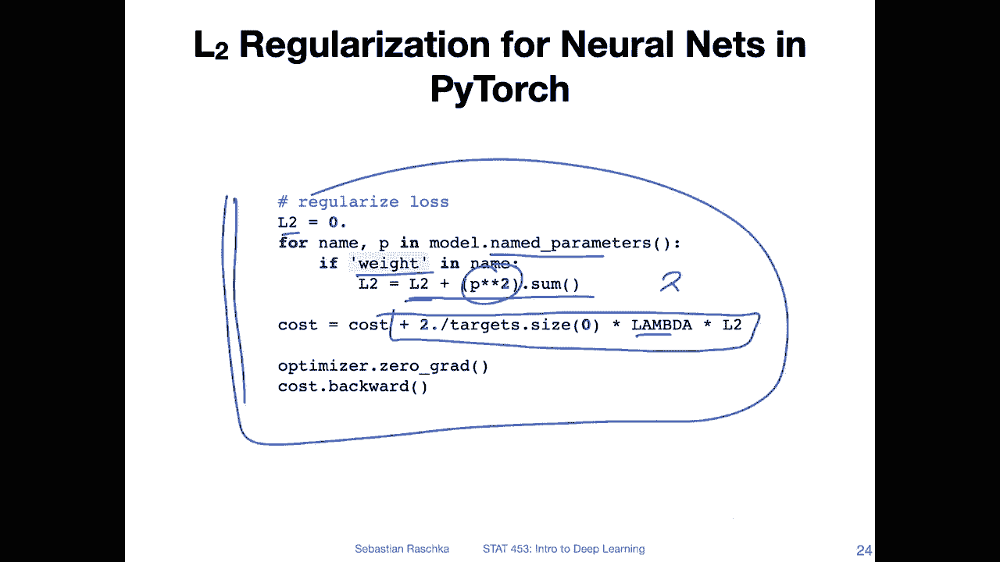

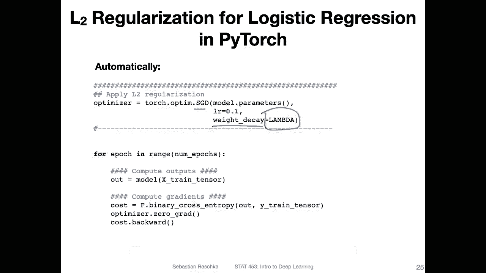

本节课中我们一起学习了神经网络中 L2 正则化的核心知识。

我们了解到，L2 正则化通过在损失函数中添加所有权重平方和作为惩罚项，来抑制过大的权重值，从而降低模型复杂度、缓解过拟合。我们从数学公式和几何视角理解了其工作原理，并掌握了将其从简单模型推广到多层神经网络的方法。最后，我们学习了在 PyTorch 中实现 L2 正则化的两种实用技巧，其中使用优化器的 `weight_decay` 参数是最为便捷的方式。

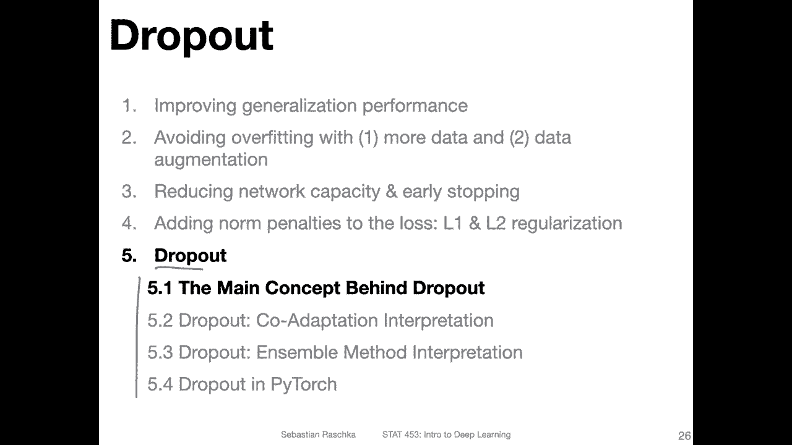

虽然 L2 正则化是控制模型复杂度的经典技术，但在现代深度学习中，像 Dropout 这样的方法可能更为常见。在接下来的课程中，我们将继续探讨其他有效的正则化技术。