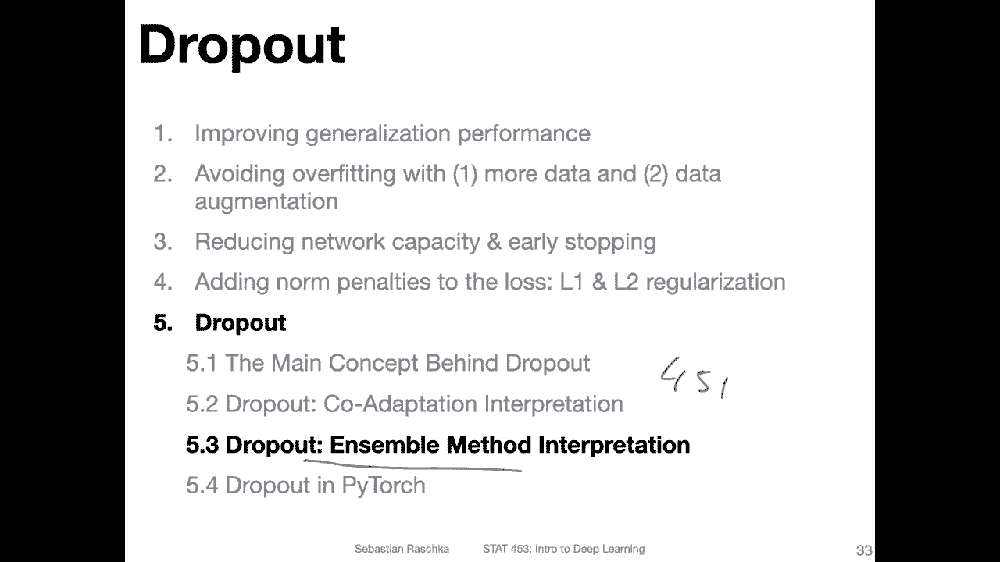
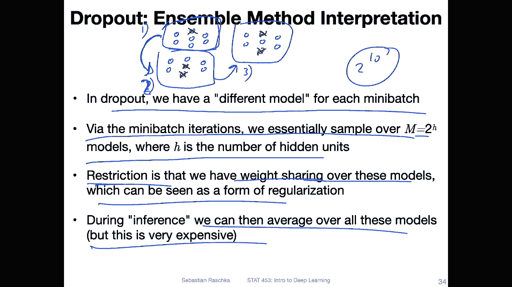
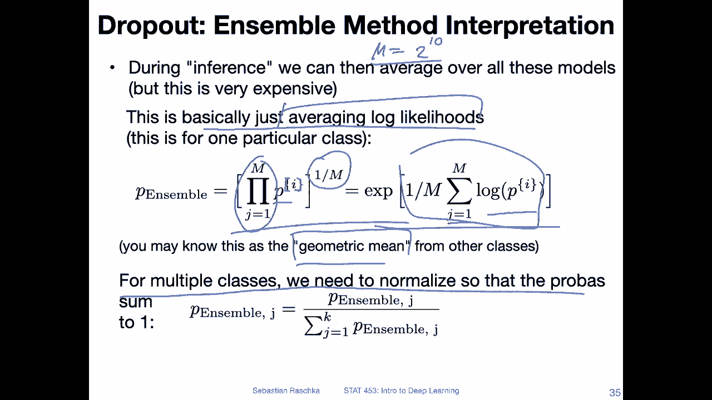
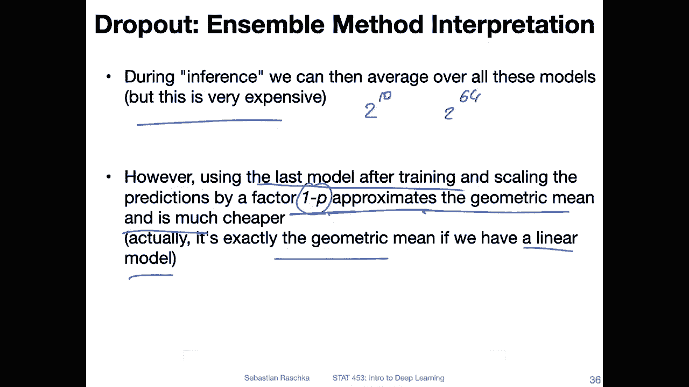

# 79：L10.5.3 - (选修) Dropout 的集成方法解释 🧠

在本节课中，我们将要学习 Dropout 技术为何有效的另一种解释。我们将从集成方法的角度来理解 Dropout，并探讨它如何通过近似模型集成来提升神经网络的性能。

---

上一节我们介绍了 Dropout 的基本概念，本节中我们来看看 Dropout 与集成方法之间的联系。

集成方法的核心思想是组合多个模型，并对它们的预测结果进行平均。直观地理解，这就像在做重要决策时咨询多位专家，而非仅依赖一位专家的意见。通常，综合多位专家的共识会比单一个人的意见更可靠。

以下是集成方法的几个常见例子：
*   多数投票
*   Bagging
*   随机森林
*   Boosting

然而，在深度学习中，我们通常专注于训练单个模型，因为训练多个模型的成本非常高昂。

---

那么，为什么可以将 Dropout 视为一种集成方法呢？

在 Dropout 的训练过程中，每个前向传播都会随机丢弃一部分神经元。这意味着每个小批量数据所“看到”的神经网络结构都略有不同。

从本质上讲，Dropout 可以被看作是在采样大量不同的子网络模型。对于一个具有 **H** 个隐藏单元的层，可能的子网络组合数量高达 **2^H** 个。因此，Dropout 可以被视为一种模型集成。

但这种集成有一个关键限制：时间维度。我们并非同时并行地使用所有这些子网络，而是在训练循环中依次使用它们。第一个小批量使用一个子网络，更新权重后，下一个小批量使用另一个子网络，并基于更新后的权重继续训练。

这种限制可以看作是一种权重共享机制。不同的子网络在训练过程中共享并迭代更新同一组权重参数。这种权重共享本身也是一种正则化约束，为模型添加了额外的信息。

---

现在，让我们进行一个思想实验。假设在模型训练完成后，我们真的为推理阶段创建了所有 **M** 个可能的子网络模型。

为了结合这些模型的预测，一个简单的方法是平均它们的输出。对于二分类问题，这相当于计算所有模型预测似然的几何平均值。

**公式表示如下：**
对于测试数据点 **i**，其综合概率 **P_i** 可以计算为所有 **M** 个模型预测概率乘积的 **1/M** 次方：
`P_i = (∏_{m=1}^{M} p_m)^{1/M}`

取对数后，等价于对对数似然求算术平均：
`log(P_i) = (1/M) * Σ_{m=1}^{M} log(p_m)`

对于多分类问题，我们还需要对结果进行归一化，使得所有类别的概率之和为 1，然后取概率最高的类别作为预测标签。

---

然而，上述方法在实际中并不可行。即使对于一个只有 10 个隐藏单元的层，也需要处理 **2^10** 个模型，计算成本过高。

那么，我们如何解决这个问题呢？

实际上，我们之前讨论的标准 Dropout 技术已经近似地计算了这个几何平均。在训练完成后，我们在测试阶段对神经元的激活值乘以缩放因子 **1/(1-p)**（其中 **p** 是丢弃概率）。这个操作正是对集成模型中几何平均的一种近似。

根据原始的 Dropout 论文论证，对于一个线性模型，这种缩放操作得到的结果与计算所有子网络几何平均的结果是精确等价的。因此，Dropout 可以被解释为一种高效且计算可行的模型集成近似方法。

---

本节课中我们一起学习了 Dropout 的集成方法解释。我们了解到 Dropout 可以被视为在训练过程中采样大量子网络，并通过权重共享机制进行近似集成。在推理阶段，通过对激活值进行缩放，我们能够近似地获得这些子网络预测的几何平均，从而以较低的计算成本获得了集成方法带来的鲁棒性提升。这就是 Dropout 为何能够有效防止过拟合、提升模型泛化能力的一种理论解释。