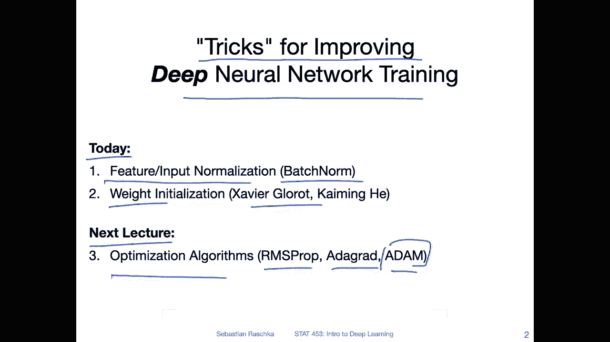
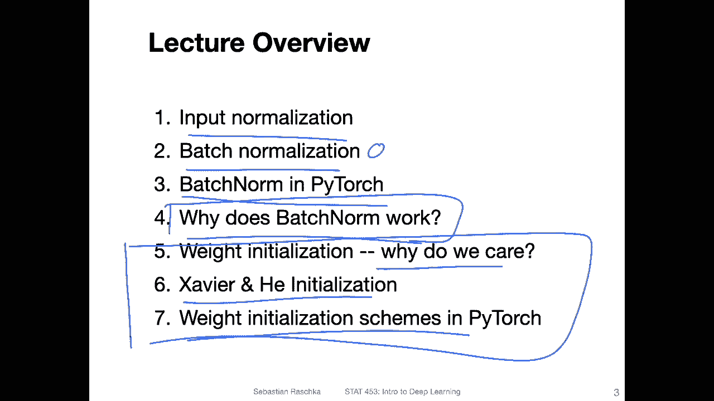

# 81：L11.0 - 输入归一化与权重初始化 🧠

在本节课中，我们将学习如何通过输入归一化和权重初始化技术来改善深度神经网络的训练效果与泛化性能。首先，我们会介绍输入归一化的基本概念，然后深入探讨批量归一化（Batch Normalization）的原理与实现。接着，我们将讨论不同的权重初始化策略，并解释它们为何在实践中至关重要。

## 输入归一化 📊

上一节我们概述了本节课的主要内容，现在让我们首先看看输入归一化。输入归一化是一种预处理技术，旨在将输入数据调整到相似的尺度范围内。

以下是进行输入归一化的常见步骤：

1.  计算训练数据集中每个特征维度（例如，图像中的每个像素位置）的均值。
2.  计算训练数据集中每个特征维度的标准差。
3.  使用以下公式对每个数据样本进行归一化：
    `x_normalized = (x - mean) / std`

这种处理有助于加速训练过程的收敛，因为优化算法（如梯度下降）在不同尺度特征上的更新步长会更加均衡。

## 批量归一化（Batch Norm）⚙️

了解了基础的输入归一化后，本节中我们来看看一种更强大的技术——批量归一化。批量归一化不仅对输入层有效，更常用于神经网络中的隐藏层，以稳定和加速深度网络的训练。

在PyTorch中，实现批量归一化非常简单。以下是一个示例代码片段：

```python
import torch.nn as nn

# 为具有100个输入特征的线性层添加批量归一化
batch_norm_layer = nn.BatchNorm1d(100)

# 在网络的前向传播中使用
# normalized_output = batch_norm_layer(linear_layer_output)
```

## 批量归一化为何有效？🤔

我们已经介绍了批量归一化的操作方法，现在我们来探讨它为何能提升训练效果。其背后的理论仍在讨论中，但主要有以下几种观点：

*   **减少内部协变量偏移**：该理论认为，网络中间层输入的分布会随着前面层参数的更新而不断变化，这给训练带来困难。批量归一化通过固定每层输入的均值和方差来缓解这个问题。
*   **平滑优化地形**：有研究表明，批量归一化能使损失函数对参数的变化更加平滑，从而允许使用更大的学习率，并使得优化过程更稳定。
*   **轻微的正则化效果**：由于批量归一化在训练时使用小批量的统计量（均值、方差）进行归一化，这为模型注入了一些噪声，可能起到了类似Dropout的正则化作用，有助于防止过拟合。



## 权重初始化策略 🔑

在讨论了归一化技术之后，我们转向另一个关键主题：权重初始化。恰当的权重初始化对于深度网络能否成功训练至关重要，它能帮助缓解梯度消失或爆炸等问题。

以下是两种广泛使用的权重初始化方法：

1.  **Xavier/Glorot 初始化**：这种方法旨在使每一层输出的方差尽可能保持一致。它通常与tanh或Sigmoid激活函数搭配使用。对于一个线性层，其公式为：
    `W ~ Uniform(-sqrt(6/(fan_in + fan_out)), sqrt(6/(fan_in + fan_out)))`
    其中 `fan_in` 和 `fan_out` 分别是该层的输入和输出单元数。

2.  **Kaiming/He 初始化**：这种方法专门为ReLU及其变体（如Leaky ReLU）激活函数设计。它通过考虑ReLU激活函数的特性来调整方差。对于使用ReLU的网络，初始化公式为：
    `W ~ Normal(0, sqrt(2 / fan_in))`

在PyTorch中，我们可以方便地应用这些初始化：

```python
import torch.nn as nn
import torch.nn.init as init

def weights_init(m):
    if isinstance(m, nn.Linear):
        # 应用 Xavier 初始化
        init.xavier_uniform_(m.weight)
        # 或应用 Kaiming 初始化
        # init.kaiming_uniform_(m.weight, mode='fan_in', nonlinearity='relu')
        if m.bias is not None:
            init.constant_(m.bias, 0)

# 将初始化函数应用到模型
model.apply(weights_init)
```

## 总结 📝



本节课中，我们一起学习了改善神经网络训练的两组重要技术。首先，我们探讨了输入归一化及其进阶版——批量归一化，了解了它们的操作方式、在PyTorch中的实现以及可能的工作原理。随后，我们讨论了权重初始化的必要性，并介绍了Xavier和Kaiming这两种针对不同激活函数的初始化策略及其代码实现。掌握这些技巧将帮助你更有效地训练深度神经网络。在下一讲中，我们将继续学习优化算法来进一步提升梯度下降的学习过程。