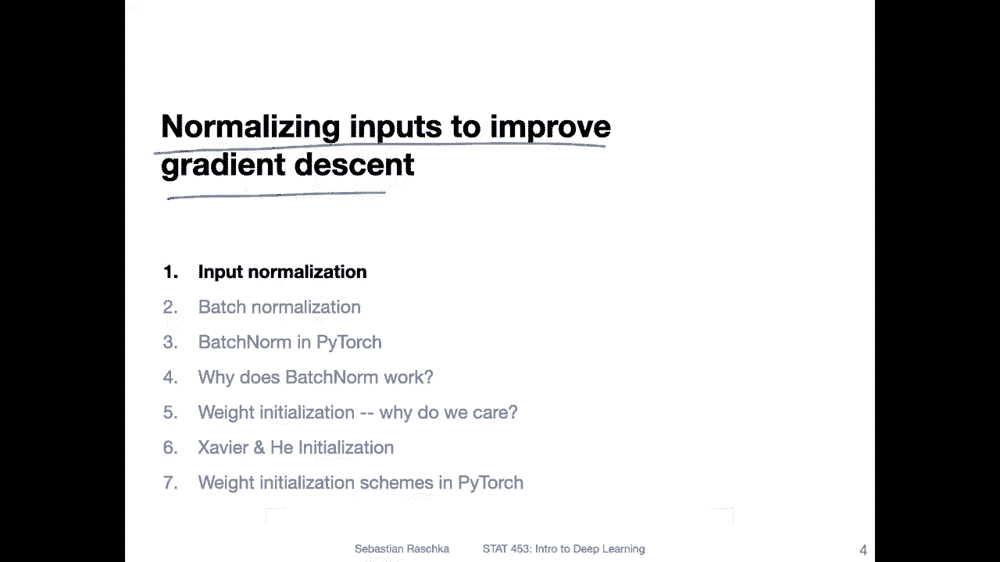
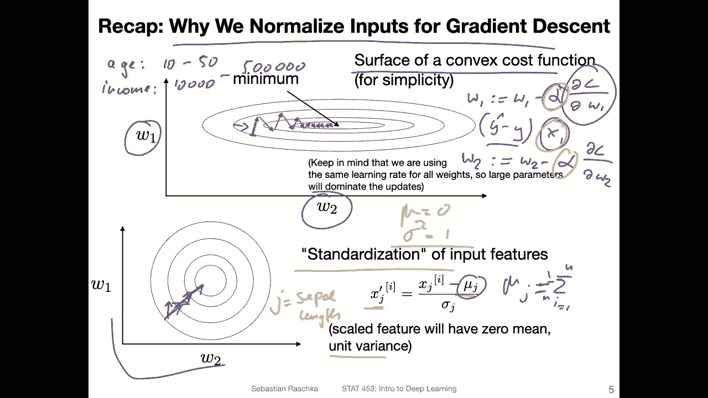
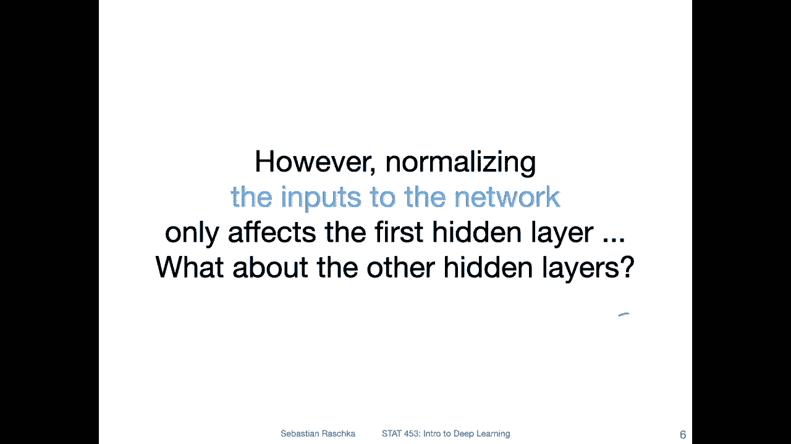
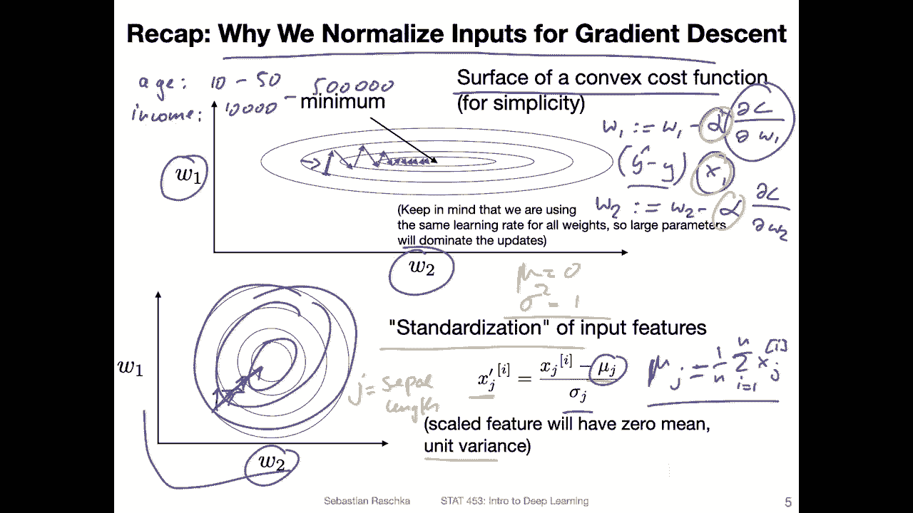
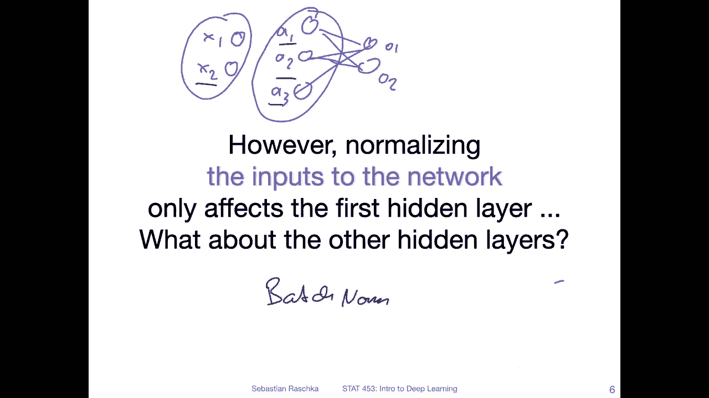
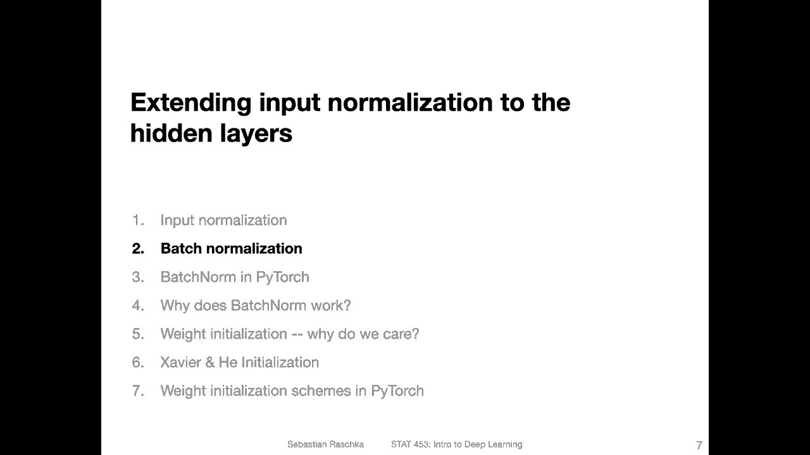

# 82：L11.1 - 输入规范化 📊

在本节课中，我们将学习输入规范化的概念，了解它如何帮助改善梯度下降算法的性能，并简要介绍其在深度神经网络中的应用背景。

---

## 为什么需要规范化输入？

上一节我们介绍了梯度下降的基本原理，本节中我们来看看为什么输入特征的尺度差异会影响其性能。

假设我们有一个简单的凸损失函数曲面。在深度神经网络中，损失函数通常并非凸函数，但为了简化说明，我们以此为例。如果我们使用梯度下降法，更新权重的公式通常涉及输入特征本身。例如，权重更新公式为：

`w = w - α * ∂L/∂w`

其中，`∂L/∂w` 的计算通常包含输入特征 `x`。如果输入特征处于不同的尺度（例如，年龄范围是10-50岁，而收入范围是10,000-500,000美元），那么为所有权重找到一个合适的学习率 `α` 将变得非常困难。尺度大的特征可能需要更小的学习率，否则优化过程容易在某个维度上“超调”，导致训练不稳定，出现锯齿状的优化路径。

此外，大多数优化算法在输入特征以零为中心且数值较小时表现更好。大数值还可能引发计算上的不稳定性问题。

---

## 标准化：Z-Score 方法

为了解决上述问题，实践中一个常用且有效的方法是 **Z-Score 标准化**（或称标准化）。此方法旨在使数据具备标准正态分布的特性，即均值为0，方差为1（标准差为1）。需要注意的是，如果原始数据本身不服从正态分布，此方法不会改变其分布形状，只会调整其均值和尺度。

以下是标准化的具体操作步骤，针对每个特征单独进行：

对于一个特定的数据点 `i` 的某个特征 `j`（例如，鸢尾花数据集中第 `i` 朵花的“花萼长度”），我们按以下公式进行转换：

`x_norm[i][j] = (x[i][j] - μ[j]) / σ[j]`

其中：
*   `μ[j]` 是特征 `j` 在所有样本上的均值。
*   `σ[j]` 是特征 `j` 在所有样本上的标准差。

通过这种处理，我们通常能获得一个更对称、行为更良好的损失曲面，从而有助于找到更优的学习率，并使训练过程更加稳定。

---

## 从输入到隐藏层激活值

我们刚刚讨论了如何标准化神经网络的输入层特征。现在，让我们将视角转向网络的内部。

考虑一个简单的深度神经网络，它具有输入 `x1`、`x2`，隐藏层激活值 `a1`、`a2`、`a3`，以及输出 `o1`、`o2`。对于后续的层（例如输出层）而言，前一层的激活值 `a1`、`a2`、`a3` 就相当于它的“输入”。

因此，一个自然的想法是：**标准化隐藏层的激活值** 可能同样有益，因为这可以确保每一层接收到的输入都处于相对稳定和规范的尺度上，从而缓解深度网络训练中的“内部协变量偏移”等问题。

---

## 预告：批标准化 (Batch Normalization)

在下一节视频中，我们将深入探讨一种专门用于标准化隐藏层激活值的技术——**批标准化 (Batch Normalization)**。

你可以将其视为隐藏层激活值标准化的一个变体，但它引入了一个关键的“转折”：它包含了可学习的参数（缩放参数 `γ` 和平移参数 `β`），使得网络在标准化的同时，仍能保留原有的表达能力。这将是我们接下来要学习的重点内容。

---

本节课中我们一起学习了输入规范化的重要性及其实现方法（Z-Score标准化），并理解了将规范化思想延伸到神经网络隐藏层的动机，为学习更高级的规范化技术（如批标准化）奠定了基础。