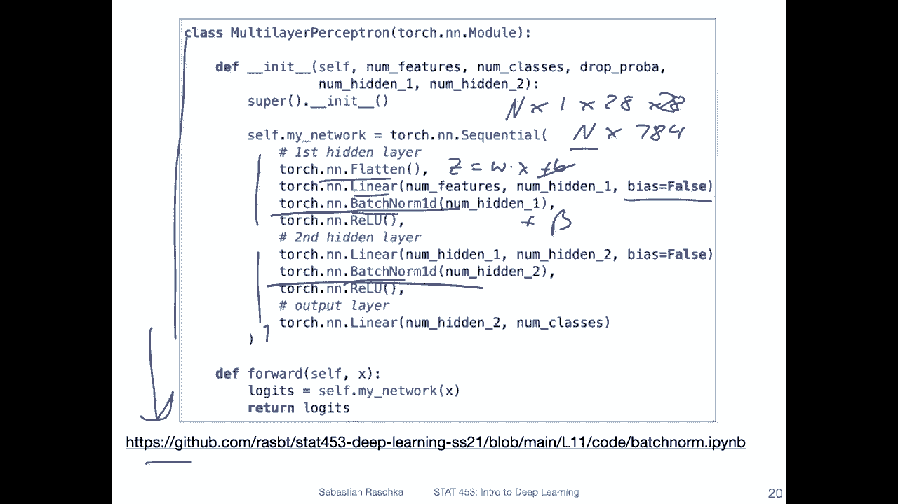
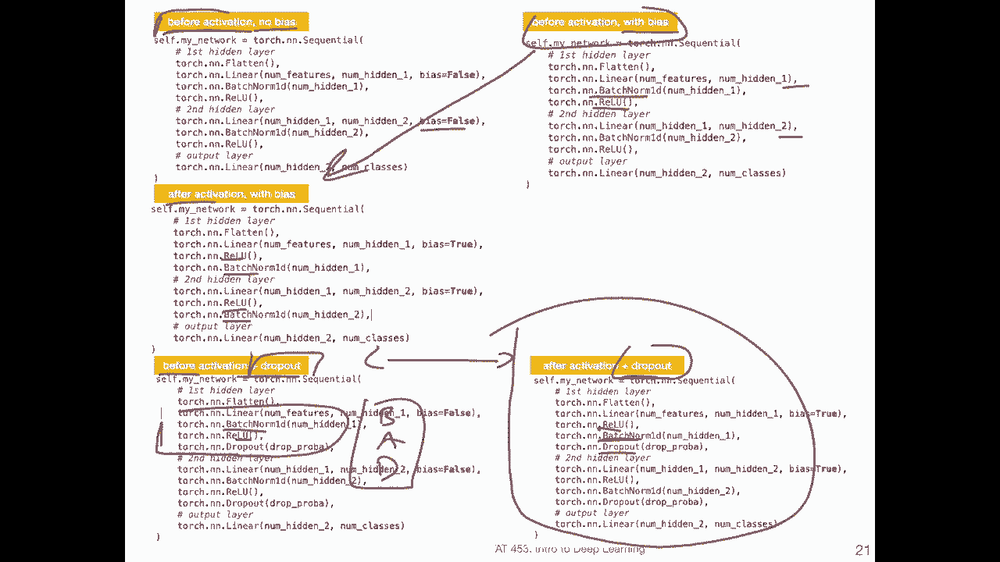
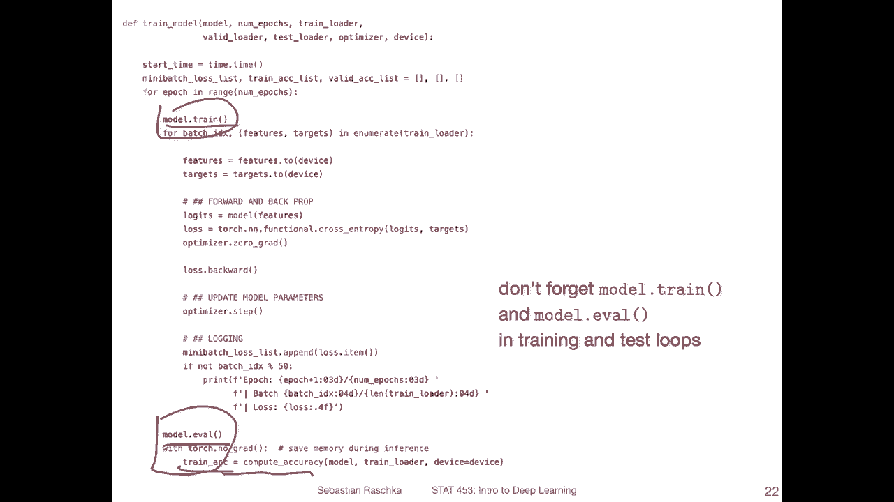
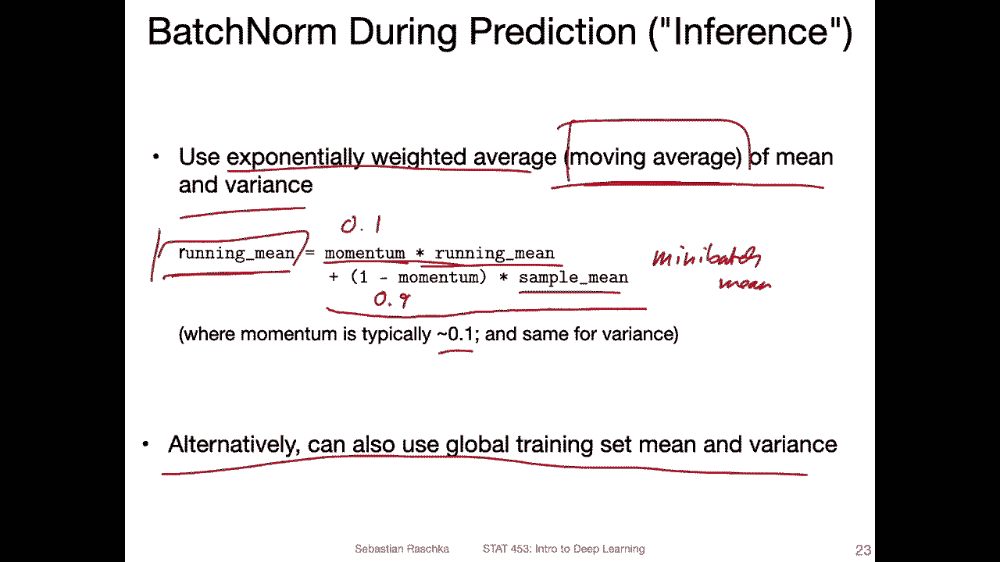
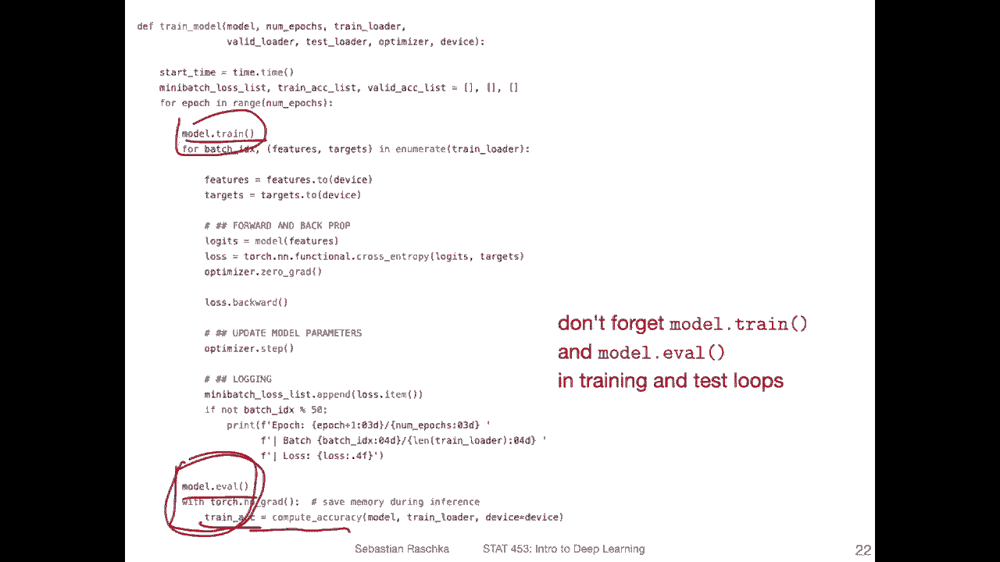
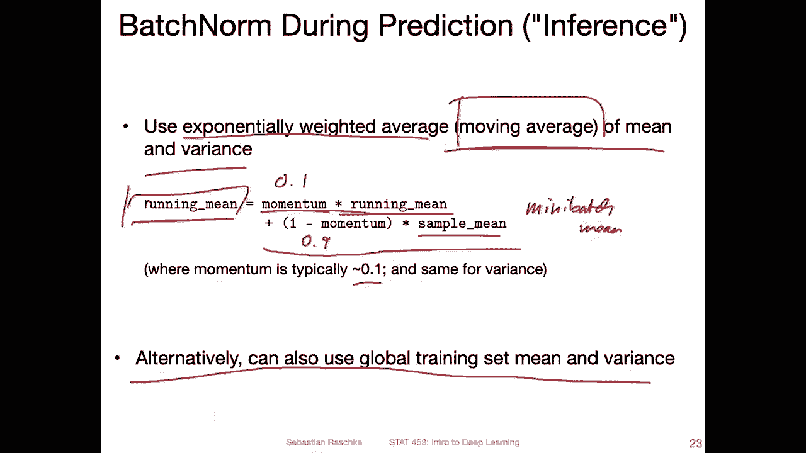
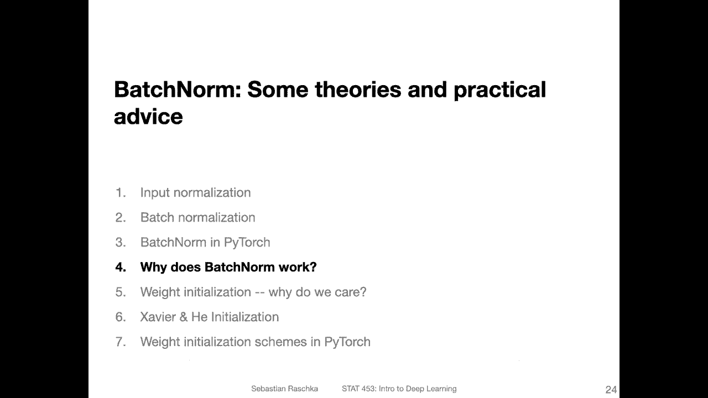

# 84：L11.3 - PyTorch 中的 BatchNorm 🧠 📚

在本节课中，我们将学习如何在 PyTorch 中实际使用批归一化。我们还将简要讨论批归一化在模型推理阶段的行为，因为训练时我们使用小批量数据，但在预测时可能只有单个数据点。


---

## 🛠️ 在 PyTorch 中使用 BatchNorm

上一节我们介绍了批归一化的概念，本节中我们来看看如何在 PyTorch 中实现它。

我使用了上周实现 Dropout 的代码，并稍作修改：移除了 Dropout 并添加了批归一化层。这里将复用相同的代码，不深入讨论细节，你可以在 Giub 上找到完整代码。

以下是主要代码，即我们需要修改的多层感知机。

```python
# 示例：在 PyTorch 中添加 BatchNorm1d 层
import torch.nn as nn

class MultilayerPerceptron(nn.Module):
    def __init__(self):
        super().__init__()
        self.flatten = nn.Flatten()
        self.hidden_1 = nn.Linear(784, 128)
        self.bn1 = nn.BatchNorm1d(128)  # 在第一个线性层后添加 BatchNorm
        self.hidden_2 = nn.Linear(128, 256)
        self.bn2 = nn.BatchNorm1d(256)  # 在第二个线性层后添加 BatchNorm
        self.out = nn.Linear(256, 10)

    def forward(self, x):
        x = self.flatten(x)
        x = self.hidden_1(x)
        x = self.bn1(x)
        x = torch.relu(x)
        x = self.hidden_2(x)
        x = self.bn2(x)
        x = torch.relu(x)
        x = self.out(x)
        return x
```

我们有两个隐藏层和一个输出层。首先，我使用了 `Flatten`，因为我处理的是 MNIST 数据，其维度为 `n × 1 × 28 × 28`。`Flatten` 会将其展平为 `n × 784` 的向量，其中 `n` 是批次大小，然后全连接线性层才能正常工作。

我在线性层之后插入了 `BatchNorm1d`。这里的 `1d` 可能会令人困惑，这是因为卷积网络有稍有不同的版本，称为 `BatchNorm2d`。`BatchNorm1d` 就是我们之前视频中讨论的标准批归一化，`1d` 只是为了区分它们。

我在第二个隐藏层也做了同样的事情。注意，我将线性层的偏置设置为 `False`，因为如果我们在计算净输入时使用 `权重 × 特征 + 偏置`，而批归一化中又添加了可学习的 β 参数，那么偏置就变得冗余了。但保留它也没有问题，我测试过，在这个案例中没有发现差异。

这就是在 PyTorch 中使用批归一化的方式。完整的代码示例可以在链接中找到，但这真的没什么可多说的，因为它只是这里的两行代码。



---

## 🔬 实验：BatchNorm 的位置与 Dropout

上一节我们看到了基础用法，本节中我们通过一些实验来探索不同设置的影响。

我运行了一些实验。在我刚刚展示的代码中，默认启用了偏置，并且将批归一化放在激活函数之前，这通常是原始论文中提出的方式。

但如今，人们更常见的是将其放在激活函数之后。我将在下一个视频中详细讨论这一点。这里，当我运行多层感知机代码时，我发现在激活函数之前或之后使用批归一化，性能上没有注意到任何差异。

我还运行了结合 Dropout 的实验。在这种情况下，除了网络不再过拟合之外，我也没有注意到太大差异。与不使用 Dropout 相比，两种 Dropout 情况下的测试准确率都略低，可能是我使用了太多的 Dropout。但至少可以看到不再有过拟合。

以下是具体的比较：
*   在激活函数前使用 BatchNorm，然后使用 Dropout。
*   在激活函数后使用 BatchNorm，然后使用 Dropout。

在实践中，我也没有注意到任何差异。如今，如果使用 Dropout，更常见的建议是将 BatchNorm 放在激活函数之后。一个有趣的记忆方法是：如果你有 BatchNorm -> 激活函数 -> Dropout，你可以称之为“BAD”（BatchNorm, Activation, Dropout 的首字母），而将 BatchNorm 放在激活函数之后可能“更好”。这通常在卷积网络等架构中可能带来微小差异，因此这是一个可以尝试的超参数。

---

## 🧪 训练与推理模式

现在，让我们看看训练函数。这与上周在 Dropout 中使用的训练函数完全相同，但它再次强调了 `train()` 和 `eval()` 模式的重要性。

在训练期间，我们将模型设置为训练模式，因为批归一化层会在此模式下计算**运行均值**和**运行方差**。我将在下一张幻灯片中讨论这一点。



```python
# 训练循环示例
model.train()  # 设置为训练模式
for epoch in range(num_epochs):
    # ... 训练步骤 ...
    # BatchNorm 会在此计算并更新运行统计量

# 评估循环示例
model.eval()  # 设置为评估模式
with torch.no_grad():
    # ... 评估步骤 ...
    # BatchNorm 将使用训练阶段计算好的运行统计量，而不是当前批次的统计量
```

在评估模式下，我们模拟的是推理场景。在推理时，你可能只有一个数据点。例如，谷歌搜索引擎可能只有一个用户进行查询，而你的网络使用了批归一化，你需要进行归一化，但你并没有一个批次的用户数据。那么，我们如何处理这种情况呢？

---

## 📊 推理时的处理方式

有两种方式来处理推理时的场景。



简单的方法是使用**整个训练集的全局均值和方差**。你可以在进行输入标准化时计算这些特征均值和方差。但这在实践中并不非常常见。

更常见的方法是使用**指数加权平均**或**移动平均**。在实践中，人们通常在训练期间保持均值和方差的移动平均值，也可以称之为运行均值。

它的计算方式是通过一个动量项，通常是一个像 0.1 这样的小值。

**运行均值更新公式**：
`running_mean = momentum * previous_running_mean + (1 - momentum) * current_batch_mean`

**运行方差更新公式**：
`running_var = momentum * previous_running_var + (1 - momentum) * current_batch_var`

这里本质上就是一个移动平均或运行均值。你对方差也做同样的事情，并保存这些值。在推理时，你就使用这些值来缩放你要进行预测的数据点。

你不需要手动做这件事。顺便说一下，通过使用 `model.eval()`，这会自动发生。以上只是对底层发生事情的解释。

这就是批归一化在 PyTorch 中的工作方式。

---





## 📝 总结



本节课中我们一起学习了：
1.  **如何在 PyTorch 中实现 BatchNorm**：使用 `nn.BatchNorm1d` 层，通常将其插入在线性层之后、激活函数之前或之后。
2.  **BatchNorm 与 Dropout 的配合**：实验表明，将 BatchNorm 置于激活函数之后并与 Dropout 结合是更常见的做法，可作为超参数进行尝试。
3.  **训练与推理模式的区别**：必须使用 `model.train()` 和 `model.eval()` 来正确切换模式，以控制 BatchNorm 是计算批次统计量还是使用运行统计量。
4.  **推理时的处理机制**：BatchNorm 在训练阶段通过移动平均累积运行均值和方差，并在推理阶段使用这些固定统计量对单个数据点进行归一化，这个过程在调用 `eval()` 时会自动处理。



在下一个视频中，我将简要概述试图解释批归一化如何工作的各类文献。