# 85：L11.4 - 为什么 BatchNorm 有效 📚

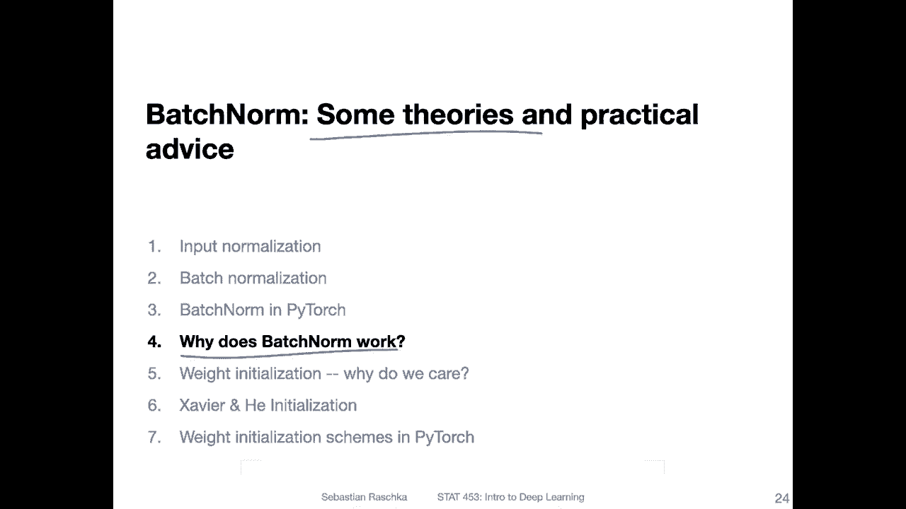

在本节课中，我们将探讨批标准化（Batch Normalization）为何能有效提升深度神经网络的训练效果。我们将回顾其提出的初衷，分析几种主流理论，并介绍一些相关的实证研究。

---

## 🧠 BatchNorm 为何有效：理论与证据

在之前的课程中，我们讨论了 BatchNorm 的工作原理。本节我们将探讨其为何有效。虽然无法给出确切的答案，但我们可以汇总一些理论和实证证据来支持某些观点。

### 内部协变量偏移理论

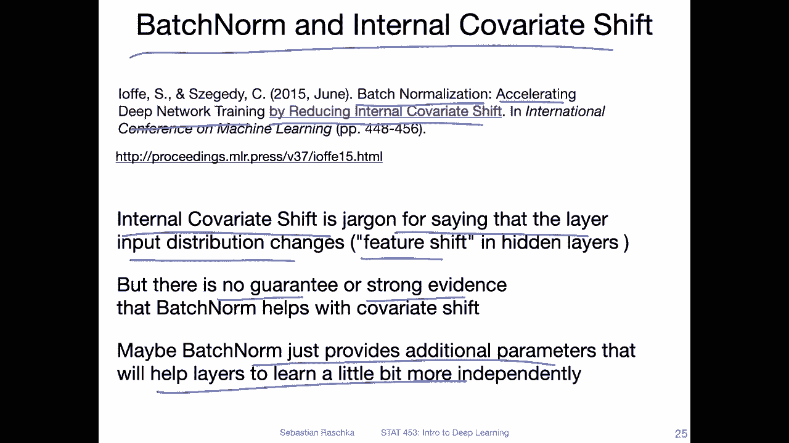

最初提出 BatchNorm 的论文提到了 **内部协变量偏移** 的概念。作者认为，BatchNorm 通过减少这种内部协变量偏移来加速训练。

**内部协变量偏移** 指的是网络中某一层的输入分布会随着训练过程而发生变化。简单来说，就是特征的分布在训练过程中发生了偏移。BatchNorm 通过对这些输入进行重新标准化，理论上可以防止这种偏移。

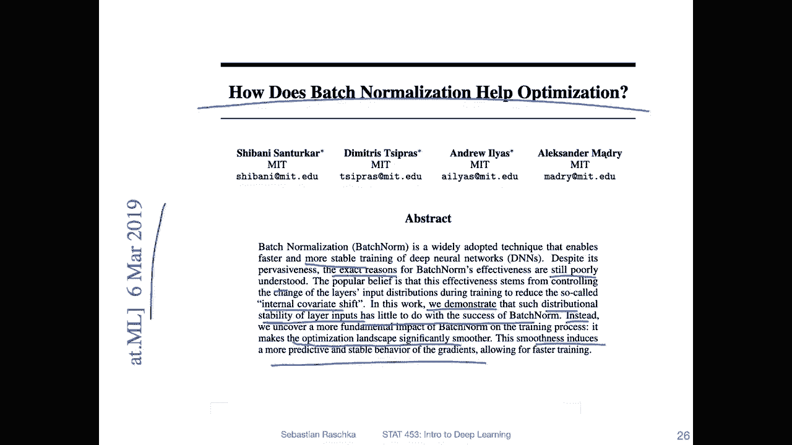

然而，这一理论并没有得到强有力的证据支持。后续有论文对这一观点提出了质疑。

### 层间解耦理论

另一种推测是，BatchNorm 使得网络各层之间的依赖性降低。在深度网络中，如果某一层（尤其是早期层）的输出出现问题，它会像多米诺骨牌一样影响后续所有层。BatchNorm 可能通过标准化每一层的输入，使得各层对前一层错误的鲁棒性增强，从而实现一定程度的解耦。

但这同样只是众多理论中的一种。

---

## 📄 关键研究：BatchNorm 如何帮助优化？

一篇2019年的论文《How Does Batch Normalization Help Optimization?》提供了新的见解。该论文指出，虽然 BatchNorm 有助于稳定训练，但其确切原因仍不明确。

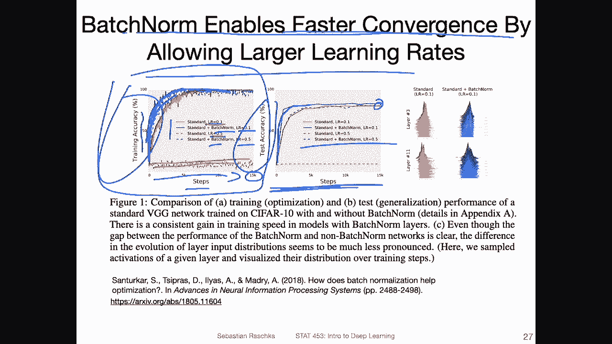

论文反驳了“减少内部协变量偏移”是其主要作用的观点。他们通过实验证明，即使人为引入分布偏移，带有 BatchNorm 的网络依然表现良好。

**该研究的主要发现是：BatchNorm 使得优化问题的损失曲面（loss landscape）变得更加平滑。** 这带来了两个好处：
1.  训练更加稳定。
2.  允许使用更大的学习率，从而可能实现更快的收敛。

**公式表示**： 平滑的损失曲面意味着梯度 `∇L` 的变化更稳定，减少了训练中的剧烈波动。

---

## 📊 实证观察：学习率与训练稳定性

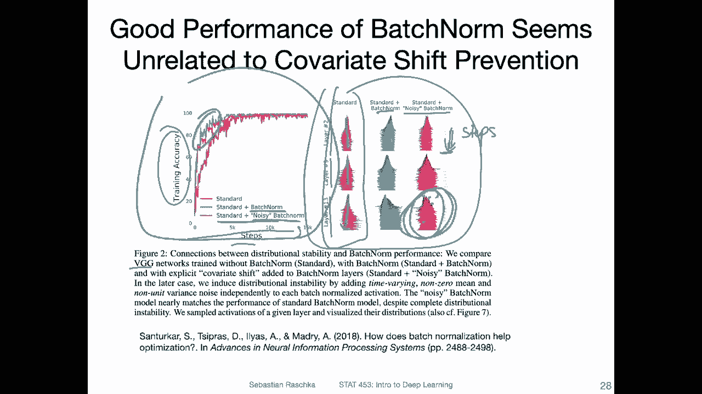

该论文通过实验展示了 BatchNorm 对训练的影响：

以下是其实验的关键发现：
*   **允许更大的学习率**： 在没有 BatchNorm 的标准网络中，过大的学习率（如0.5）会导致训练崩溃。而加入 BatchNorm 后，网络能够以相同的学习率稳定训练。
*   **加速收敛**： 在训练集上，使用 BatchNorm 的网络（无论学习率大小）达到相同精度所需的步骤更少，即收敛更快。
*   **提升测试性能**： 在测试集上，使用 BatchNorm 的网络最终性能通常更好或相当，并且训练过程更加稳定。

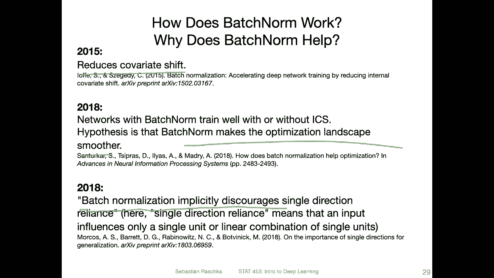

**核心结论**： BatchNorm 的主要优势可能不在于直接提升最终精度，而在于 **使训练过程更稳定、更鲁棒**，降低了超参数调优的难度。

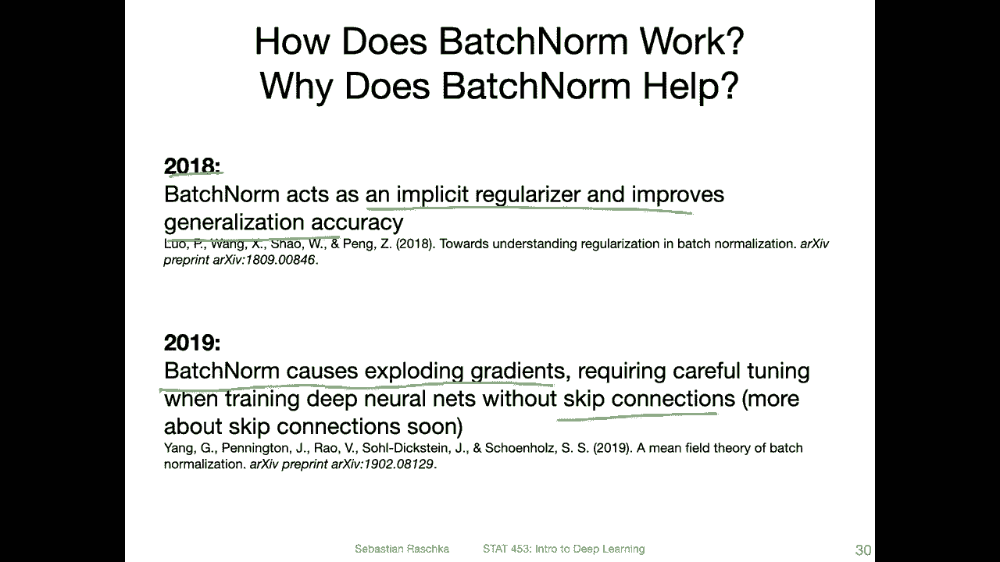

---

## 📚 其他相关理论与研究

关于 BatchNorm 为何有效，还有许多其他研究，以下按时间顺序简要列出：
*   **减少内部协变量偏移**： 原始论文理论。
*   **平滑优化曲面**： 上文详述的2019年论文观点。
*   **减少单方向依赖**： 有论文认为 BatchNorm 隐式地鼓励网络不过度依赖单个特征方向。
*   **隐式正则化**： 2018年的研究提出 BatchNorm 作为一种隐式正则化器，有助于提升泛化能力。
*   **导致梯度爆炸**： 也有论文指出，在某些架构（如带有跳跃连接的残差网络）中，BatchNorm 可能导致梯度爆炸问题。

---

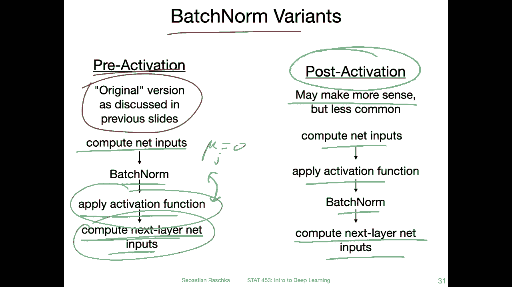

## ⚙️ 实践建议与技巧

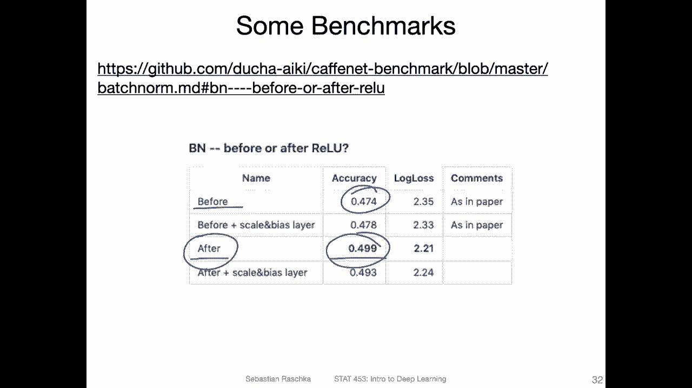

了解理论后，我们来看看如何在实践中更好地使用 BatchNorm。

### BatchNorm 的位置：激活函数之前还是之后？

原始论文将 BatchNorm 层放在 **线性变换之后，激活函数之前**。其流程为：
`计算净输入 Z -> BatchNorm -> 激活函数 -> 输出`

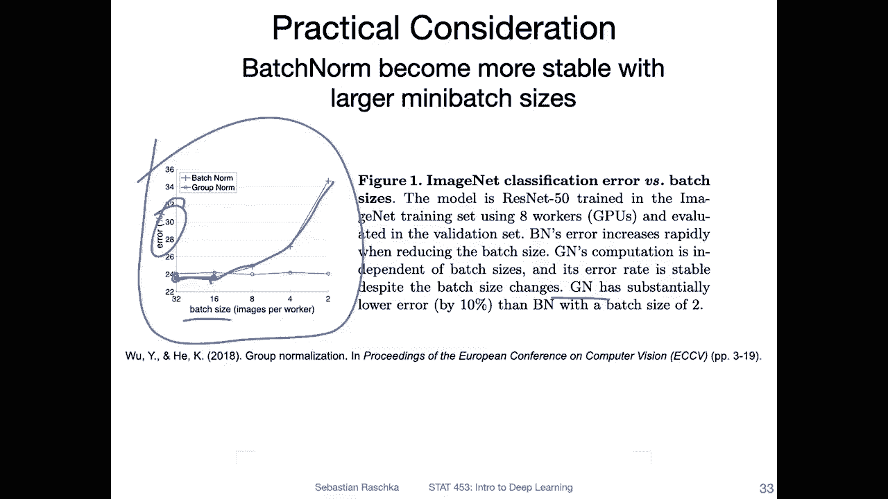

然而，也有实践将 BatchNorm 放在 **激活函数之后**。流程变为：
`计算净输入 Z -> 激活函数 -> BatchNorm -> 输出`

**代码示例对比**：
```python
# 原始顺序：BN -> Activation
z = layer(x)
z_bn = batch_norm(z)
a = activation(z_bn)

# 调整后顺序：Activation -> BN
z = layer(x)
a = activation(z)
a_bn = batch_norm(a)
```
**理由**： 如果激活函数（如 Sigmoid）会改变数据的分布（例如将均值从0变为0.5），那么将 BatchNorm 放在其后可以确保输入下一层的数据仍然是标准化的。一些实验表明，将 BatchNorm 置于激活函数之后可能带来轻微的性能提升。

### 批大小的影响

BatchNorm 的效果严重依赖于批大小。因为其计算依赖于当前批次的均值和方差统计量。

**核心建议**： 使用足够大的批大小（通常建议大于16，实践中32或64更常见）。当批大小过小（如2, 4, 8）时，估计的统计量噪声过大，会导致 BatchNorm 效果变差，甚至损害性能。

### 批大小为何常选2的幂次？

在实践中，我们经常看到批大小被设置为32、64、128等2的幂次方。这主要有两个原因：
1.  **硬件优化**： GPU 的并行计算单元（CUDA核心）数量通常是2的幂次方。使用2的幂次作为批大小可以更好地平衡工作负载，提高计算资源的利用率。
2.  **简化超参数搜索**： 将搜索空间限制在2的幂次方（如32, 64, 128, 256）而非连续值（如30, 35, 40），可以大大减少需要尝试的超参数组合数量，简化调优过程。

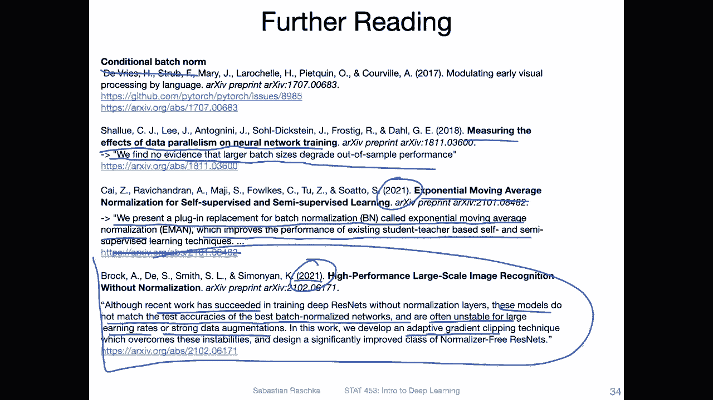

---

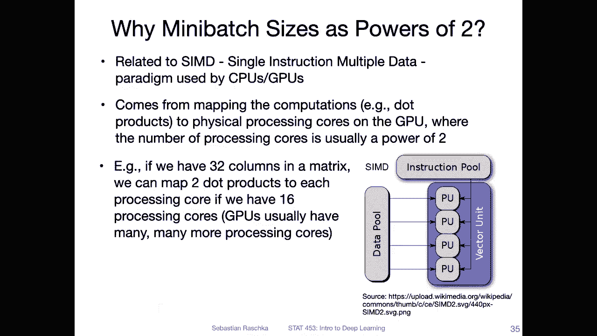

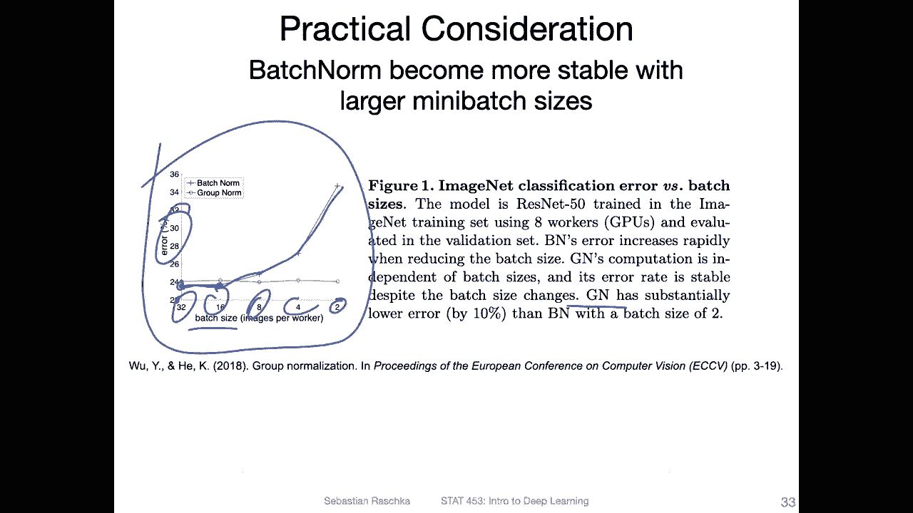

## 🔍 延伸阅读与前沿动态

如果你对 BatchNorm 及其替代方案感兴趣，以下是一些进阶阅读方向：
*   **条件批标准化**： 将类别信息融入 BatchNorm，为不同类别学习不同的缩放和偏移参数。
*   **大批次训练研究**： 探讨批大小对泛化性能的影响，有研究认为大批次并不必然损害性能。
*   **指数移动平均标准化**： 一种2021年提出的 BatchNorm 替代方案，旨在提升自监督和半监督学习的性能。
*   **无 BatchNorm 训练**： 2021年的研究通过**自适应梯度裁剪**技术，成功训练了不依赖 BatchNorm 且性能优异的深度网络，这为架构设计提供了新思路。

---

## 🎯 课程总结

本节课我们一起深入探讨了批标准化有效的可能原因。
*   我们首先回顾了 **内部协变量偏移** 这一原始理论，但也了解到后续研究对其提出了质疑。
*   关键的研究指出，BatchNorm 的主要作用可能是 **平滑优化问题的损失曲面**，从而稳定训练、允许使用更大的学习率。
*   在实践部分，我们讨论了 BatchNorm 的放置顺序、**批大小的重要性**（建议使用大于16的批大小），以及选择2的幂次作为批大小的实用原因。
*   最后，我们列举了一些前沿研究方向，为你进一步探索提供了线索。

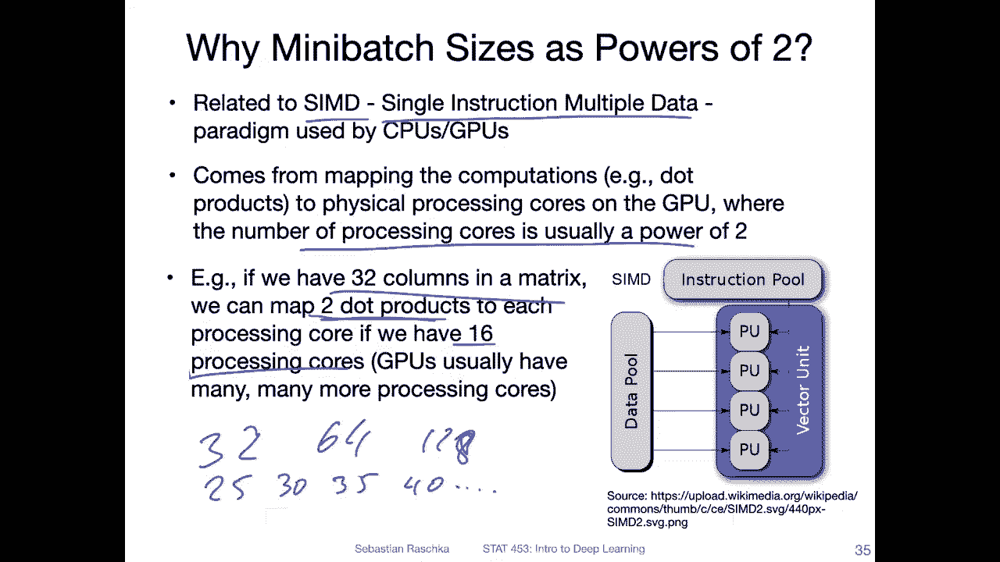

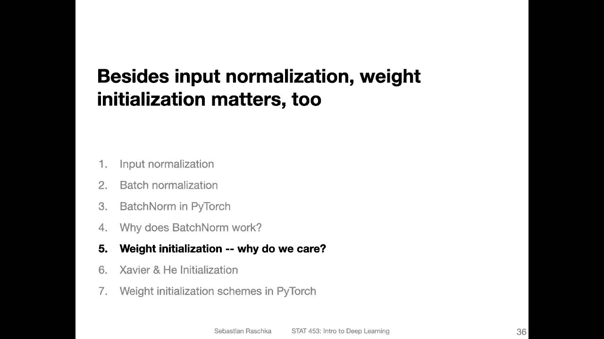

理解这些理论有助于我们更明智地在实际项目中应用和调整 BatchNorm，从而构建更稳定、高效的深度学习模型。