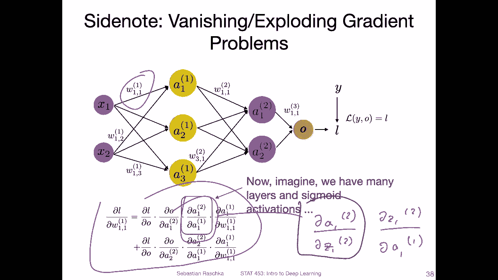
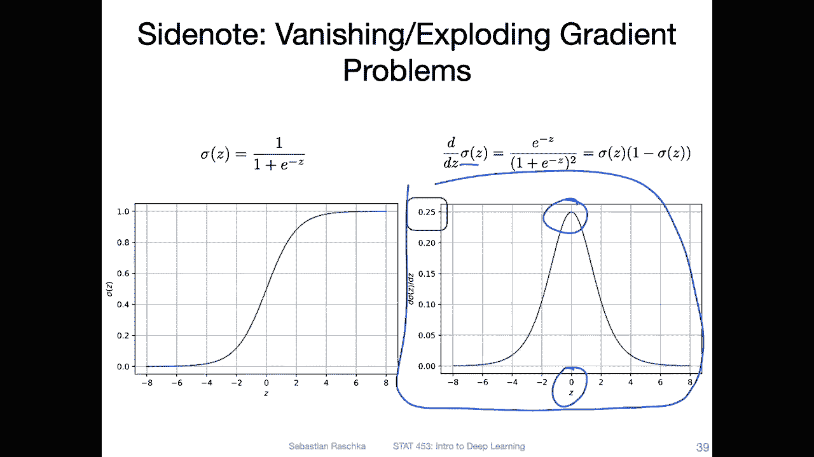
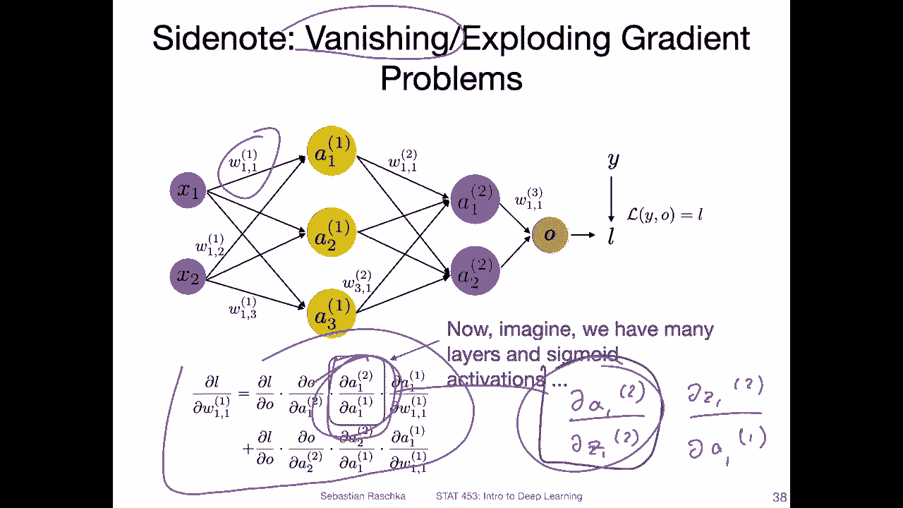
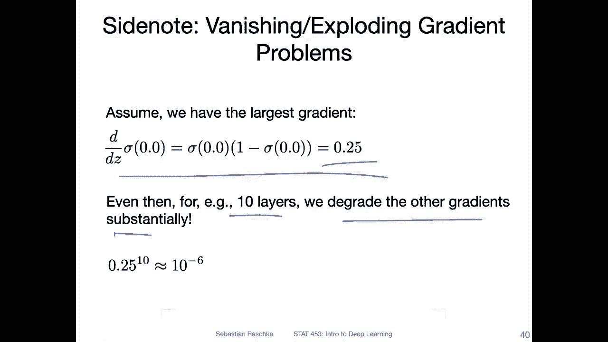
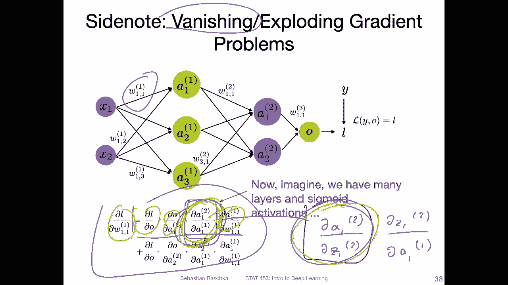
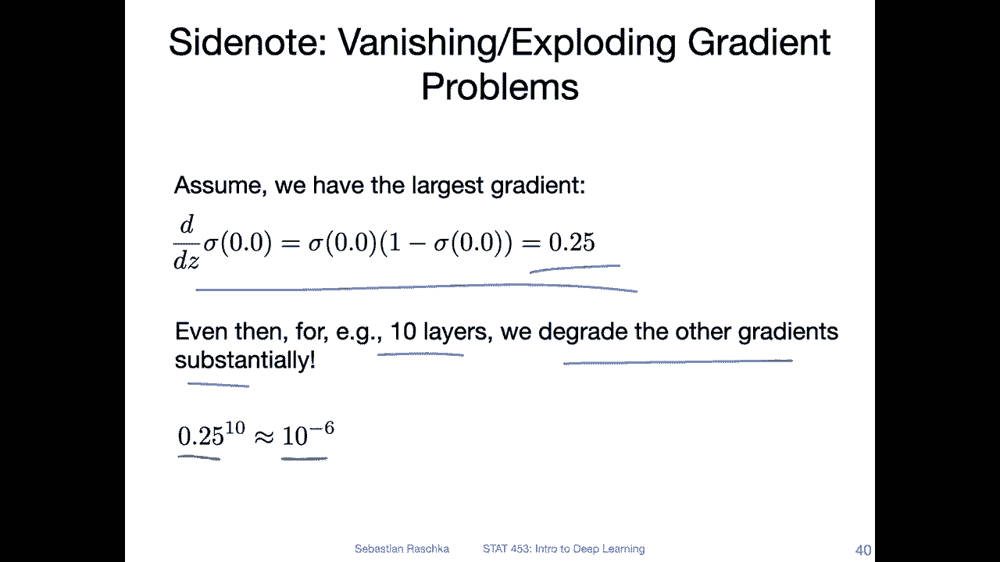
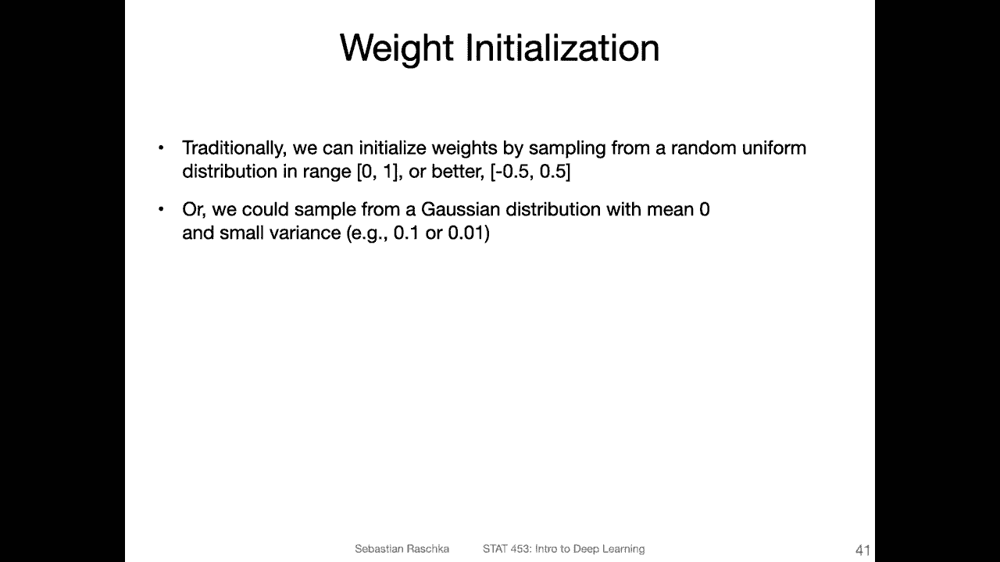
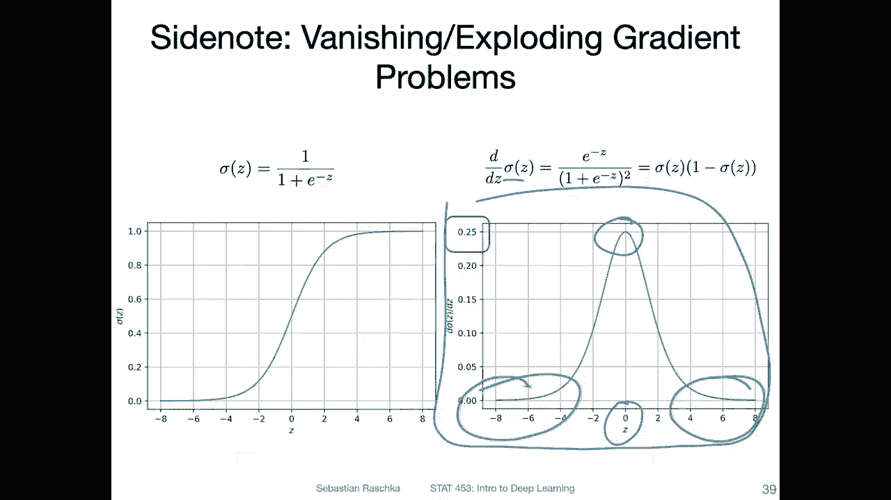
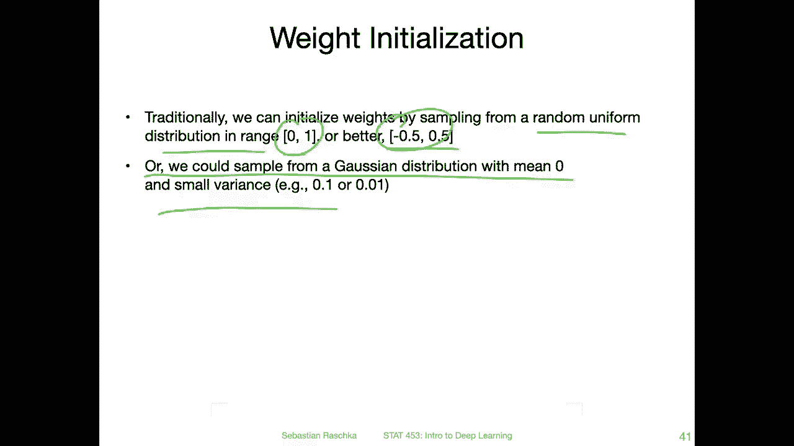

# 86：L11.5 - 权重初始化：为何重要？ 🎯

在本节课中，我们将要学习神经网络中权重初始化的重要性。我们将探讨不恰当的初始化如何导致梯度消失等问题，并简要介绍两种常见的初始化方法及其背后的动机。

---

上一节我们讨论了输入归一化的重要性。本节中，我们来看看权重初始化为何同样关键。除了打破多层感知机中的对称性，我们还需要确保权重处于一个合适的尺度上。

## 打破对称性与控制尺度 🔄

我们之前提到，将权重初始化为小的随机数，是为了打破多层感知机中的对称性。除此之外，保持权重相对较小也是另一个需要考虑的因素。这与之前视频中提到的输入归一化概念有关。

为了解释和说明这一点，让我们再次思考多层感知机中更新某个特定权重的过程。

以下是从之前幻灯片中复制的公式，这里没有新内容，但希望大家重点关注激活函数对其输入的导数部分：

`∂a / ∂z`

我们可以将其展开。关键部分在于计算激活函数相对于其输入的导数。例如，如果我们使用逻辑Sigmoid函数，其导数在其输入为0时最大，但最大值也仅为0.25。

`σ'(z) = σ(z) * (1 - σ(z))`， 当 `z=0` 时，`σ'(0) = 0.25`

## 梯度消失问题 📉

在反向传播中，我们会多次乘以这个小于1的导数项。如果我们有很多层，例如10层，并且假设这是逻辑Sigmoid函数能得到的最大梯度，那么我们将与一个最大值仅为0.25的值相乘多次。

实际上，对于10层网络，梯度值可能会衰减到大约10的-6次方。梯度将变得非常小，以至于网络可能无法有效学习。

`梯度衰减 ≈ (0.25)^10 ≈ 9.5e-7`

因此，通常建议使用其他类型的激活函数，或者通过调整学习率来调节。这也是为什么将权重初始化为以0为中心很重要的一个动机。例如，如果使用逻辑Sigmoid函数，至少能获得最大的梯度。

## 初始化策略建议 💡

如果输入或净输入值很小或很大，梯度甚至会变得更小。因此，我们希望权重初始化后，输入能大致集中在0附近。

以下是几种初始化策略：
*   可以从一个随机均匀分布中初始化权重，例如范围在 `[-0.5, 0.5]` 或更小的 `[-0.05, 0.05]`。
*   也可以选择正数范围。对于ReLU函数，这可能不那么重要。然而，如果输入同时包含正负值，使用正负范围能提供更多组合可能。
*   另一种非常常见的方法是，从一个均值为0、方差较小的随机高斯分布中初始化权重。

这些只是过去常用的一些建议。如今，更常见的做法是使用Xavier初始化或Kaiming He初始化等方法。我们将在下一个视频中讨论这些内容。

---

本节课中，我们一起学习了权重初始化的重要性。我们了解到，不恰当的初始化（尤其是使用Sigmoid等激活函数时）可能导致梯度消失问题，从而阻碍深层网络的学习。因此，选择以0为中心的小随机值进行初始化是一个良好的起点。现代深度学习框架通常提供了更先进的初始化方法，帮助我们更有效地训练神经网络。