# 87：L11.6 - Xavier Glorot 与 Kaiming He 初始化 🧠

在本节课中，我们将学习深度神经网络中两种最常用的权重初始化方案：Xavier Glorot 初始化和 Kaiming He 初始化。我们将了解它们的基本原理、适用场景以及如何通过简单的数学公式实现它们。

---

## Xavier Glorot 初始化 🔄

上一节我们介绍了权重初始化的重要性，本节中我们来看看第一种常用方案：Xavier Glorot 初始化。这种方法有时简称为 Xavier 初始化或 Glorot 初始化，名称来源于提出该方法的论文的第一作者。

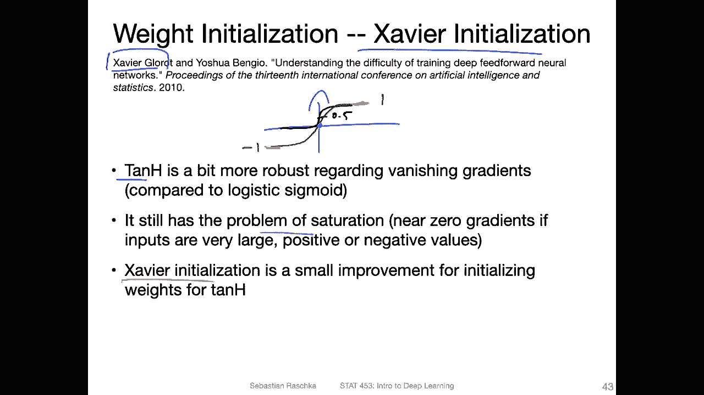

Xavier 初始化通常与双曲正切激活函数配合使用。双曲正切函数是一种类似逻辑 S 型函数的 S 型激活函数，但其输出以 0 为中心。

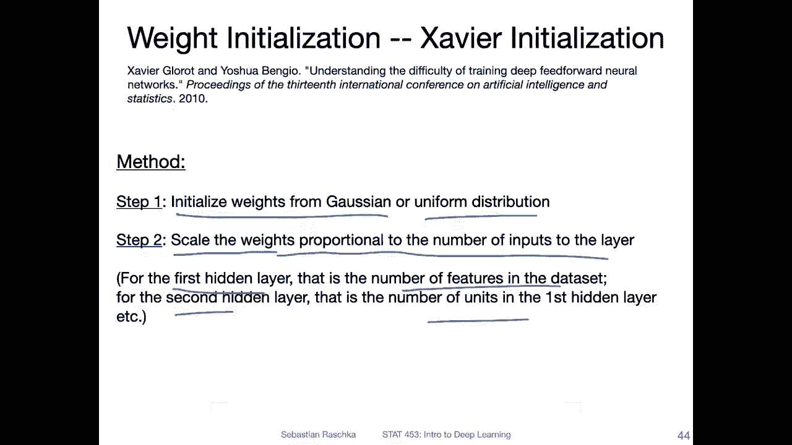

逻辑 S 型函数在输入为 0 时输出 0.5，而双曲正切函数在输入为 0 时输出 0，其输出范围在 -1 到 1 之间。双曲正切函数在中心点的导数为 1，相比逻辑 S 型函数在中心点导数为 0.25，其梯度消失问题有所缓解。然而，在极端值附近，它仍然存在饱和区，梯度非常小或为零，这仍然是一个问题。Xavier 初始化可以作为一项改进，有助于防止权重落入这些极端值区域。

### Xavier 初始化的步骤

以下是 Xavier 初始化的具体步骤：

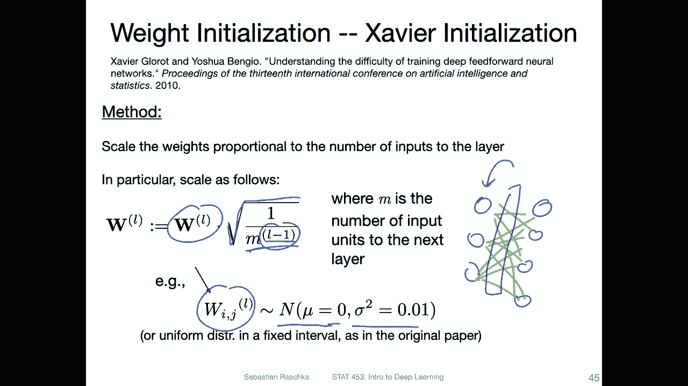

1.  从均值为 0、方差较小的正态分布或均匀分布中初始化权重。
2.  根据该层输入单元的数量（即前一层的特征数）对权重进行缩放。

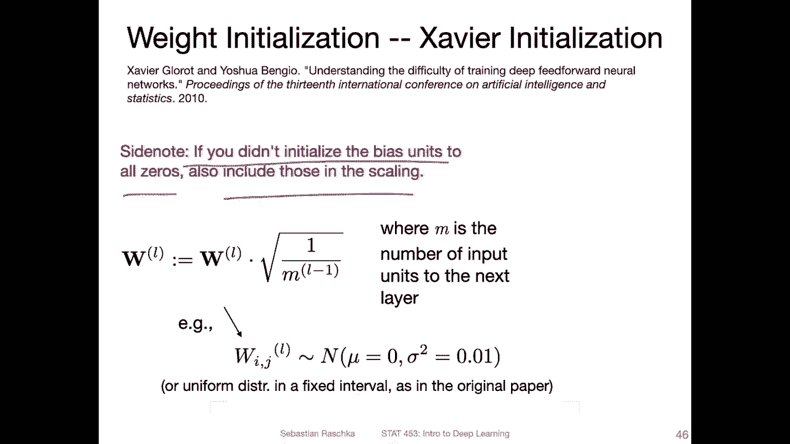

### 数学公式

假设权重从一个均值为 0、方差为 σ² 的正态分布中初始化。那么，缩放后的权重可以表示为：

**公式：**
`W_scaled = W * sqrt(1 / n_in)`

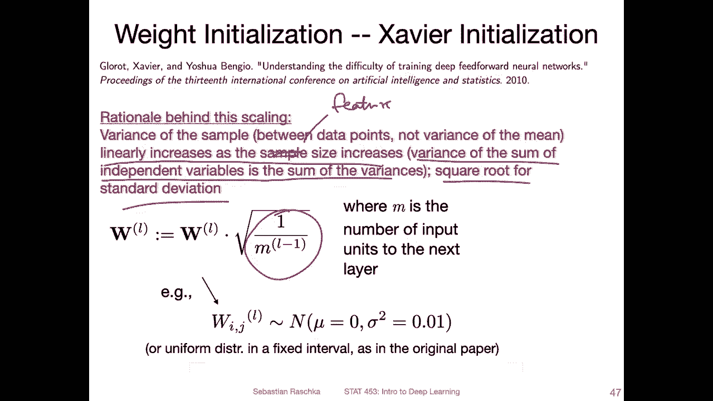

其中，`n_in` 是前一层的单元数（也称为“扇入”）。

### 原理简述

这种缩放背后的原理是考虑网络净输入的方差。当我们计算一个单元的净输入时，它是权重与前一层的激活值的乘积之和。如果我们将权重和激活值视为独立变量，那么随着前一层单元数（即“样本”数）的增加，和的方差会增加（因为独立变量之和的方差等于方差之和）。通过乘以 `1 / sqrt(n_in)` 进行缩放，我们旨在保持各层激活值方差的稳定性，从而缓解梯度消失或爆炸问题。

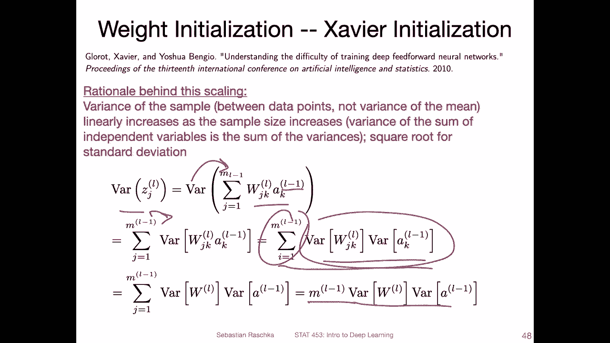

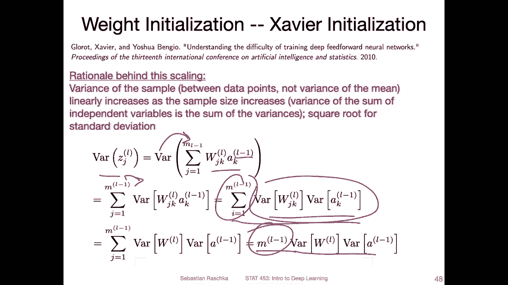

在实践中，有时也会考虑“扇出”（即该层的输出单元数），但使用“扇入”更为常见。

### 效果对比

在 Xavier 的原始论文中，通过可视化展示了使用与不使用 Xavier 初始化的区别。在不使用 Xavier 初始化、仅使用双曲正切激活函数的网络中，深层网络的激活值分布会严重集中在 0 附近。在反向传播时，较早的层几乎得不到有效的梯度更新（梯度消失），导致网络主要更新后面的层，而几乎忽略了前面的层。

而使用 Xavier 初始化后，所有层的梯度都保持在合理的范围内，有效缓解了不同层学习速度差异过大的问题。

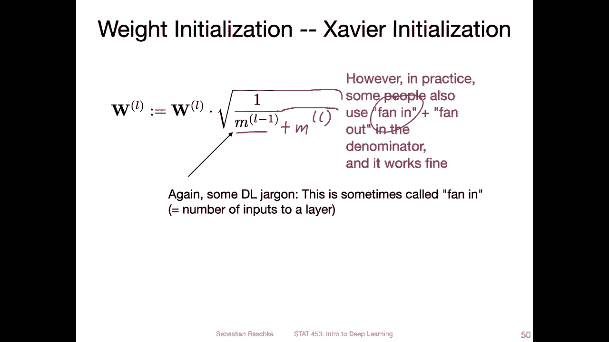

---

## Kaiming He 初始化 ⚡

上一节我们介绍了适用于双曲正切函数的 Xavier 初始化，本节中我们来看看另一种针对 ReLU 族激活函数设计的初始化方案：Kaiming He 初始化。该名称来源于论文的第一作者何恺明。

Xavier 初始化假设激活值的均值为 0，这对于以 0 为中心的双曲正切函数是合理的。但对于 ReLU 函数，情况则不同。ReLU 函数将所有负输入置为 0，因此其输出并非以 0 为中心，而是非负的。这破坏了 Xavier 初始化所依赖的假设。

Kaiming He 初始化论文中包含复杂的数学推导，但其核心结论非常简单：在 Xavier 初始化的基础上，为缩放因子增加一个增益系数 `sqrt(2)`。

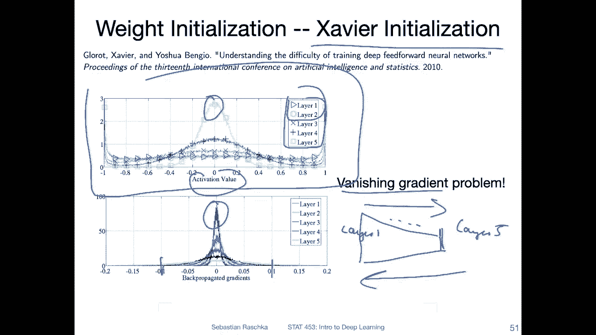

### 数学公式

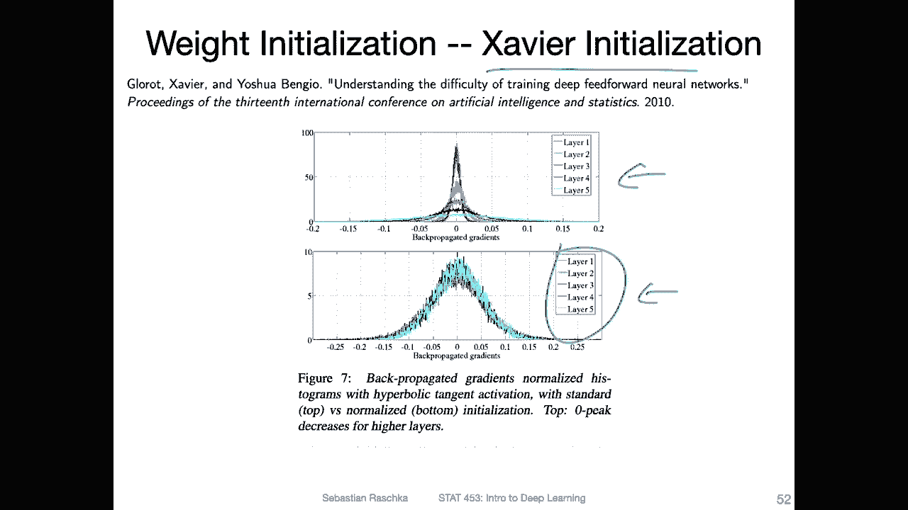

对于使用 ReLU 激活函数的层，其权重初始化公式为：

**公式：**
`W_scaled = W * sqrt(2 / n_in)`

这个额外的 `sqrt(2)` 因子专门用于补偿 ReLU 函数将一半的激活值置零所导致的方差减半效应，从而在正向传播过程中更好地保持激活值的方差。

---

## 实践建议与总结 🛠️

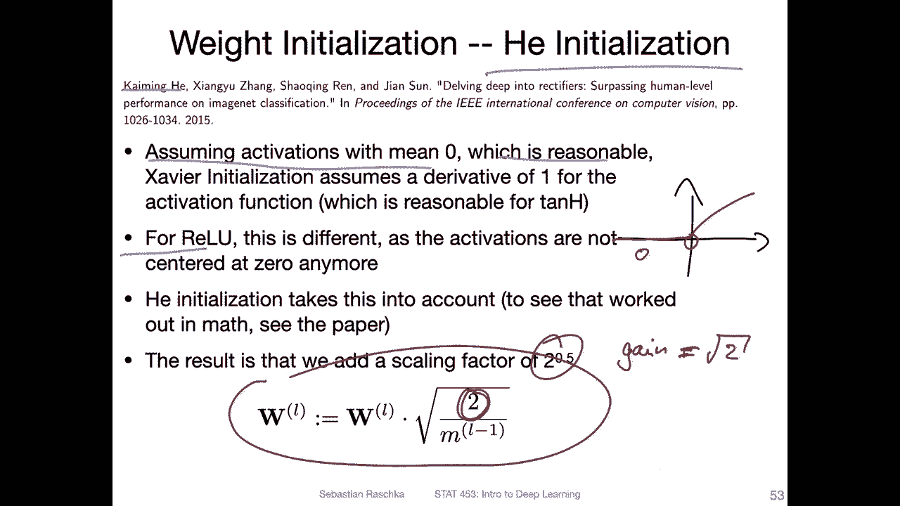

本节课我们一起学习了 Xavier Glorot 和 Kaiming He 这两种重要的权重初始化方法。Xavier 初始化适用于类似双曲正切的 S 型激活函数，而 Kaiming He 初始化则专门为 ReLU 及其变体设计。

不过，在实际应用中，你通常不需要手动实现这些初始化。现代深度学习框架（如 PyTorch、TensorFlow）已经为各种层和激活函数设置了合理的默认初始化方式。理解这些原理有助于你在需要调试网络或自定义架构时做出明智的选择。在接下来的课程中，我们将看到如何在 PyTorch 中具体应用和修改权重初始化方案。

**总结要点：**
*   **Xavier 初始化**：使用公式 `W * sqrt(1 / n_in)`，常用于双曲正切等 S 型函数。
*   **Kaiming He 初始化**：使用公式 `W * sqrt(2 / n_in)`，专为 ReLU 激活函数设计。
*   **核心目标**：通过适当的缩放，使各层激活值的方差在正向和反向传播中保持稳定，促进网络的有效训练。