# 88：L11.7 - PyTorch 中的权重初始化 🧠


在本节课中，我们将学习 PyTorch 如何处理权重初始化，以及如何根据需要自定义初始化方案。权重初始化是神经网络训练中的重要环节，它影响着模型训练的收敛速度和最终性能。

---

## 🔍 PyTorch 的默认初始化方案

上一节我们介绍了权重初始化的概念，本节中我们来看看 PyTorch 的默认做法。PyTorch 的默认权重初始化方案在不同版本中有所变化。在当前的 1.8 版本中，对于线性层（`nn.Linear`）和卷积层（`nn.Conv2d`），PyTorch 默认使用 **Kaiming Uniform** 初始化方法。

查看 PyTorch 源代码可以发现，其默认初始化假设用户将使用 **Leaky ReLU** 作为激活函数。初始化公式中包含了 `math.sqrt(5)` 这一项，就是为 Leaky ReLU 设计的。

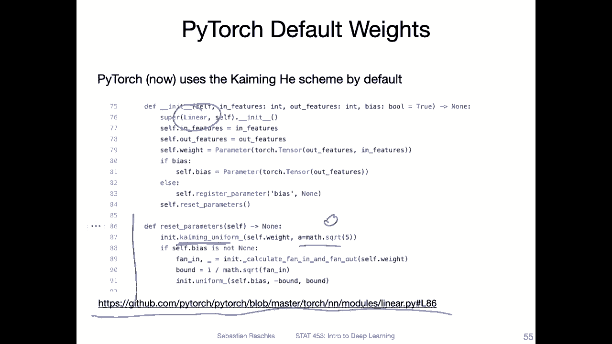

**代码示例：PyTorch 默认初始化（Leaky ReLU 假设）**
```python
# 这是 PyTorch 内部实现的简化示意
def kaiming_uniform_(tensor, a=math.sqrt(5)):
    # ... 初始化逻辑
```

在实践中，即使你使用普通的 ReLU 激活函数，使用这个默认初始化通常也能工作良好，差异可能不明显。

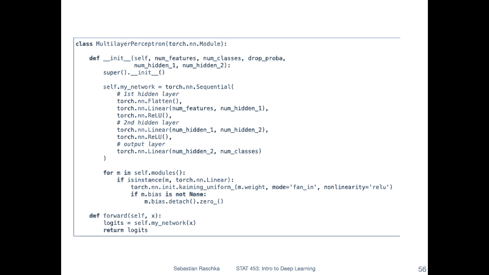

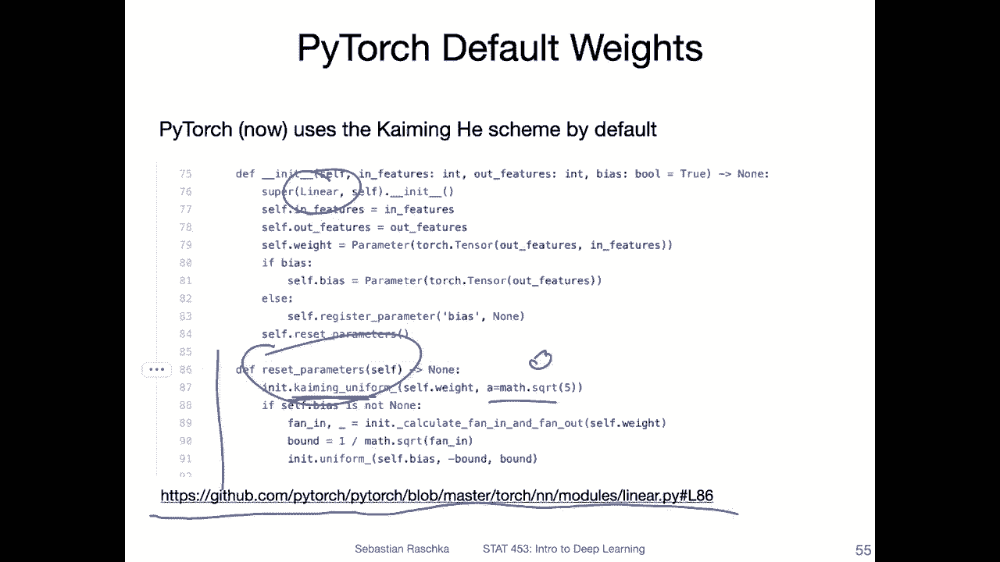

---

## 🛠️ 如何手动覆盖权重初始化

如果你想自定义初始化方案，可以手动覆盖 PyTorch 的默认行为。以下是一种常用的方法：在定义网络后，遍历其所有模块，并对特定类型的层（如线性层）应用新的初始化。

以下是具体步骤：

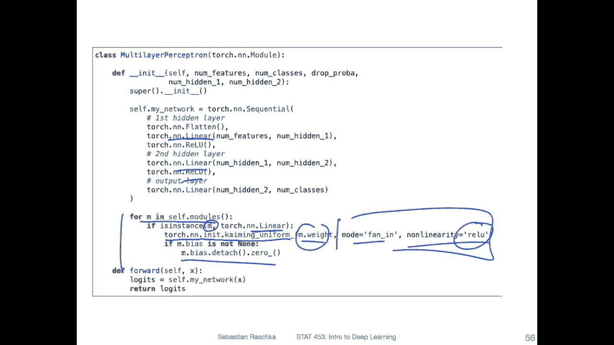

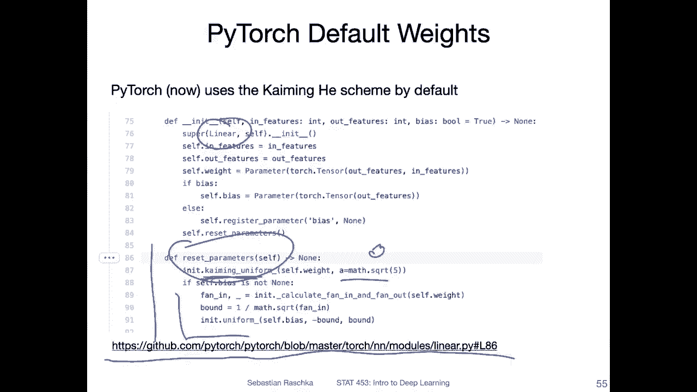

1.  遍历网络中的所有模块。
2.  筛选出你希望初始化的特定层类型（例如 `nn.Linear`）。
3.  对该层的权重（`.weight`）应用新的初始化函数。
4.  你也可以选择性地初始化偏置项（`.bias`）。

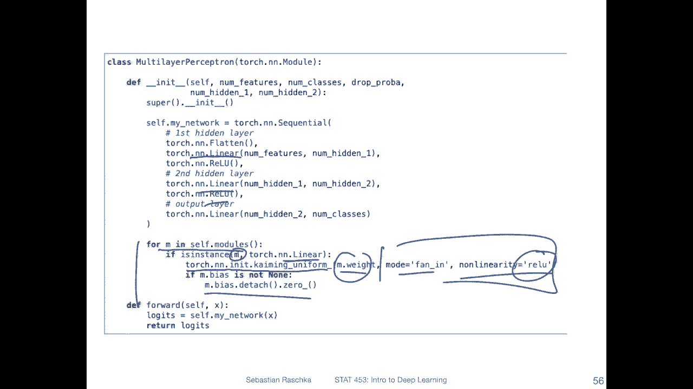

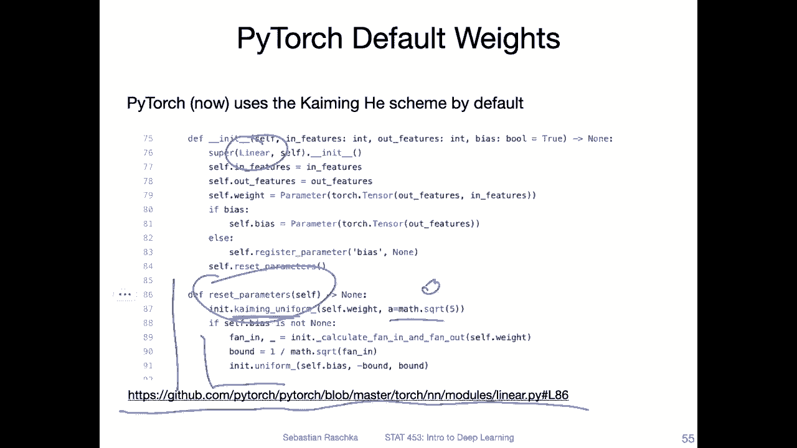

**代码示例：手动应用 Kaiming Uniform 初始化（针对 ReLU）**
```python
import torch.nn as nn
import torch.nn.init as init

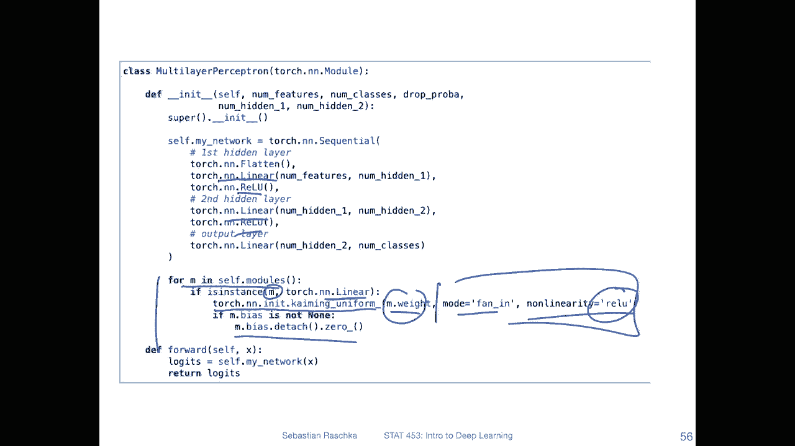

# 假设 `model` 是你的神经网络
for m in model.modules():
    if isinstance(m, nn.Linear):
        # 使用针对 ReLU 的 Kaiming Uniform 初始化权重
        init.kaiming_uniform_(m.weight, mode='fan_in', nonlinearity='relu')
        # 将偏置初始化为 0
        if m.bias is not None:
            init.constant_(m.bias, 0)
```

> **注意**：默认的 PyTorch 初始化是针对 Leaky ReLU 的（`nonlinearity='leaky_relu'`）。上面的代码将其改为了针对普通 ReLU。根据经验，两者差异不大，但你可以根据自己使用的激活函数进行选择。

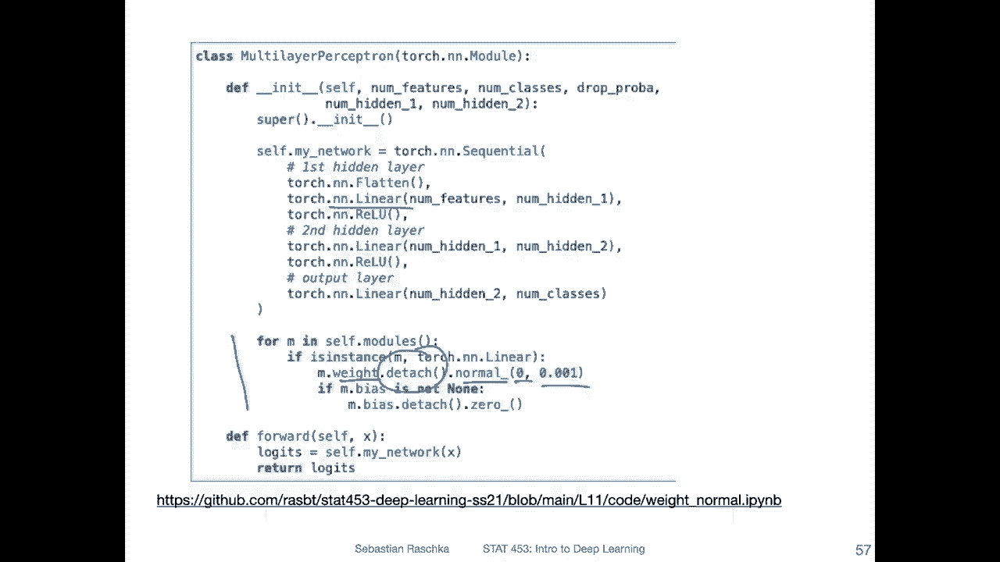

---

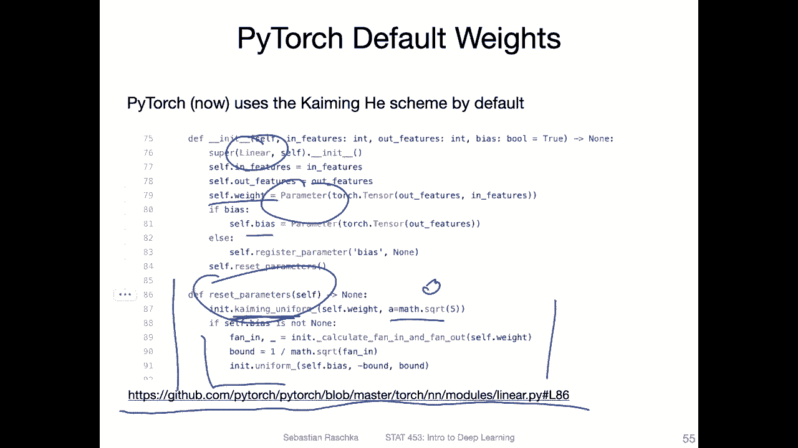

## ⚙️ 其他初始化方法示例：高斯初始化

除了 Kaiming 初始化，我们也可以使用其他分布，例如高斯（正态）分布来初始化权重。


**代码示例：使用高斯分布初始化**
```python
for m in model.modules():
    if isinstance(m, nn.Linear):
        # 使用均值为0，标准差为0.001的高斯分布初始化权重
        m.weight.data = torch.randn_like(m.weight.data) * 0.001
        # 使用 .detach() 防止该操作被计入计算图
        m.weight.data = m.weight.data.detach()
        if m.bias is not None:
            init.constant_(m.bias, 0)
```

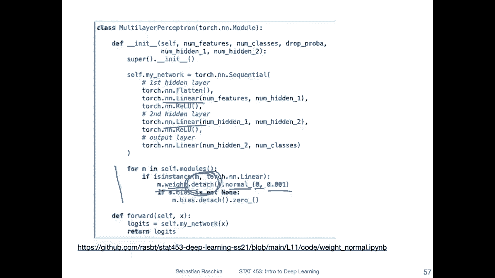

这里使用了 `.detach()` 方法。这是因为 PyTorch 中的可学习参数（`nn.Parameter`）默认会跟踪梯度计算。权重初始化应该是训练的起点，而不应被视为计算图的一部分。使用 `.detach()` 可以将其从当前计算图中分离，避免不必要的梯度计算。

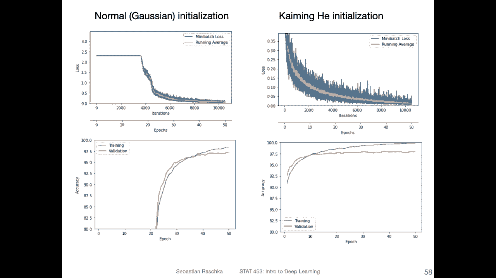

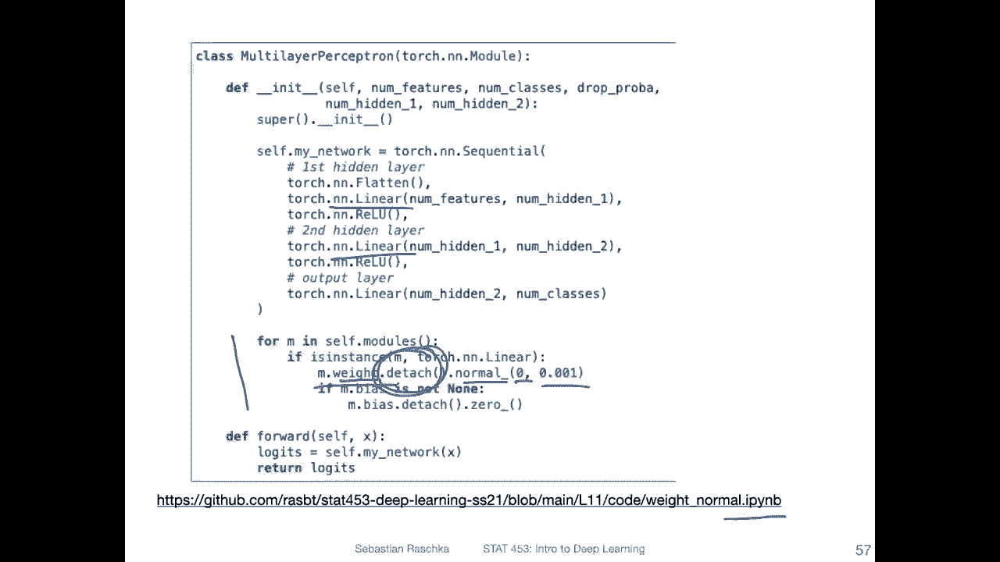

---

## 📊 初始化方法的影响与批归一化（Batch Norm）的作用

不同的初始化方法对训练过程有显著影响。例如，在使用 ReLU 的网络中，不合适的初始化（如标准差过小的高斯初始化）可能导致前几个训练周期损失下降缓慢，模型似乎“停滞”不前，之后才突然开始学习。

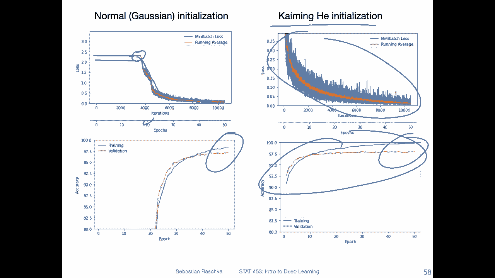

然而，当网络中使用 **批归一化** 时，权重初始化的选择变得不那么关键。批归一化通过对每一层的输入进行标准化，减少了内部协变量偏移，使得网络对初始权重的尺度不那么敏感，训练过程更加稳定和鲁棒。

**实践对比**：
*   没有批归一化时，**Kaiming 初始化** 通常比随意的高斯初始化表现更好。
*   引入批归一化后，即使使用简单的高斯初始化，模型也能快速、稳定地训练。

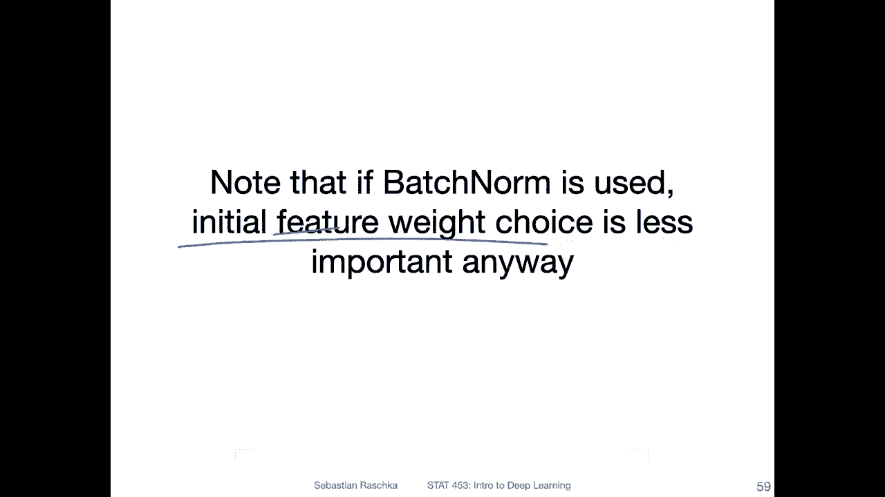

---

## ✅ 总结

本节课中我们一起学习了 PyTorch 中的权重初始化：
1.  PyTorch 默认使用 **Kaiming Uniform** 初始化，并假设激活函数为 Leaky ReLU。
2.  我们可以通过遍历模型模块并调用 `torch.nn.init` 中的函数来**手动覆盖初始化方案**。
3.  初始化时使用 `.detach()` 可以防止初始化操作被错误地加入计算图。
4.  虽然权重初始化很重要，但当网络中使用 **批归一化** 时，其重要性会降低，因为批归一化增强了模型对初始化的鲁棒性。

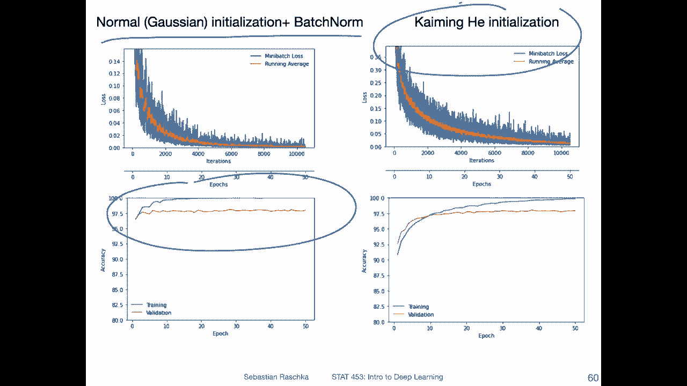

对于大多数使用 ReLU 族激活函数和批归一化的现代网络，PyTorch 的默认初始化通常是一个良好的起点。当你使用特殊的激活函数或架构时，再考虑查阅文献并自定义初始化策略。