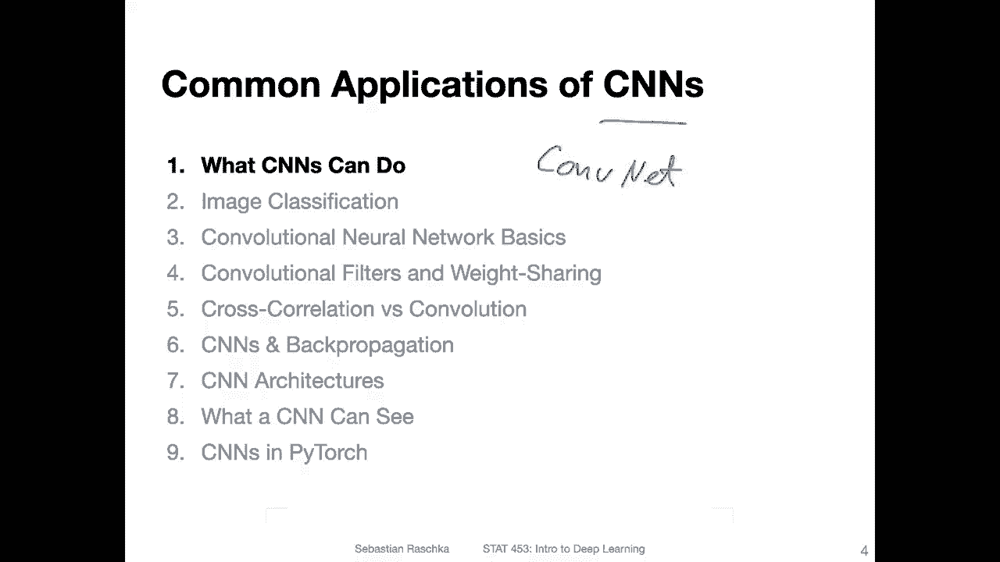
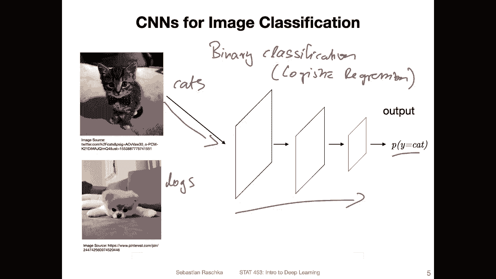
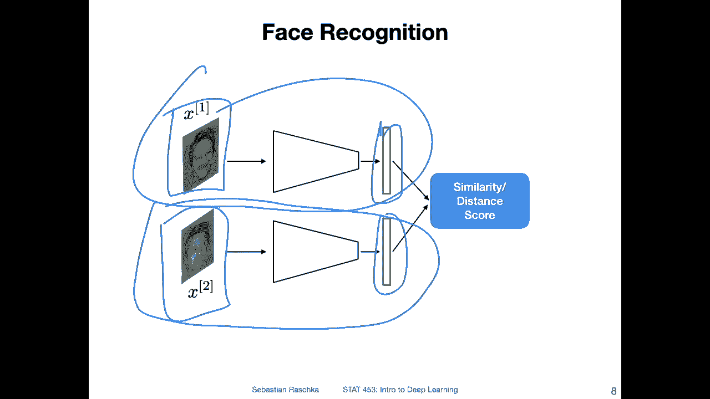
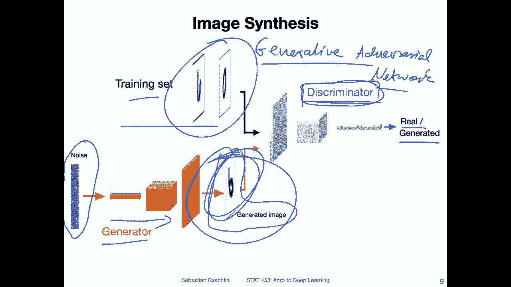
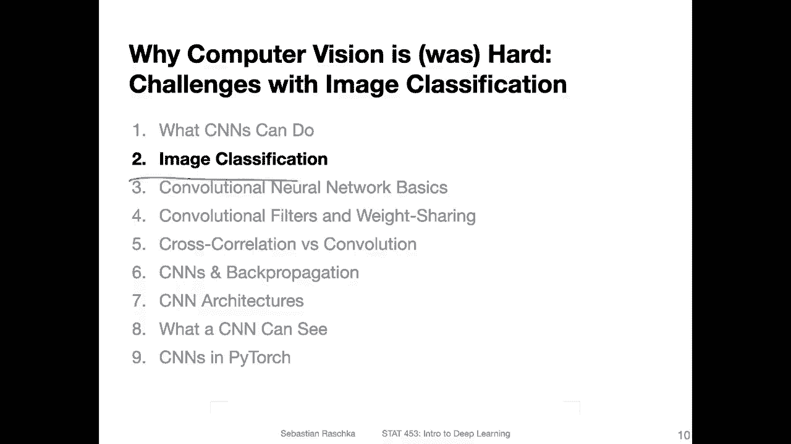

# 98：L13.1 - 常见应用 🖼️🤖

在本节课中，我们将要学习卷积神经网络（CNN）的几种常见应用。CNN是处理图像数据的一种强大神经网络架构，它在计算机视觉领域有着广泛的应用。

---

## 图像分类 📸

上一节我们介绍了CNN的基本概念，本节中我们来看看其最直接的应用：图像分类。图像分类任务的目标是让模型识别出输入图像所属的类别。

最简单的应用是二分类问题，例如区分猫和狗。其原理类似于我们之前讨论的逻辑回归，但输入是图像而非简单的特征。图像被输入到网络中，经过一系列卷积层（通常最后还有全连接层），最终输出一个概率分数，表示图像属于某个类别（例如是猫）的可能性。

当然，我们也可以将其扩展为多类别分类，只需在最后使用我们之前讨论过的Softmax层即可。本质上，这与我们使用多层感知机（MLP）所做的类似，区别在于我们使用了卷积层，这将在本课程中详细讨论。

---

## 目标检测 🎯

除了常规的分类，CNN另一个常见的应用是目标检测。你可以将其视为分类和目标定位的结合。

目标检测不仅需要识别图像中的物体（例如一辆车），还需要用一个边界框（Bounding Box）将其位置标出，并为该框分配一个类别标签。因此，网络本质上同时学习两个任务：定位物体和分类。

你可以将其视为一种回归任务，网络学习预测边界框的坐标。一个著名的例子是YOLO（You Only Look Once）算法。虽然目标检测是一个重要主题，但由于课程范围限制，我们不会深入探讨。如果你对此感兴趣，YOLO的原始论文是一个很好的起点。

---

## 实例分割 ✂️

与目标检测相关的任务是实例分割。它比目标检测更进一步。

实例分割的目标不是仅仅用一个矩形框出物体，而是为图像中的每个目标物体生成一个精确的像素级掩码（Mask）。例如，对于一个人，分割模型会勾勒出人的精确轮廓，而不仅仅是一个包围盒。因此，这是一种更精确的目标检测形式。

Mask R-CNN是解决该问题的经典方法之一。这同样是一个更高级的主题，本课程不会详细展开，但了解其存在是很有帮助的。

---

## 人脸识别 👤

另一个重要的应用是人脸识别。我过去在这方面有深入的研究。虽然人脸识别与分类有关，但并不完全相同。

一种方式是将人脸识别构建为一个超多类别的分类问题（例如有10,000个不同的人）。但这种方法计算成本高，且每个类别的样本通常很少，训练起来非常困难。

因此，业界通常采用基于成对或三元组损失（Pairwise/Triplet Loss）的方法。网络学习的是图像的“特征表示”或“嵌入”。其核心思想是：**同一人的不同照片，其特征表示应非常相似（距离近）；不同人的照片，其特征表示应差异较大（距离远）**。然后，我们可以设定一个阈值来判断是否为同一人。

实现这种相似度比较的一种经典网络结构是孪生网络（Siamese Networks）。同样，这是一个更深入的主题，本课程将主要聚焦于用于分类的CNN。

---

## 生成对抗网络 🎨

我们将在本课程后续部分讨论的另一个重要应用是生成对抗网络（GANs）。CNN可以用于图像合成。

GANs包含两个部分：生成器（Generator）和判别器（Discriminator）。
*   **生成器（G）**：接收一个随机噪声向量 `z`（例如从正态分布中采样），通过一个类似“反向”的卷积网络，生成一张图片 `G(z)`。
*   **判别器（D）**：接收一张图片，判断它是“真实的”（来自训练集）还是“生成的”（来自生成器）。

训练过程是一个“博弈”：
1.  训练判别器 `D` 更好地区分真实与生成图像。
2.  训练生成器 `G` 生成更逼真的图像以“欺骗”判别器。

通过这种对抗训练，生成器最终能合成出看起来非常真实、但并非训练集中原有图像的新图片。GANs用途广泛，例如创造合成训练数据、进行图像编辑等，我们将在后续专门课程中详细讨论。

---

## 总结 📝

本节课我们一起学习了卷积神经网络（CNN）的几种常见应用：
1.  **图像分类**：识别图像的整体类别。
2.  **目标检测**：在识别类别的同时，用边界框定位物体。
3.  **实例分割**：为目标物体生成像素级的精确掩码。
4.  **人脸识别**：通过比较特征相似度来识别身份。
5.  **生成对抗网络（GANs）**：用于生成新的、逼真的图像。

本课程作为入门，将主要深入讲解**图像分类**这一基础且核心的应用，为理解更复杂的模型打下坚实的基础。