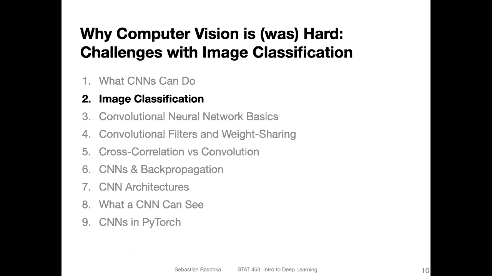
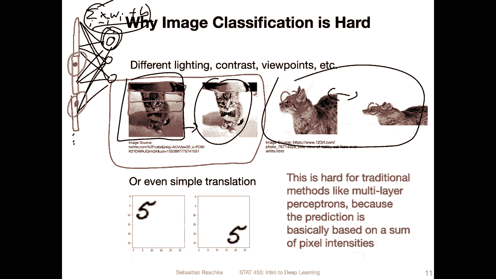
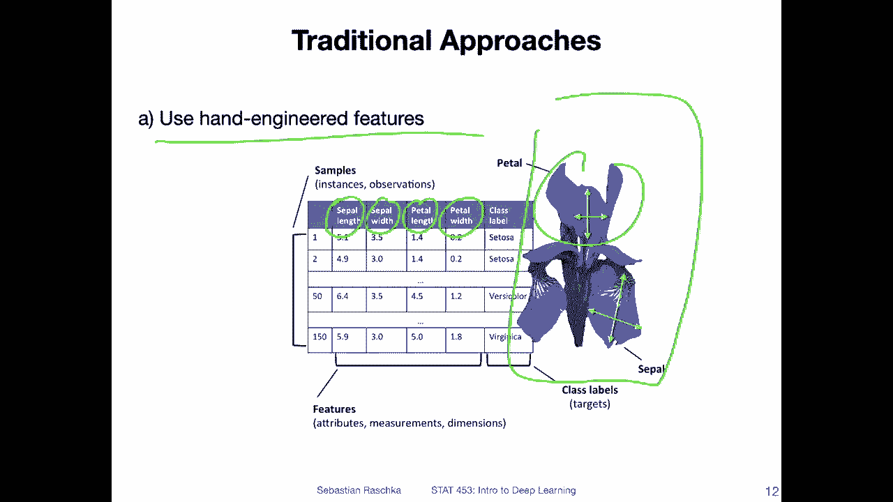
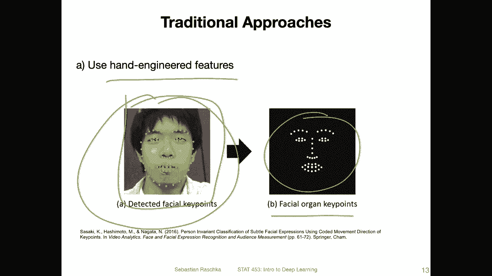
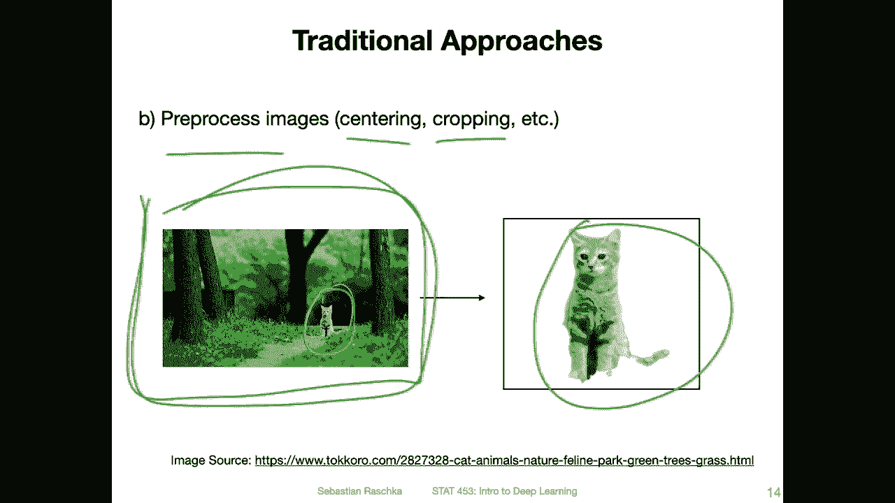
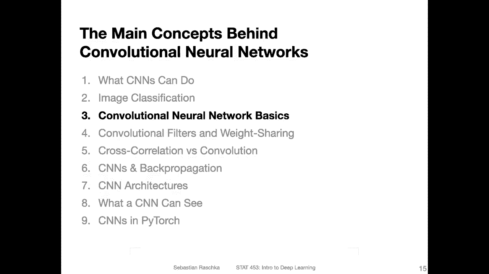

# 99：L13.2 - 图像分类的挑战 🖼️

在本节课中，我们将要学习图像分类任务所面临的核心挑战。理解这些挑战，有助于我们更好地欣赏卷积神经网络（CNN）的价值，并了解在CNN出现之前，人们是如何尝试解决这些问题的。

---

## 图像分类为何困难？

在深入探讨卷积神经网络之前，我们首先需要理解计算机视觉和图像分类本身是一项非常困难的任务。只有认识到其难度，才能充分体会卷积网络所取得的优异性能。

例如，观察下面这张猫的图片。作为人类，你可以轻松地识别出这是同一只猫。

但对于计算机或传统的神经网络而言，这实际上是一项相当困难的任务。为什么会这样呢？

回想一下多层感知机（MLP）的工作原理。我们通常会将图像的行像素拼接成一个很长的向量作为输入。假设第一行、第二行、第三行像素被拉平成一个长向量 `X`，然后输入到MLP中。网络的第一层隐藏层与输入层是全连接的，形成一个非常密集的网络。

激活值的计算本质上是输入与权重的加权和再加上偏置：`activation = sum(weights * inputs) + bias`。这意味着我们是在对特征值进行求和。

现在考虑另一种情况：同一张图像，但整体变暗了。由于图像变暗，所有像素值都降低了，这会导致计算出的激活值也相应降低。因此，光照、对比度等条件的变化会严重影响网络的性能。当然，对图像进行归一化处理很重要，但这只是挑战之一。

即使处理了光照问题，图像还可能存在轻微的形变或物体位置的变化。人类依然能认出这是同一只猫。

但在MLP中，假设左边图像某个像素区域在向量中的位置是 `X[100:150]`，而右边图像中同一物体区域可能位于向量的 `X[300:350]` 位置。由于网络是全连接的，连接这两个不同位置的权重完全不同（`W1` vs `W2`），因此计算出的激活值也会天差地别。物体的位置变化会严重影响传统神经网络的性能。

综上所述，在多层感知机的框架下思考，图像分类实际上是一项非常艰巨的任务。

---

## 卷积网络出现前的传统策略

那么，如何确保获得良好的分类性能呢？卷积网络是解决方案之一。但在卷积网络被发明之前，人们有哪些其他策略呢？

### 策略一：手动特征提取

一种经典策略是手动进行特征提取。这意味着，我们不直接将原始图像输入网络，而是由领域专家研究图像，思考并手动提取出一些关键特征，然后用这些特征进行工作。

以鸢尾花分类为例，专家可能会假设不同类别的鸢尾花在尺寸上存在差异。因此，手动提取的特征可以是：
*   花萼长度
*   花萼宽度
*   花瓣长度
*   花瓣宽度

### 策略二：提取面部关键点

另一种传统方法应用于人脸识别。人们不直接输入完整的人脸图像，而是开发算法来定位面部关键 landmarks，例如眼睛、鼻子、嘴巴的位置。然后基于这些关键点的几何关系进行比较和识别。

### 策略三：图像预处理

第三种传统技术是对图像进行预处理，这对于卷积网络至今仍有益处。例如，在MNIST手写数字数据集中，所有数字都已从背景中清理出来，并且基本位于图像中心。

但在现实世界的图像中，目标物体通常不会单独出现。例如，一张猫的图片可能包含公园或森林作为背景。

在传统计算机视觉中，人们会手动或开发一些背景去除工具，先提取出目标物体，再进行分类，这简化了任务。基本操作包括提取、居中、裁剪等。

当然，这些预处理对于卷积网络，尤其是在数据集较小时，仍然是有益的。然而如今，如果拥有海量数据（例如数百万张图像），卷积网络即使不进行精细的预处理，也能表现得很好。因为网络会从数据中学习如何聚焦于图像中的重要部分。例如，在动物分类任务中，网络将学会关注图像中的动物区域。

本质上，卷积网络内部会隐式地学习如何进行特征提取。这也是为什么深度学习有时被称为“特征学习”或“自动特征学习”。深度学习能够隐式地学习如何提取特征，从而替代了繁琐的手动特征工程。

---

## 过渡与预告

上一节我们介绍了图像分类的挑战以及卷积网络出现前的解决方案。我们看到，手动特征提取依赖专家知识且费时费力，而传统神经网络又难以处理图像中的平移、光照等变化。

本节中，我们了解到卷积神经网络通过其独特的结构，能够自动、隐式地从数据中学习有效的特征表示，从而克服了这些挑战。

在接下来的视频中，我们将终于可以开始探讨卷积神经网络的工作原理。

我将深入讲解最早的卷积网络架构之一，并逐步描述其中的各个组件。

---

## 总结

本节课中，我们一起学习了：
1.  **图像分类的核心挑战**：对于传统全连接网络，图像的光照变化、对比度调整以及物体位置平移都会严重影响分类性能，因为网络缺乏对这类空间不变性的内置处理机制。
2.  **卷积网络前的传统策略**：主要包括**手动特征提取**（依赖领域知识）、**面部关键点检测**以及**图像预处理**（如背景去除、居中裁剪）。这些方法需要大量人工干预，且泛化能力有限。
3.  **深度学习的优势**：卷积神经网络能够通过训练，**自动学习**到具有平移不变性等特性的特征提取器，实现了“特征学习”，从而避免了繁琐且需要专业知识的手动特征工程。

理解了这些背景和挑战，我们就能带着更明确的问题意识，进入卷积神经网络精彩的世界。