# 112：L14.1 - 卷积和填充 🧠

在本节课中，我们将要学习卷积神经网络中的**填充**机制。填充是一种与步长配合使用，用于控制卷积层输出尺寸的技术。我们将通过公式和示例，详细解释其工作原理和计算方法。

---

## 概述

上一节我们介绍了卷积的基本概念和步长。本节中我们来看看**填充**。填充允许我们在输入图像的边缘添加额外的像素（通常是零值），从而控制卷积操作后输出特征图的大小。它既可以防止输出尺寸过快缩小，也能在某些情况下保持输入与输出的尺寸相同。

---

## 填充的基本概念

填充的核心思想是在输入图像的四周添加指定数量的像素行/列。以下是填充的几个关键点：

*   **目的**：控制输出尺寸，使其大于或等于不填充时的尺寸。
*   **常见值**：添加的像素值通常设置为0。
*   **对称性**：填充可以是对称的（上下左右填充相同数量），也可以是非对称的。

下图展示了在一个4x4的输入上，使用3x3卷积核、步长为1时，不同填充值的效果：

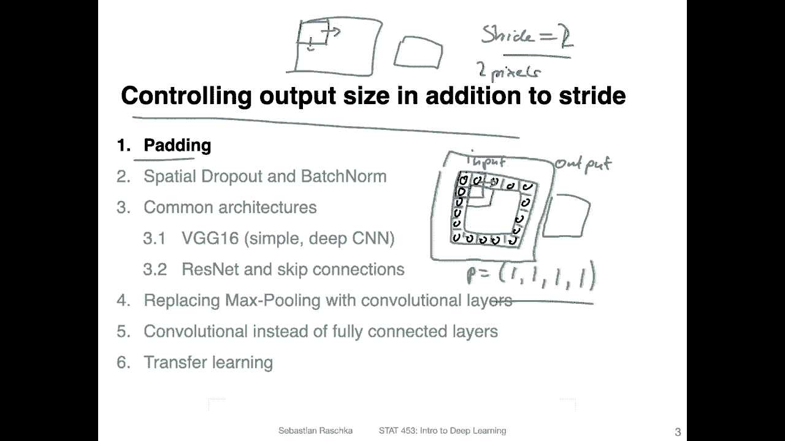

---

## 输出尺寸计算公式

计算卷积层输出尺寸的通用公式如下。该公式同时考虑了输入尺寸、卷积核尺寸、步长和填充：

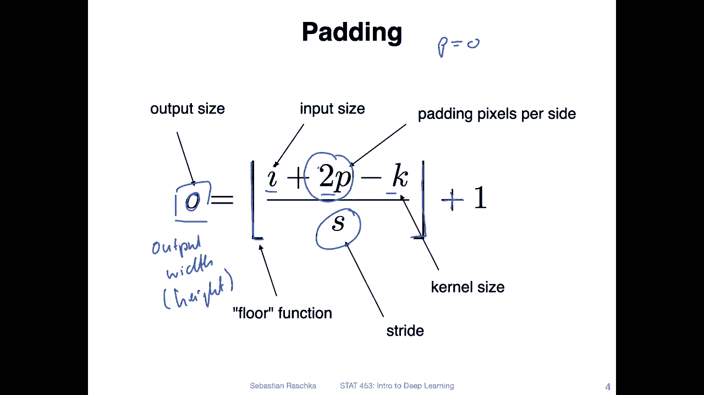

**公式**：
`output_size = floor((input_size + 2*padding - kernel_size) / stride) + 1`

其中：
*   `floor()` 表示向下取整。
*   `input_size` 是输入的高度或宽度。
*   `kernel_size` 是卷积核的高度或宽度。
*   `stride` 是步长。
*   `padding` 是填充的像素数（假设为对称填充）。

这个公式适用于输出的高度和宽度计算。

---

## 填充效果示例分析

以下是几个具体的示例，展示了不同填充和步长设置下的输出结果：

1.  **无填充，步长为1**：输入为4x4，使用3x3卷积核。根据公式计算，输出为2x2。卷积核在滑动时会“丢失”边缘的像素信息。
2.  **填充为2，步长为1**：输入为5x5，使用4x4卷积核。添加两圈零值填充后，输出尺寸增大。
3.  **无填充，步长为2**：输入为5x5，使用3x3卷积核。步长增大导致输出尺寸进一步缩小至2x2。

---

## “Valid”与“Same”卷积

在深度学习框架中，常会遇到两种特定的填充模式术语：

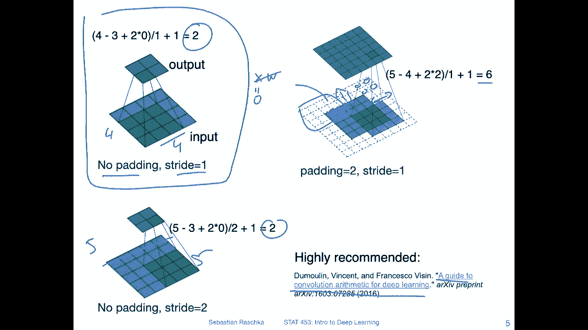

*   **Valid 卷积**：指不进行任何填充的操作。其结果是输出尺寸会小于输入尺寸。上图中的示例1和示例3即属于此类。

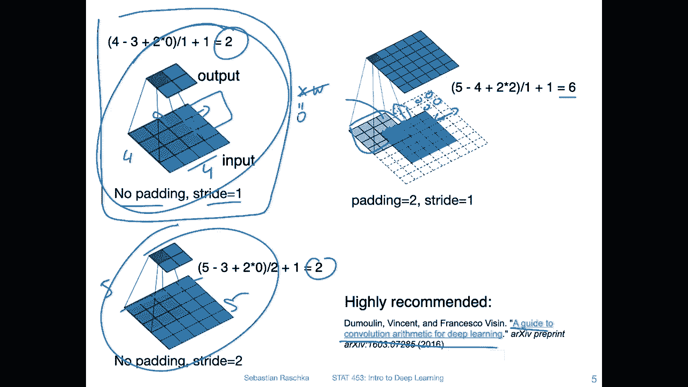

*   **Same 卷积**：指通过填充，使得**输出尺寸与输入尺寸完全相同**的操作。这需要精心选择填充值。

---

## 如何实现“Same”卷积

为了实现“Same”卷积（输出尺寸等于输入尺寸），我们可以对公式进行推导。为了简化，我们先假设步长 `stride = 1`，并忽略向下取整操作。

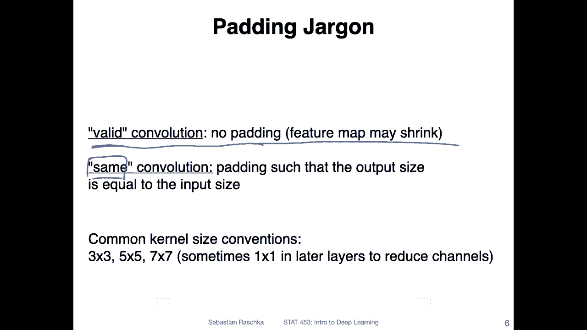

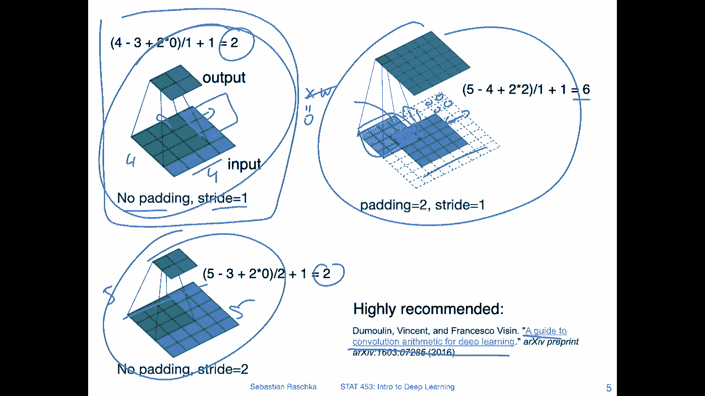

**推导过程**：
我们希望 `output_size = input_size`。
代入公式：
`input_size = (input_size + 2*padding - kernel_size) / 1 + 1`
两边整理后得到：
`padding = (kernel_size - 1) / 2`

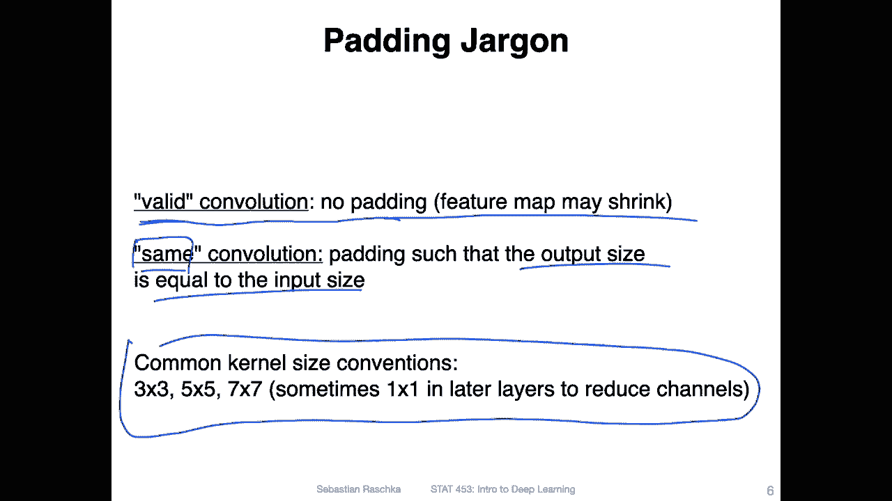

**结论**：当步长为1时，要得到“Same”卷积，所需的对称填充量 `padding` 应为 `(kernel_size - 1) / 2`。这解释了为何实践中常见的卷积核尺寸是3x3、5x5、7x7等**奇数**，因为这样计算出来的填充量是整数，便于对称填充。

例如，对于3x3卷积核：`padding = (3-1)/2 = 1`。
对于5x5卷积核：`padding = (5-1)/2 = 2`。

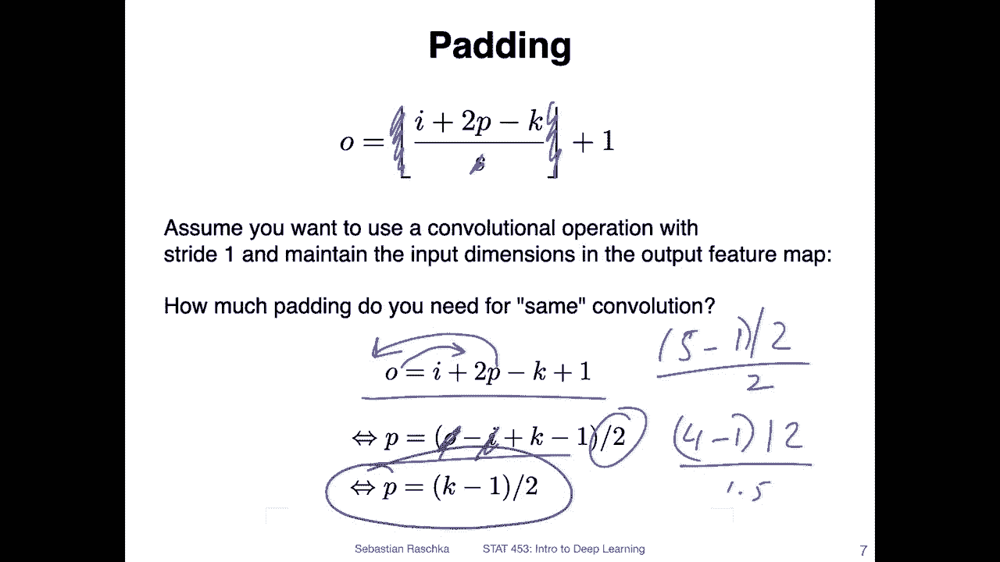

---

## 总结

本节课中我们一起学习了卷积神经网络中的**填充**技术。我们了解到：
1.  填充通过在输入边缘添加像素（常为0）来影响输出尺寸。
2.  掌握输出尺寸的通用计算公式 `output_size = floor((input_size + 2*padding - kernel_size) / stride) + 1` 至关重要。
3.  “Valid”卷积代表无填充，“Same”卷积代表通过填充使输入输出尺寸一致。
4.  为实现“Same”卷积，通常选择奇数尺寸的卷积核，并设置 `padding = (kernel_size - 1) / 2`（步长为1时）。

理解填充是构建有效CNN架构的基础，它帮助我们精细控制网络中层与层之间的空间维度变化。

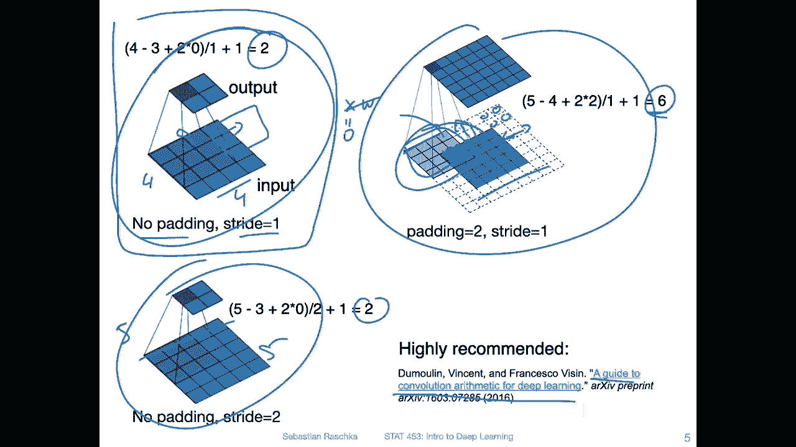

---

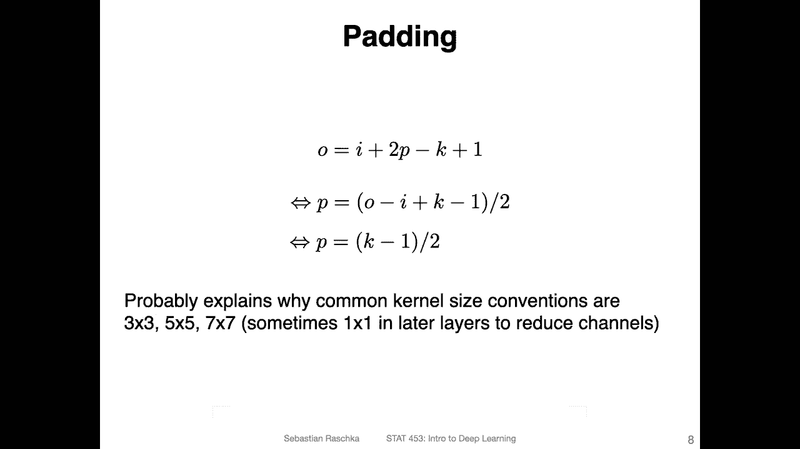

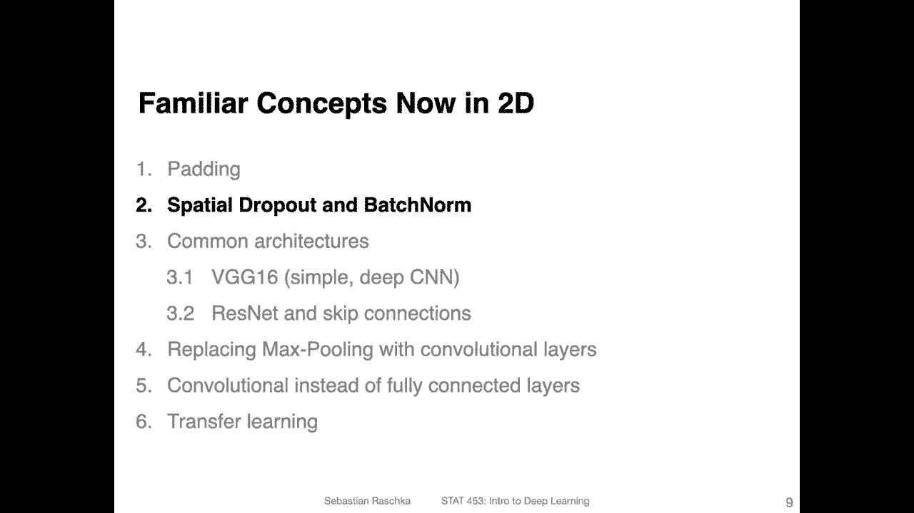

**下一节预告**：在接下来的内容中，我们将探讨空间Dropout和空间池化操作。