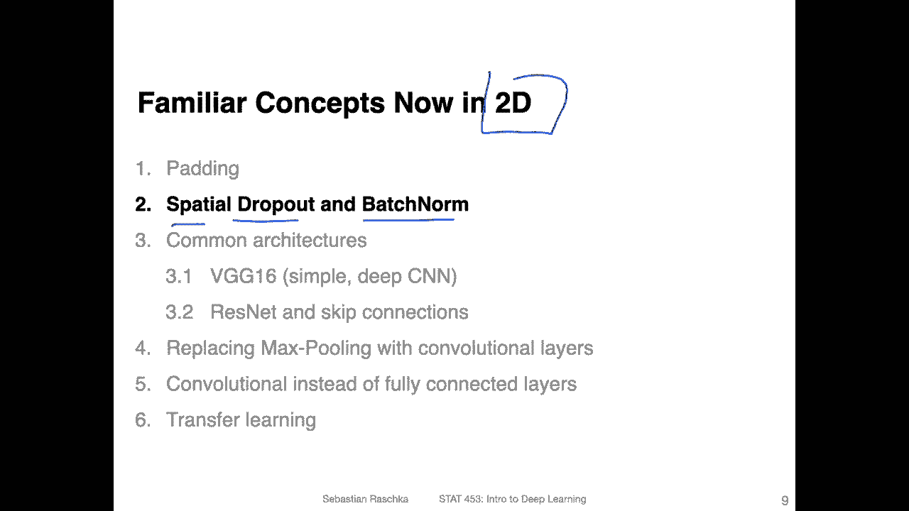
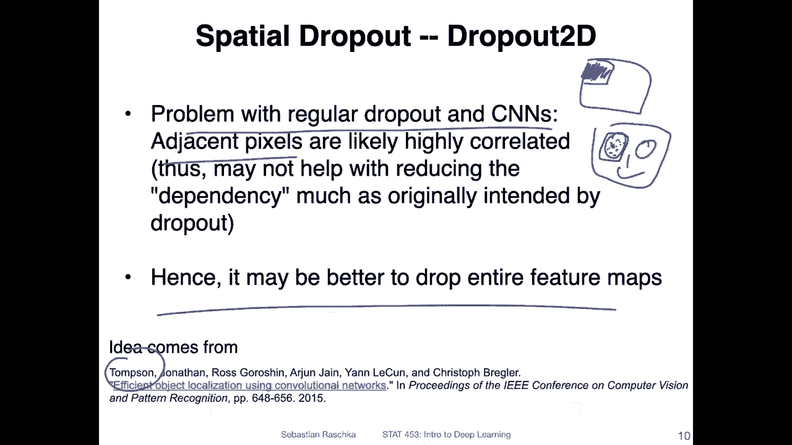
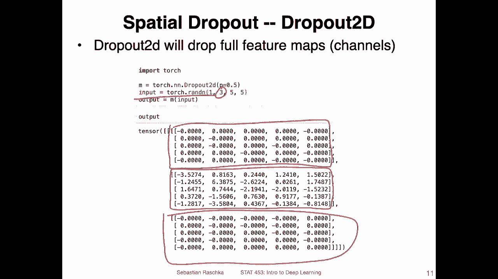
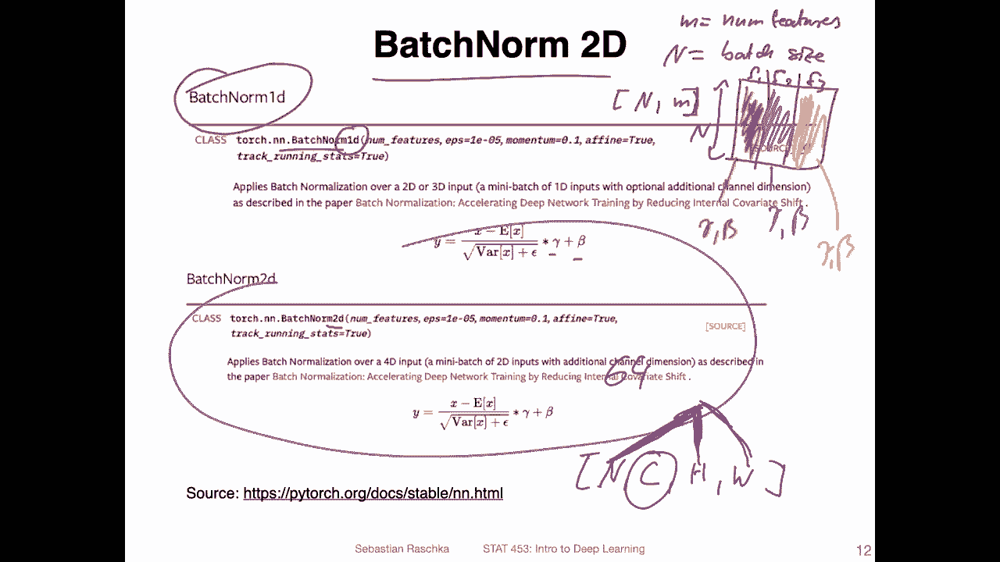
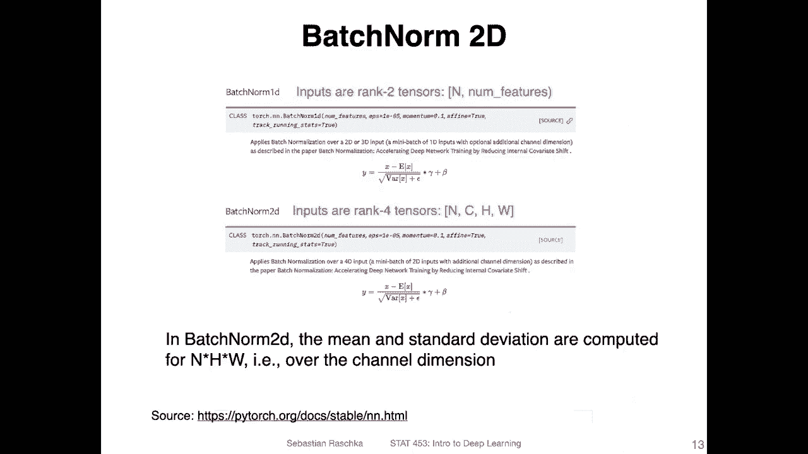
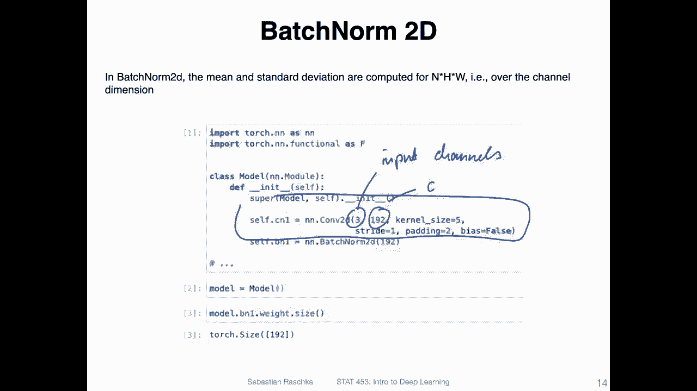
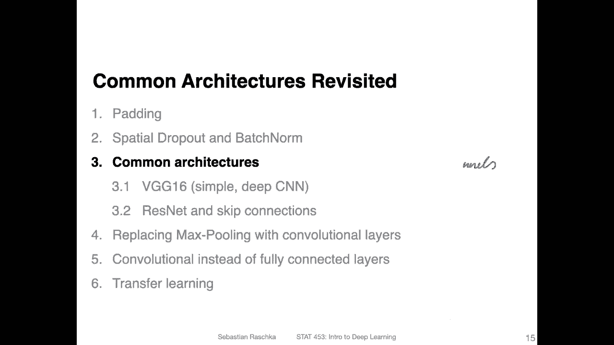
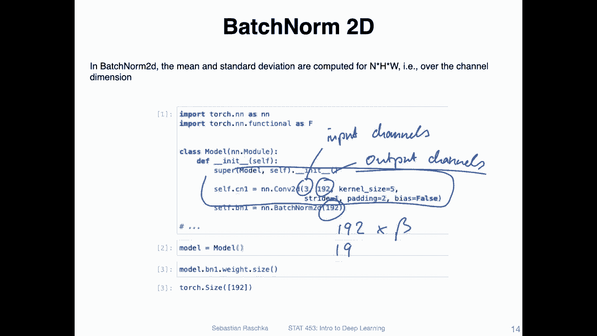
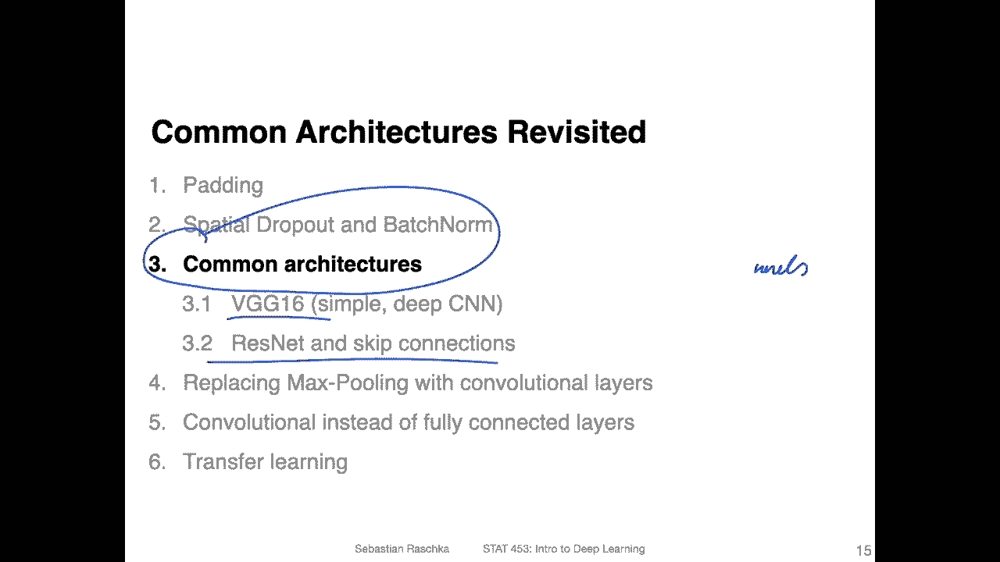

# 113：L14.2 - 空间丢失与批量归一化 🧠

在本节课中，我们将学习如何将熟悉的概念，如 Dropout 和 BatchNorm，应用到卷积神经网络（CNN）的二维图像处理场景中。这些概念在卷积设置下分别被称为 **空间丢失** 和 **批量归一化**。虽然听起来很高级，但你会发现它们的实现非常直接，无需太多额外工作。

---

## 🔍 为什么需要空间丢失？



上一节我们介绍了多层感知机中的 Dropout。那么，为什么在卷积网络中需要一个新的版本或进行修改呢？

当然，你可以直接使用之前学过的常规 Dropout。但根据 Thompson 在下方链接论文中的观点，常规 Dropout 在图像场景中存在一个问题。

在图像处理中，我们通常使用卷积核在图像上滑动，相邻像素之间通常具有高度相关性。因此，如果在某个感受野中随机丢弃一半的像素，除了可能带来一些缩放差异外，并不会对输出产生太大影响。

我们可以这样理解：假设有一张人脸图像，其中有许多像素共同构成了一只眼睛。如果我们将这些像素中的一半屏蔽掉，眼睛这个概念本身并没有发生根本性改变。

因此，论文中的观点是：与其在特征图中随机丢弃单个像素位置，不如丢弃整个**通道**。在网络的后几层，这些通道通常代表了更高级、更宏观的概念，正如我们在上一节纹理分析中提到的，一个通道可能代表检测到的眼睛，另一个代表嘴巴，等等。

空间丢失的核心思想是：通过丢弃这些高级特征，即丢弃整个特征图，而不是单个像素。本质上，这是将 Dropout 应用于**通道**而非像素。

---

## 💻 如何在 PyTorch 中实现空间丢失？

在 PyTorch 中实现空间丢失非常简单。你只需要使用 `nn.Dropout2d` 来代替之前使用的 `nn.Dropout1d`。

以下是一个示例，展示了它的工作原理。图中每个方框代表一个通道。假设我们有一个具有三个通道的随机输入，可以看到其中两个通道被置零。这就是空间丢失的工作方式。



```python
import torch.nn as nn

# 定义一个空间丢失层，丢弃概率为 0.5
spatial_dropout = nn.Dropout2d(p=0.5)
```

---



## 📊 卷积网络中的批量归一化

接下来，我们看看批量归一化。这与我们在全连接层中使用的 `BatchNorm1d` 类似，但在卷积层中，我们使用 `BatchNorm2d`。

为了快速回顾，我们之前在全连接网络中使用 `BatchNorm1d` 时，是针对每个特征在批次维度上计算均值和方差。假设输入维度是 `N x M`（N 是批次大小，M 是特征数量），那么我们会为每个特征计算一组独立的缩放参数 **γ**（gamma）和偏移参数 **β**（beta）。如果有三个特征，就有三组 γ 和 β。

现在，我们将这个概念扩展到二维情况。卷积层的输入是四维张量：`[批次大小, 通道数, 高度, 宽度]`。

`BatchNorm2d` 的计算方式是：在批次、高度和宽度这三个维度上计算均值和方差。因此，γ 和 β 的数量与**通道数**相对应。如果有 64 个通道，就有 64 个 γ 和 64 个 β。

---

## 💻 如何在 PyTorch 中实现批量归一化？

在 PyTorch 中实现 `BatchNorm2d` 同样直接。你需要在卷积层之后添加它，并指定特征数量（即输出通道数）。

```python
import torch.nn as nn

# 定义一个卷积层，输入通道为 3，输出通道为 192
conv_layer = nn.Conv2d(in_channels=3, out_channels=192, kernel_size=3)

# 在卷积层后添加批量归一化层，参数数量需与输出通道数匹配（192）
batch_norm = nn.BatchNorm2d(num_features=192)
```



在上面的代码中，`num_features` 参数设置为 192，因为卷积层输出了 192 个通道，所以批量归一化层会有 192 个 γ 和 192 个 β 参数。



---





## 📝 本节总结

本节课中，我们一起学习了如何将 Dropout 和 BatchNorm 适配到卷积神经网络中：



*   我们了解了**空间丢失**的原理：它通过丢弃整个特征图通道来更有效地正则化卷积网络，避免因像素间相关性而削弱 Dropout 的效果。
*   我们学习了**批量归一化在卷积中的应用**：`BatchNorm2d` 在批次、高度和宽度维度上计算统计量，并为每个通道学习独立的 γ 和 β 参数。
*   我们掌握了在 PyTorch 中实现这两个层的简单方法：使用 `nn.Dropout2d` 和 `nn.BatchNorm2d`。



在下一节视频中，我们将简要回顾不同的卷积网络架构，并深入探讨 VGG16 和 ResNet 模型。