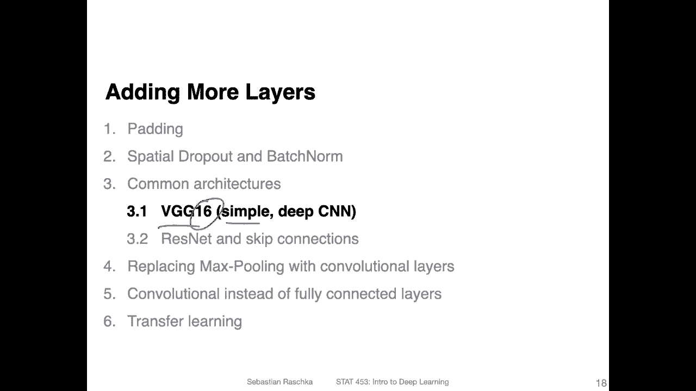
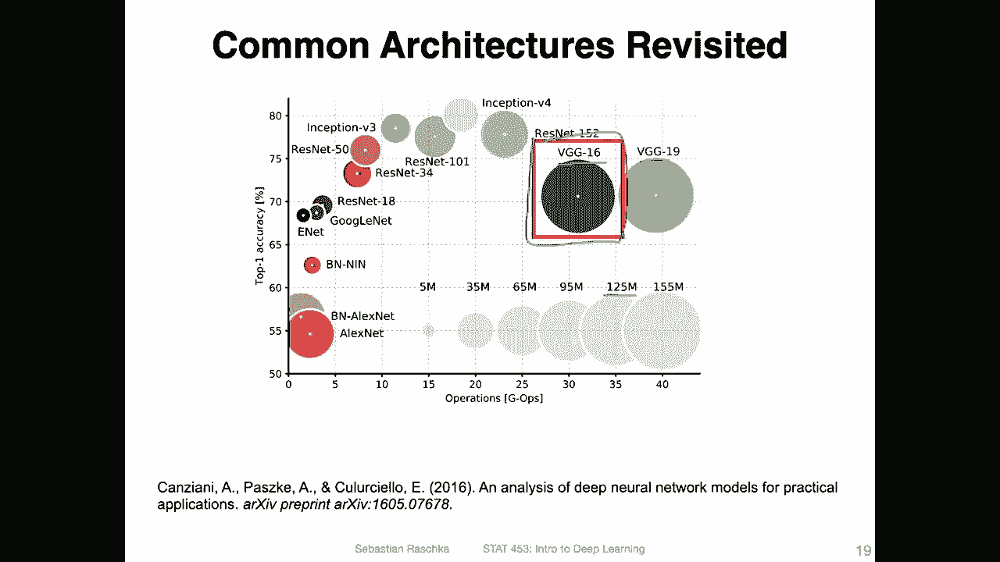
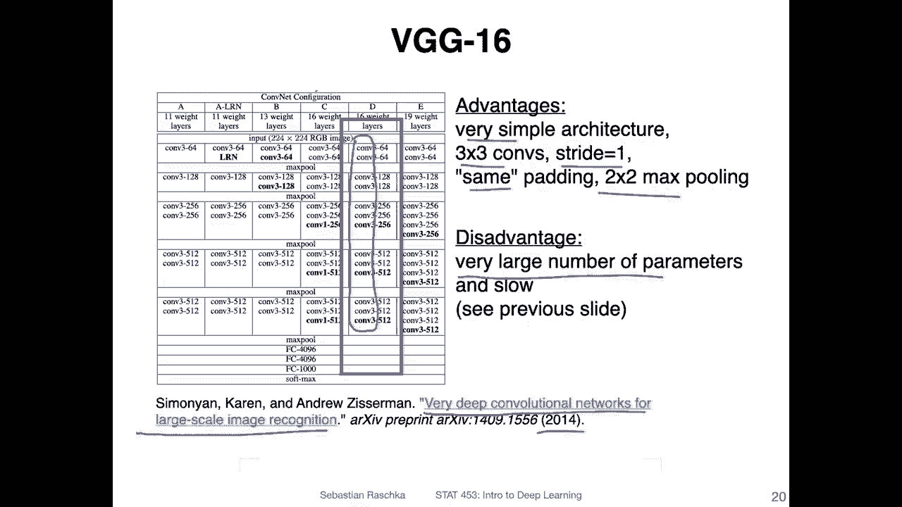
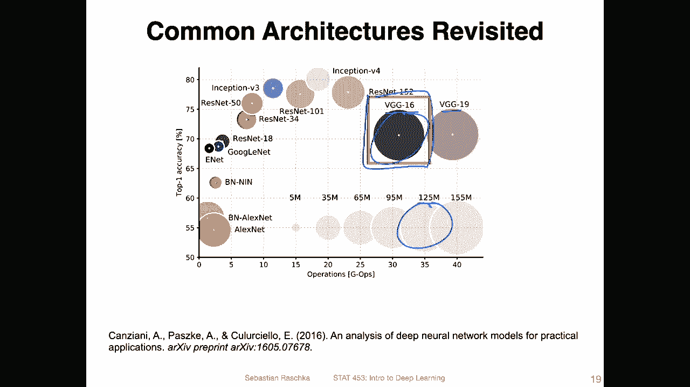
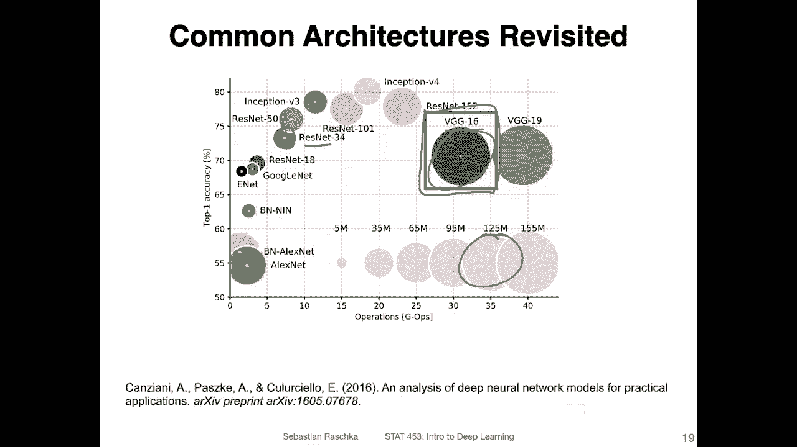
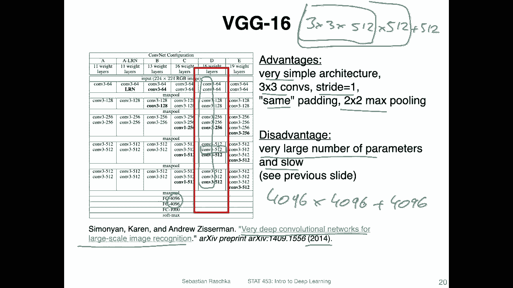
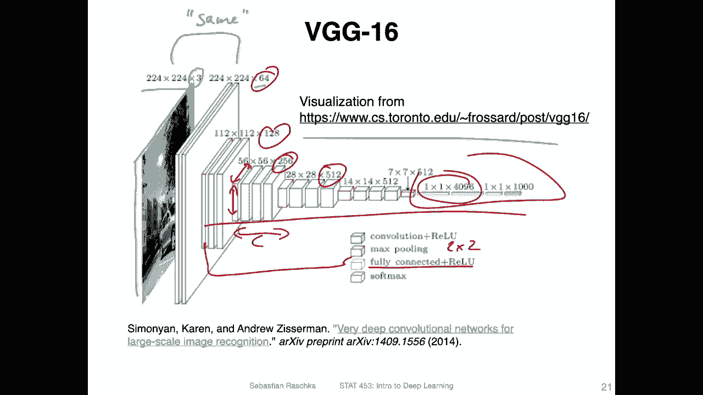

# 115：L14.3.1.1 - VGG16 架构概述 🏗️

在本节课中，我们将具体学习 VGG16 架构。这是一个非常简洁、直接的网络结构。

## 架构简介

上一节我们介绍了 AlexNet，VGG16 可以看作是它的一个延伸，但层数更多。本质上，它是一个包含 16 层的网络。

作为参考，根据上一视频展示的图表，VGG16 位于此处。可以看到它相对较大，实际上是图中第二大的网络，拥有大约 **1.25 亿个参数**。图中更大的网络是 VGG19，一个有 19 层的变体，但增加这三层并未显著改变性能。因此，我们重点讨论 16 层的版本。

本节视频主要展示架构的外观，下一节视频将通过代码实现它。本概述基于 2014 年的论文《Very Deep Convolutional Networks for Large-Scale Image Recognition》，虽然已有七年历史，但其结构简单，易于实现和实验，非常适合学习。

## 核心特点与结构

VGG16 的一个优点是结构相对直观，这使得编码实现非常简单。

其核心是大量使用 **3x3 卷积核**。所有卷积核大小均为 3x3，这使得结构非常简洁。卷积步长（stride）为 1，并采用“相同卷积”（same convolution）方式，通过填充（padding）使得每次卷积后输入与输出的空间尺寸（高度和宽度）保持一致。

网络使用 **2x2 最大池化**（max pooling）来减小特征图尺寸，上图未展示，下一张幻灯片会说明。

需要注意的一个方面是，VGG16 参数量非常大，因此运行速度也较慢。回顾图表，它看起来很大。一个自然的问题是：它只有 16 层，为什么如此庞大？相比之下，我们将在后续课程中看到的 ResNet-34 有 34 层，但参数量却小得多。VGG16 庞大的原因主要在于其通道数。

以下是网络中一个卷积层的参数计算示例：

以其中一个卷积块为例，它有 512 个输入通道和 512 个输出通道。对于一个 3x3 卷积，每个卷积核的参数数量是 `3 * 3 * 512`。由于有 512 个这样的卷积核，所以权重参数总量为 `3 * 3 * 512 * 512`。此外，每个输出通道还有一个偏置（bias）参数，因此总参数量非常庞大。这样的结构在网络中重复多次，参数量便累积起来。

全连接层部分同样巨大，例如一个 `4096x4096` 的全连接层就有超过 1600 万个权重参数。多个这样的层叠加，使得总参数量惊人。

## 架构可视化与设计理念

这里有一个来自相关网站的、更直观的架构可视化图。

卷积网络的一个基本设计理念是“挤压”出特征信息。通常遵循一个通用趋势或指导原则：**随着网络加深，逐步减小特征图的高度和宽度，同时增加通道数**。

以下是 VGG16 的具体流程：

*   输入图像尺寸为 `224x224`，具有 3 个颜色通道（RGB）。
*   经过第一次卷积后，我们得到 64 个通道的特征图。这里使用了“相同卷积”以保持空间尺寸。
*   图中红色部分代表 **2x2 最大池化**，它将特征图尺寸减半。
*   随后，网络继续进行多轮类似的“挤压”操作。
*   可以看到，通道数（网络的“宽度”）在增加，而特征图的高度和宽度在减小。这正是在逐步提炼和浓缩图像中的信息。
*   最后是**全连接层**部分。实际上，全连接层也可以用卷积层等效表示，这将在后续视频中展示，因此上图也以此方式呈现。

## 总结

本节课我们一起学习了 VGG16 架构的概述。我们了解到它是一个层数较深、结构规整的卷积神经网络，核心是堆叠多个使用小尺寸（3x3）卷积核和最大池化的模块。其设计遵循了逐步减少空间尺寸、增加特征通道数的经典模式。尽管参数量庞大导致计算效率较低，但其清晰的结构使其成为理解深度卷积网络基础的优秀范例。在下一节中，我们将通过代码来具体实现这个架构。