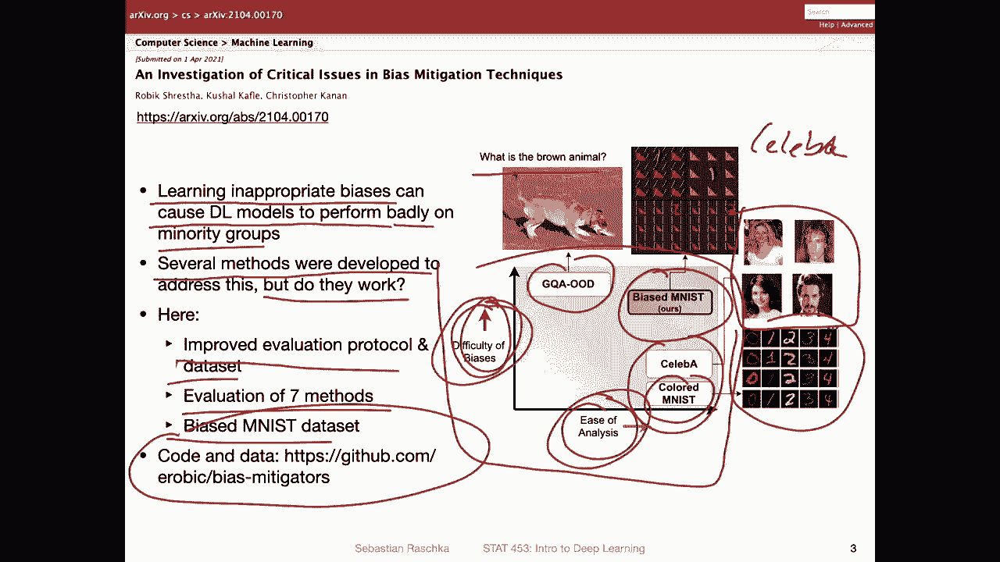
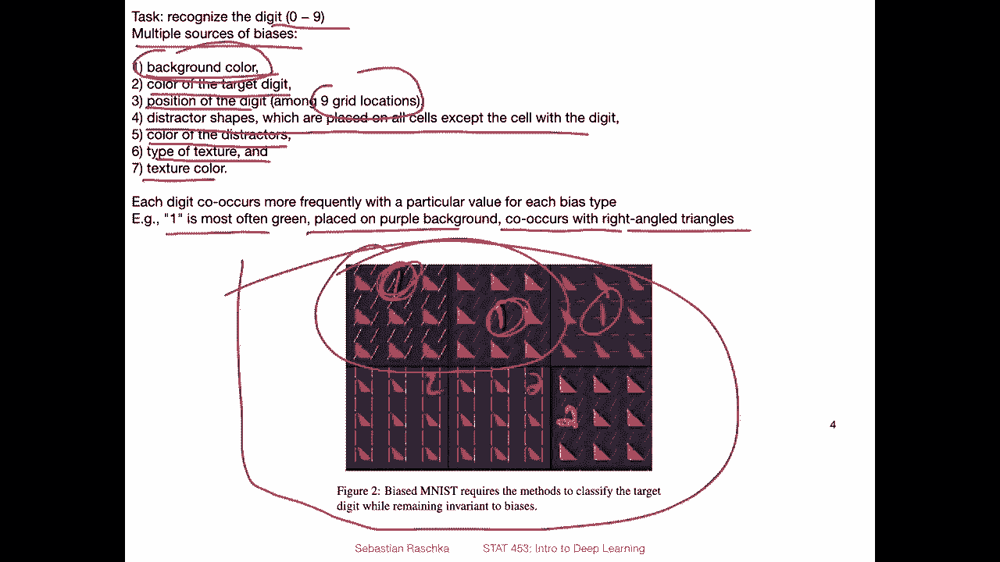
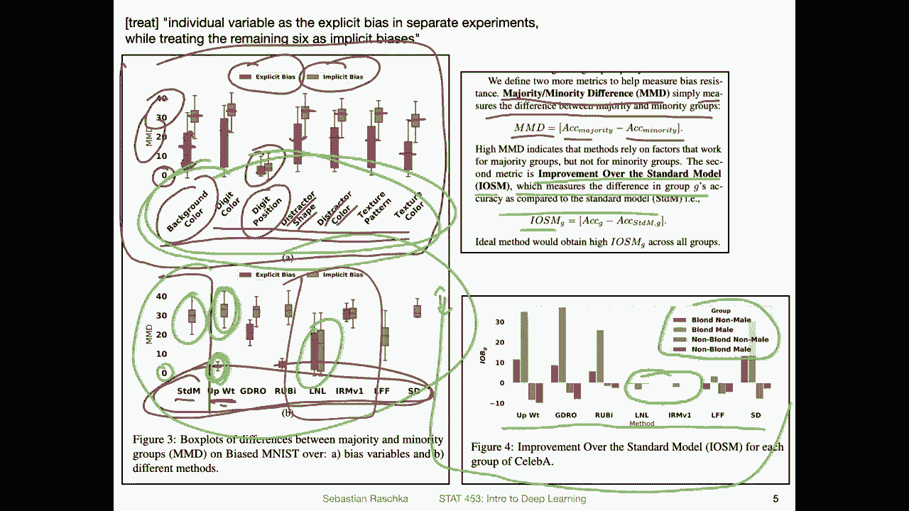
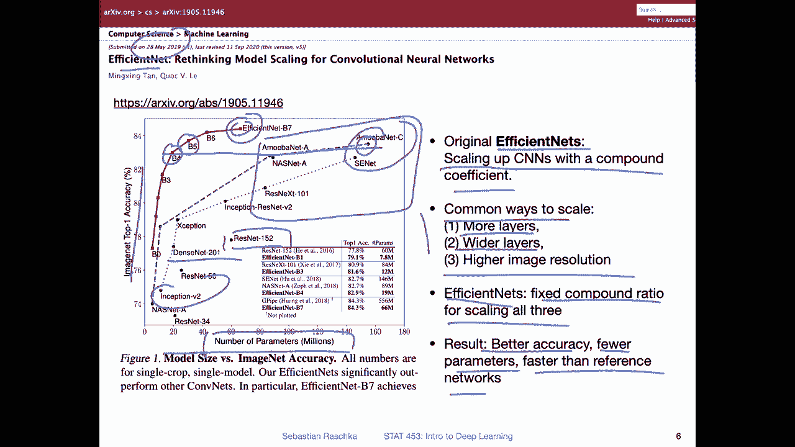
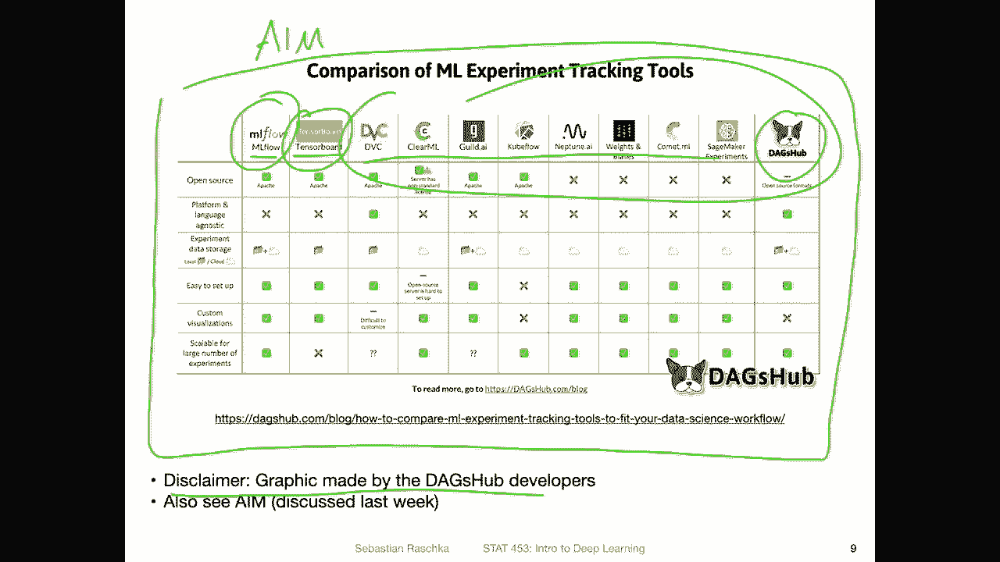

# 深度学习新闻 #10：2021年4月3日 📰

在本节课中，我们将学习本周深度学习领域的两项重要进展。首先，我们将探讨一篇关于分析和缓解深度学习模型偏见的新论文及其提出的新数据集。随后，我们将介绍一种新的卷积神经网络架构——EfficientNetV2。最后，我们还会简要了解一个新的优化器和一个实验跟踪工具列表。

---

## 🔍 偏见分析与缓解方法评估

上一节我们介绍了卷积神经网络，本节中我们来看看如何评估和缓解模型中的偏见问题。先前我们讨论过，将深度学习应用于某些问题时可能存在严重的偏见问题。例如，之前视频中提到的系统，它通过深度神经网络来评估求职者，但一个主要问题是，如果背景中有书架，系统对求职者的评分会有显著差异，这显然是不应该发生的。

本周有一篇论文评估了不同缓解此类偏见的系统。已经开发了多种技术，核心问题是：这些技术到底有多有效？学习到这些不恰当的偏见会导致深度学习模型在少数群体上表现极差，这是我们希望预防或避免的。这些已开发的方法，其核心问题在于它们是否真的有效，以及有多大用处。几周前我介绍过一篇论文，其中提到这些方法只在非常刻板的公平性意义上有效。

无论如何，我认为存在多个层面的问题。首先，将模型应用于特定类型的问题是否合理或明智？其次，我们可以使用哪些方法来减少偏见？再者，我们如何评估这些方法是否真的有效？这是我们应该提出的三个不同层次的问题。

在这篇论文中，作者试图改进评估协议，并提供了一个名为“Biased MNIST”的新数据集。他们特别评估了七种不同的方法，其代码和数据集已在GitHub上开源。

以下是论文中描述偏见分析问题的概述。存在不同类型的数据集，例如问答数据集和“Setup A”数据集（我们可能在后续关于生成对抗网络或变分自编码器的课程中使用）。问答数据集包含了多种复杂的偏见，但分析起来并不容易。而“Setup A”数据集和彩色MNIST数据集（即带颜色的MNIST版本）虽然易于分析，但其中需要检测的偏见过于简单，不足以真正评估不同的偏见缓解方法。因此，他们开发了这个“Biased MNIST”数据集，声称它既易于分析，又能提供足够难度的偏见。

这个“Biased MNIST”数据集的任务是识别0到9这10个不同的数字。它包含了7种不同的偏见来源：
*   背景颜色
*   待分类目标数字的颜色
*   数字的位置（有9个网格位置）
*   干扰形状（图像中其他用于分散预测注意力的形状）
*   干扰物的颜色
*   纹理类型
*   纹理颜色

以下是数据集的一个示例。顶行是数字“1”。在这个例子中，数字“1”通常是绿色的，并且最常出现在紫色背景上，并且经常与直角三角形同时出现。但有时它会是其他颜色，例如红色。在这种情况下，绿色是多数类，而其他颜色是少数类。因此，对于每个数字，他们设定了一些在多数类中常见、在少数类中不常见的特征，例如改变颜色或背景。通过这种方式，他们试图评估网络对这些非数字本身特征的敏感程度。网络对改变干扰物颜色或形状有多敏感？网络对数字位置（是在中心还是在上部）有多敏感？他们分析了不同类型的干扰，以判断网络是专注于数字本身，还是其他如颜色等特征。

以下是该论文的一些结果。我必须承认这些结果有点难以解读，希望我的理解是正确的。论文中的表述并非完全清晰，但根据我的理解，我来为大家讲解一下。

首先，我们来看这个MMD图。他们将MMD定义为“多数-少数差异”，用于衡量多数群体和少数群体之间的差异。他们计算了多数类的准确率（例如，上一张幻灯片中绿色的数字“1”是多数类）和少数类的准确率（例如，红色的数字“1”）。他们针对我们上一张幻灯片讨论的七种偏见分别计算了MMD，每次专注于一种他们称之为“显性偏见”的偏见，而“隐性偏见”则是未被处理的那些。这里的箱线图（如果我没理解错的话）是针对不同方法绘制的。我们稍后会看这些方法，但下方列出了七种不同的方法。因此，箱线图是跨不同方法绘制的。

例如，在这里你可以看到，当将背景颜色视为显性偏见时，显性偏见的MMD中位数（平均而言）低于隐性偏见。隐性偏见是未被处理的那些。在所有情况下，显性偏见的中位数都低于隐性偏见的中位数。因此，这些方法在降低你指定的目标变量（例如干扰物形状、干扰物颜色等）的偏见方面，在某种程度上是有效的。对于数字位置，我们看到没有太大差异，这可能是因为卷积网络天生对位置具有一定的不变性，而且人们通常已经使用了数据增强（如随机裁剪）来处理输入。

但除此之外，你可以看到显性偏见和隐性偏见之间存在巨大差异。因此，这些方法在某种程度上是有效的，但另一方面，它们离零值还很远，所以效果并不是非常好。而且你可以看到，对于隐性偏见，它们仍然存在，多数类和少数类之间仍有高达30%到40%的巨大差异。

接下来，我们更详细地看看这些方法。这里我们可以看到七种方法。SD是标准方法，你可以将其视为基线模型。然后他们比较了其他7种方法。以这里的UpWt为例，他们将其显性偏见的结果圈了出来。现在，箱线图的范围（如果我没理解错的话）是针对这些不同类型的隐性偏见的。因此，箱线图的范围现在是跨隐性偏见的。你可以看到，对于一种特定的显性偏见，其MMD接近0，但其他隐性偏见的MMD仍然很高。我认为他们的分析方式是：遍历所有偏见，每次将其中一个视为显性偏见，而将剩余的六个视为隐性偏见，然后取平均值。这就是该方法在区分显性偏见和隐性偏见时的平均表现。

你可以看到，如果你指定了显性偏见，这种方法在处理这些显性偏见方面相当不错，但所有其他偏见仍然是一个大问题，实际上甚至比标准模型中的问题更大。因此，如果你使用这种方法，你可能会修复你指定的显性偏见，但会使其他所有问题变得更糟。总体而言，没有一种方法能够真正处理所有的隐性偏见。你可以看到，到处都存在大问题。也许这里这个方法，对于显性和隐性偏见，其MMD都是最低的。我认为真正棘手的部分是隐性偏见，因为它们可能潜藏在你的数据集中。对于显性偏见，即使存在，你也能意识到，也许可以告诉人们要注意这一点。但隐性偏见可能是一个更大的问题。然而，你可以看到所有这些方法对于这类问题都不是非常鲁棒。

在右侧，有另一种评估指标，他们称之为“IOSM”（相对于标准模型的改进）。它衡量的是与标准模型相比，群体准确率差异的变化。同样，你可以看到在大多数情况下，这些模型或方法都存在一些问题。但对于“Setup A”数据集，有一些方法在这四种偏见类型上的差异非常小。因此，在像“Setup A”这样的简单数据集上，有些方法处理得很好。但当他们观察这个“Biased MNIST”数据集时，这些问题仍然存在，因为你可以看到L和L以及I am（指代具体方法）的结果仍然有问题。因此，也许在开发方法时，“Biased MNIST”数据集也是值得考虑的，因为右侧的“Setup A”数据集可能过于简单了。

好吧，我认为这仍然是一个活跃的研究领域。我也不是这个领域的专家，只是觉得这篇论文和一个用于评估潜在偏见缓解方法的新数据集可能值得一看。

---

## 🏗️ 新的卷积神经网络架构：EfficientNetV2

上一节我们讨论了偏见分析，本节中我们来看看一种新的卷积神经网络架构。在课堂上，由于时间限制，我们只讨论了几种架构，但总会有更多有趣的架构出现。我之前提到过EfficientNet，这里先简要介绍一下，因为我们还没正式讨论过它。大约两年前，EfficientNet架构家族被提出，这不算新闻，我们将在下一张幻灯片讨论新闻。本质上，这是一种构建高效神经网络架构的方法。

它涉及使用复合系数来扩展卷积网络。传统上，我们有三种扩展卷积网络的方式：
1.  增加更多层（深度）
2.  增加层的宽度（通道数）
3.  提高图像分辨率

通常，如果我们提高图像分辨率，网络性能不会很好，因此我们也必须改变层数、层宽等。EfficientNet背后的思想是分析这些缩放维度如何相互关联。他们提出了一个特定的公式来协调缩放这三个组件。他们发现，通过他们的方法，可以用更少的参数获得更好的准确率，并且在应用缩放时，网络运行速度比参考网络更快。

在左侧的图表中是一个比较。例如，这里有ResNet-152（一个大型网络）、DenseNet、Inception等。横轴是参数数量，右侧的网络参数当然更多。纵轴是在ImageNet上的性能。你可以看到，与其他参考架构相比，EfficientNet的参数数量更少，但性能更好。观察性能最好的非EfficientNet网络，可能是这个。你可以看到，他们开发了一个高效得多的架构，达到了与这个MobileNet相当的准确率。这确实是一个非常有趣的方法，即EfficientNet。

然而，这里的新闻是关于EfficientNetV2，它也在4月1日发布（有两篇4月1日的论文）。对于4月1日的论文，你总是需要小心一点，就像你可能记得我的“Car Network”可能有时不是真正的网络，可能只是个愚人节玩笑。但在这种情况下，这似乎是一篇正经的论文，而且实际上非常酷。它扩展了EfficientNet，使其性能更好。

他们引入了新的操作，例如“Fused and B Convolution”。我们不会深入探讨细节，但本质上，它涉及在训练过程中逐步增加图像尺寸。通常，当你增加图像尺寸时，性能会下降，也可能出现更多过拟合，这可能仅仅是因为现在有更多像素了。他们的做法是在训练过程中逐步提高分辨率，同时自适应地调整正则化，结合使用了Dropout和数据增强。我认为这也是一个很酷的想法。你可以看到，所有这些架构都是EfficientNetV2。它们都比这里的EfficientNetV1表现好得多，实际上是一个巨大的改进，在ImageNet上从83%提升到了87.4%，同时仍然保持高效。

---

## 🧠 其他新闻：新优化器与实验跟踪工具

既然我们最近讨论了不同的优化算法，并且也有相关的测验和考试题目，我想介绍一个新的优化器。现在有一个名为“Matt Grt”的优化器，它不代表“Matt Grt学生”，而是对EGrt和Adam的一种改进。

他们说Adam并没有完全达到成为通用深度学习优化器的目标，而Matt Grt方法正是为了解决这些问题而设计的。Adam和带动量的SGD在不同类型的问题上表现良好，但并非所有问题。在左侧图表上可能有点难看清，这里是Adam。在右侧，Adam位于这个高性能区域的上方。对于SGD加上动量，我认为它在这里和这里（指图表位置）的上方。你可以看到，有时M（可能指Matt Grt）更好，有时SGD更好。他们现在提出了一个新方法Matt Grd，它总是表现良好，总是位于上方区域。这可能是另一个值得关注的有趣事物。我还没有在实践中尝试过，但如果你感兴趣，可以试试。他们在GitHub上提供了代码，论文中应该也有链接。我还没有详细研究这篇论文，但它可能是另一个值得考虑的有趣方法。

上周我简要提到了一种用于跟踪机器学习实验的新工具，叫做Aim。出于某种原因，Aim不在这张列表上。但这里有一个不同实验跟踪工具的有趣列表。上周我还提到了MLflow和TensorBoard。这里还有更多选择。这张图表是由DagsHub的人制作的，DagsHub也在这个列表上。所以，你应该对这张图表持保留态度，但它仍然可能是一个有趣的表格，你可以在其中找到不同的实验跟踪替代方案。如果你正在做课程项目，并且希望采用更有条理的方法（相比于在Excel电子表格中跟踪模型性能或使用Matplotlib），这些工具可能对你有用。就我个人而言，我并没有广泛使用这些方法。我和一位同事正在使用MLflow，我有时也用TensorBoard，但经常两者都不用。我认为其他工具也相当不错。这真的只是个人喜好、实验规模以及你是否经常进行大量实验的问题。就像所有事情一样，关键在于找到平衡点：不要使用对你所做的事情来说过于复杂的东西，但如果你经常大规模地进行某些工作，那么在重新发明轮子、编写自己的跟踪工具之前，也许可以先看看是否已经有现成的解决方案可以解决你的问题。

---

## 📝 总结

本节课中我们一起学习了本周深度学习领域的重要动态。我们首先深入探讨了一篇关于评估深度学习模型偏见缓解方法的新论文，以及其提出的“Biased MNIST”数据集，该数据集旨在更有效地评估模型对多种偏见的敏感性。接着，我们介绍了EfficientNetV2这一新的卷积神经网络架构，它通过渐进式分辨率缩放和自适应正则化，在保持高效的同时显著提升了性能。最后，我们还简要了解了一个新的优化器Matt Grt和一个实验跟踪工具的概览列表。这些进展展示了该领域在追求更公平、更高效、更易管理的模型方面的持续努力。