# 122：L14.5 - 用卷积层替代全连接层 🧠

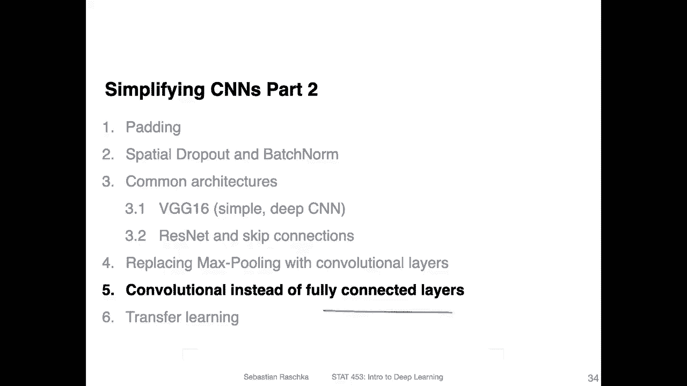

在本节课中，我们将学习如何用卷积层来替代神经网络中的全连接层。我们将探讨两种不同的实现方法，并通过代码示例验证它们的等价性。理解这种转换有助于我们更深入地理解卷积操作的原理，并构建完全由卷积层组成的网络。

## 全连接层回顾 🔍

在上一节中，我们学习了全连接层的基本结构。现在，我们来看看一个具体的例子。

左侧展示的是一个我们之前见过的全连接层。为了适应幻灯片，这个全连接层有4个输入和2个输出。

以下是计算过程：
*   我们从一个绿色的权重向量 **W1** 开始。输出（绿色点）是通过将权重向量与输入 **X** 相乘，再加上一个偏置单元（图中未显示）计算得到的。我们称这个结果为 **output1**。
*   第二个输出 **output2** 的计算方式完全相同，只是使用了黄色的权重向量 **W2**。

## 方法一：将输入视为2D图像 🖼️

上一节我们回顾了全连接层的计算。本节中，我们来看看第一种用卷积层替代它的方法。

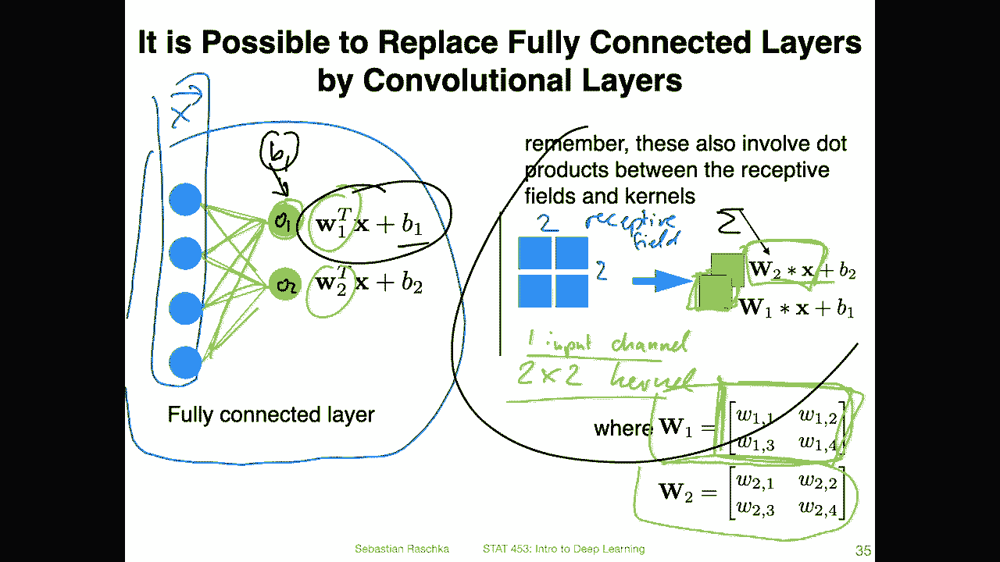

我们可以使用卷积层完成完全相同的计算。具体操作如下：
*   我们将4个输入排列成一个2x2的图像。
*   我们使用一个卷积核。以绿色输出为例，我们使用一个具有1个输入通道、2x2核大小的卷积核，其权重就是 **W1**。
*   第二个卷积核（对应黄色输出）同样具有1个输入通道和2x2的核大小，其权重是 **W2**。
*   卷积操作本质上是对感受野内的输入进行加权求和（点积），然后加上偏置。这与全连接层的计算完全相同。

从宏观上看，这相当于使用了两个卷积核，每个核有1个输入通道，核大小为2x2。

## 代码验证：方法一 💻

概念可能比看起来复杂，让我们通过代码示例来验证第一种方法。

以下是全连接层的设置：
```python
# 定义输入 (1, 2, 3, 4)，并重塑为卷积网络常用的格式 (N, C, H, W)
inputs = torch.tensor([1, 2, 3, 4], dtype=torch.float32).view(1, 1, 2, 2)

# 定义全连接层
fc_layer = nn.Linear(4, 2)

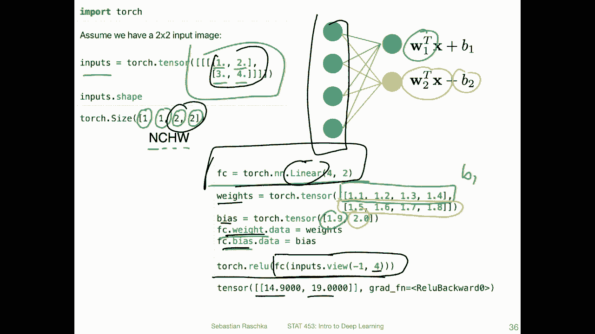

# 手动设置权重和偏置以便比较
weights = torch.tensor([[1, 2, 3, 4],  # W1 (绿色)
                        [5, 6, 7, 8]]) # W2 (黄色)
bias = torch.tensor([0.1, 0.2])       # 偏置
fc_layer.weight.data = weights
fc_layer.bias.data = bias

# 计算全连接层输出（需要将输入展平为向量）
fc_output = fc_layer(inputs.view(1, -1))
print(fc_output)  # 输出结果例如：tensor([[14., 19.]])
```

现在，我们用卷积层实现相同的功能：
```python
# 定义卷积层：1个输入通道，2个输出通道（两个核），核大小2x2
conv_layer = nn.Conv2d(in_channels=1, out_channels=2, kernel_size=2)

# 将全连接层的权重重塑为卷积核的形状 (out_channels, in_channels, H, W)
conv_weights = weights.view(2, 1, 2, 2)
conv_layer.weight.data = conv_weights
conv_layer.bias.data = bias

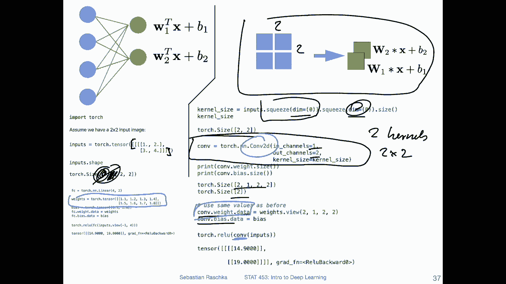

# 计算卷积层输出
conv_output = conv_layer(inputs)
print(conv_output)  # 输出形状为 (1, 2, 1, 1)，数值与全连接层结果相同
```
运行代码后，卷积层输出的数值与全连接层完全一致，只是结果的排列方式（多出了通道维度）不同。这证明了第一种替代方法的有效性。

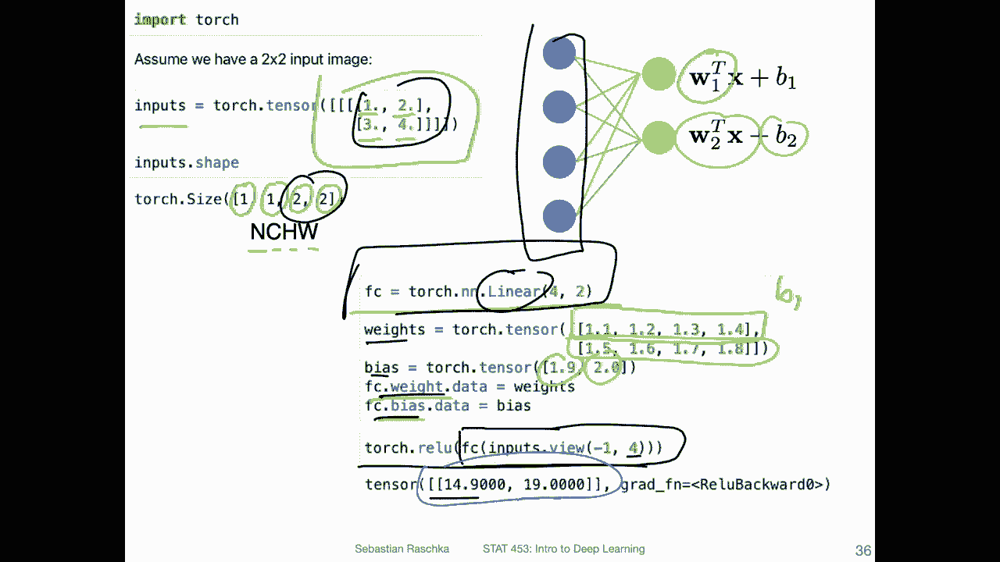

## 方法二：将输入堆叠为通道 📚

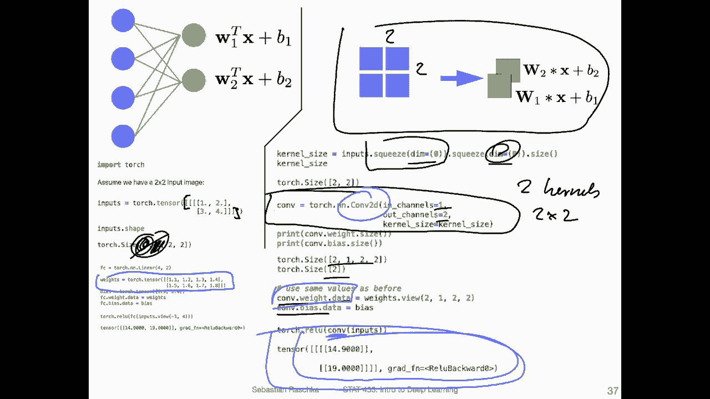

除了将输入排列成2D图像，我们还有第二种替代方法。

第二种方法是将这个输入向量堆叠起来。我们可以使用两个卷积核，每个核有4个输入通道，来实现与全连接层相同的效果。

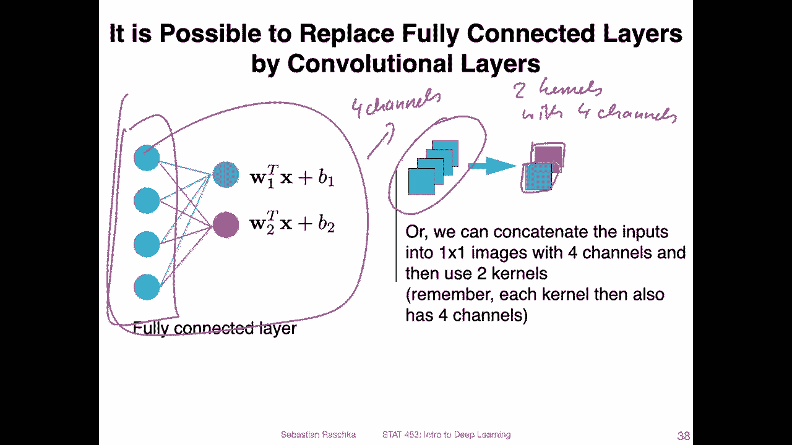

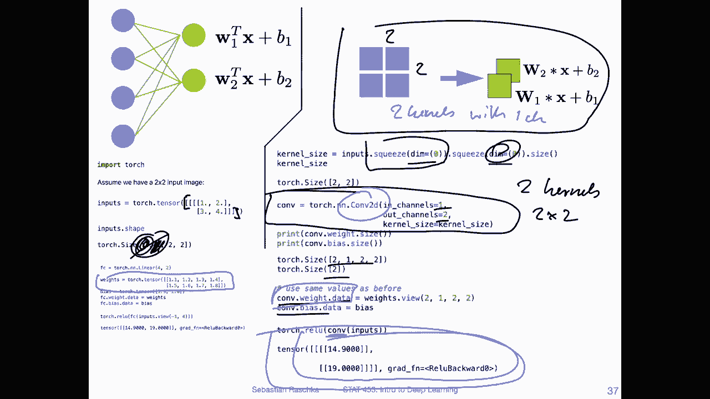

之前，我们有两个核，每个核有1个通道。现在，我们有两个核，每个核有4个通道。主要的区别在于，这里我们将输入堆叠为通道，而第一种方法是将其排列成2x2的格式。两种方法都能产生与全连接层等价的结果。

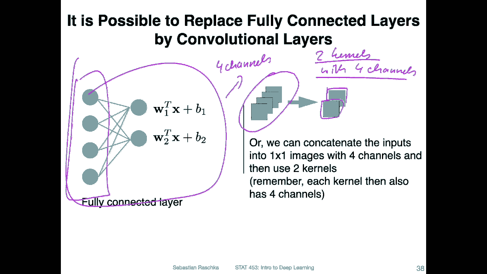

## 代码验证：方法二 🔬

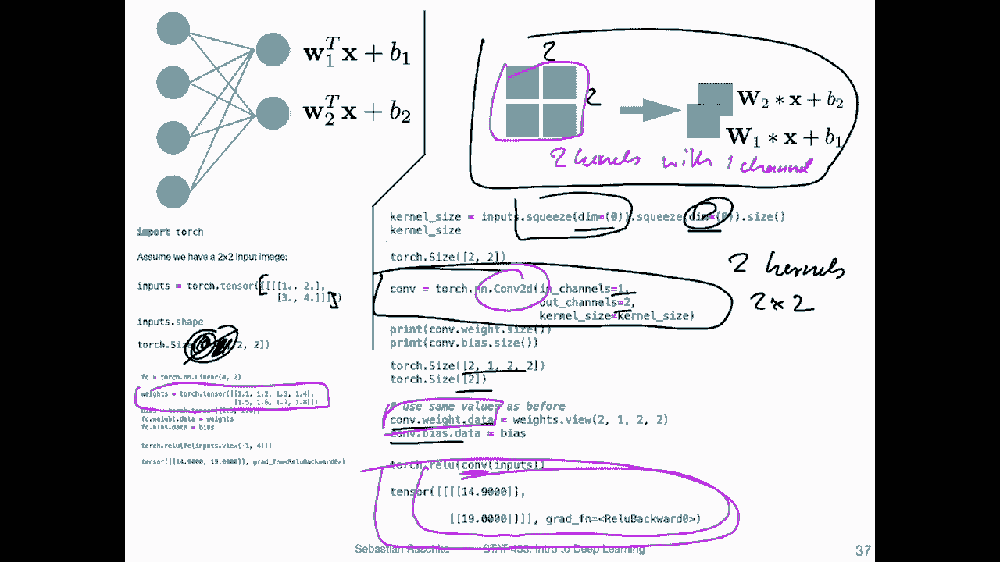

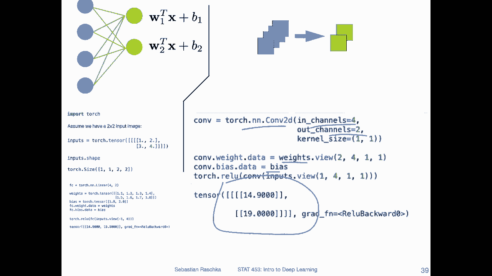

如果你不相信，这里还有另一个例子。

以下是第二种方法的代码实现（使用4输入通道的卷积）：
```python
# 将输入视为4个通道的1x1“图像”
inputs_stacked = torch.tensor([1, 2, 3, 4], dtype=torch.float32).view(1, 4, 1, 1)

# 定义卷积层：4个输入通道，2个输出通道，核大小1x1
conv_layer_stacked = nn.Conv2d(in_channels=4, out_channels=2, kernel_size=1)

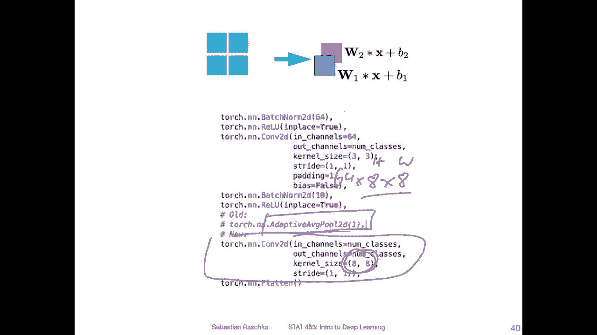

# 注意：权重需要对应新的形状。这里为了比较，我们使用变换后的相同权重。
# 实际上，一个4输入通道、1x1的卷积核等价于一个在特定位置上的全连接计算。
# 为了精确匹配原全连接层，需要精心设置权重值。
weights_stacked = ... # 根据W1, W2重新排列权重以匹配4输入通道
conv_layer_stacked.weight.data = weights_stacked
conv_layer_stacked.bias.data = bias

conv_output_stacked = conv_layer_stacked(inputs_stacked)
print(conv_output_stacked) # 输出结果同样与全连接层等价
```
使用相同的权重进行比较，我们再次得到了完全相同的结果。这是用卷积层替代全连接层的两种不同方式。

## 应用于全卷积网络 🚀

现在，让我们重新审视我们的全卷积网络，之前我们使用了自适应池化层。

例如，我们可以不使用自适应池化层或全连接层，而是应用我们的新想法，在这里也使用卷积层，让这个全卷积网络更加“纯粹”。此时，我将卷积核大小设置为8x8，因为在上一个代码笔记本中我们发现，到达这一阶段时特征图的大小是8x8（64个通道，高8宽8）。运行这个网络，虽然不会得到与自适应池化完全相同的结果（因为现在参数更多了），但它能正常运行，甚至可能给出更好的结果。

## 两种架构对比 ⚖️

最后，我们来直接对比一下使用全连接层实现和完全使用卷积层实现的网络。

以下是两种架构的对比：
*   **左侧（传统方式）**：
    1.  一个Conv2D层（64输入通道，64输出通道）。
    2.  将输出展平（Flatten），将64x8x8的特征图转换为一维特征向量。
    3.  一个全连接层（Linear），将特征向量映射到类别数（如10类）。
*   **右侧（全卷积方式）**：
    1.  同样的Conv2D层。
    2.  一个卷积层（Conv2d），其输入通道为64，输出通道数等于类别数（如10），核大小设置为前一层的特征图大小（8x8）。这样做的目的是得到一个1x1的输出空间维度。

理论上，右侧的实现应该能给出与左侧等价的结果。在实践中尝试时，如果发现结果略有不同，可能与随机权重初始化有关，因为每次调用层时都会创建随机权重，这使得比较变得困难。但正如我们之前所见，在精心设置权重的情况下，它们能产生完全相同的结果。

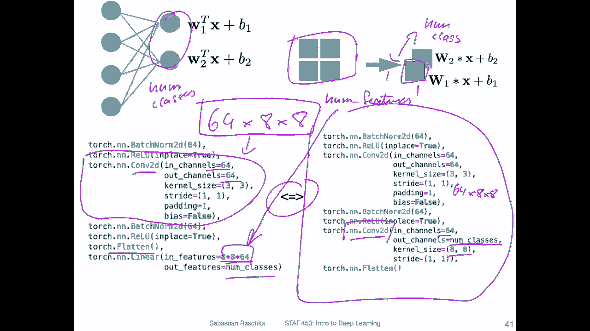

需要说明的是，几年前我出于兴趣在更严肃的网络中尝试过这种方法。通常这样做并没有好处。我当时认为，在CUDA实现中可能更容易获得更好的性能，因为可以更好地利用多GPU的并行性。但实际上，我发现最后一层使用全连接还是卷积层几乎没有任何差异。因此，这里展示的内容更像是一个玩具实验或示例，旨在说明我们**有能力**这样做以达到等价效果，但**并非必要**。你可以将此视频视为完全可选的内容，它主要有助于从技术角度理解卷积的工作原理。

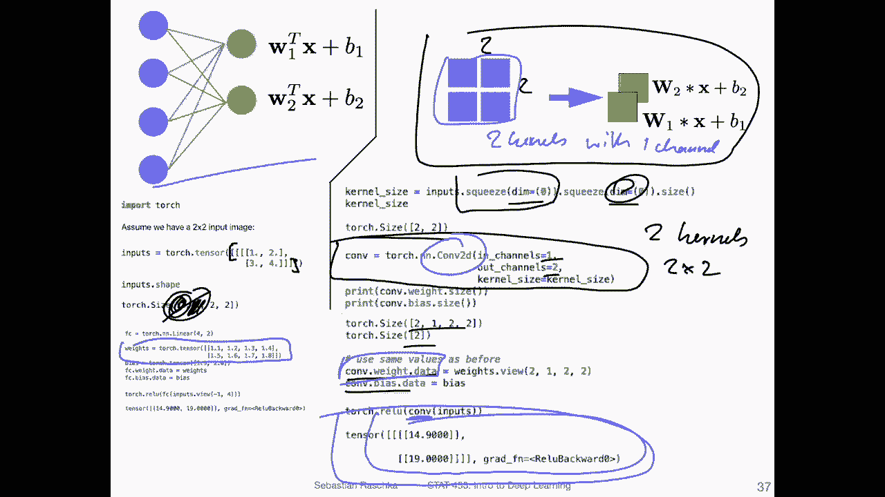

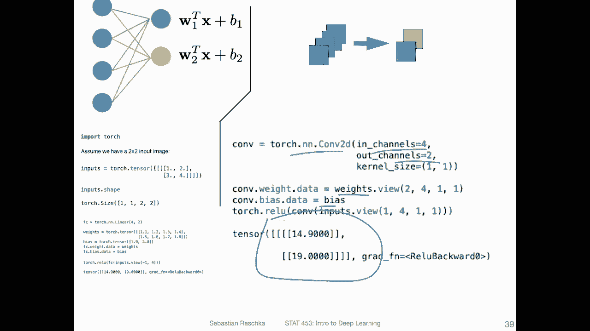

## 总结 📝

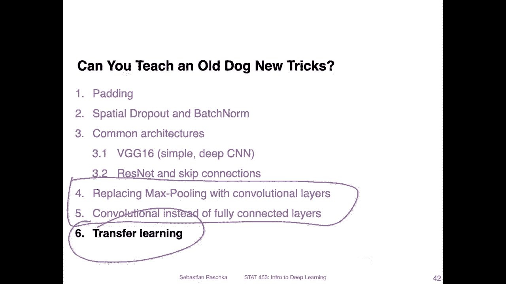

本节课中，我们一起学习了用卷积层替代全连接层的两种方法。我们通过具体的图示和代码，验证了这两种方法在数学上的等价性。我们还探讨了如何将这种思想应用于构建更“纯粹”的全卷积网络，并对比了传统架构与全卷积架构的异同。重要的是要理解，这种替代在理论上是可行的，能帮助我们深化对网络层本质的理解，但在实际应用中，根据具体任务和框架选择全连接层或卷积层通常都是合理的。在接下来的课程中，我们将回到一个更重要的主题——迁移学习，这对于大家的课程项目将非常有用，因为它能帮助我们利用相关的数据集。