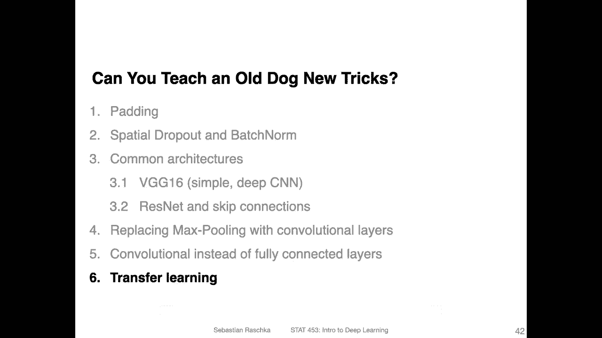
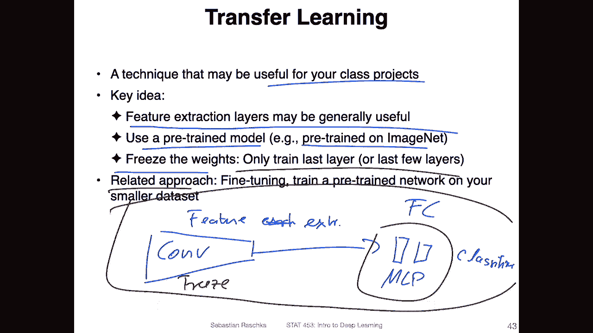
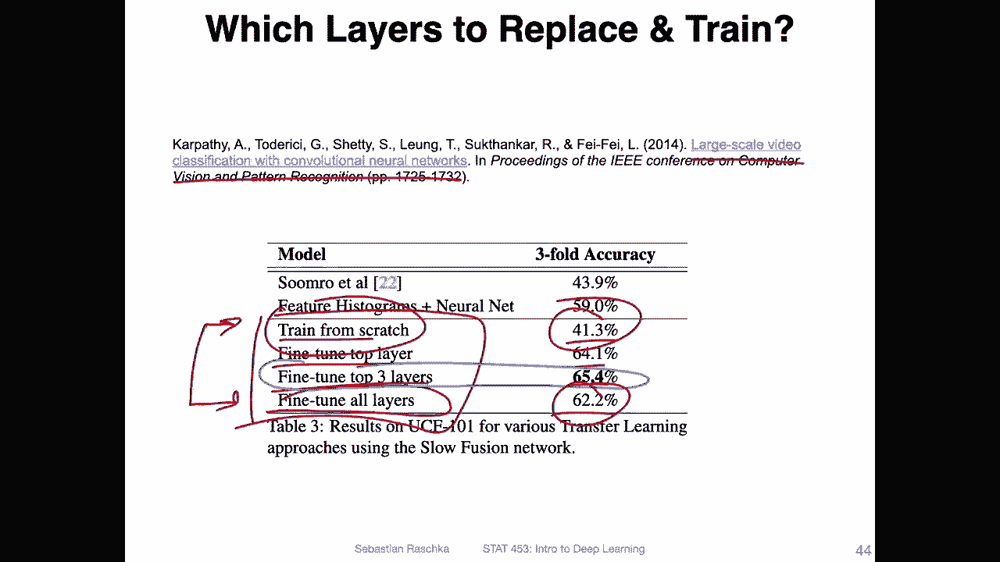
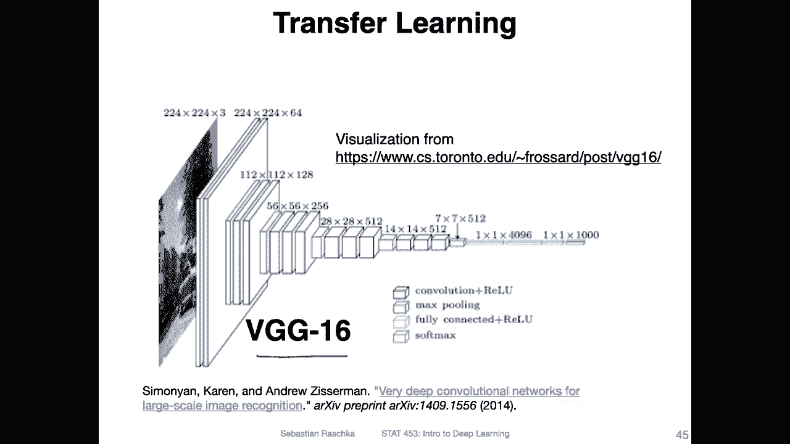
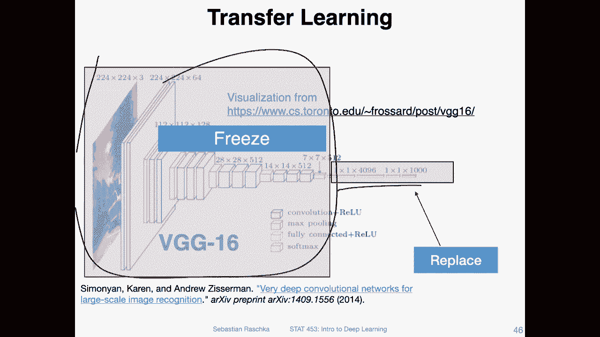
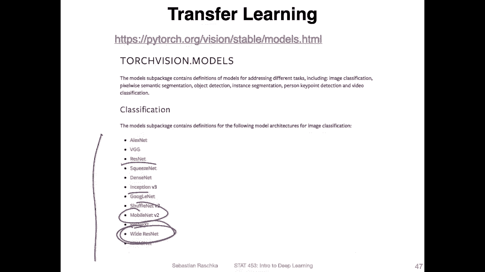
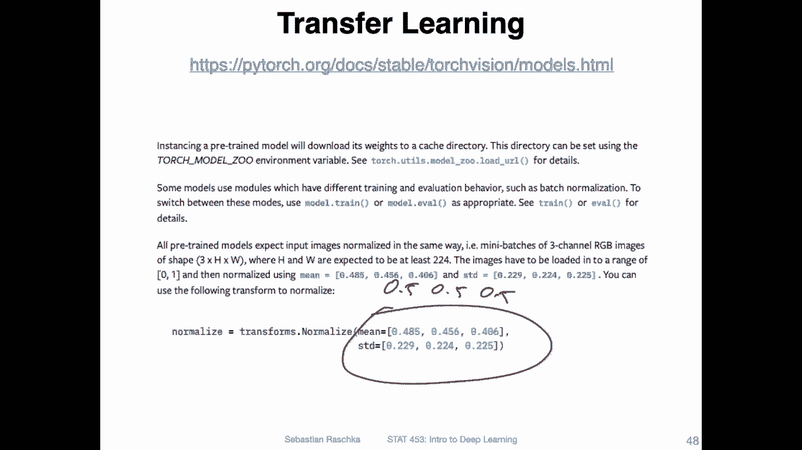
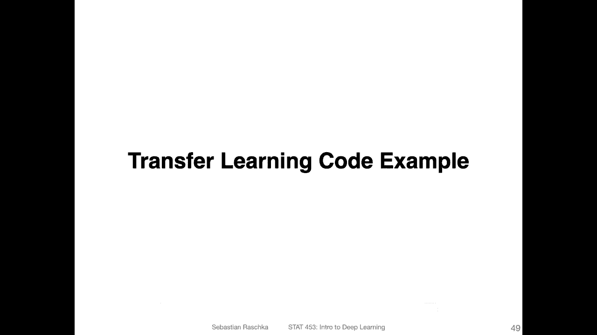

# 123：L14.6.1 - 迁移学习 🧠

在本节课中，我们将要学习迁移学习的概念及其在卷积神经网络中的应用。迁移学习是一种强大的技术，它允许我们利用在大型数据集上预训练的模型，来提升在较小目标数据集上的任务性能。

---

## 📚 概述

所有优秀的课程和讲座都有结束的时候。这是卷积神经网络架构系列中的最后一个主题。虽然迁移学习并非卷积网络特有的主题，但现在是讨论它的好时机，因为目前已有一些优秀的预训练计算机视觉模型可供使用。迁移学习对于课程项目尤其有用。

## 🔍 核心概念

迁移学习的核心思想在于，卷积神经网络通常包含两个主要部分：
1.  **特征提取部分**：由卷积层构成。
2.  **分类器部分**：通常由全连接层（或线性层）构成，即多层感知机。

迁移学习的理念是，卷积层构成的自动特征提取管道，可能对其他相关任务同样有用。

例如，许多同学正在进行的课程项目涉及通过胸部X光数据预测新冠肺炎。一个合理的假设是：在一个与新冠肺炎无关的大型通用胸部X光数据集上训练的网络，如果在我们特定的新冠肺炎数据上进行微调，可能对新冠肺炎检测也有帮助。

在深度学习中，我们通常有大型基准数据集，但这些数据集主要用于模型比较和基准测试。在实际应用中，我们通常拥有的数据集要小得多。因此，问题在于：我们能否利用这些海量数据来训练网络，然后在我们的较小目标数据集上对这些网络进行微调？

## 🛠️ 迁移学习方法

以下是迁移学习的几种常见方法：

*   **冻结权重**：使用在ImageNet等数据集上预训练的模型，**冻结**特征提取层（卷积层）的权重。这意味着在训练过程中保持这些权重固定，不进行更新，只训练最后几层（如全连接层）。
*   **整体微调**：在给定数据上训练整个网络，然后在较小的目标数据集上对整个网络进行微调。这是迁移学习的一种特殊情况，即不冻结任何权重。

## 📊 实践效果

下图展示了一项关于大规模视频分类的旧论文中的实验结果，它很好地总结了使用迁移学习时的几种选项及其性能对比：

*   **从头开始训练**：准确率为41%。
*   **预训练后仅微调最后一层**：准确率为64%。
*   **预训练后微调最后三层**：准确率达到最佳的65%。
*   **预训练后微调所有层**：准确率为62%。

从这个案例可以看出，微调三层网络取得了最佳结果。然而，这并非普遍规律。微调多少层只是另一个需要考虑的超参数，其最佳值取决于网络架构、数据集等诸多因素。

一个关键发现是：**从头开始训练**的性能远不如**使用大型数据集预训练后再微调**，即使不冻结任何层也是如此。

## 🎬 下节预告

在下一节视频中，我们将具体演示如何在PyTorch中实现迁移学习。我们将使用已学习的VGG16模型进行说明，因为它是最容易解释的模型之一。

具体步骤将是：
1.  使用在ImageNet上预训练的VGG16模型。
2.  冻结其卷积层。
3.  替换其输出层。
4.  在一个不同的数据集（为简化代码，我们将使用CIFAR-10数据集）上微调这些新层。

当然，这是一个通用概念，可以应用于任何数据集。

## 📝 可用模型与注意事项

除了VGG16，还有其他可用的预训练模型。VGG16可能不是性能最佳的模型，且计算成本较高。对于课程项目，如果想获得良好性能，Wide ResNet和Inception v3也是不错的选择，但运行速度较慢。MobileNet是一个性能不错且速度较快的网络。当然，还有残差网络（ResNet）。实际效果可能因任务而异。

**进行迁移学习时，有一个重要注意事项：**
你必须仔细检查预训练模型的提供者所使用的数据标准化方法。在PyTorch中，一些在ImageNet上预训练的模型是可用的。如果你想使用这些模型，必须注意使用与它们相同的数据标准化参数。对于ImageNet，他们使用了特定的均值和标准差进行归一化。通常，我们需要使用相同的参数来处理我们的新数据集，以确保数据尺度与网络预期的一致。

## 🎯 总结

本节课我们一起学习了迁移学习。我们了解了其核心思想：利用预训练模型的特征提取能力来加速和提升在小数据集上的学习效果。我们探讨了冻结权重和整体微调等不同方法，并通过实例看到了迁移学习相比从头训练的优势。最后，我们预告了下一节将在PyTorch中进行实践，并提醒了使用预训练模型时数据标准化的重要性。迁移学习是深度学习实践中一项极其有价值的技能。