# 125：L15.0- 循环神经网络简介 📚

在本节课中，我们将要学习循环神经网络。循环神经网络是一种特殊的神经网络，能够对序列数据进行建模。一个常见的应用是自然语言处理，例如将文档视为一系列单词，或将每个单词视为一系列字符或字母。今天，我们将从宏观角度了解循环神经网络的工作原理，并在课程最后展示一个文档分类的示例。

本课程名为“深度学习与生成模型导论”，通过本节课，我们将完成深度学习导论部分。相信届时你将能对深度学习及其可应用的不同问题领域有一个广泛而良好的理解，这将成为你深度学习的基础知识。之后，我们将把这些知识应用到生成模型部分，这部分内容将从下周开始。下周，我们将运用卷积层等概念，以及稍后介绍的循环神经网络来生成新数据。具体来说，我计划下周讲解自编码器和变分自编码器，它们是专门用于生成数据的网络类型，我们将使用卷积层来处理图像数据。之后，我还会讲解生成对抗网络，这是一个非常热门的话题。最后，我们将再次回到循环神经网络，探讨如何生成新的文本数据。

今天，我们的重点是循环神经网络的宏观概述，以及课程末尾提供的分类示例。大约在一到两周后，我们将重新探讨循环神经网络在文本生成中的应用。

现在，让我们正式开始今天的课程，因为有很多内容需要讨论。

以下是今天课程计划涵盖的主题。如果你对处理文本数据感兴趣，需要知道循环神经网络并非处理文本的唯一方法。因此，我将首先简要介绍其他一些处理文本数据的方法。在简要概述之后，我们将更深入地探讨循环神经网络，了解它们如何进行序列建模。

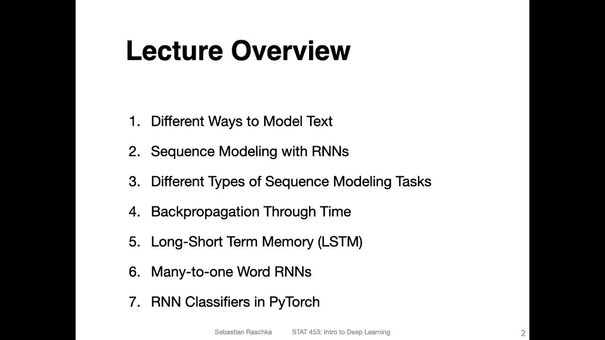

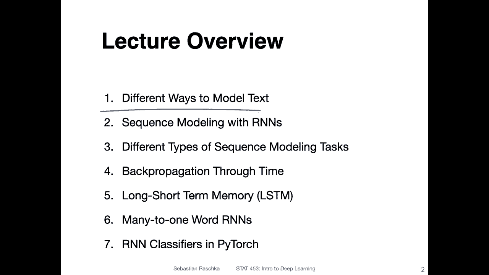

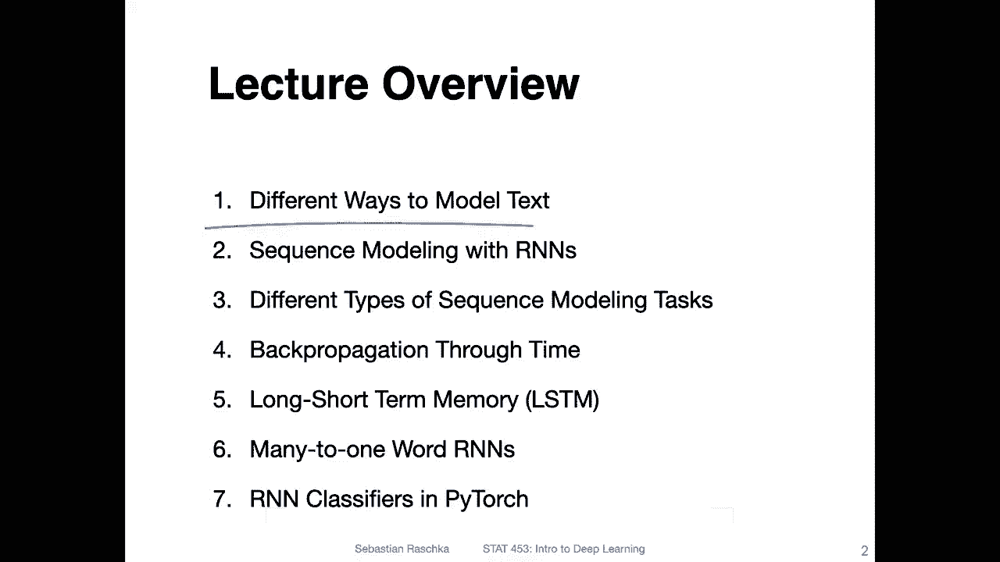

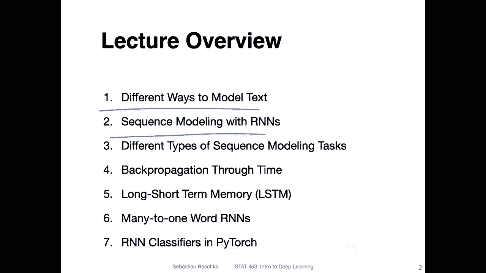

接下来，我将讨论不同类型的序列建模任务，因为除了文本分类之外还有更多应用。然后，我们将讲解随时间反向传播，这是我们在多层感知机和卷积网络背景下已经讨论过的反向传播算法的一个修改版本。

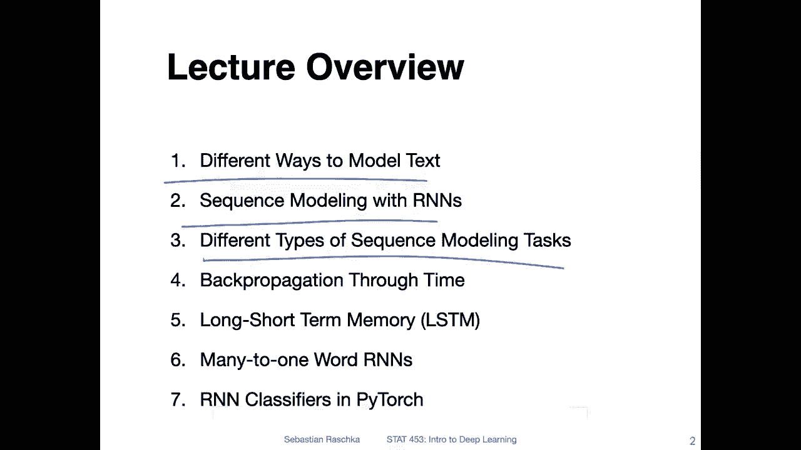

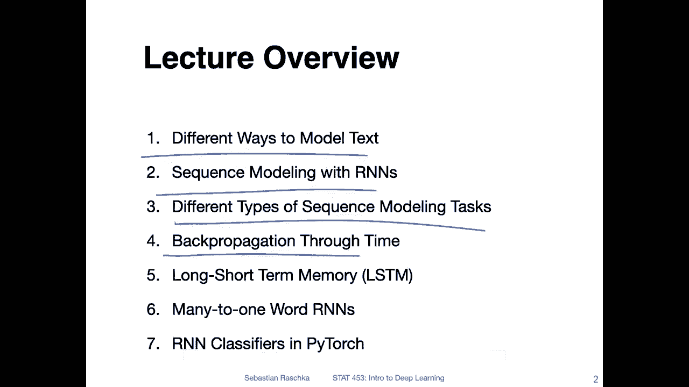

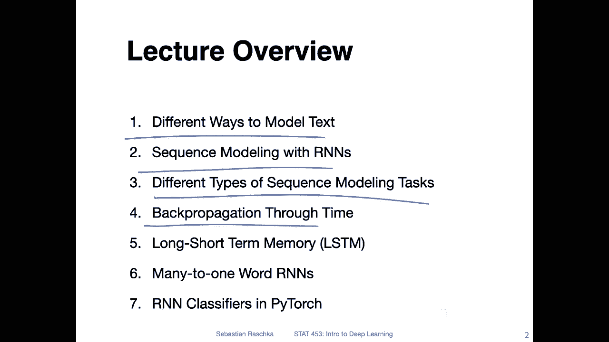

之后，我们将讨论长短期记忆网络。这是一种特殊的循环神经网络单元，有助于处理更长的序列。

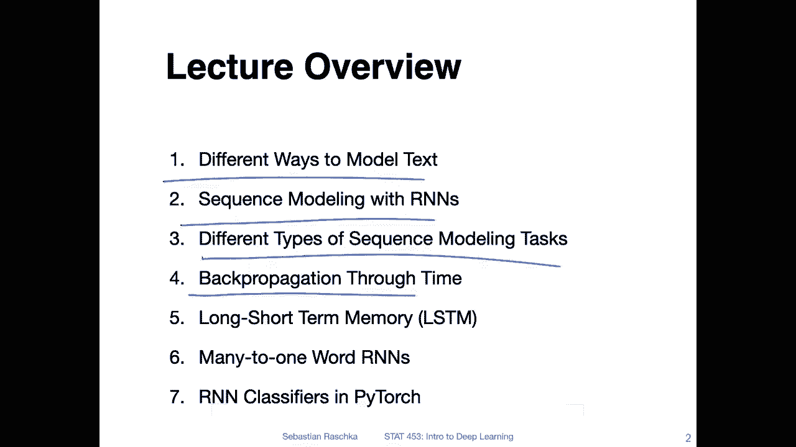

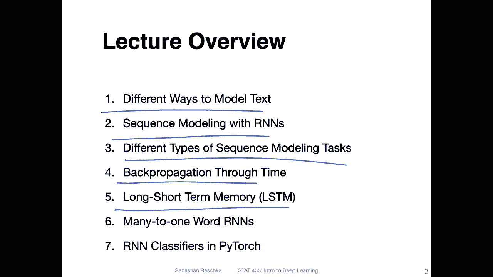

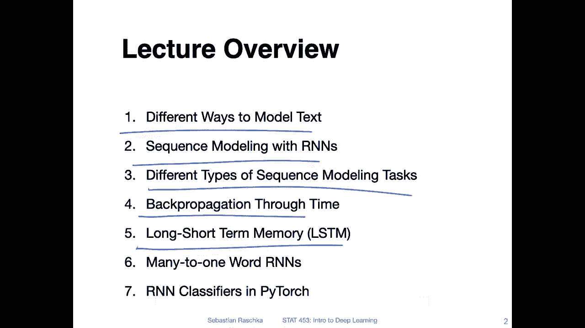

接着，我们将探讨“多对一”词级循环神经网络。这只是一个比较花哨的说法，指的是我们处理一个文本序列并希望对其进行分类的场景，即从多个单词组成的序列得到一个输出标签。我们将在此使用词级循环神经网络。稍后我也会讨论字符级循环神经网络，即一次处理一个字符，而这里我们一次处理一个单词。

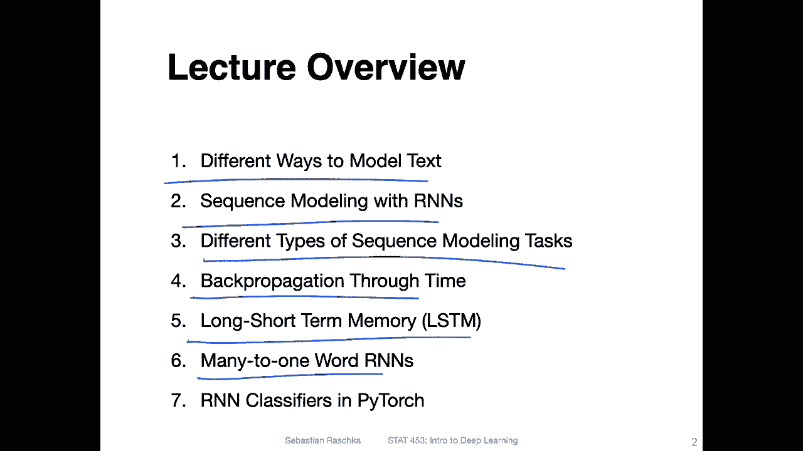

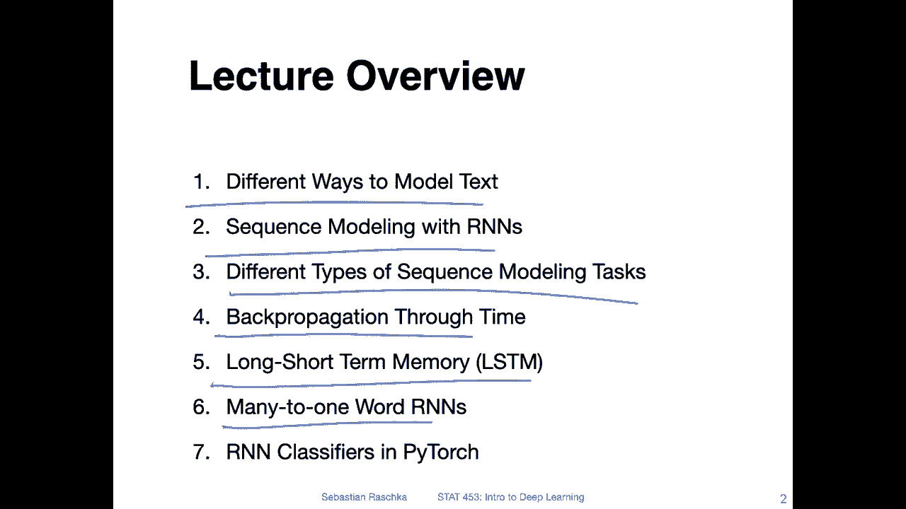

或者，观察一个例子，当我们有一段文本并希望对其进行分类时。即从一个序列（包含许多单词）到一个输出标签，我们将在这里使用词级循环神经网络。稍后我也会讨论字符级循环神经网络，字符级循环神经网络一次处理一个字符，而这里我们一次处理一个单词。

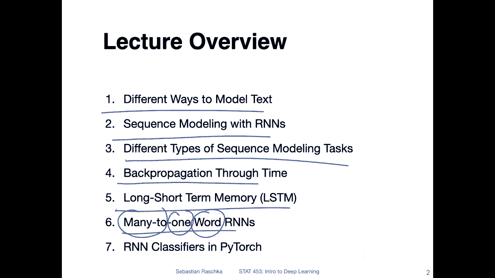

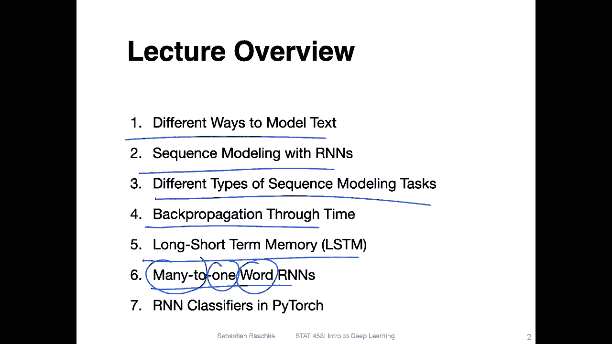

最后，我将展示如何在 PyTorch 中实现这些网络。

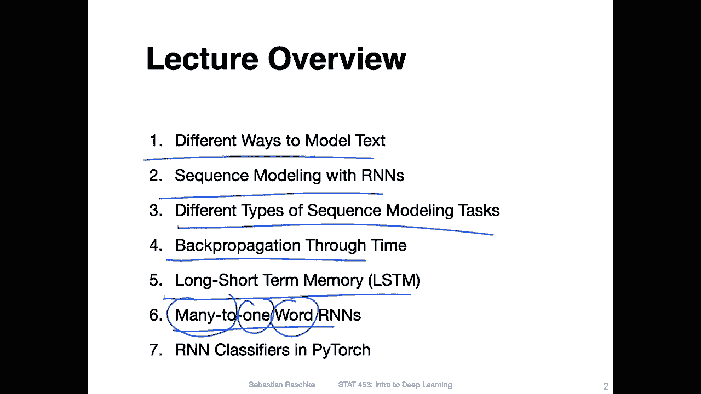

---

本节课中，我们一起学习了循环神经网络的基本概念、其处理序列数据的能力、不同类型的序列建模任务、随时间反向传播算法、长短期记忆网络单元的结构与作用，以及“多对一”词级循环神经网络在文本分类中的应用框架。我们还预览了后续课程中循环神经网络在文本生成等更高级任务中的角色。