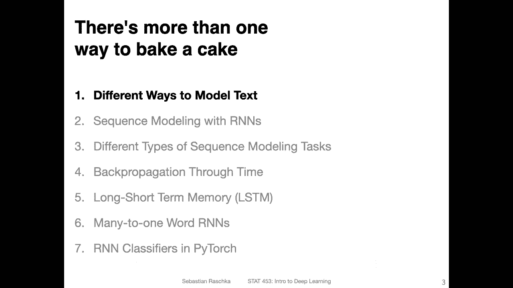
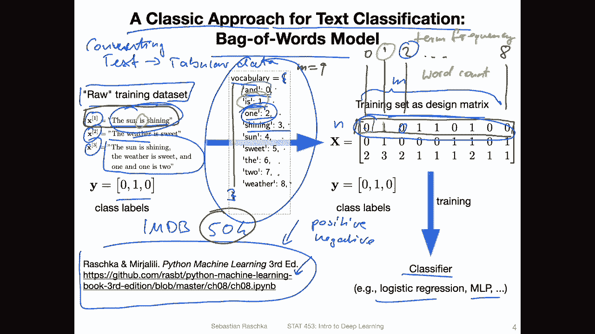
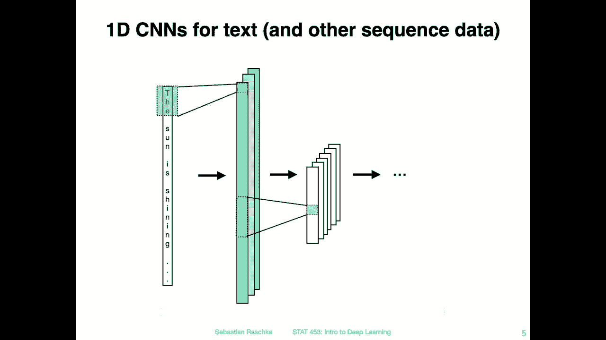
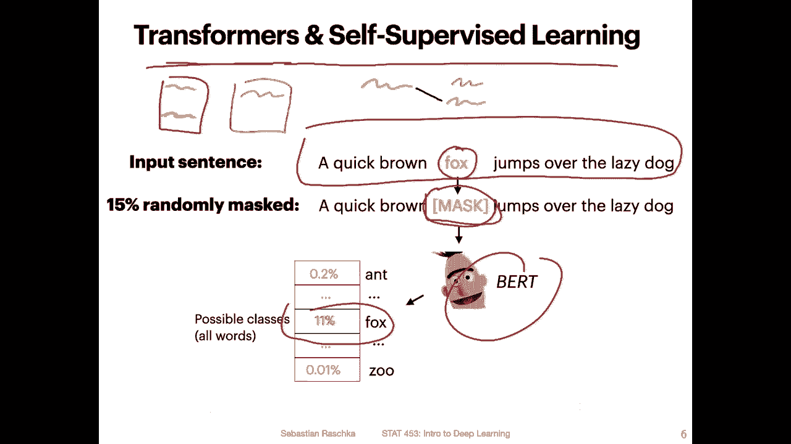
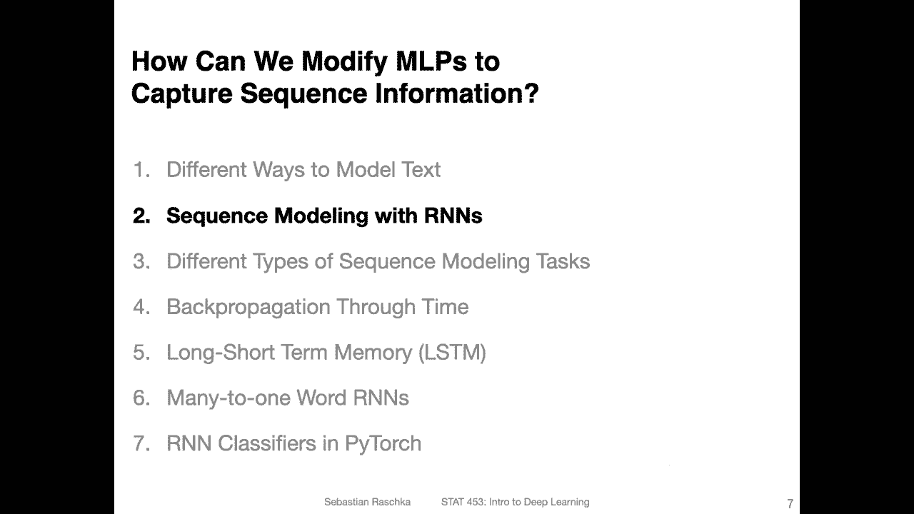

# 126：L15.1 - 处理文本数据的不同方法 📚

在本节课中，我们将学习处理文本数据的几种主要方法。我们将从经典的词袋模型开始，然后探讨一维卷积神经网络，最后简要介绍更现代的Transformer模型。了解这些方法的优缺点，有助于你在不同场景下选择合适的技术。

---

## 📦 词袋模型

在深入探讨循环神经网络之前，我们先回顾一种经典的文本分类方法——词袋模型。本节中，我们将了解其基本原理和实现方式。

词袋模型是一种将文本转换为表格数据集的简单方法。它的缺点在于忽略了单词之间的序列关系，但作为基线模型，它在某些任务上依然有效。

以下是构建词袋模型的基本步骤：

1.  **构建词汇表**：收集整个训练数据集中所有独特的单词，并为每个单词分配一个唯一的索引。
2.  **创建设计矩阵**：将每个文本样本转换为一个向量。向量的长度等于词汇表的大小，每个位置的值代表对应单词在该文本中出现的次数（即词频）。
3.  **训练分类器**：使用生成的设计矩阵（如 `X_train`）和对应的标签（如 `y_train`）来训练一个传统的分类器，例如逻辑回归或多层感知机。

例如，对于句子 “the sun is shining”，在词汇表 `{“and”:0, “is”:1, “one”:2, “shining”:3, “sun”:4, “sweet”:5, “the”:6, “weather”:7, “2”:8}` 中，其向量表示为 `[0, 1, 0, 1, 1, 0, 1, 0, 0]`。这可以形式化地表示为：

**设计矩阵 X** 的形状为 `(n_samples, vocabulary_size)`，其中每个元素 `X[i, j]` 表示词汇表中第 `j` 个单词在第 `i` 个文本样本中出现的次数。

---

## 🧠 一维卷积神经网络

上一节我们介绍了忽略序列信息的词袋模型，本节中我们来看看如何利用卷积神经网络来捕捉文本中的局部模式。

卷积神经网络不仅可用于图像，经过调整后也能处理文本数据。这里我们使用一维卷积层，让卷积核在文本序列上滑动以提取特征。

其工作原理如下：

1.  **文本数值化**：首先将文本中的每个字符或单词转换为数字。例如，可以将字母映射到其在字母表中的位置。
2.  **一维卷积操作**：使用一个一维卷积核在数值化后的序列上滑动。在每一步，卷积核覆盖一个局部窗口，计算窗口内数值与卷积核权重的点积，并加上偏置，通过激活函数后生成一个特征值。
3.  **堆叠卷积层**：可以堆叠多个卷积层来提取更高级别的特征。

例如，对于单词 “the”，将其字符转换为数值 `[20, 8, 5]`。一个大小为3的卷积核 `[w1, w2, w3]` 在其上滑动，计算方式为：`output = activation(w1*20 + w2*8 + w3*5 + bias)`。

在代码中，这通常通过 `torch.nn.Conv1d` 或 `tf.keras.layers.Conv1D` 层来实现。

---

## ⚡ Transformer 模型

我们了解了基于局部窗口的卷积方法，现在来看看当前处理文本数据更先进的方式——Transformer模型。它完全依赖于自注意力机制，无需循环结构。

Transformer模型是当前自然语言处理领域的主流架构。它的核心是自注意力机制，能够建模序列中任意两个元素之间的关系，无论它们相距多远。

Transformer的成功与以下两个关键点密不可分：

*   **海量数据需求**：Transformer模型通常需要在数十亿句子的语料库上进行训练，这需要巨大的计算资源。
*   **自监督学习**：为了利用无标签的海量文本数据，Transformer使用自监督任务来生成训练信号。例如，BERT模型就使用了以下两种任务：
    1.  **掩码语言建模**：随机遮盖输入句子中15%的单词，然后训练模型预测被遮盖的单词。
    2.  **下一句预测**：给定两个句子，训练模型判断它们是否在原文中连续出现。

由于训练Transformer需要极大的成本，对于许多实际任务，循环神经网络仍然是更可行和高效的选择。我们将在后续课程中更详细地探讨Transformer。

---

## 📝 总结

本节课中我们一起学习了处理文本数据的三种主要方法：

1.  **词袋模型**：一种简单快速的基线方法，将文本转换为词频向量，但忽略了单词顺序。
2.  **一维卷积神经网络**：通过卷积核捕捉文本中的局部特征模式，适用于某些分类任务。
3.  **Transformer模型**：基于自注意力机制的强大架构，能建模长距离依赖，但需要海量数据和计算资源进行训练。

理解这些方法的适用场景和权衡，是构建有效文本处理系统的第一步。在接下来的课程中，我们将重点深入探讨循环神经网络。