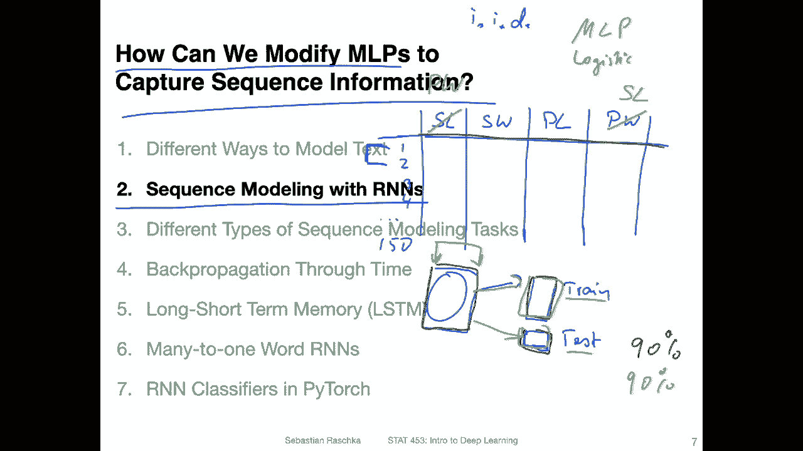
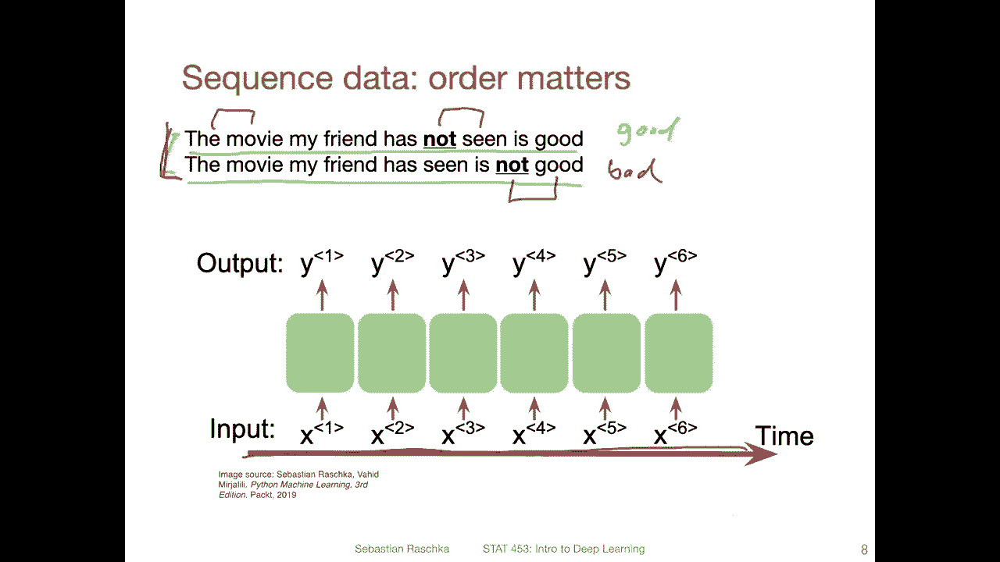
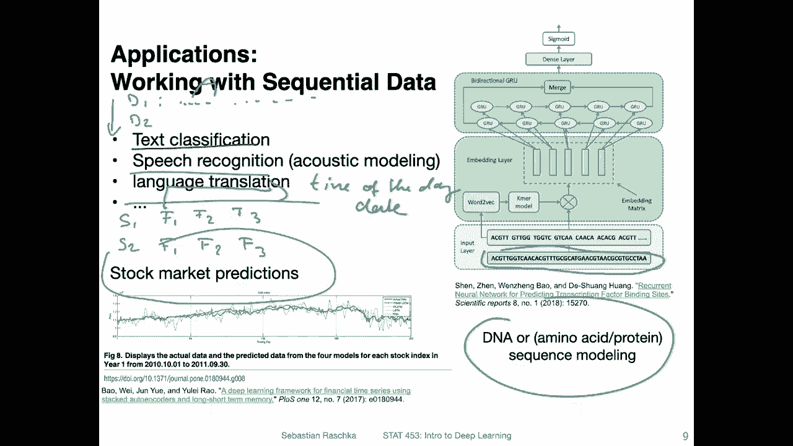
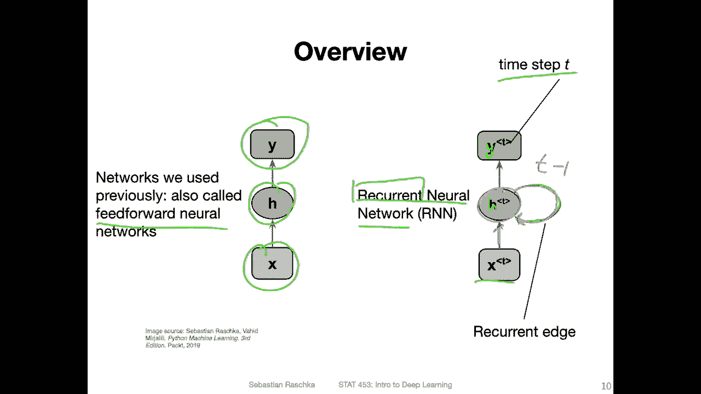
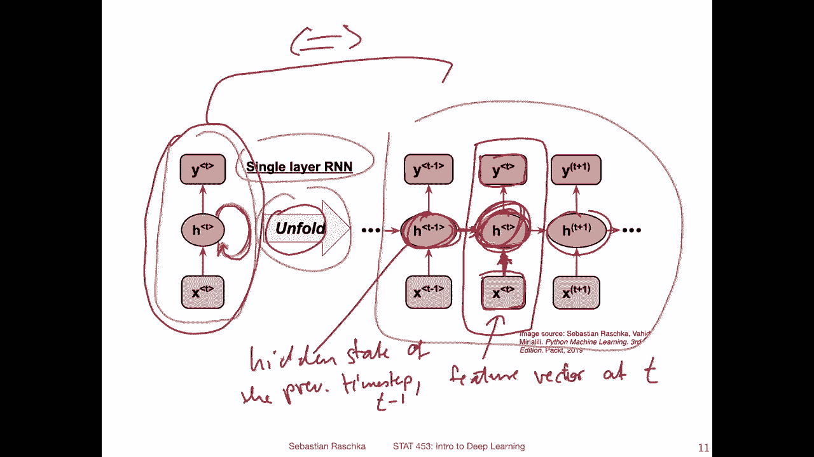
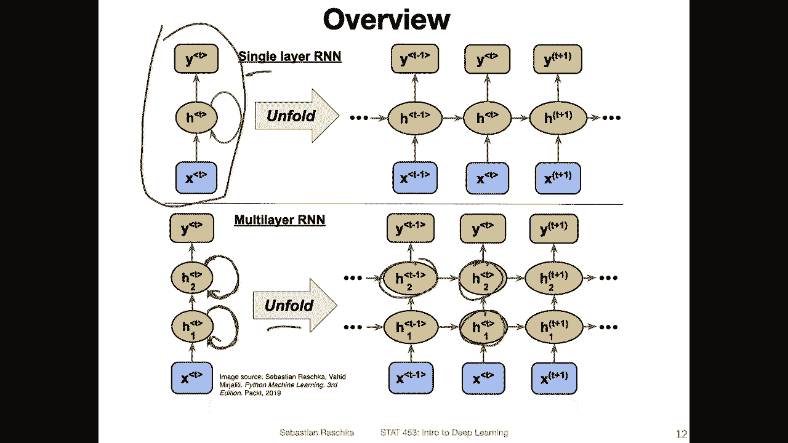
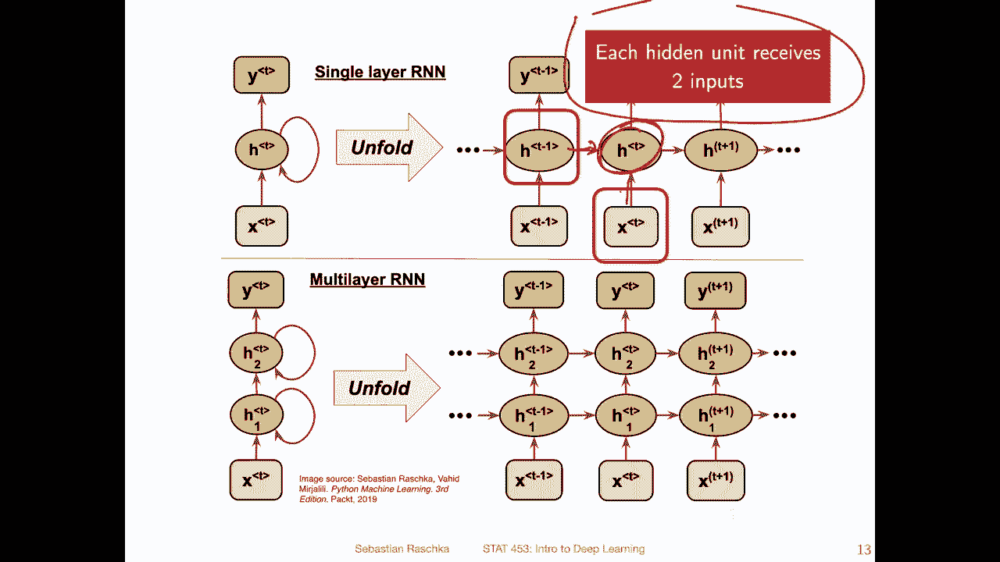
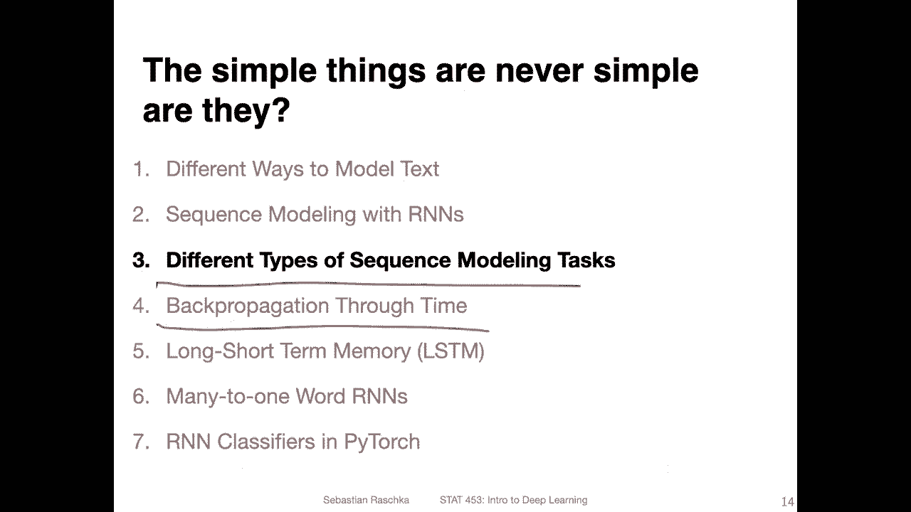

# 127：L15.2 - 使用 RNN 进行序列建模 🧠

在本节课中，我们将学习如何修改多层感知机以捕获序列信息。具体来说，我们将探讨如何使用循环神经网络进行序列建模。

## 如何判断模型是否使用了序列信息

在深入探讨循环神经网络之前，我们先思考一个问题：如何判断一个模型是否已经使用了序列信息？例如，逻辑回归或多层感知机这类模型，它们是否利用了序列信息？

答案是否定的。我们可以从两个维度来理解训练数据中可能存在的序列信息：一是跨训练样本轴，二是跨特征轴。

为了说明这一点，让我们回顾一下经典的鸢尾花数据集。虽然这个例子有些简单，但它能很好地阐明问题。

在鸢尾花数据集中，我们有花萼长度、花萼宽度、花瓣长度和花瓣宽度等特征，构成一个表格数据集。我们有150个训练样本。

当你拥有这个数据集并将其分割为训练集和测试集后，你可以对测试集中的所有记录进行**随机打乱**。然后，当你在这个打乱后的测试集上评估模型性能时，应该得到与打乱前**完全相同**的结果。这表明模型并未使用跨训练样本轴的序列信息，它将数据视为**独立同分布**的。

另一种序列信息可能编码在特征中。例如，如果你交换数据集中两列的位置（比如交换花萼长度和花瓣宽度），然后以相同的方式分割数据集并训练模型，你应该得到与交换前**完全相同**的准确率。这是因为多层感知机和逻辑回归等模型将特征视为独立的，不依赖于特征的特定顺序。

然而，当我们回顾词袋模型时，这可能会成为一个问题。词袋模型有一个词汇表，但它本质上丢弃了每个训练样本中单词的顺序信息。

考虑以下两个句子：
1.  The movie my friend has not seen is good.
2.  The movie my friend has seen is not good.

这两个句子含义截然不同。第一个句子表示朋友没看过一部好电影，第二个句子表示朋友看过一部不好的电影。但如果使用基于词频的词袋模型，这两个句子会产生完全相同的特征向量，导致语义信息丢失。在这里，单词的**顺序**至关重要。

循环神经网络可以帮助我们捕获这种顺序信息。

## 序列数据的例子 📊

以下是几个序列数据的例子：

*   **文本分类**：这是我们本节课将重点关注的领域。在文本数据集中，时间维度体现在单词的顺序上。每个文档可以看作一个训练样本。
*   **语音识别**：处理一系列声音信号。
*   **机器翻译**：将一个序列（源语言）翻译成另一个序列（目标语言）。
*   **股票市场预测**：每个股票可以看作一个训练样本，时间维度是日期，特征向量可能包含价格、新闻情绪等信息。
*   **DNA序列建模**：将DNA序列视为字符序列进行处理。

## 循环神经网络的结构

之前我们使用的是**前馈神经网络**，如多层感知机、卷积网络和逻辑回归。它们通常有一个输入特征向量 `x`，经过若干隐藏层，最终产生输出。

在循环神经网络的设置中，我们引入了**循环边**。新元素在于我们有了一个时间步 `t`。在时间步 `t`，我们得到一个特征向量，将其输入到隐藏状态，并产生一个输出。但除此之外，隐藏层不仅接收当前时间步的输入，还接收来自**先前时间步**（例如 `t-1`）的信息。

为了更清晰地展示，我们通常使用**展开**的视图，这也是实际代码实现的方式。下图展示了单层循环神经网络的展开状态。

让我们聚焦于中心的时间步 `t`。它接收时间步 `t` 的特征向量 `x_t`，这会产生隐藏状态 `h_t`，进而产生输出 `o_t`。此外，这个时间步还接收来自**前一个时间步 `t-1`** 的隐藏状态 `h_{t-1}` 作为输入。

可以看到，现在有两个输入：一个是来自序列的当前特征向量 `x_t`，另一个是前一个时间步的隐藏状态 `h_{t-1}`。这使得网络能够感知序列的顺序。然后，`h_t` 会被传递到下一个时间步 `t+1`，依此类推。

右侧的紧凑表示法和左侧的展开表示法是等价的，只是展示方式不同。在代码实践中，我们通常使用展开版本。

## 多层循环神经网络

上一节我们介绍了单层循环神经网络，当然，我们也可以将此概念扩展到多层循环神经网络。下图展示了一个具有两个隐藏层的循环神经网络。

同样的原理适用于每一层：对于每个隐藏层，我们都有循环边。展开后可以看到，某一层的某个单元既接收来自同一时间步上一层的输入，也接收来自同一层前一个时间步的输入。

再次强调，每个隐藏单元接收两个输入。如果我们聚焦于某个特定单元，它会接收来自当前层前一时间步和同一时间步上一层的输入。

## 总结与展望

本节课我们一起学习了循环神经网络的基本结构，了解了它如何通过引入循环连接来捕获序列中的顺序信息，从而解决了像词袋模型那样丢失单词顺序的问题。

我们看到了循环神经网络在时间步 `t` 的隐藏状态 `h_t` 是如何由当前输入 `x_t` 和前一时间步的隐藏状态 `h_{t-1}` 共同决定的，其核心思想可以概括为以下公式：

`h_t = f(W_{xh} * x_t + W_{hh} * h_{t-1} + b_h)`

其中 `f` 是激活函数，`W_{xh}` 和 `W_{hh}` 是权重矩阵，`b_h` 是偏置项。

在接下来的课程中，我们将探讨如何使用这种架构处理不同类型的序列建模任务，并深入讲解适用于此类模型的**反向传播算法**（即通过时间反向传播）是如何工作的。

