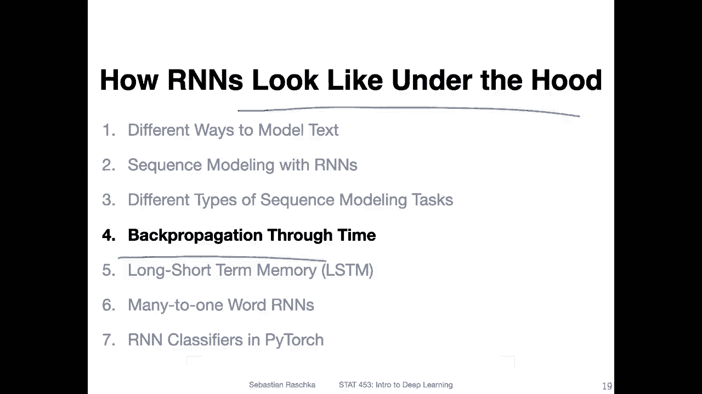
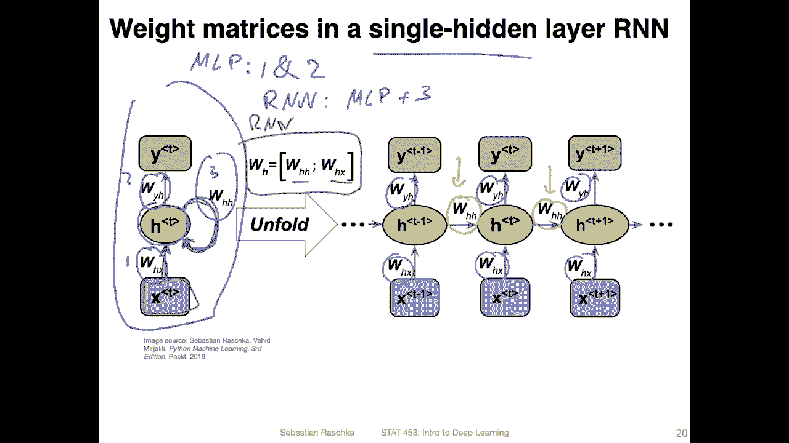
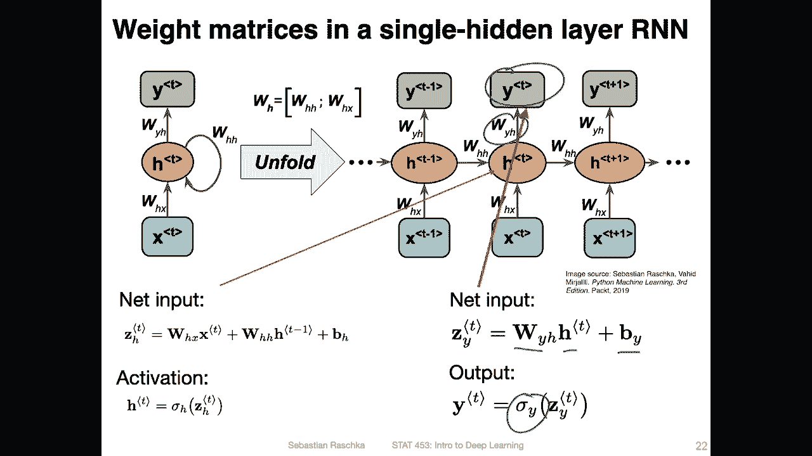
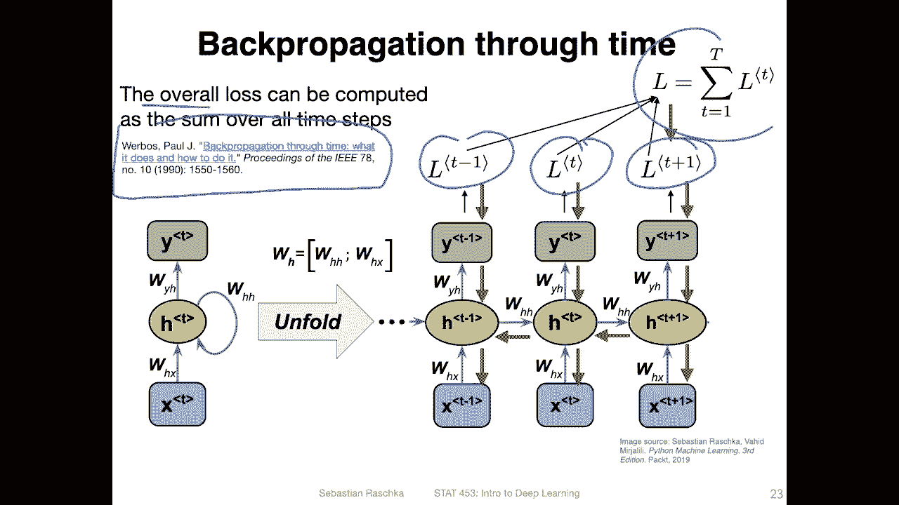
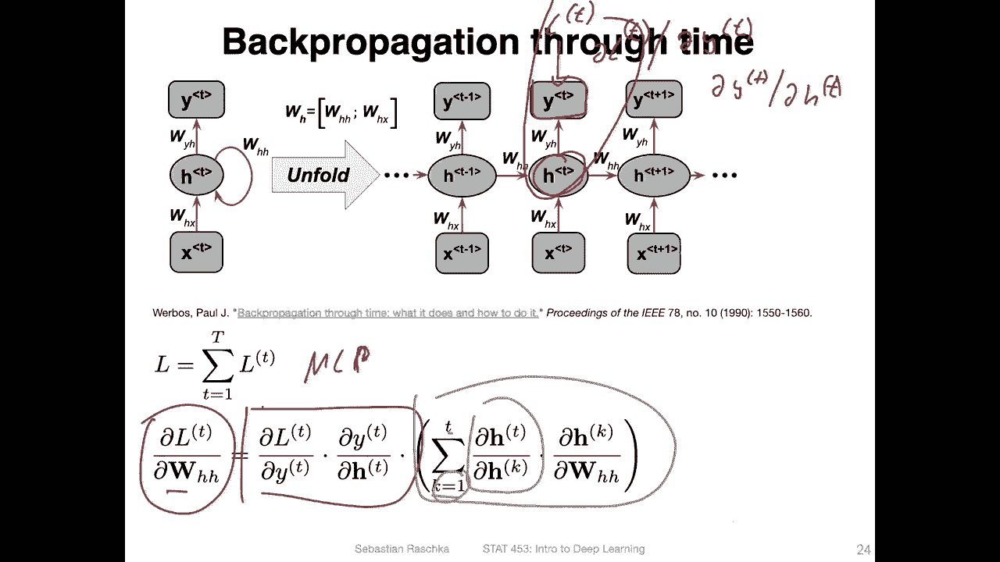
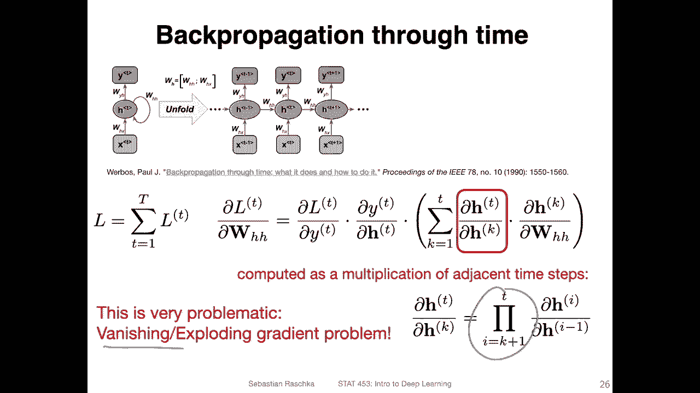
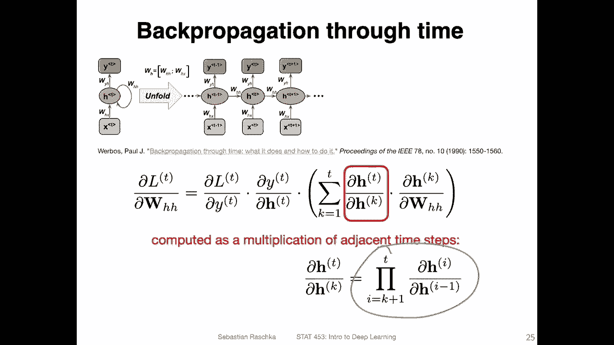
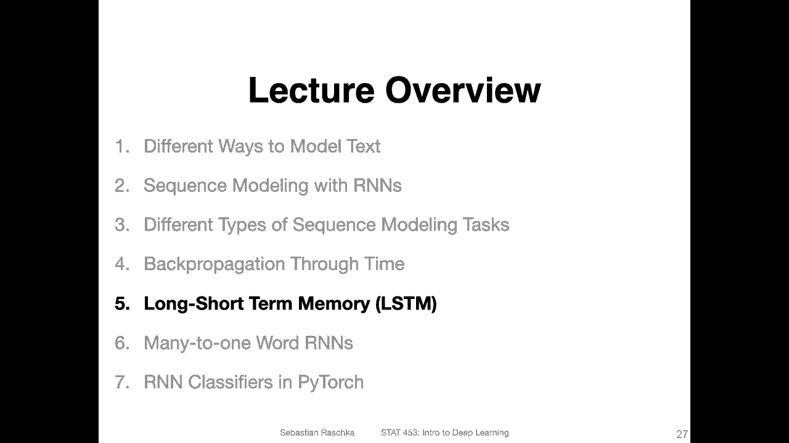

# 129：L15.4 - 时间反向传播概述 📚

在本节课中，我们将学习循环神经网络（RNN）内部的核心训练算法——时间反向传播（Backpropagation Through Time, BPTT）。我们将了解其基本工作原理，并认识它与标准反向传播的区别，特别是如何处理时间维度上的梯度计算。

---

## 循环神经网络的结构回顾 🔄

上一节我们介绍了循环神经网络的基本概念，本节中我们来看看其内部结构，特别是权重矩阵的构成。

下图展示了一个单隐藏层的循环神经网络。左侧是紧凑表示法，右侧是沿时间轴展开的版本。

以下是网络中涉及的三个主要权重矩阵：

*   **权重矩阵 1 (W_xh)**：连接输入层到隐藏层。
*   **权重矩阵 2 (W_hy)**：连接隐藏层到输出层。
*   **权重矩阵 3 (W_hh)**：连接前一个隐藏状态到当前隐藏状态。

与普通的多层感知机（MLP）相比，循环神经网络新增了**权重矩阵 3 (W_hh)**，这是处理序列依赖性的关键。在展开的视图中，可以看到这些权重矩阵在**每个时间步都是共享的**。

---

## 前向传播计算 🧮

了解了结构后，我们来看看前向传播时，如何计算每个时间步的隐藏状态和输出。

### 隐藏状态的计算

在时间步 **t**，隐藏状态的净输入由两部分组成：当前输入和上一个隐藏状态。

其计算公式如下：
`net_h[t] = W_xh * x[t] + W_hh * h[t-1] + b_h`

其中：
*   `x[t]` 是时间步 t 的输入。
*   `h[t-1]` 是时间步 t-1 的隐藏状态。
*   `b_h` 是隐藏层的偏置项。

得到净输入后，我们通过一个激活函数（如 tanh、ReLU）来计算当前隐藏状态：
`h[t] = activation_function(net_h[t])`

### 输出的计算

输出层的计算方式与多层感知机完全相同：
`y[t] = activation_output(W_hy * h[t] + b_y)`

根据任务类型（如分类、回归），输出层的激活函数可以是 Softmax、Sigmoid 或线性函数。

---

## 损失函数与时间反向传播 ⚖️

前向传播得到了预测结果，接下来我们需要定义损失并计算梯度以更新网络。

### 损失函数的构成

损失函数的设计取决于具体的序列建模任务：
*   **多对一任务**（如文本分类）：通常只使用最后一个时间步的损失。
*   **多对多任务**（如序列标注）：通常每个时间步都有一个损失。

在通用情况下，我们可以为每个时间步计算一个损失 `L[t]`，总损失是它们的和：
`L_total = sum(L[t] for t in 1 to T)`

### 时间反向传播的核心思想

时间反向传播是标准反向传播算法在时间序列上的扩展。其核心挑战在于计算损失对循环权重 `W_hh` 的梯度。

假设我们计算时间步 **T** 的损失 `L_T` 对 `W_hh` 的梯度。由于 `W_hh` 在每个时间步都被使用，梯度必须沿着时间轴反向传播回去。

梯度计算涉及一个连乘项：
`∂L_T/∂W_hh ≈ sum( ∂L_T/∂h_T * ∂h_T/∂h_k * ∂h_k/∂W_hh )`，其中 k 从 1 到 T。

这个公式表明，当前损失对早期权重的梯度，需要通过所有中间隐藏状态进行链式求导。

---

## 梯度消失与爆炸问题 💥

上述链式求导中的连乘操作会带来一个严重问题：**梯度消失或梯度爆炸**。

*   **梯度消失**：当连乘的梯度值大多小于 1 时，随着时间步回溯，梯度会指数级衰减到接近零，导致早期层的权重几乎无法更新。
*   **梯度爆炸**：当连乘的梯度值大多大于 1 时，梯度会指数级增长，变得极大，导致训练不稳定。

幸运的是，在实际应用中，我们通常使用 PyTorch、TensorFlow 等深度学习框架，它们内置的自动微分（Autograd）功能会为我们处理这些复杂的梯度计算。然而，理解其背后的原理有助于我们认识循环神经网络的局限性。

---

## 总结与展望 🎯

本节课中我们一起学习了时间反向传播的基本概念。我们回顾了循环神经网络的结构，了解了其前向传播过程，并重点探讨了 BPTT 算法如何沿时间轴传播梯度，以及由此引发的梯度消失/爆炸问题。

认识到基本循环神经网络的这一缺陷后，在下一节课中，我们将介绍一种改进的循环网络结构——**长短期记忆网络（LSTM）**，它被专门设计来缓解梯度消失问题，从而能够学习更长期的依赖关系。