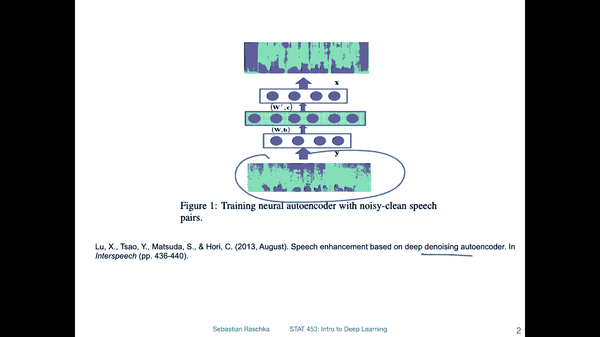
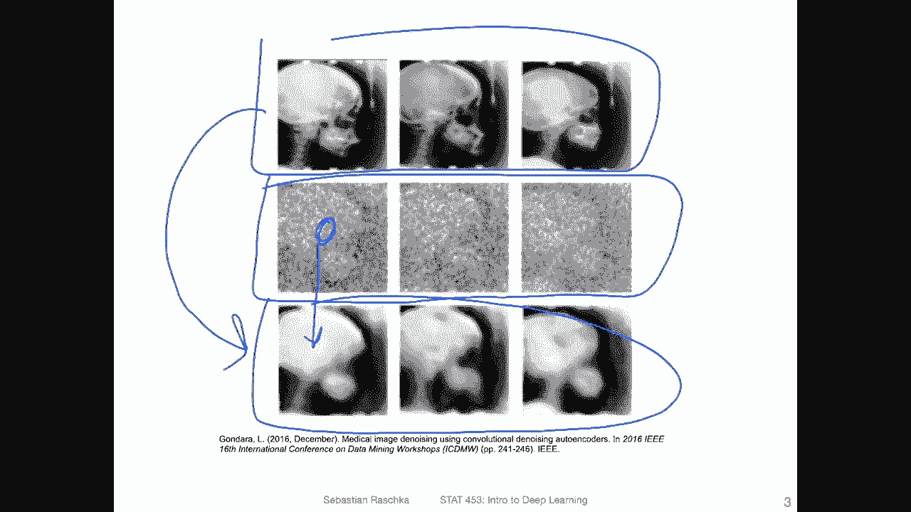
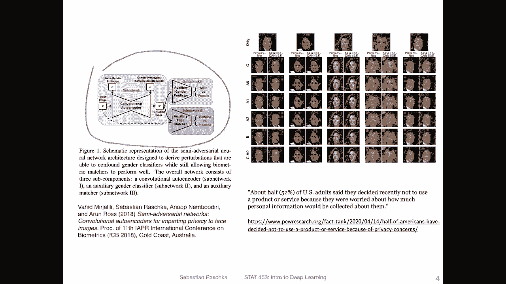
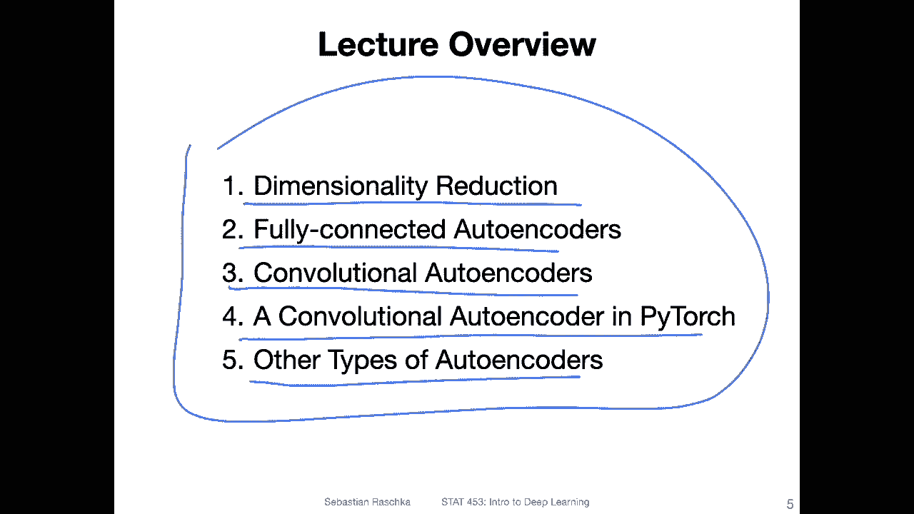

# 132：L16.0 - 自编码器简介 🧠

在本节课中，我们将要学习自编码器的基本概念。自编码器是一种能够将数据编码为更紧凑表示，并尝试将其重构回原始维度的架构。虽然自编码器本身可能并非极其强大，但它是理解后续生成模型（如变分自编码器和生成对抗网络）的重要基础。此外，在学习自编码器的过程中，我们也会接触到反卷积等概念，这些知识在后续课程中同样有用。

## 动机与应用示例 🎯

上一节我们介绍了自编码器的基本定位，本节中我们来看看为什么自编码器是有趣且有用的。自编码器不仅是生成模型的入门，其本身也能用于多种实际应用。

以下是自编码器的一些应用示例：

*   **语音去噪**：研究人员使用一种称为“去噪自编码器”的模型，将含噪语音的频谱图转换为更清晰、干净的语音。
*   **图像增强**：在医学图像处理等领域，自编码器被用于从噪声图像中恢复出更清晰的图像。尽管会损失一些细节，但其去噪和恢复能力依然令人印象深刻。
*   **隐私增强**：例如，在面部识别场景中，可以使用卷积自编码器来移除图像中的性别信息，同时保留用于身份匹配的关键特征。这有助于在完成安全验证（如与犯罪数据库比对）的同时，最小化对个人敏感信息的收集。

## 课程主题概览 📋

以下是本节课将涵盖的五个主要主题：

1.  **降维简介**：理解自编码器背后的降维思想。
2.  **全连接自编码器**：介绍类似于多层感知机的、使用全连接层构建的自编码器。
3.  **卷积自编码器**：将自编码器概念扩展到更适合处理图像的卷积结构。
4.  **PyTorch实现**：展示如何使用PyTorch实现一个卷积自编码器。
5.  **其他自编码器类型**：简要介绍其他类型的自编码器，其中**变分自编码器**将在下一节课中详细讨论。

本节课中我们一起学习了自编码器的核心概念、应用场景以及课程的主要内容框架。自编码器通过编码与解码的过程学习数据的紧凑表示，是通往更复杂生成模型世界的一块重要基石。在接下来的章节中，我们将深入探讨其具体实现与变体。