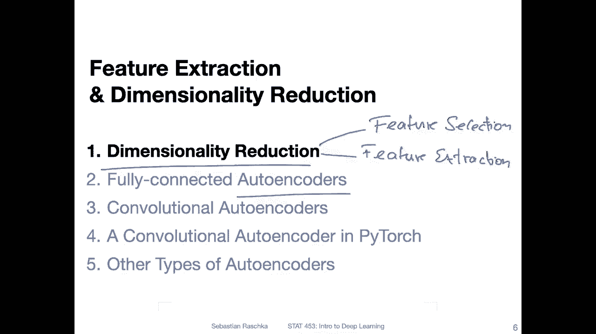
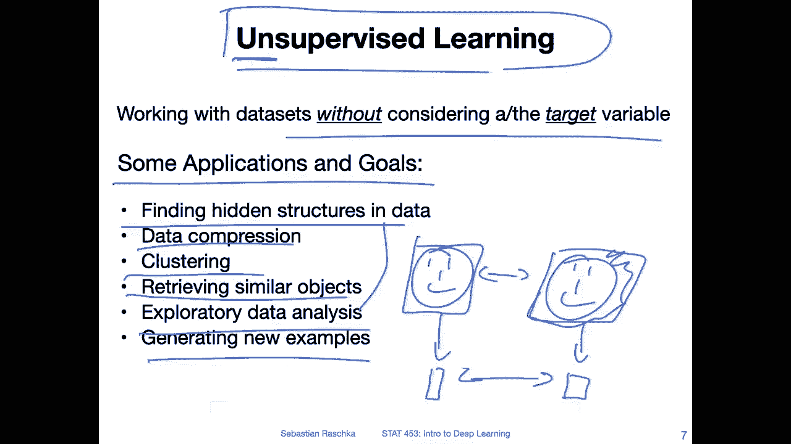
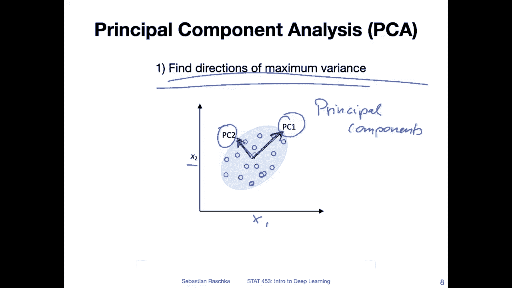
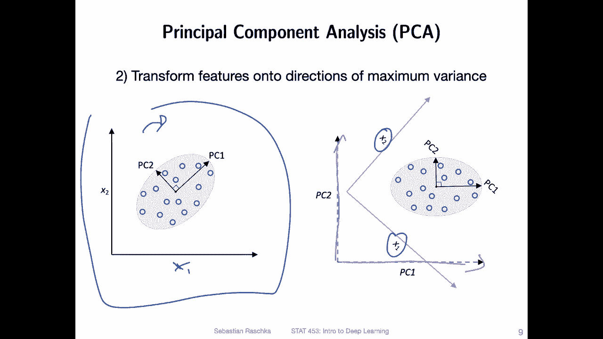
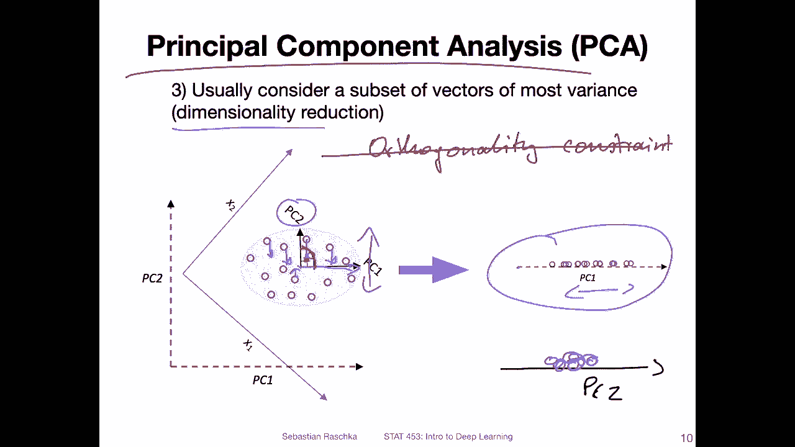
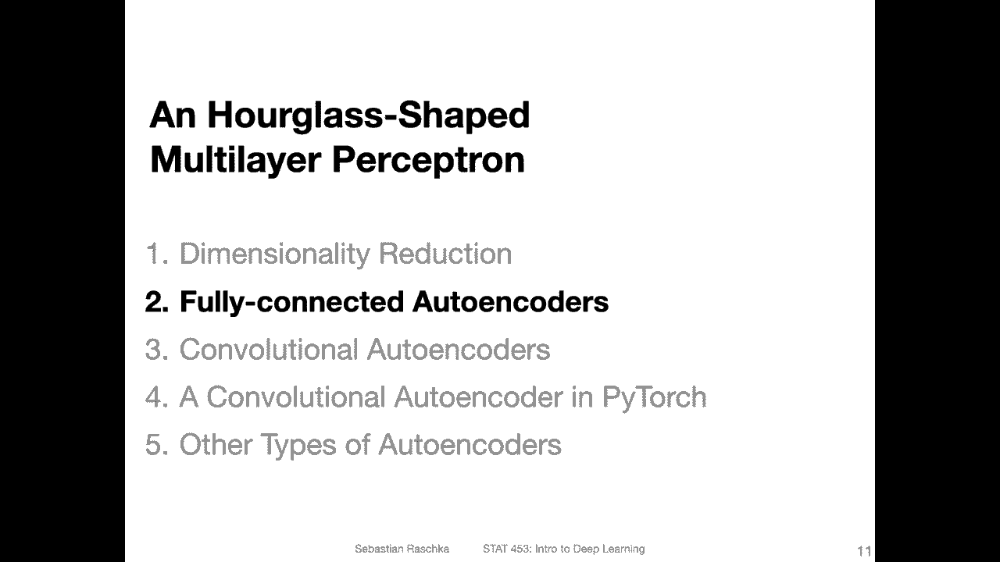

# 133：L16.1 - 降维 🎯

在本节课中，我们将要学习**降维**这一机器学习中的重要概念。降维旨在减少数据集中的特征数量，是数据预处理和特征工程中的关键技术。我们将从降维的基本概念出发，介绍其两种主要方法，并重点讲解一种经典的无监督降维技术——主成分分析（PCA），为后续理解自编码器打下基础。

## 降维概述 📊

在深入讲解自编码器之前，让我们先简要讨论一下降维。

降维是一个广义术语，用于描述减少数据集中特征数量的过程。

降维的一个子主题是**特征选择**。如果你有一个包含大量特征的数据集，你可以选择这些特征的一个子集，这就是特征选择。

降维的另一个子主题是**特征提取**。特征选择与特征提取的区别在于，在特征提取中，我们不一定保留原始特征。通常，特征提取是原始特征的组合，例如通过线性或非线性变换得到新特征。在本视频中，我将展示一个特征提取的例子，这也是自编码器背后的核心概念。自编码器可以被视为一种特征提取算法。

## 无监督学习与降维目标 🤖

自编码器（至少是常规的自编码器）也属于**无监督学习**的范畴。你可能在本学期早期的视频中听说过无监督学习，当时我们讨论了机器学习的三大类别。

第一类是**监督学习**，另一类是**强化学习**，而这里讨论的第三类就是**无监督学习**。顾名思义，无监督学习就是没有标签的监督学习。我们只使用特征，而不使用标签，即忽略目标变量。

有些问题我们根本没有目标变量。有时我们可能有目标变量，但可能决定不使用它。当我们谈论无监督学习时，有不同的应用类型和目标。

以下是几种常见的无监督学习目标：

*   **发现数据中的隐藏结构**。
*   **压缩数据**，例如出于存储需求。
*   一些机器学习算法容易受到**维度灾难**的影响。通过减少特征数量，我们可以提升模型性能。
*   **聚类**，即对相似类型的对象进行分组，本质上与“检索相似对象”这一点非常相似。例如，如果你有两张人物照片，背景不同，直接逐像素比较以判断是否为同一人非常困难。但我们可以为两张图像提取一个更低维度的特征向量，然后比较这些特征向量。我们假设用于构建此特征向量的方法只关注了关键信息（如图像中的人脸），而忽略了背景。
*   特征提取的另一个目标可以是**探索性数据分析**，这与发现数据中的隐藏结构有关。例如，你想绘制一个高维数据集，而人类无法真正可视化超过三个维度的图。因此，你可以将高维数据集通过特征提取降至两到三维，然后进行绘制。
*   最后一个重要目标是**生成新样本**。我们可以尝试学习数据集的分布，然后从该分布中采样以生成新数据。这将是下一讲讨论变分自编码器时的主题。今天我将展示一个生成新数据的例子，但这里的方法并不理想，更好的方法将在下一讲的变分自编码器中介绍。

总而言之，在讨论自编码器之前，让我继续用一个降维的例子来说明。

## 主成分分析（PCA）示例 🔍

我想你们很多人都听说过**主成分分析**。我们不会在本课程中深入探讨PCA的细节，因为它不是一个深度学习主题，但这里会从宏观角度进行概述。

在PCA中，我们本质上是寻找**最大方差的方向**，这是第一步。如下图所示，圆圈代表数据点，你有两个特征x1和x2。图中的PC1和PC2代表你的**主成分**。

如果你将这里的数据集视为一个二维矩阵，这些主成分本质上代表该矩阵的**特征向量**。PC1是与最大特征值相关的特征向量，PC2是与第二大特征值相关的特征向量。它们给出了数据**最分散**的方向。我们假设数据在这个轴（PC1）上最分散，而PC2是第二分散的方向。

一旦我们找到了这些主成分（即最大方差的方向），下一步就是进行**旋转**。如下图所示，x1和x2是我们的原始特征空间。现在我将它向右旋转，得到了两个新特征轴：PC2和PC1。我将我的数据集对齐到这个新的特征轴上，这本质上可以看作是一个**线性变换**。

如果我想进行降维，我可以只考虑具有最大方差的方向，而忽略另一个。在这里，我会将我的数据集从二维降至一维。例如，我会考虑第一个特征向量（PC1），而忽略第二个（PC2）。这样做的结果就是“压缩”数据。你可以想象将所有数据点向下压缩到一维上。

下图展示了将数据仅投影到一维（PC1）上的样子。这是方差最分散的主成分。如果你对PC2做同样的事情，你会发现数据在这个方向上分散程度较小，很多点会重叠在一起。

这只是一个宏观概念。当然，从二维降到一维的例子有些简单。在实际应用中，我们可能有数百或数千个特征，需要将其降至更小的维度空间。那么，我们应该保留多少个主成分呢？这是一个需要查看主成分所保留或捕获的累积方差的话题。由于这并非深度学习的核心内容，此处不再深入。我只是想向你展示一种经典的降维技术。

事实上，自编码器做的事情与此类似。这里有一点我尚未提及：PCA有一个**正交性约束**。自编码器本质上做的是类似的事情，也会给出类似主成分的结果。然而，自编码器至少没有显式地施加这种正交性约束。不过，使用线性激活函数的自编码器本质上就类似于主成分分析。当然，在深度学习的背景下，我们也会讨论非线性激活函数。我们将在下一个视频中看到，自编码器实际上会比这个主成分分析更复杂一些。

以上是对一种经典降维技术的简要概述。在下一个视频中，我将实际展示自编码器的样子。

## 总结 📝

本节课中，我们一起学习了降维的基本概念。我们了解到降维包括特征选择和特征提取两种主要方式，并认识到自编码器属于后者的范畴。通过主成分分析（PCA）的例子，我们直观地理解了如何通过寻找数据最大方差的方向，并对其进行线性变换和投影，来实现数据从高维到低维的压缩。这为我们接下来深入学习更强大的非线性降维工具——自编码器，奠定了重要的基础。