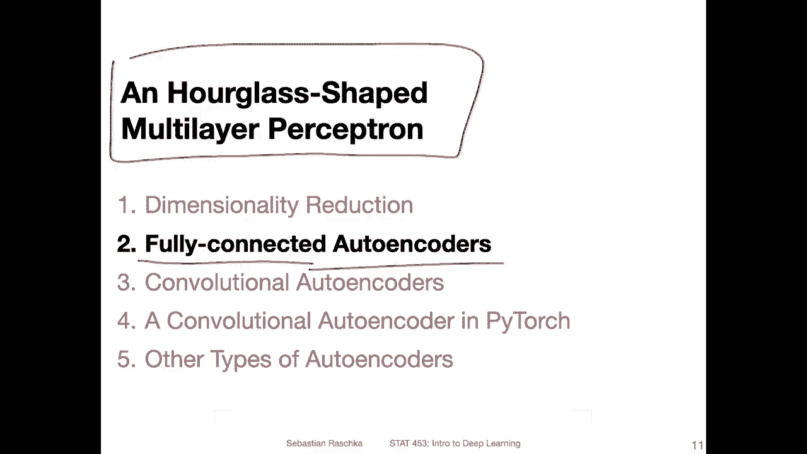
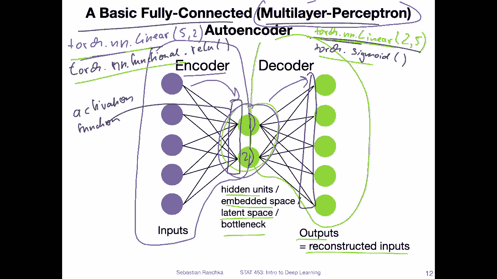
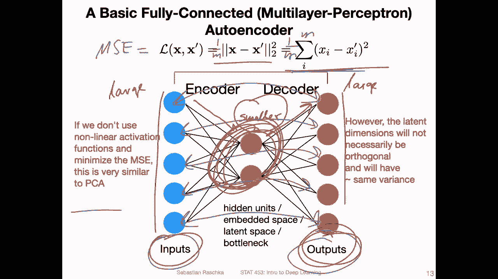
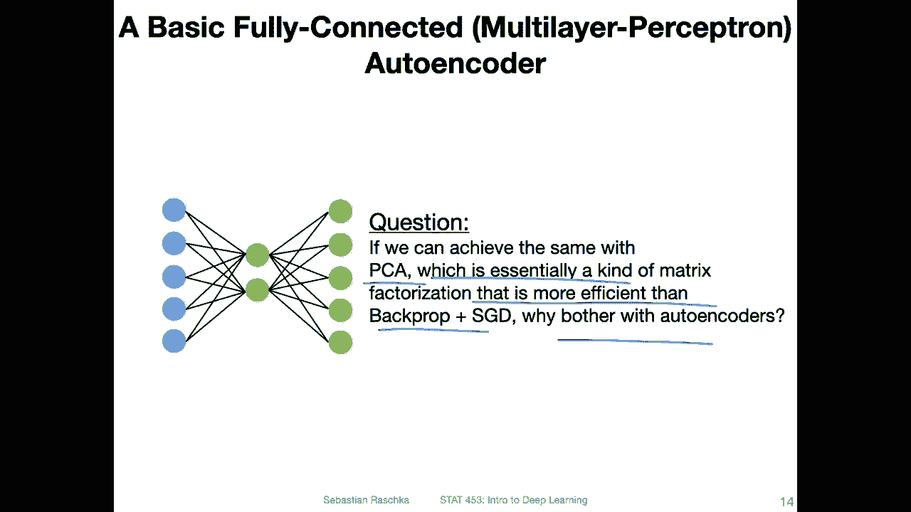
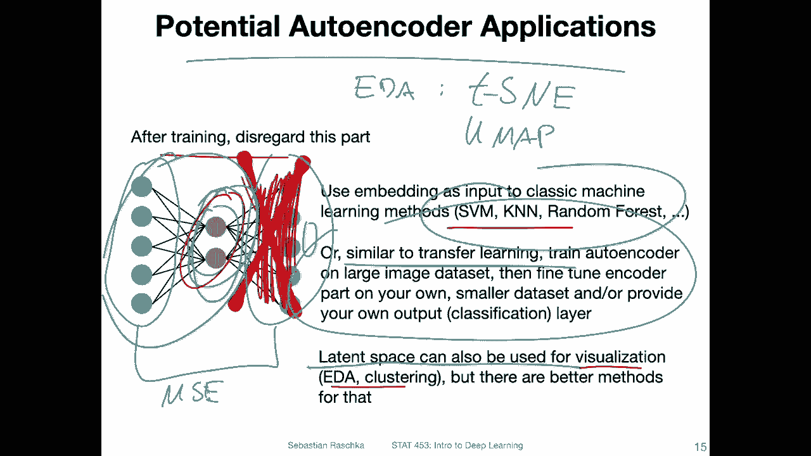
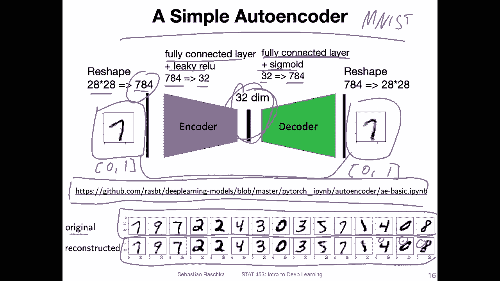
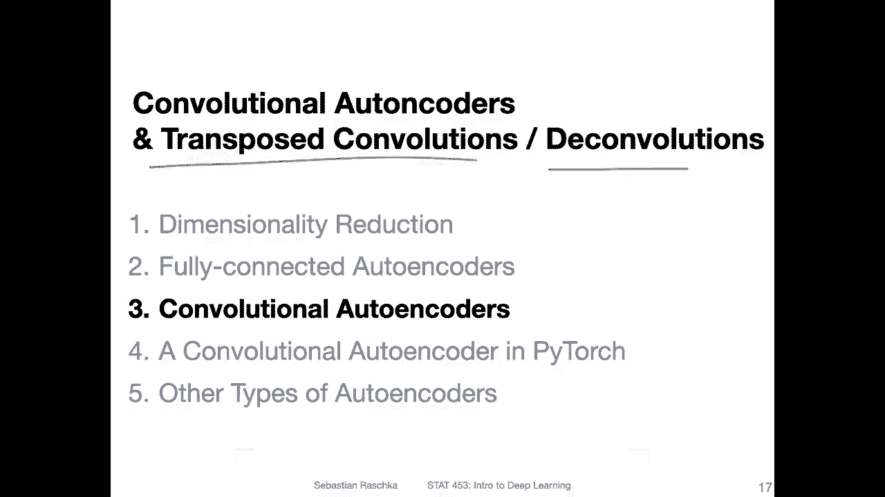

# 134：L16.2 - 完全连接的自编码器 🧠



在本节课中，我们将要学习自编码器的基本概念，特别是完全连接的自编码器。我们将了解其结构、工作原理、与主成分分析的区别，以及它在实际中的应用。

---

## 自编码器简介

自编码器是一种特殊类型的神经网络，其结构类似于沙漏。你可以将其视为一个多层感知机。


上图展示了一个非常简单的完全连接自编码器。它本质上是一个多层感知机。

---

## 编码器与解码器

让我们从观察上图开始。图中被圈出的部分是所谓的**编码器**部分。本质上，这是一个全连接层。在 PyTorch 的语境中，你可以将其视为一个线性层。

**编码器**可以表示为一个全连接层，例如，具有 5 个输入和 2 个输出。

在另一侧，我们有一个**解码器**。解码器本质上也是一个全连接层，但方向相反，具有 2 个输入和 5 个输出。它旨在将数据恢复回原始维度。

在编码器和解码器之间，我们有一个被称为**隐藏单元**或**嵌入空间**（有时也称为**潜在空间**或**瓶颈**）的部分。输出是**重构的输入**。

我们的操作是将特征投影到一个更小维度的空间，然后再将其重构出来。

---

## 与主成分分析的区别

如果自编码器仅按上述方式设置，它将与上一视频中介绍的主成分分析相似，但存在关键区别。

区别在于，这里没有正交性约束。没有明确的方法来确保嵌入空间中的特征1和特征2是正交的，而这在主成分分析中是通过提取特征向量来保证的。

另一个区别是，我们使用了全连接层。但仅使用线性变换会显得能力有限。在实践中，为了学习非线性变换，我们会引入非线性激活函数。



在实践中，我们会在全连接层之后连接一个激活函数。例如，在 PyTorch 中，结构可能如下：

```python
# 编码器部分
encoder = torch.nn.Sequential(
    torch.nn.Linear(in_features=784, out_features=32),
    torch.nn.LeakyReLU()
)
# 解码器部分
decoder = torch.nn.Sequential(
    torch.nn.Linear(in_features=32, out_features=784),
    torch.nn.Sigmoid()
)
```

这意味着我们有一个全连接层，接着是一个非线性激活函数，然后是另一个全连接层和另一个激活函数。中心隐藏单元的数量可以是任意的，也可以使用多个隐藏层。


如前所述，如果不使用非线性激活函数，自编码器将类似于主成分分析。但在实践中，我们使用非线性激活函数，因此它实际上比主成分分析更强大，因为它可以学习非线性变换。

---

## 学习机制与损失函数

上一节未提及的关键点是，我们拥有输入和输出（即重构的输入）的目的是为了学习这种变换。

我们计算输入和输出之间的差异，并利用它进行反向传播，从而使自编码器学会对数据进行良好的压缩。

自编码器从高维输入映射到较小的嵌入空间表示，然后再映射回高维。我们如何知道这是一个好的表示？我们如何知道它很好地代表了原始数据？

这就是为什么我们需要将其投影回来。我们将其投影回原始空间，然后可以比较输出和输入。我们希望它们相似。

如果它们相似，即输入数据能够被重构，输出与输入接近，那就意味着中心的潜在表示必须捕获了关于输入数据的重要信息。如果中心不包含任何有用信息，我们将无法通过输出重构输入。

因此，这种设置确保了自编码器确实能够在嵌入空间中保留最有用的信息。



有不同的损失函数可用于此目的，最简单的是 L2 差或均方误差。

我们会逐个比较每个输入和输出。例如，对于五个输入和五个输出，我们会逐一比较它们，求和，然后可能取平均值，即均方误差。

**均方误差公式**可以表示为：
`MSE = (1/M) * Σ (input_i - output_i)^2`

其中 M 是维度数。



这就是自编码器的基本设置。


---

## 为何使用自编码器？

既然使用主成分分析也能实现类似效果（主成分分析本质上是一种非常高效的线性变换或矩阵分解，比使用随机梯度下降训练自编码器更高效），我们为何还要使用自编码器？

原因在于，主成分分析是线性变换，而自编码器可以更强大，能够学习非线性变换。例如，在处理图像数据时，我们可以将全连接层替换为卷积层等。因此，对于更复杂的数据类型，我们有更多机会构建更好的模型。


---

## 自编码器的应用

在实践中，仅仅重构图像本身可能没有直接意义，因为如果我们已经有输入图像，为何还要对重构感兴趣？

在常规自编码器中，重构仅用于计算均方误差损失，以学习嵌入空间。

训练完成后，我们可以移除解码器部分，仅使用嵌入作为我们提取的特征。

例如，有些人可能在大型数据集上训练自编码器，生成所有嵌入，然后尝试在其上训练分类器（如使用支持向量机、K近邻、随机森林等传统机器学习方法）。当然，你也可以直接使用它，例如构建一个具有一个隐藏层的多层感知机。

自编码器的优势在于它不需要标签信息，因此可以应用于大型未标记数据。这类似于迁移学习：你可以在非常大的数据集上训练自编码器，让它学习如何提取好的特征。然后，如果你只有该数据子集的标签，你可以使用传统方法在这些嵌入上训练模型。

你还可以将潜在空间（低维空间）用于可视化目的，例如，如果是二维的，可以用于探索性数据分析的散点图。当然，它不限于二维，也可以是更高维度，用于聚类等任务。然而，必须指出，在实际应用中，对于非线性变换的降维，可能有更好的技术，例如 t-SNE 或 UMAP。

但自编码器仍然是学习大型未标记数据并将其作为传统机器学习分类器输入的良好技术。当然，自编码器还有许多更有趣的方面和应用，我们将在后续课程中介绍，例如变分自编码器。



---


## 简单实现示例

这里是一个简单自编码器的实现，应用于 MNIST 数据集。

左侧是一个手写数字“7”的图像。在 MNIST 中，它是 28x28 维的图像，我们将其重塑为 784 维的特征向量。

这个向量输入到全连接层，后接 Leaky ReLU 激活函数。该全连接层将输入图像从 784 维压缩到 32 维。

然后，我们使用另一个全连接层将 32 维的隐藏空间转换回 784 维表示，该层后接一个 Sigmoid 激活函数。使用 Sigmoid 是因为我们将输入图像像素归一化到 0 到 1 之间，Sigmoid 的输出也在 0 到 1 之间，这样我们就可以计算像素之间的均方误差并使其最小化。

上图展示了原始 MNIST 图像和底部的重构图像。可以看到重构并不完美，存在一些伪影，但总体效果很好。因此，我们非常简单的自编码器能够在这个 32 维空间中保留足够的信息来重构原始图像。32 维大约是 784 维输入的 1/20，因此我们能够将尺寸减少约 20 倍。

如果你对此代码感兴趣，可以在 GitHub 上找到。我们不会在此详细讲解代码，因为在接下来的视频中，我们将展示一个更有趣的卷积自编码器示例。



---

## 总结与下节预告

本节课中，我们一起学习了完全连接自编码器的基本概念。我们了解了其沙漏形结构、编码器和解码器的作用、通过重构输入进行学习的机制，以及它与主成分分析的区别。我们还探讨了自编码器的应用场景和一个简单的实现示例。


在下一个视频中，我将介绍卷积自编码器的一些概念，涉及转置卷积和反卷积（两者是同一事物的不同名称）。之后，我们将在 PyTorch 中实现它。



