# 135：L16.3 - 卷积自编码器与转置卷积 🧠

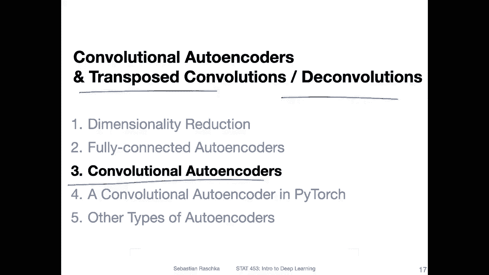

在本节课中，我们将要学习卷积自编码器的基本结构，并深入探讨其核心组件——转置卷积（也称为反卷积或分数步长卷积）。我们将了解为什么需要它，以及它是如何工作的。

## 概述

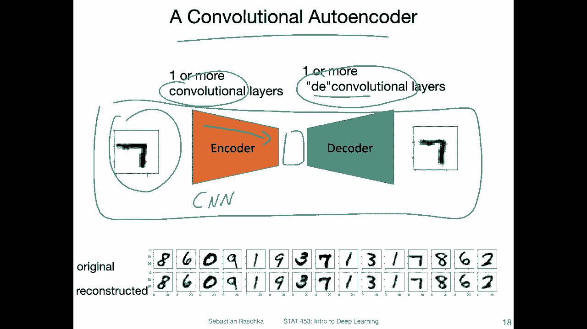

卷积自编码器的整体结构与之前学过的全连接自编码器类似。主要区别在于，编码器和解码器不再使用全连接层，而是分别使用卷积层和转置卷积层。编码器通过卷积操作将输入图像压缩为更小的特征表示，而解码器则需要一种方法将这个小的表示“还原”为原始尺寸的图像。这就是转置卷积的作用。

## 什么是转置卷积？🔄

上一节我们介绍了卷积自编码器的基本概念，本节中我们来看看其解码部分的核心——转置卷积。

转置卷积、反卷积或分数步长卷积，这些术语在深度学习中通常指代同一种操作。其核心目标是实现上采样，即输入一个较小的特征图，输出一个较大的特征图。这与常规卷积的下采样效果正好相反。

在数学上，严格的反卷积被定义为卷积运算的逆运算。但在深度学习实践中，我们通常只需要一个能实现上采样的卷积操作，而不必是精确的数学逆运算。因此，“转置卷积”这个名称更为常用。

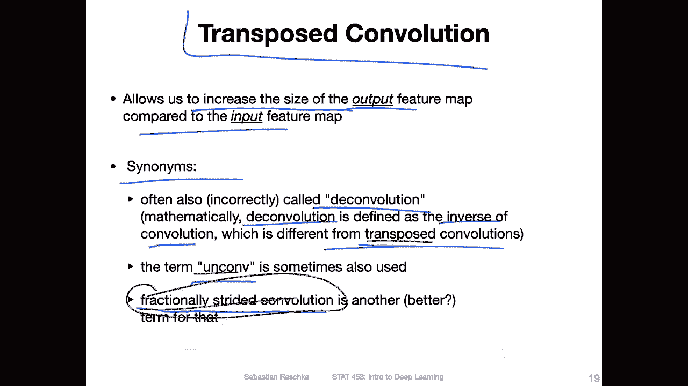

## 转置卷积的工作原理 ⚙️

为了更好地理解转置卷积，我们先回顾一下常规卷积。常规卷积使用一个滑动窗口（卷积核）在输入图像上移动，通过加权求和计算输出特征图的每个像素值。

转置卷积可以看作是这个过程的反向。它从一个小的输入开始，通过卷积核生成一个大的输出。以下是其工作原理的直观理解：

假设我们有一个 2x2 的输入和一个 3x3 的卷积核，步长为 2。
1.  取输入的第一个像素值，将其与整个 3x3 卷积核的每个权重相乘，得到一个 3x3 的中间块。
2.  根据步长（此处为 2），将输入指针移动到下一个像素，重复步骤 1，生成另一个 3x3 中间块，并将其放置在输出网格的相应位置（通常向右移动 2 格）。
3.  对输入的所有行和列重复此过程，将生成的中间块在输出网格上叠加（重叠部分的值会相加）。
4.  最终，这些中间块组合成一个更大的输出特征图（例如，从 2x2 输入得到 5x5 输出）。

这种“一输入像素扩展为一块输出”的视角，是理解转置卷积最直观的方式之一。

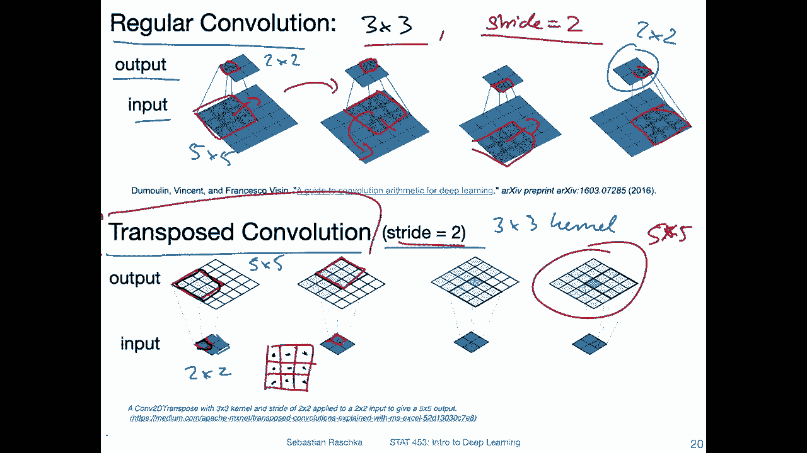

## 转置卷积的实现方式（仿真方法）💻

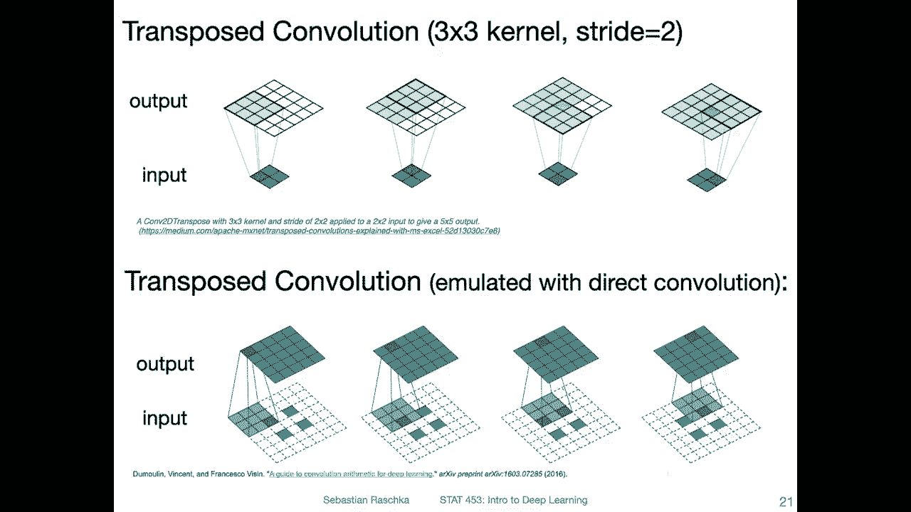

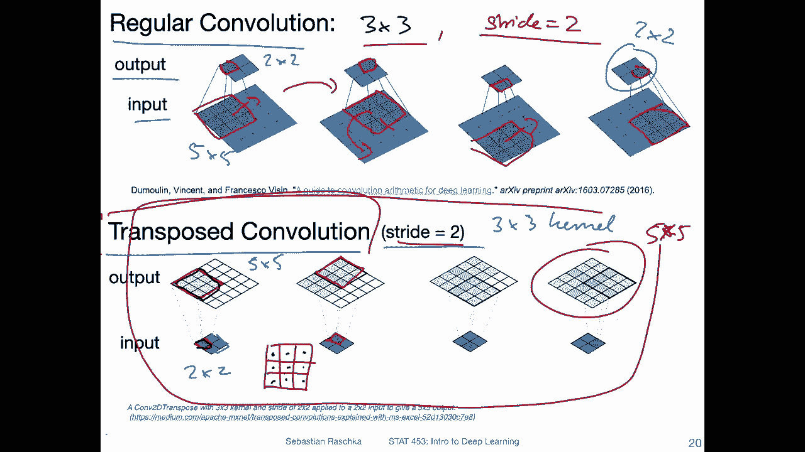

虽然上一节介绍的概念视角很直观，但在代码实现中，转置卷积通常通过一种“仿真”方式，利用常规卷积操作来完成。

这种方法的核心思想是：通过向输入特征图添加特定的**填充**和**间距**，然后对其应用一个常规卷积，从而模拟出上采样的效果。

具体步骤如下：
1.  **插入间距**：根据步长 `s`，在输入特征图的每个像素之间插入 `(s-1)` 行和列的零值。
2.  **添加填充**：在扩展后的特征图四周添加填充。填充量 `p'` 通常与原始卷积核大小和期望的输出有关，计算公式为 `p' = k - p - 1`，其中 `k` 是核大小，`p` 是原始卷积的填充。
3.  **执行常规卷积**：使用一个与原始卷积核形状相同、但权重可能经过转置的核，对处理后的特征图进行步长为 1 的常规卷积。

这种“分数步长卷积”的称呼，正是源于在输入像素间插入零值步长的操作。尽管这种实现方式在代码上更直接，但“一输入扩展为一块”的概念模型对于理解其行为更有帮助。

## 输出尺寸计算公式 📐

在使用 PyTorch 等框架时，我们需要知道转置卷积层的输出尺寸。给定输入尺寸，可以通过以下公式计算：

**公式**：
`H_out = (H_in - 1) * stride - 2 * padding + kernel_size`

其中：
*   `H_in`：输入特征图的高度（或宽度）。
*   `H_out`：输出特征图的高度（或宽度）。
*   `stride`：步长。
*   `padding`：填充值。
*   `kernel_size`：卷积核大小。

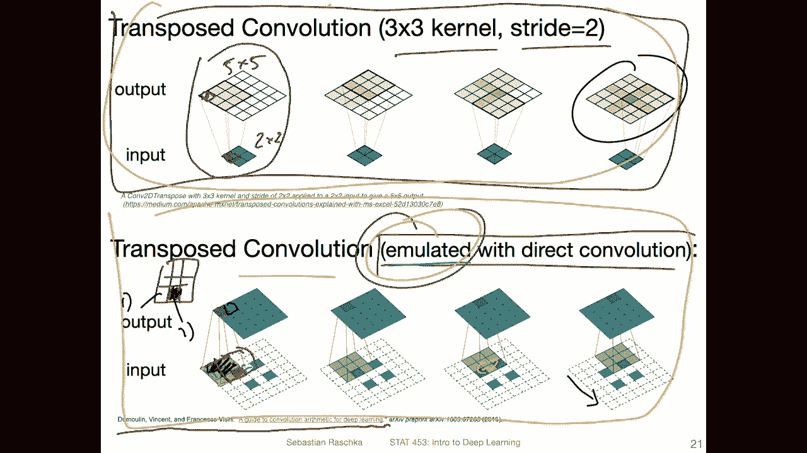

**注意**：在转置卷积中，**增加填充会减小输出尺寸**，这与常规卷积中增加填充会增大输出尺寸的效果相反。

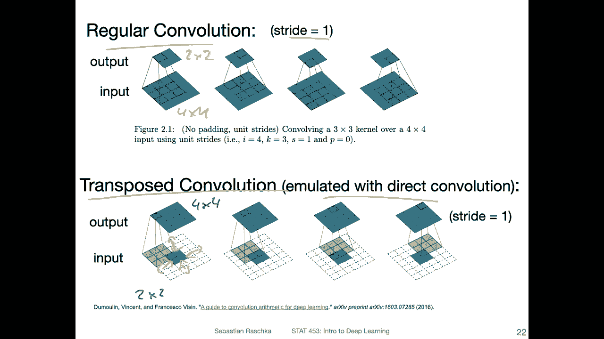

以下是一个简单的代码示例，展示如何在 PyTorch 中使用转置卷积并验证输出尺寸：

```python
import torch
import torch.nn as nn

# 定义一个转置卷积层
# 输入通道1，输出通道1，核大小3，步长2，填充1
transpose_conv = nn.ConvTranspose2d(in_channels=1, out_channels=1, kernel_size=3, stride=2, padding=1)

# 创建一个 2x2 的模拟输入 (batch_size=1, channels=1, height=2, width=2)
input_tensor = torch.randn(1, 1, 2, 2)

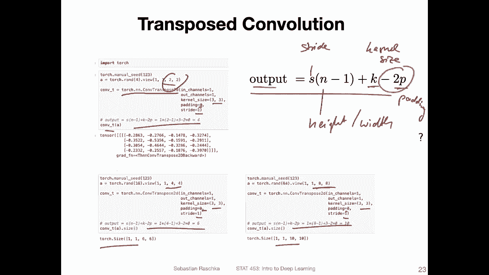

# 前向传播
output_tensor = transpose_conv(input_tensor)

print(f"输入尺寸: {input_tensor.shape}")
print(f"输出尺寸: {output_tensor.shape}")
# 根据公式计算期望的输出尺寸：
# H_out = (2 - 1)*2 - 2*1 + 3 = 3
# 因此输出应为 3x3
```

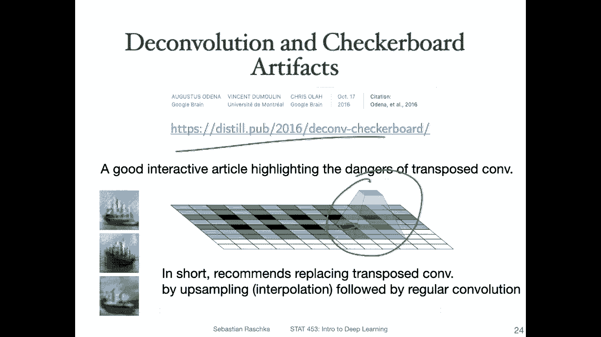

## 棋盘格效应及应对策略 🏁

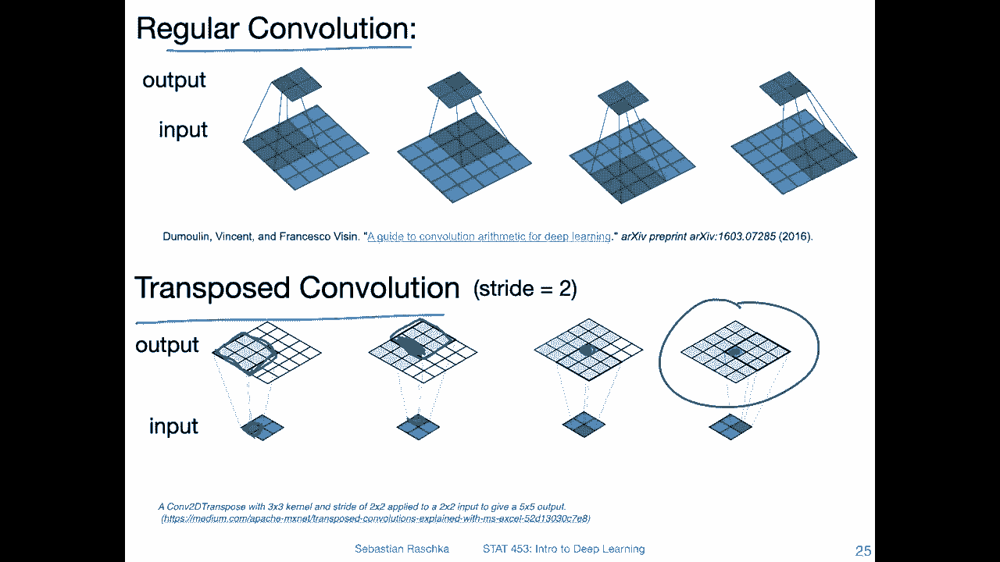

转置卷积在实践中可能遇到一个称为“棋盘格效应”的问题。这是由于在上采样过程中，输出特征图中某些区域由多个输入像素的贡献重叠而成，而其他区域则贡献较少，导致不均匀的、类似棋盘格的伪影。

以下是可能导致棋盘格效应的原因：
*   当卷积核大小不能被步长整除时，重叠模式可能不均匀。
*   特别是在使用较大的步长时，重叠区域和“空洞”区域的对比会更明显。

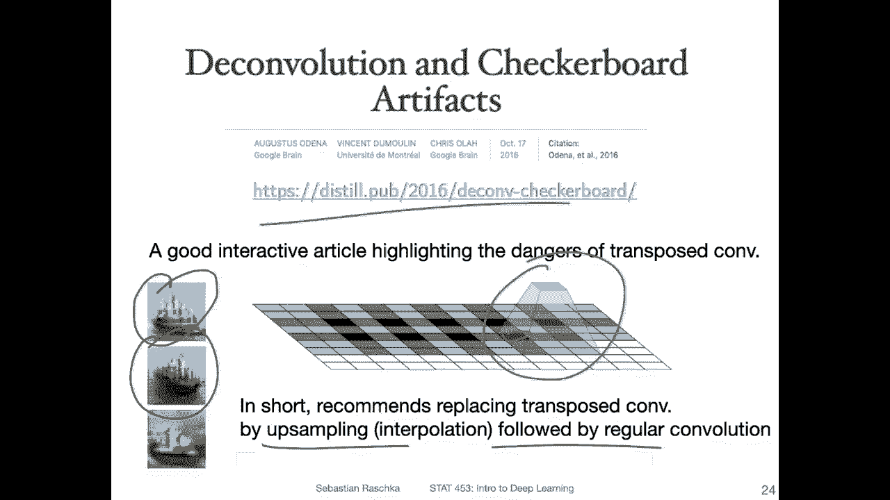

为了缓解或避免棋盘格效应，可以考虑以下策略：
1.  **调整核大小与步长**：选择核大小是步长的整数倍（例如，步长为2时使用2x2或4x4的核），可以减少不均匀的重叠。
2.  **使用替代上采样方法**：一种常见且有效的替代方案是使用“最近邻上采样”或“双线性上采样”先将特征图放大到目标尺寸，然后再接一个常规卷积层进行学习。这种方法通常能产生更平滑的结果。
    *   例如：`Upsample(scale_factor=2, mode=‘nearest’)` + `Conv2d(...)`

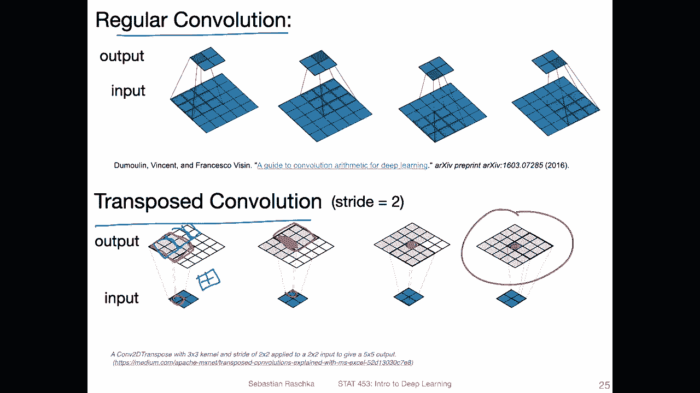

在实际应用中，并非所有转置卷积都会产生明显的棋盘格效应。建议在具体任务中尝试不同方法，并根据生成图像的质量来选择最佳方案。

## 总结

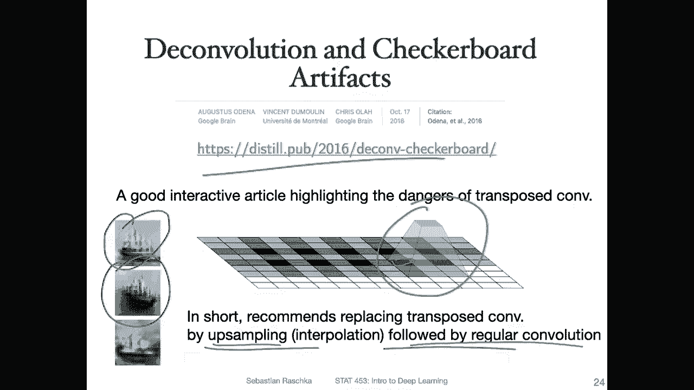

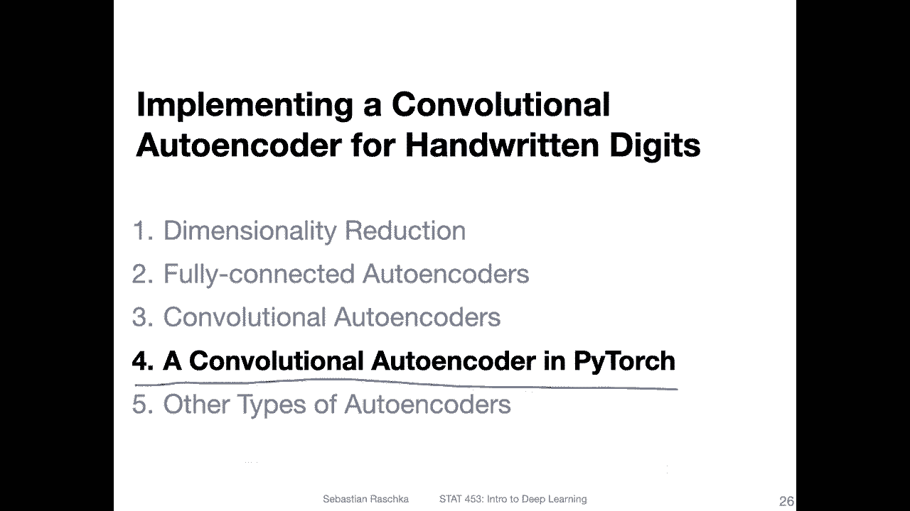

本节课中我们一起学习了卷积自编码器的关键组成部分——转置卷积。我们首先了解了它的目的，即实现特征图的上采样。然后，我们从概念和实现两个角度探讨了其工作原理，并给出了输出尺寸的计算公式。最后，我们讨论了转置卷积可能带来的棋盘格效应及其解决方案。掌握转置卷积是理解和使用卷积自编码器、生成对抗网络以及许多图像分割模型的重要基础。