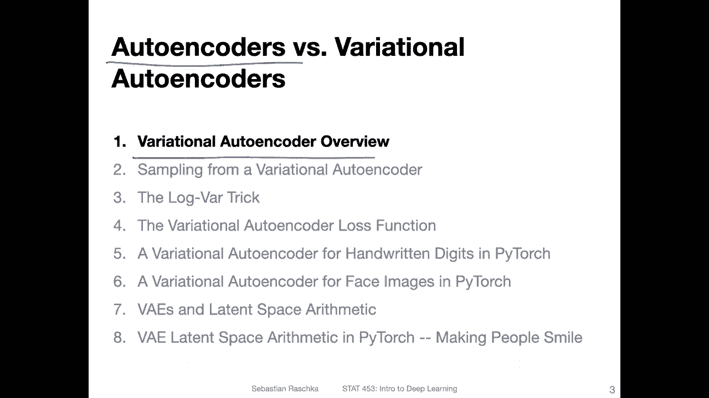
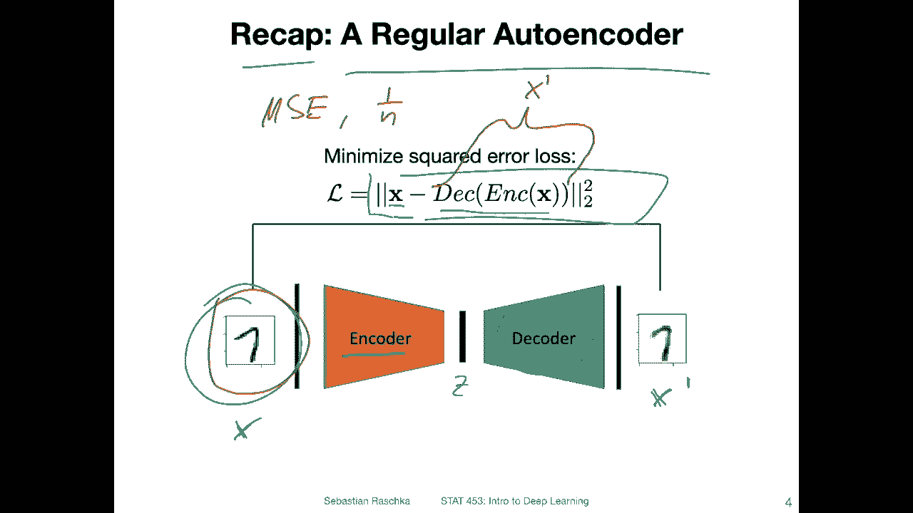
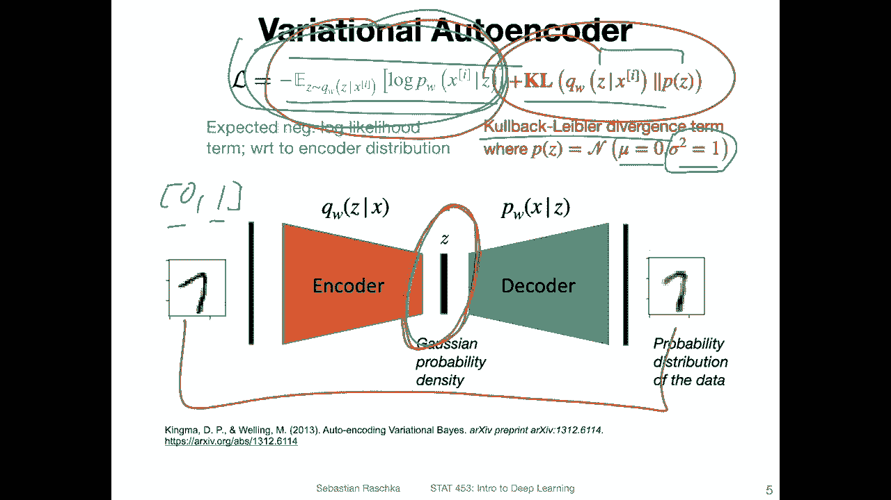
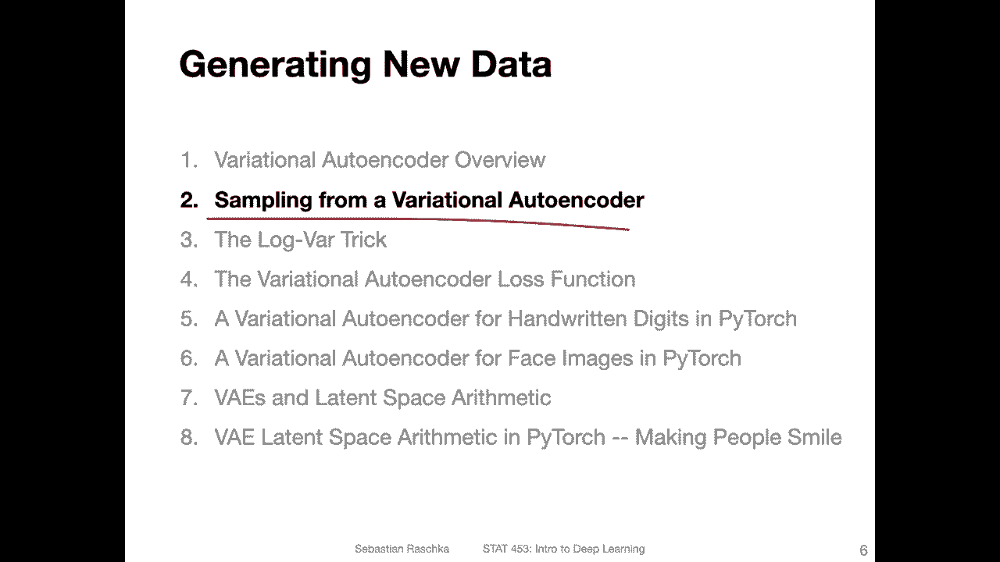

# 139：L17.1 - 变分自编码器概述 🧠

在本节课中，我们将学习变分自编码器的基本概念。我们会从回顾上周学过的标准自编码器开始，然后逐步引入变分自编码器的核心思想、目标函数及其优势。

## 回顾：标准自编码器 🔄

上一节我们介绍了标准自编码器的基本结构。本节中，我们先来回顾一下它的工作原理。

标准自编码器是一个由两部分组成的神经网络模型：一个编码器和一个解码器。

以下是其工作流程：
*   编码器接收输入图像 **X**，并将其编码为一个潜在表示，我们称之为 **Z**。
*   解码器接收这个潜在表示 **Z**，并将其重构回图像，我们称之为 **X'**。

我们的目标是让原始输入 **X** 与重构输出 **X'** 尽可能相似。一种常用的方法是计算它们之间的均方误差。

其损失函数可以表示为：
`L = || X - Decoder(Encoder(X)) ||²`
或者，对于一个小批次中的 **n** 个样本，计算平均损失：
`L = (1/n) * Σ || X_i - X'_i ||²`

## 引入：变分自编码器 🆕

上一节我们回顾了标准自编码器。本节中，我们来看看更复杂的变分自编码器。

变分自编码器的目标函数由两项组成。整体上，我们优化的是证据下界。

其损失函数包含两个部分：
1.  **重构损失**：与标准自编码器类似，旨在使重构图像 **X'** 接近原始输入 **X**。
2.  **KL 散度**：用于衡量潜在空间中的编码分布与一个先验分布（通常是标准多元高斯分布）之间的差异。

标准多元高斯分布具有零均值和单位方差（对于多元情况，协方差矩阵是单位矩阵）。KL 散度的目标是让编码器的输出分布接近这个标准正态分布。

对于重构损失项，通常有两种选择：
*   如果假设数据服从多元伯努利分布，可以使用二元交叉熵。
*   对于像图像这样的数据（像素值归一化到 0 到 1 之间），使用均方误差通常效果更好。虽然交叉熵也可用，但在实践中可能导致图像更模糊，因为它会偏向于像素值 0.5。

简而言之，变分自编码器有两个目标：一是生成逼真的重构图像，二是让潜在编码的分布规整化，使其类似于标准正态分布。

## 优势与展望 🚀

在介绍了变分自编码器的基本框架后，我们自然会问：它比标准自编码器好在哪里？

在接下来的视频中，我们将探讨如何从变分自编码器中采样，以及为什么在采样方面，变分自编码器比标准自编码器更具优势。这将是理解其价值的关键。

---

**本节课中，我们一起学习了：**
1.  回顾了标准自编码器的结构与目标。
2.  引入了变分自编码器，其目标函数包含重构损失和 KL 散度两项。
3.  了解了 KL 散度的作用是规范潜在空间，使其分布接近标准正态分布。
4.  简要讨论了重构损失函数的选择。
5.  预告了变分自编码器在数据采样方面的优势，这将在后续课程中详细展开。