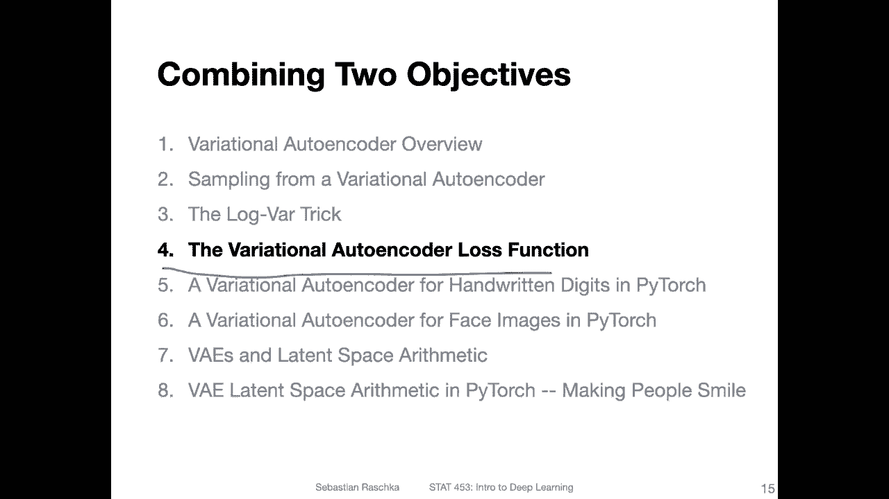
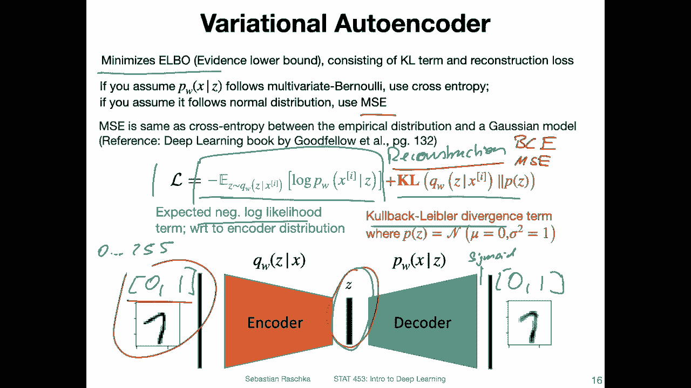
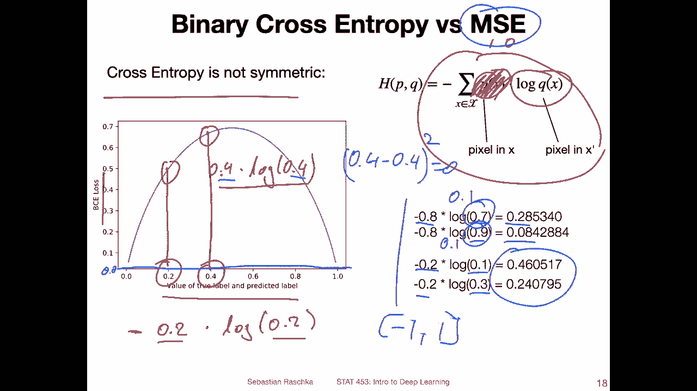
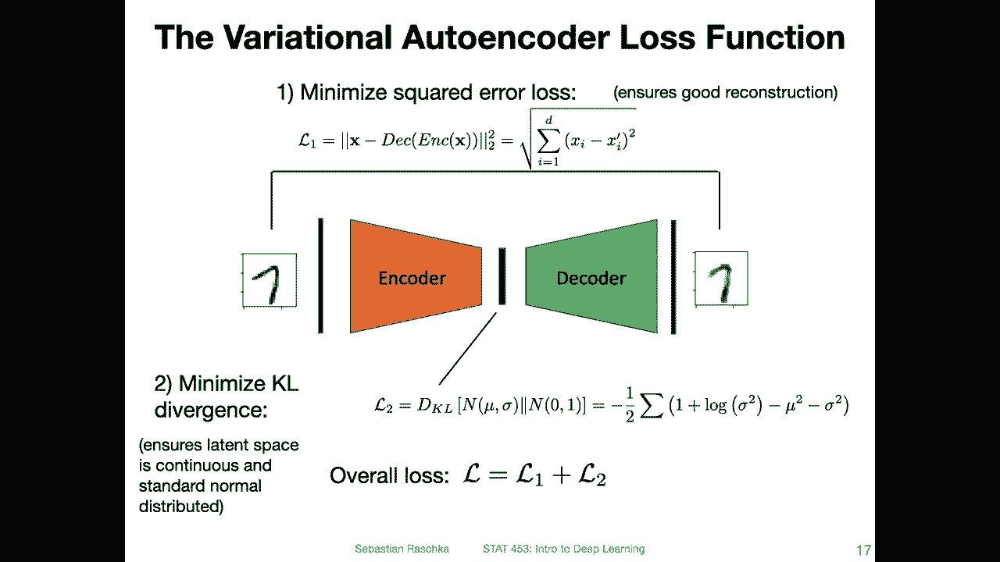
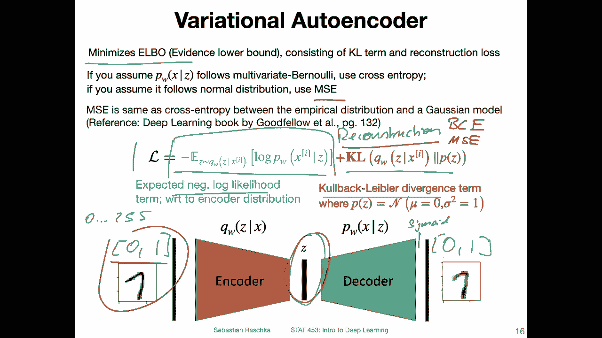
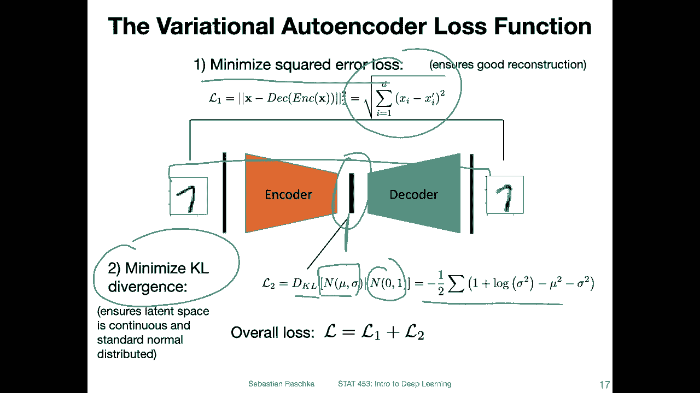
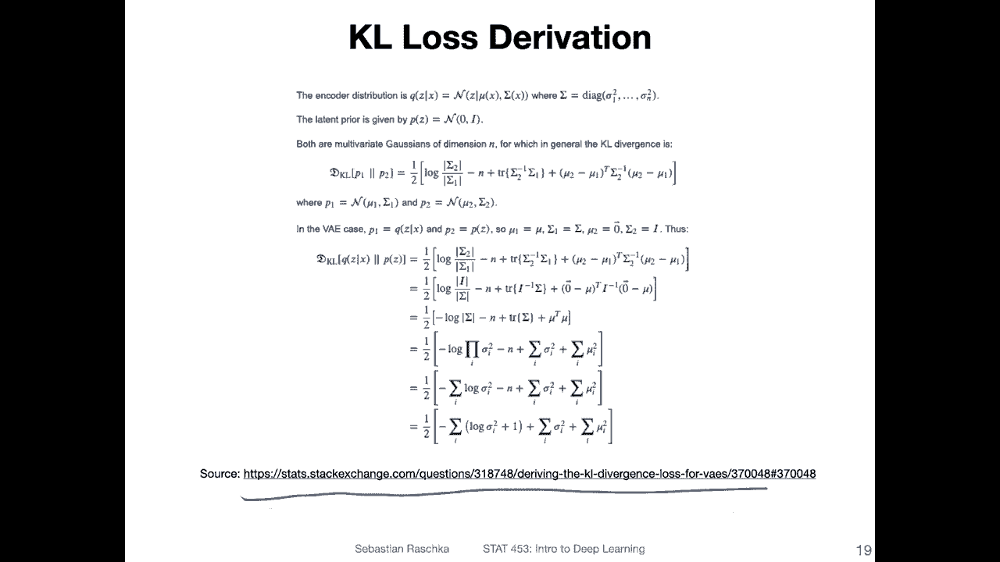
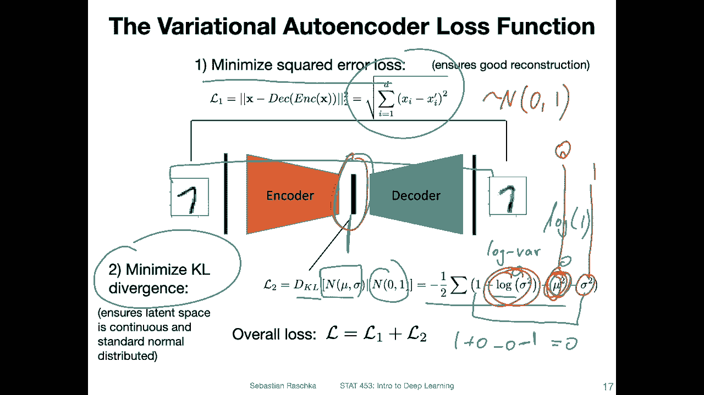
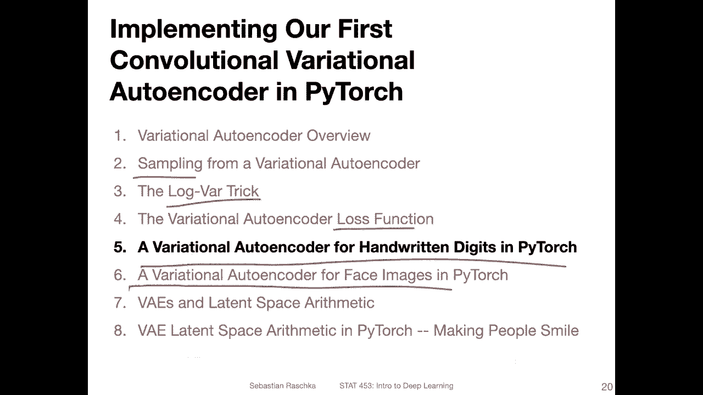

# 142：L17.4- 变分自编码器损失函数 🧠

在本节课中，我们将学习变分自编码器（VAE）损失函数的构成与原理。我们将重点解析其两个核心部分：重构损失和KL散度项，并讨论实践中如何选择损失函数。

---

## 概述

变分自编码器的总体目标是**最小化证据下界**。其损失函数主要由两部分构成：**数据的负对数似然期望**（重构损失）和**KL散度项**。后者用于衡量潜在空间分布与标准多元高斯分布之间的差异。

上一节我们介绍了VAE的架构，本节中我们来看看其核心的优化目标——损失函数。

---

## 损失函数构成

变分自编码器的损失函数公式如下：

**L = E[ -log p(x|z) ] + D_KL( q(z|x) || p(z) )**

其中：
*   **E[ -log p(x|z) ]** 是重构损失项。
*   **D_KL( q(z|x) || p(z) )** 是KL散度项，确保潜在空间分布 `q(z|x)` 接近先验分布 `p(z)`（标准正态分布）。

最大化数据的对数似然等价于最小化其负值，因此公式中带有负号。

---

## 重构损失的选择

在实践中，对于重构损失，常见的选择是**二元交叉熵**或**均方误差**。

以下是两种选择的对比分析：

*   **二元交叉熵**：当输入图像像素值被归一化到 `[0, 1]` 范围，并且解码器输出层使用Sigmoid激活函数时，有些人会使用二元交叉熵。但需注意，图像像素是连续值而非伯努利分布的0或1离散值。使用二元交叉熵可能导致图像重建结果更模糊，且其损失计算不对称，对不同的像素值惩罚不一致。

*   **均方误差**：对于连续值像素（无论是 `[0, 1]` 还是 `[-1, 1]` 范围），使用均方误差通常更合理。它直接衡量原始像素与重建像素之间的欧几里得距离，计算对称且直观。

因此，**建议对连续像素值使用均方误差作为重构损失**。其计算公式（对批次数据取平均）为：

**MSE = (1/N) * Σ (x_i - x'_i)^2**

其中 `N` 是批次中的样本数，求和是对所有像素进行的。

---

## KL散度项

KL散度项用于约束编码器输出的潜在分布。我们假设先验分布 `p(z)` 是标准正态分布 `N(0, I)`。

编码器为每个输入 `x` 输出一个均值向量 `μ` 和一个对数方差向量 `log(σ^2)`。KL散度的具体计算公式如下：

**D_KL = -0.5 * Σ (1 + log(σ^2) - μ^2 - σ^2)**

其中求和是对潜在空间的所有维度进行的。

该公式的推导过程涉及一些数学变换，但核心思想很直观：**最小化此项会迫使均值向量 `μ` 接近0，方差 `σ^2` 接近1**。当 `μ = 0` 且 `σ^2 = 1` 时，KL散度达到最小值0，此时潜在分布 `q(z|x)` 就成为了标准正态分布。

---

## 损失函数推导（可选）

如果你对KL散度项的具体推导过程感兴趣，可以参考相关资料。其核心是利用了高斯分布的KL散度解析式以及对数方差的重参数化技巧。

---

## 总结

本节课中我们一起学习了变分自编码器的损失函数。
1.  总损失由**重构损失**和**KL散度损失**两部分组成。
2.  对于图像等连续数据，**均方误差**比二元交叉熵更适合作为重构损失。
3.  **KL散度项**的作用是正则化潜在空间，使其分布接近标准正态分布，这是VAE能够进行平滑插值和生成新样本的关键。

在接下来的课程中，我们将通过代码示例，将重参数化技巧、对数方差技巧以及本课介绍的损失函数结合起来，实际训练一个能够生成手写数字和人脸图像的变分自编码器。