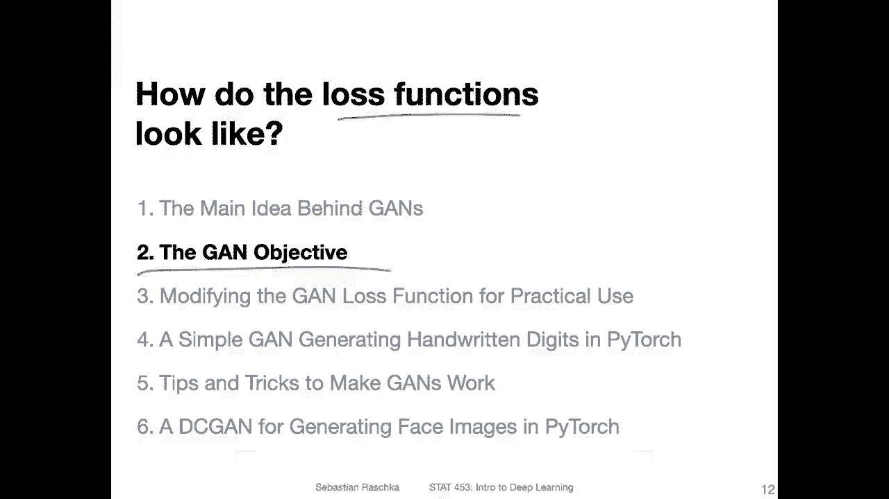
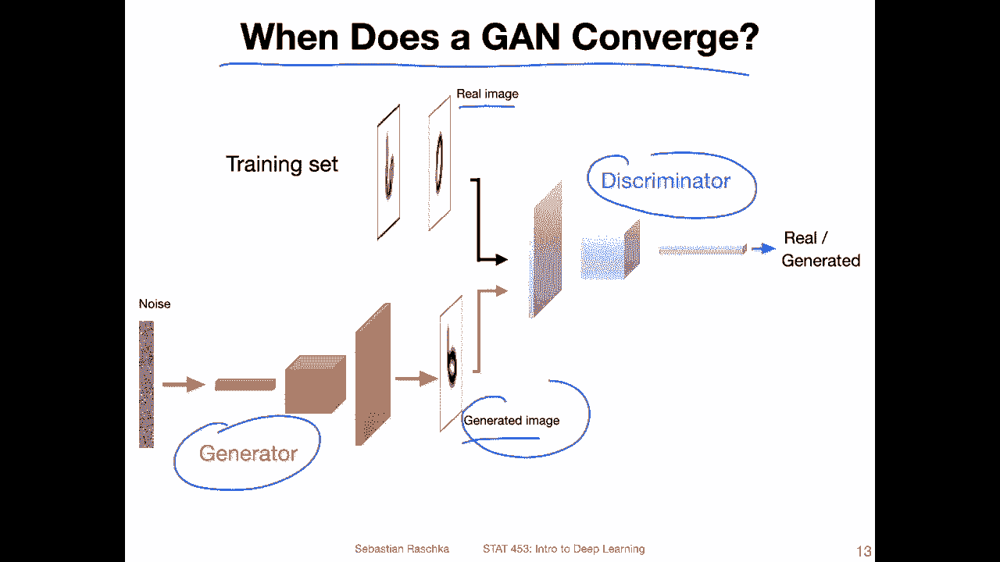
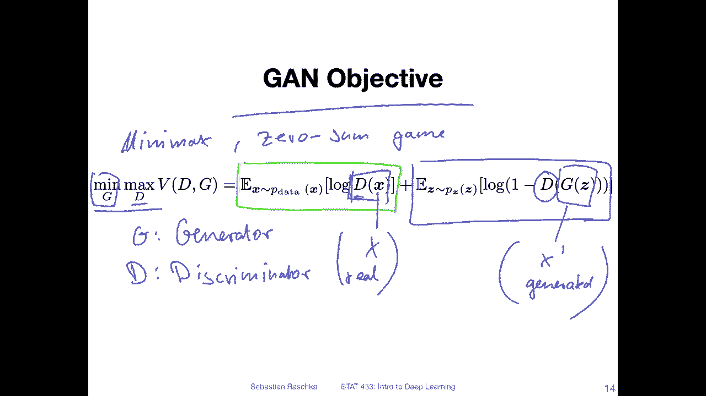
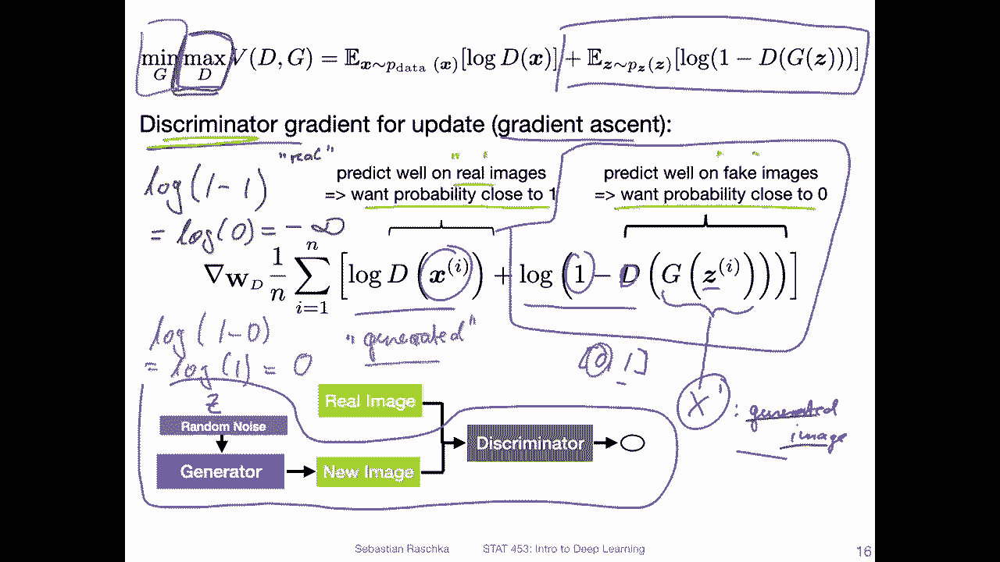
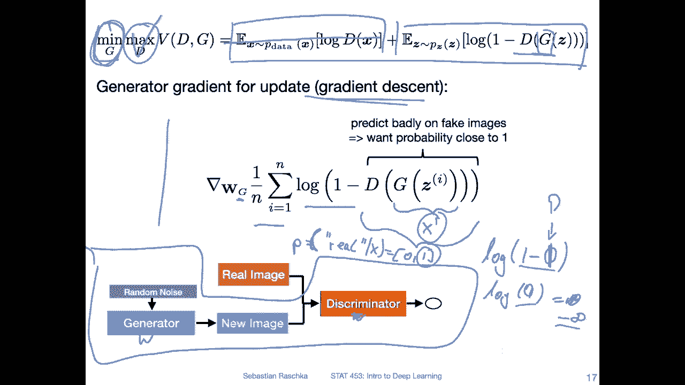
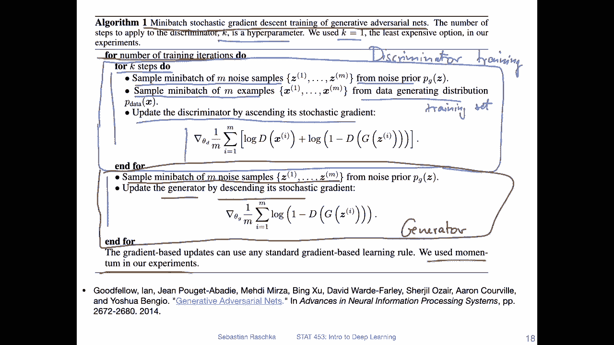
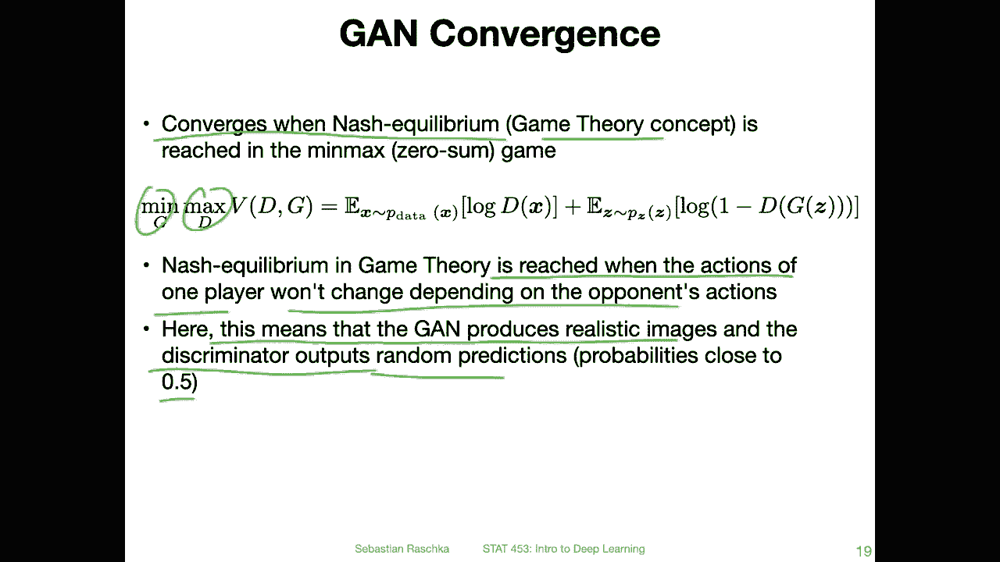
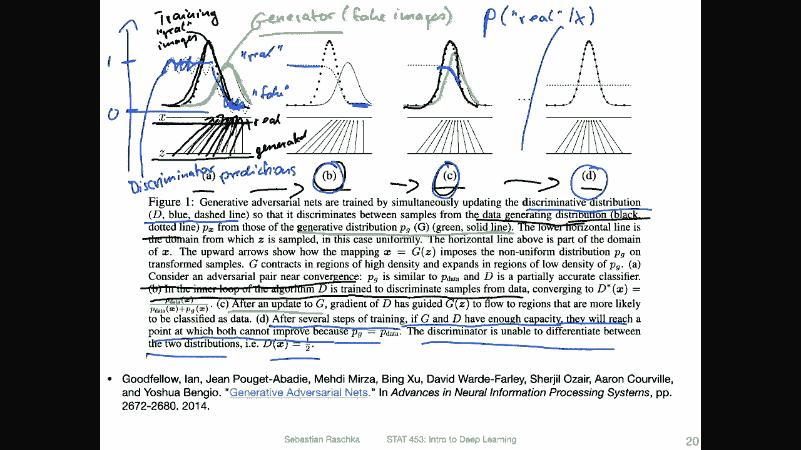
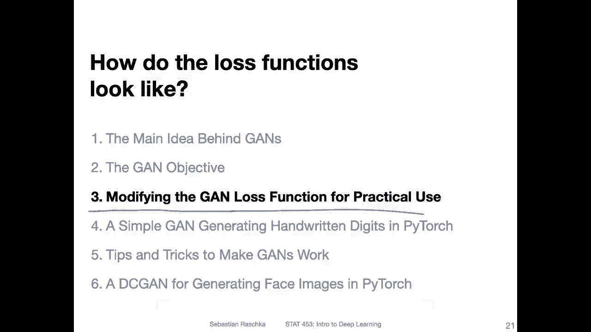

# 148：L18.2 - GAN 目标 🎯

在本节课中，我们将学习生成对抗网络（GAN）的核心目标与损失函数。我们将详细拆解GAN的优化过程，理解判别器和生成器如何通过“对抗”达到平衡，并最终生成逼真的数据。

---

## GAN 概述与收敛问题

上一节我们介绍了GAN的基本架构。本节中，我们来看看GAN的优化目标，即损失函数的具体形式。

在深入损失函数之前，我们先思考一个重要问题：GAN何时收敛？答案可能并不直观。判别器被训练来区分真实图像和生成图像，它希望更准确地检测出生成图像。与此同时，生成器希望更好地“欺骗”判别器。两者之间存在着一种微妙的博弈关系。

如果训练得当，整个系统最终会达到一个平衡点。在博弈论中，这被称为**纳什均衡**。在这个平衡点上，判别器和生成器都处于一个相对满意的状态。

---

## GAN 的损失函数：极小极大博弈

GAN的整体损失函数如下所示，它本质上是一个**极小极大博弈**：

$$
\min_G \max_D V(D, G) = \mathbb{E}_{x \sim p_{data}(x)}[\log D(x)] + \mathbb{E}_{z \sim p_z(z)}[\log(1 - D(G(z)))]
$$

公式中有两个主要部分：
*   第一部分 $\mathbb{E}_{x \sim p_{data}(x)}[\log D(x)]$ 涉及判别器对**真实图像**的预测。
*   第二部分 $\mathbb{E}_{z \sim p_z(z)}[\log(1 - D(G(z)))]$ 涉及判别器对**生成图像**的预测。

其中，$G$ 代表生成器，$D$ 代表判别器。$x$ 是真实图像，$z$ 是噪声输入，$G(z)$ 是生成的图像 $x‘$。$D(\cdot)$ 的输出是一个介于0和1之间的概率值，表示输入图像为“真实”的概率。

接下来，我们将分步解析这个公式，先看判别器的部分，再看生成器的部分。

---

## 判别器的目标：最大化

现在，我们聚焦于损失函数中与判别器 $D$ 相关的部分，即 $\max_D$ 的部分。由于这是一个最大化问题，我们使用**梯度上升**法来更新判别器的参数 $W_D$。

在实践中，我们无法获得真实的数据分布 $p_{data}(x)$，只能使用包含 $N$ 个样本的训练集。因此，期望 $\mathbb{E}$ 被替换为对训练样本的求和，形成经验损失。

以下是判别器损失相对于其参数的梯度：

$$
\nabla_{W_D} \frac{1}{N} \sum_{i=1}^N \left[ \log D(x^{(i)}) + \log(1 - D(G(z^{(i)}))) \right]
$$

为了清晰，我们分两项来理解这个梯度。

### 第一项：对真实图像的判别

我们首先关注公式中的第一项：$\log D(x)$。

判别器 $D(x)$ 为真实图像输出一个介于0和1之间的分数，代表该图像是真实的概率。判别器的目标是**最大化**这个对数概率。

*   **最佳情况**：$D(x) = 1$，则 $\log(1) = 0$。
*   **最坏情况**：$D(x) = 0$，则 $\log(0) = -\infty$。

因此，在训练判别器时，我们希望它对所有真实图像都输出接近1的概率。

### 第二项：对生成图像的判别

现在，我们关注公式中的第二项：$\log(1 - D(G(z)))$。

这里，$D(G(z))$ 是判别器对生成图像 $x‘ = G(z)$ 是真实图像的预测概率。判别器的目标同样是**最大化**整个项。

*   **最佳情况**：如果判别器确信生成图像是假的，则 $D(G(z)) = 0$。那么 $\log(1-0) = \log(1) = 0$。
*   **最坏情况**：如果判别器错误地认为生成图像是真的，则 $D(G(z)) = 1$。那么 $\log(1-1) = \log(0) = -\infty$。

因此，在训练判别器时，我们希望它对所有生成图像都输出接近0的概率。

**总结判别器的目标**：在训练判别器时，我们希望它能够完美地区分真假图像，即对真实图像输出概率1，对生成图像输出概率0。

---

## 生成器的目标：最小化

完成判别器的分析后，我们现在聚焦于生成器 $G$ 的更新。这是一个最小化问题，因此我们使用**梯度下降**法。

在更新生成器时，我们固定判别器的参数。生成器的损失只与公式中的第二项有关，因为第一项不包含 $G$。

生成器的目标是最小化以下损失：

$$
\min_G \frac{1}{N} \sum_{i=1}^N \left[ \log(1 - D(G(z^{(i)}))) \right]
$$

回顾一下，$D(G(z))$ 是判别器认为生成图像是真实的概率。

*   在判别器部分，我们希望最大化 $\log(1 - D(G(z)))$，因此希望 $D(G(z))$ 尽可能小（接近0）。
*   然而，在**生成器**部分，我们的目标变成了**最小化** $\log(1 - D(G(z)))$。

那么，如何最小化这个项呢？
*   **最坏情况（对生成器而言）**：如果 $D(G(z)) = 0$，则 $\log(1-0) = 0$。损失值较大（因为我们要最小化，0不够小）。
*   **最佳情况（对生成器而言）**：如果 $D(G(z)) = 1$，则 $\log(1-1) = \log(0) = -\infty$。这是可能达到的最小损失值。

**总结生成器的目标**：生成器希望“欺骗”判别器，让判别器对生成的假图像输出高的“真实”概率（接近1）。这样，生成器的损失就会变得非常小。

---

## GAN 的训练算法 📜

以下是原始GAN论文中提出的训练过程，称为“小批量随机梯度下降训练生成对抗网络”（实际上结合了梯度上升和下降）。

以下是算法的步骤分解：

**外层循环**：设定训练迭代次数或轮数。

**内层交替训练**：
1.  **判别器训练**（循环k步，通常k=1）：
    *   从噪声分布 $p_z(z)$ 中采样一个小批量的 $m$ 个噪声样本 $\{z^{(1)}, ..., z^{(m)}\}$。
    *   从真实数据分布 $p_{data}(x)$（即训练集）中采样一个小批量的 $m$ 个样本 $\{x^{(1)}, ..., x^{(m)}\}$。
    *   通过**梯度上升**更新判别器，以最大化其损失。
2.  **生成器训练**：
    *   从噪声分布 $p_z(z)$ 中采样一个小批量的 $m$ 个噪声样本 $\{z^{(1)}, ..., z^{(m)}\}$。
    *   通过**梯度下降**更新生成器，以最小化其损失。

论文中建议使用带动量的随机梯度下降进行优化。在实践中，Adam优化器也常被使用，但有时人们会避免使用动量，以保持模型在对抗过程中的灵活性。

---

## GAN 的收敛状态 ⚖️

如前所述，当GAN达到**纳什均衡**时，即告收敛。在博弈论中，这意味着任一玩家的策略不会因为对手的策略改变而改变。

具体到GAN：
*   **生成器**能够产生足以乱真的图像，其数据分布 $p_g(x)$ 与真实数据分布 $p_{data}(x)$ 几乎相同。
*   **判别器**无法区分两者，对于任何输入图像，它输出“真实”的概率都接近0.5（即随机猜测）。

此时，系统达到稳定，两者都无法再通过单独改变自身策略而获益。

---

## GAN 训练过程图解 🖼️

原始论文中的一张图清晰地展示了GAN的训练动态过程。图中包含四个子图 (a, b, c, d)，描绘了从开始到收敛的步骤。

**图例说明**：
*   **黑色虚线**：真实数据分布 $p_{data}(x)$。
*   **绿色实线**：生成器分布 $p_g(x)$，即生成数据的分布。
*   **蓝色虚线**：判别器输出 $D(x)$，即判别器认为输入 $x$ 来自真实分布的概率。
*   **水平轴 ($x$)**：数据空间（此处简化为一维）。
*   **垂直轴**：概率密度（对黑、绿线）或概率值（对蓝线）。

**训练过程解析**：
1.  **图 (a)**：训练初期。生成器分布 $p_g$ 与真实分布 $p_{data}$ 差异较大。判别器 $D$ 在某些区域能很自信地做出正确判断（接近1或0）。
2.  **图 (b)**：更新判别器。在固定生成器的情况下，通过梯度上升训练判别器。判别器变得更加强大，其决策边界（蓝色曲线）变得更加尖锐和准确，能更好地区分当前生成的数据和真实数据。
3.  **图 (c)**：更新生成器。在固定判别器的情况下，通过梯度下降训练生成器。生成器学习调整其分布 $p_g$，使其向真实分布 $p_{data}$ 移动，以增大判别器犯错的概率（即让 $D(G(z))$ 变大）。
4.  **图 (d)**：经过多次交替训练后达到平衡。生成器分布 $p_g$ 完美匹配了真实分布 $p_{data}$。此时，判别器对于任何输入都只能输出0.5，因为它完全无法区分数据来源。

这个图示在概念上阐明了GAN的对抗训练思想，但在实际应用中，训练过程往往更加复杂和不稳定，达到完美的图(d)状态非常困难。

---

## 总结 🎓

本节课中，我们一起学习了生成对抗网络（GAN）的核心目标与训练机制。

我们首先探讨了GAN的收敛条件——纳什均衡。然后，深入剖析了GAN的损失函数，它构成了一个**极小极大博弈**：判别器试图最大化其区分真假的能力，而生成器试图最小化其被判别器识破的可能性。我们分别详细讲解了判别器（使用梯度上升）和生成器（使用梯度下降）的优化目标。

接着，我们介绍了GAN的标准训练算法，即交替更新判别器和生成器。最后，我们通过理论分析和图示理解了GAN的理想收敛状态，即生成器完美复现真实数据分布，而判别器失去判别能力。

在下一节课中，我们将介绍一个对原始损失函数的小修改，以便能统一使用梯度下降来训练两者，并探讨如何改善生成器训练时的梯度信号。