# 149：L18.3 - 为实际使用修改 GAN 损失函数 🧠

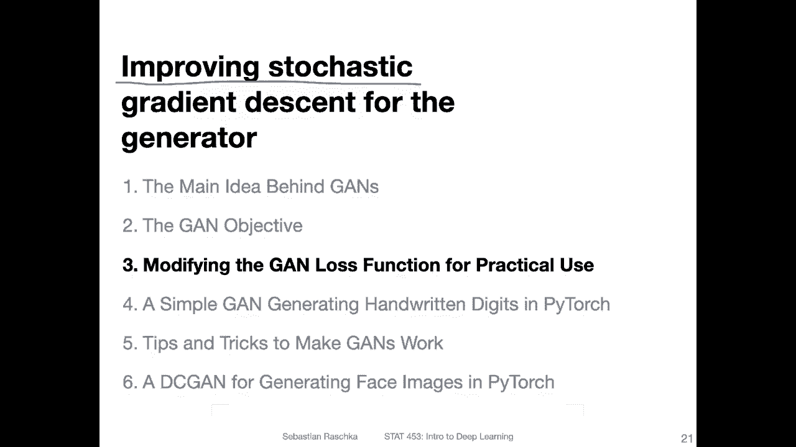

在本节课中，我们将学习如何对生成对抗网络的损失函数进行一项关键修改，以解决生成器在训练初期可能遇到的梯度消失问题，从而提升训练效率和稳定性。

---

## 🔍 GAN 训练中的常见问题

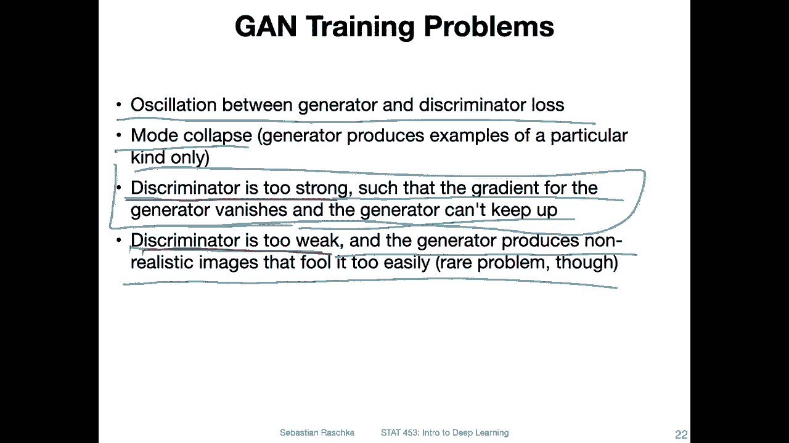

在深入探讨解决方案之前，我们先来回顾一下传统GAN训练中可能遇到的一些典型问题。

以下是GAN训练中常见的问题列表：

*   **生成器与判别器之间的持续振荡**：模型可能无法收敛，而是在一个不稳定的状态中来回摆动。
*   **模式崩溃**：生成器可能只学会生成一种能有效欺骗判别器的特定类型数据，导致生成的样本多样性极低。
*   **判别器过强**：由于分类任务通常比生成数据更容易，判别器可能变得过于强大。在训练初期，如果判别器过强，生成器从损失函数中获得的梯度信号会非常微弱，导致生成器无法有效学习。
*   **判别器过弱**：判别器太容易被生成器欺骗，导致生成器无法学习生成高质量的逼真数据。

在实践中，**判别器过强**是一个更常见的问题。接下来，我们将重点讨论如何通过修改损失函数来缓解这个问题。

---

## 🛠️ 解决判别器过强的问题

上一节我们介绍了判别器过强会导致生成器梯度消失的问题。本节中我们来看看一个具体的修改方法，以增强生成器在训练初期的学习信号。

我们首先回顾原始GAN论文中生成器的目标。生成器的目标是让判别器对其生成的假图像输出接近1的概率（即判别为“真”）。其损失函数通常表示为：

**原始生成器损失：** `L_G = log(1 - D(G(z)))`

其中，`D(G(z))` 是判别器对生成图像给出的“真”的概率。

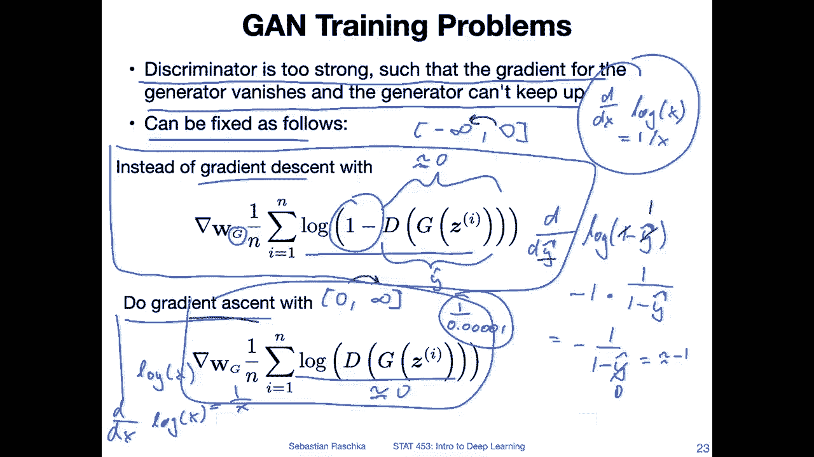

我们希望最小化这个损失。当 `D(G(z))` 接近0时（判别器能轻易识破假图像），损失 `log(1-0) = 0`，这看起来没问题。但问题在于其梯度。

让我们计算这个损失关于 `D(G(z))` 的梯度（为简化，令 `y_hat = D(G(z))`）：

**梯度计算：** `d(L_G) / d(y_hat) = -1 / (1 - y_hat)`

在训练初期，生成器能力弱，`y_hat` 通常接近0。此时梯度约为 `-1`。这个梯度信号相对较小，导致生成器学习缓慢。

为了解决这个问题，我们可以将生成器的目标从 **最小化 log(1 - D(G(z)))** 改为 **最大化 log(D(G(z)))**。

**修改后的生成器损失：** `L_G_modified = -log(D(G(z)))`

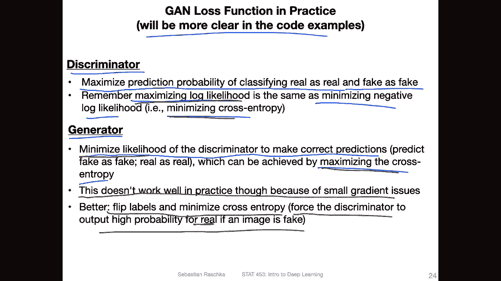

现在，当 `D(G(z))` 接近0时，损失 `-log(0)` 趋近于无穷大，梯度 `d(L_G_modified) / d(y_hat) = -1 / y_hat` 会变得非常大（因为分母 `y_hat` 很小）。这为生成器在初期提供了更强的梯度信号，使其能够更有效地对抗强大的判别器。

---

## 🔄 统一为梯度下降框架

前面我们看到了很多关于梯度上升和下降的讨论，可能显得有些复杂。但实际上，在代码实现中，我们可以将所有优化统一到熟悉的**梯度下降**框架中，并使用标准的二元交叉熵损失。

在原始论文中，判别器的训练被描述为一个梯度上升问题（最大化目标函数）。然而，最大化对数似然等价于最小化负对数似然（即交叉熵损失）。因此，我们可以直接使用PyTorch中的二元交叉熵损失和常规的优化器（如SGD或Adam）来训练判别器。

对于生成器，原始目标是**最小化判别器做出正确预测的概率**，这同样可以转化为一个交叉熵优化问题。但正如上一节所述，直接优化原始目标会导致梯度微弱。更好的实践是：**在计算生成器损失时，将假图像的标签“翻转”为真（即标签1）**。

以下是具体步骤：

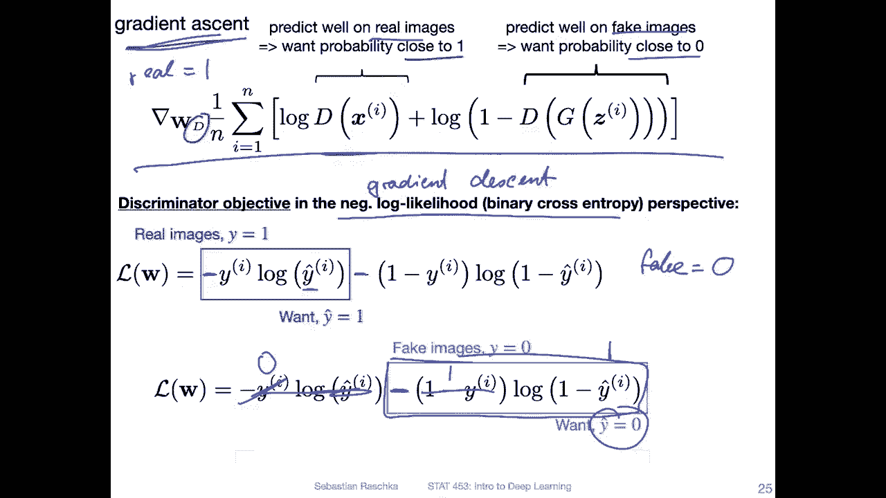

1.  **训练判别器**：
    *   对于真实图像，使用标签1。
    *   对于生成器产生的假图像，使用标签0。
    *   计算判别器对这两批图像的预测，并使用标准的二元交叉熵损失进行梯度下降优化。这鼓励判别器将真实图像判为1，假图像判为0。

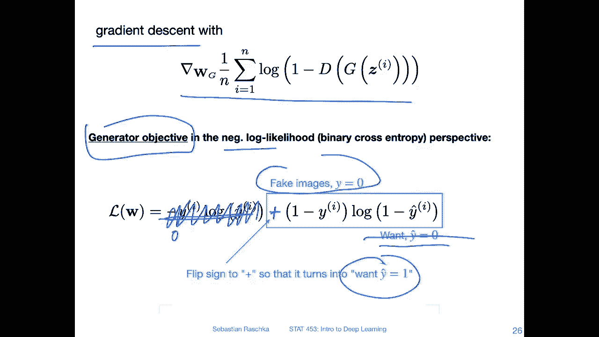

2.  **训练生成器**：
    *   保持生成器产生的图像不变。
    *   **关键修改**：将这批假图像对应的目标标签设置为1（而不是0）。
    *   再次将这批图像输入判别器，计算预测值。
    *   使用标签1和判别器的预测值计算二元交叉熵损失，并进行梯度下降优化。
    *   这样做的效果是，生成器的训练目标变成了“让判别器将假图像错误地判定为真图像”，即欺骗判别器。同时，这种“标签翻转”的技巧在实践中能提供更优的梯度。

---

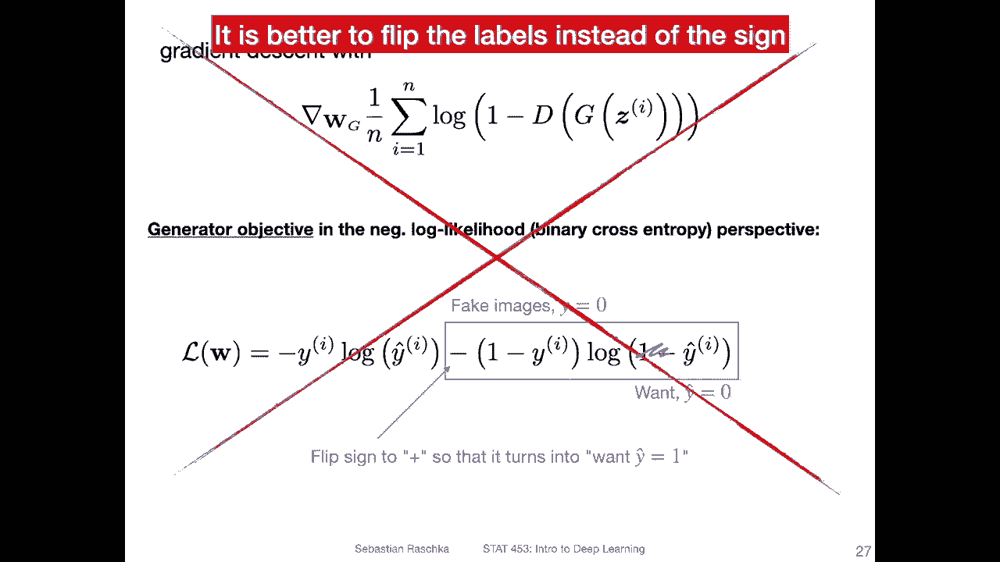

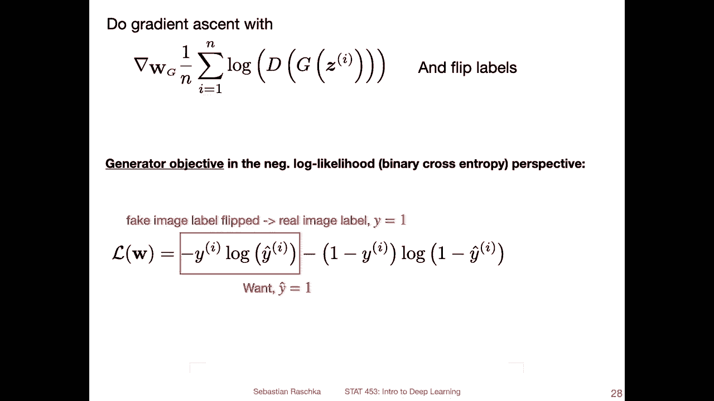

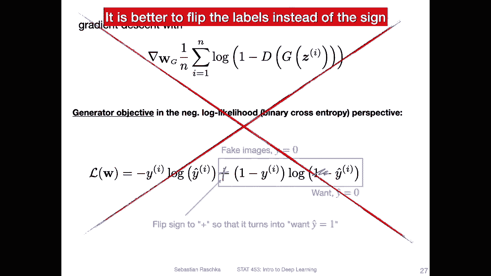

## 📝 总结

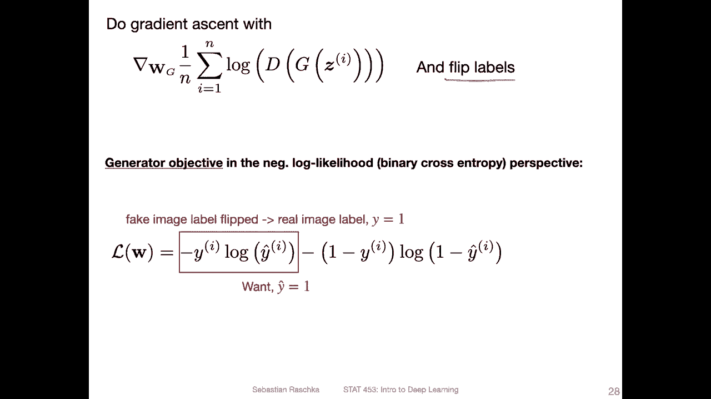

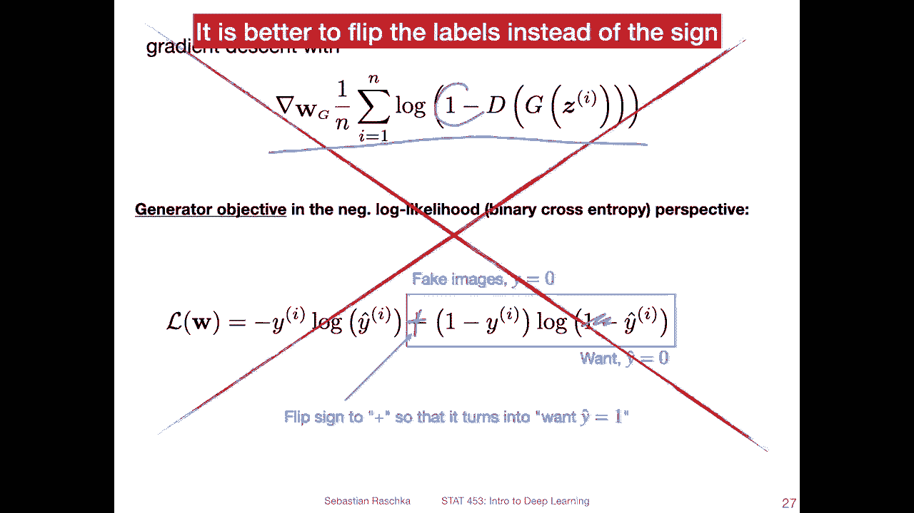

本节课中我们一起学习了如何为实际训练修改GAN的损失函数。

*   我们首先分析了GAN训练中，特别是**判别器过强导致生成器梯度消失**的常见问题。
*   接着，我们探讨了通过将生成器目标从 `min log(1-D(G(z)))` 改为 `max log(D(G(z)))` 来增强初期训练梯度的理论依据。
*   最后，我们介绍了如何在代码实践中统一使用**梯度下降**和**二元交叉熵损失**，并通过**翻转生成器训练时的标签**这一简单技巧，来实现更稳定、更高效的GAN训练。

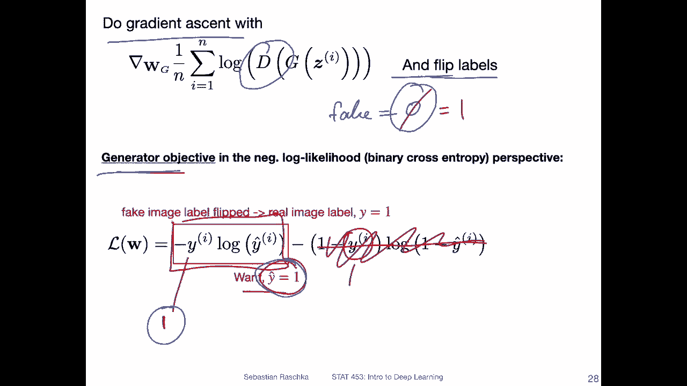

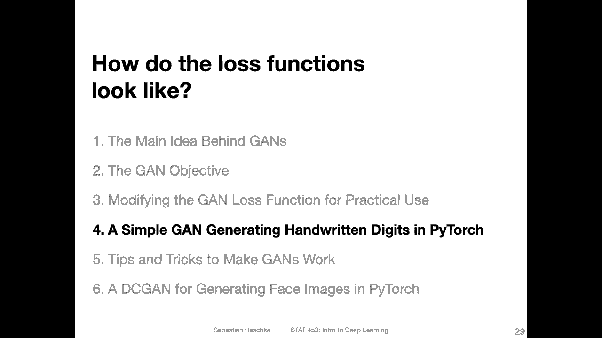

在接下来的视频中，我们将通过具体的代码示例来直观地展示这些步骤，你会发现其实现是非常清晰和直接的。