# 150：L18.4 - 在 PyTorch 中实现手写数字生成 GAN 🧠

在本节课中，我们将学习如何使用 PyTorch 实现一个生成对抗网络。我们将构建一个简单的、基于全连接层的 GAN，用于生成手写数字图像。通过代码实践，我们将把上一节讨论的理论概念具体化。

## 概述与准备工作

上一节我们介绍了 GAN 的基本原理和数学符号。本节中，我们来看看如何在 PyTorch 中具体实现一个 GAN。虽然训练 GAN 具有挑战性，但代码结构本身是清晰直接的。

首先，我们进行常规的导入和数据集准备。

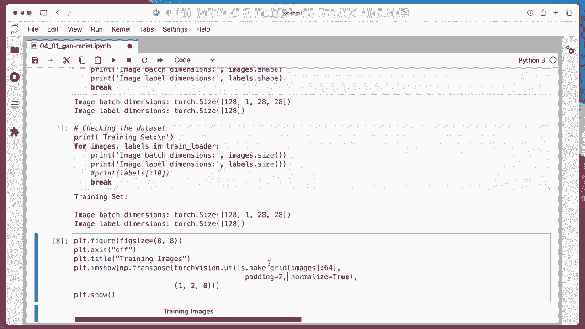

```python
import torch
import torch.nn as nn
import torch.optim as optim
from torchvision import datasets, transforms
from torch.utils.data import DataLoader
import matplotlib.pyplot as plt
```

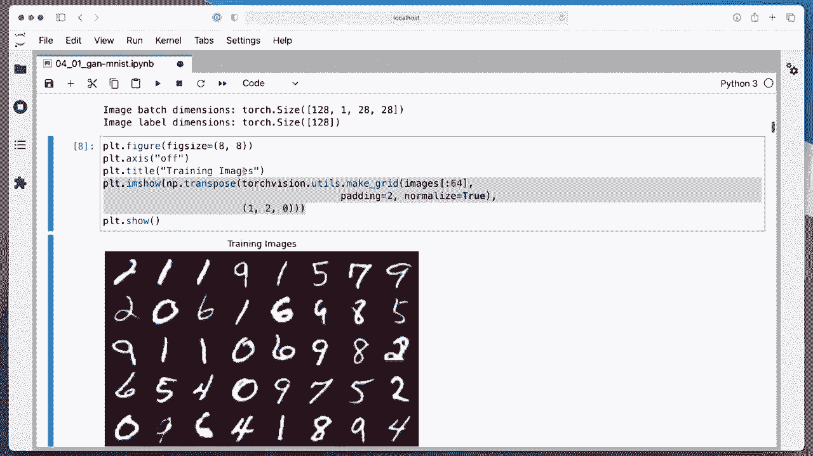

我们使用 MNIST 数据集，并将图像像素值归一化到 `[-1, 1]` 的范围，这通常比 `[0, 1]` 范围效果更好。GAN 是无监督算法，因此我们只需要训练集图像，不需要标签。

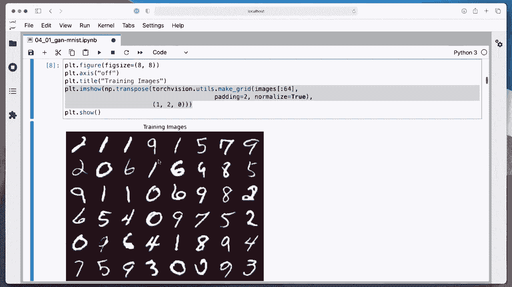

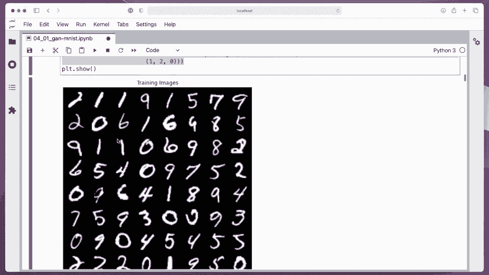

```python
transform = transforms.Compose([
    transforms.ToTensor(),
    transforms.Normalize((0.5,), (0.5,)) # 将 [0,1] 映射到 [-1,1]
])
train_dataset = datasets.MNIST(root='./data', train=True, download=True, transform=transform)
train_loader = DataLoader(train_dataset, batch_size=64, shuffle=True)
```

我们可以使用 `torchvision.utils.make_grid` 函数快速可视化一批真实图像。

```python
def show_images(images_tensor):
    grid = torchvision.utils.make_grid(images_tensor, nrow=8, padding=2, normalize=True)
    plt.imshow(grid.permute(1, 2, 0))
    plt.axis('off')
    plt.show()

# 获取一批数据并显示
dataiter = iter(train_loader)
images, _ = dataiter.next()
show_images(images)
```

## 构建生成器与判别器模型

现在进入核心部分：定义生成器 `Generator` 和判别器 `Discriminator` 模型。我们将使用 `nn.Sequential` API 来构建它们。

以下是生成器的定义。它接收一个噪声向量 `z`，通过一系列全连接层和激活函数，最终输出一个形状为 `(C, H, W)` 的“假”图像。由于输入图像被归一化到 `[-1,1]`，我们使用 `Tanh` 作为输出层的激活函数，使生成图像的像素值也在同一范围内。

```python
class Generator(nn.Module):
    def __init__(self, latent_dim=100):
        super(Generator, self).__init__()
        self.main = nn.Sequential(
            nn.Linear(latent_dim, 256),
            nn.LeakyReLU(0.2),
            nn.Dropout(0.3),
            nn.Linear(256, 512),
            nn.LeakyReLU(0.2),
            nn.Dropout(0.3),
            nn.Linear(512, 1024),
            nn.LeakyReLU(0.2),
            nn.Linear(1024, 28*28*1), # MNIST 图像尺寸为 28x28， 1个通道
            nn.Tanh()
        )
        self.latent_dim = latent_dim

    def forward(self, z):
        # 输入 z 的形状: (batch_size, latent_dim)
        img = self.main(z)
        # 将输出重塑为图像形状: (batch_size, C, H, W)
        img = img.view(img.size(0), 1, 28, 28)
        return img
```

接下来是判别器的定义。判别器本质上是一个二分类器，它接收一张图像（无论是真实的还是生成的），输出一个标量 logit，表示该图像为“真”的概率。

```python
class Discriminator(nn.Module):
    def __init__(self):
        super(Discriminator, self).__init__()
        self.main = nn.Sequential(
            nn.Linear(28*28*1, 1024),
            nn.LeakyReLU(0.2),
            nn.Dropout(0.3),
            nn.Linear(1024, 512),
            nn.LeakyReLU(0.2),
            nn.Dropout(0.3),
            nn.Linear(512, 256),
            nn.LeakyReLU(0.2),
            nn.Linear(256, 1)
            # 注意：没有 Sigmoid，因为损失函数使用 BCEWithLogitsLoss
        )

    def forward(self, img):
        # 输入 img 的形状: (batch_size, C, H, W)
        flattened = img.view(img.size(0), -1)
        validity = self.main(flattened)
        return validity.squeeze() # 将输出从 (batch_size, 1) 变为 (batch_size,)
```

## 初始化模型与优化器

模型定义好后，我们需要实例化它们，并为每个模型分别设置优化器。这是 GAN 训练的一个关键点：生成器和判别器有各自独立的优化器，用于在训练的不同阶段更新各自的参数。

```python
# 初始化模型
latent_dim = 100
generator = Generator(latent_dim)
discriminator = Discriminator()

# 设置优化器
lr_g = 0.0002 # 生成器学习率
lr_d = 0.0002 # 判别器学习率
beta1 = 0.5 # Adam 优化器的超参数

optimizer_G = optim.Adam(generator.parameters(), lr=lr_g, betas=(beta1, 0.999))
optimizer_D = optim.Adam(discriminator.parameters(), lr=lr_d, betas=(beta1, 0.999))

# 定义损失函数
criterion = nn.BCEWithLogitsLoss()
```

请注意，`optimizer_G` 只包含生成器的参数，`optimizer_D` 只包含判别器的参数。这确保了在训练生成器时，判别器的权重被“冻结”，反之亦然。

## 训练循环详解

训练 GAN 的核心在于交替训练判别器和生成器。以下是训练循环中每一步的详细说明。

首先，我们定义一些标签和用于监控训练过程的固定噪声。

```python
# 定义标签
real_label = 1.0
fake_label = 0.0

# 创建固定噪声，用于在每个epoch后生成图像以监控进度
fixed_noise = torch.randn(64, latent_dim)
```

以下是每个训练批次中的关键步骤：

**第一步：训练判别器**
目标是让判别器能正确区分真实图像和生成器产生的假图像。

1.  清零判别器优化器的梯度。
2.  用真实图像和标签 `1` 计算损失。
3.  用生成器产生的假图像和标签 `0` 计算损失。这里需要使用 `.detach()` 将假图像从生成器的计算图中分离，防止梯度传播到生成器。
4.  将两部分损失相加，反向传播并更新判别器的参数。

**第二步：训练生成器**
目标是让生成器产生的图像能够“欺骗”判别器，使其误判为真。

1.  清零生成器优化器的梯度。
2.  再次将假图像输入判别器，但这次使用“翻转”的标签 `1`（即希望判别器将假图判为真）。
3.  计算损失。注意，这里**不**使用 `.detach()`，因为我们需要梯度来更新生成器。
4.  反向传播并更新生成器的参数。

以下是训练循环的代码框架：

```python
num_epochs = 100
for epoch in range(num_epochs):
    for i, (real_imgs, _) in enumerate(train_loader):

        batch_size = real_imgs.size(0)

        # 准备真实图像的标签
        real_labels = torch.full((batch_size,), real_label)
        # 准备假图像的标签
        fake_labels = torch.full((batch_size,), fake_label)
        # 准备用于训练生成器的“翻转”假标签
        flipped_fake_labels = torch.full((batch_size,), real_label)

        # ---------------------
        #  训练判别器 (D)
        # ---------------------
        optimizer_D.zero_grad()

        # 计算真实图像的损失
        output_real = discriminator(real_imgs)
        loss_D_real = criterion(output_real, real_labels)

        # 生成假图像
        noise = torch.randn(batch_size, latent_dim)
        fake_imgs = generator(noise)

        # 计算假图像的损失，并分离计算图
        output_fake = discriminator(fake_imgs.detach())
        loss_D_fake = criterion(output_fake, fake_labels)

        # 合并判别器损失并反向传播
        loss_D = (loss_D_real + loss_D_fake) / 2
        loss_D.backward()
        optimizer_D.step()

        # ---------------------
        #  训练生成器 (G)
        # ---------------------
        optimizer_G.zero_grad()

        # 再次将假图像输入判别器，但这次目标是让判别器输出“真”
        output_fake_for_G = discriminator(fake_imgs) # 注意没有 .detach()
        loss_G = criterion(output_fake_for_G, flipped_fake_labels)

        loss_G.backward()
        optimizer_G.step()

        # 后续可以添加日志记录和可视化代码...
```

## 监控训练过程与结果可视化

训练 GAN 时，仅观察损失值往往不够直观。最有效的方法是定期查看生成器在固定噪声输入下产生的图像序列。

在训练循环中，我们可以在每个 epoch 结束后，用 `fixed_noise` 生成一批图像并保存。

```python
    # 在每个epoch结束后
    with torch.no_grad():
        fixed_fake_imgs = generator(fixed_noise).detach().cpu()
    # 保存或可视化 fixed_fake_imgs...
```

经过 100 个 epoch 的训练后，我们可以观察生成图像的演变过程。在训练初期（epoch 0），生成器输出的是无意义的噪声。随着训练进行（epoch 5, 10, 20...），图像逐渐呈现出可辨认的数字形状。在训练后期，虽然可能仍存在一些瑕疵，但大部分生成的数字已经相当清晰合理。

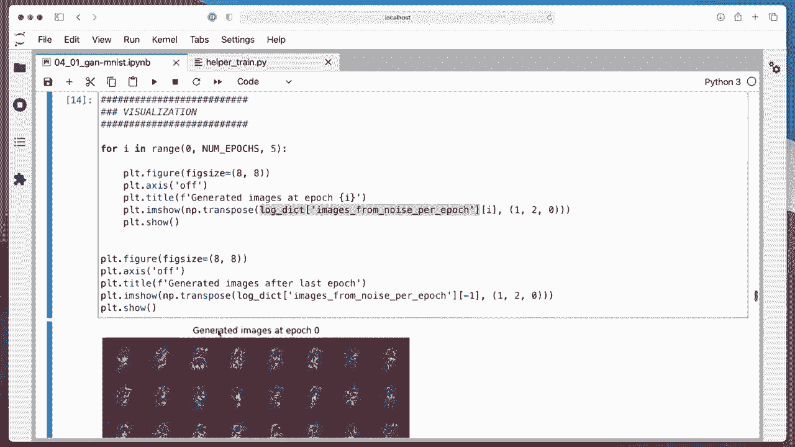

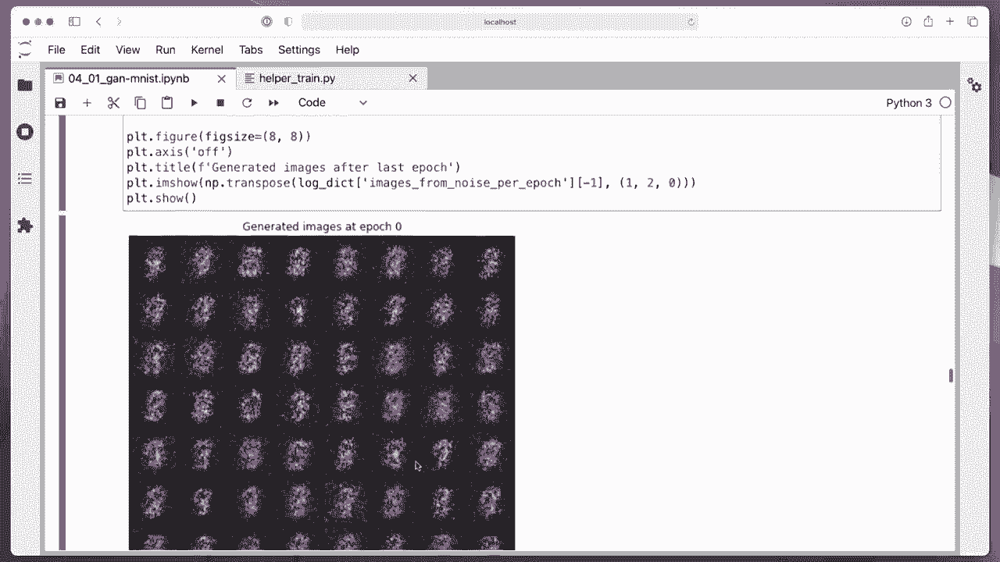

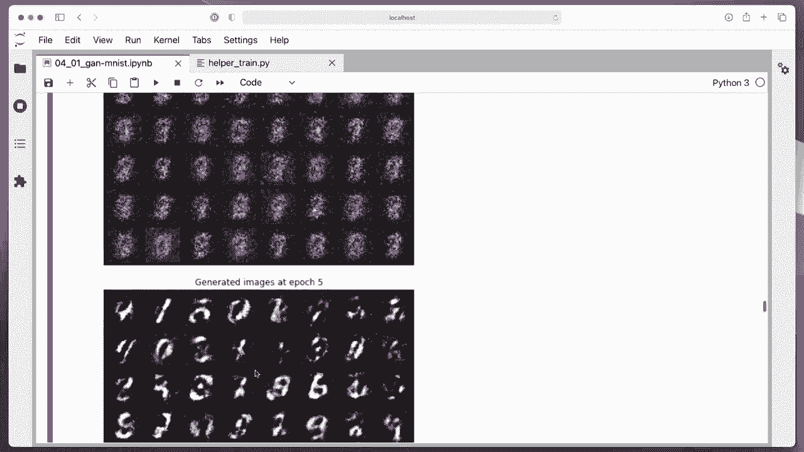

## 总结

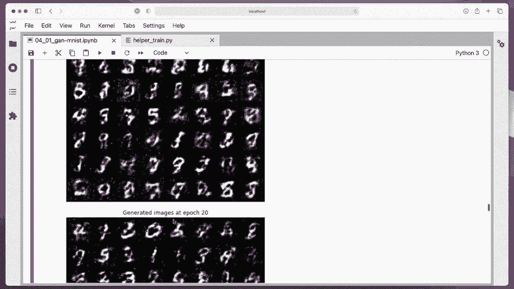

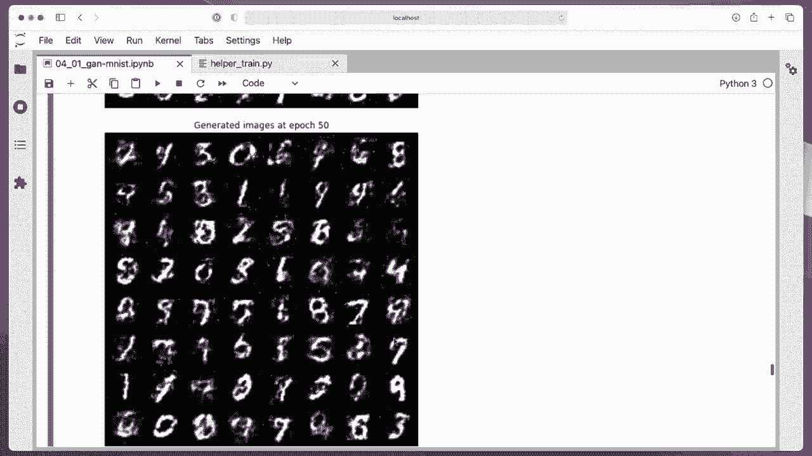

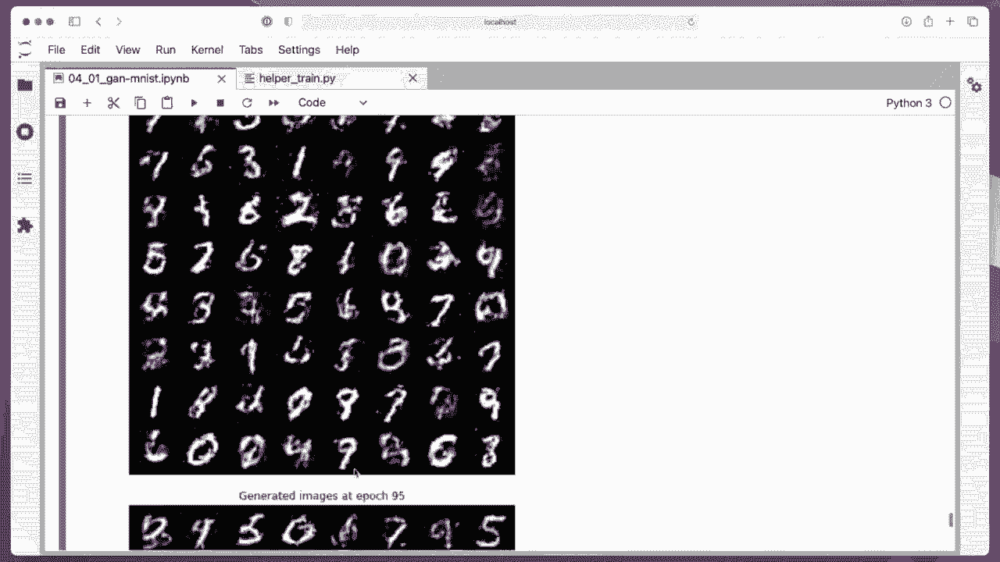

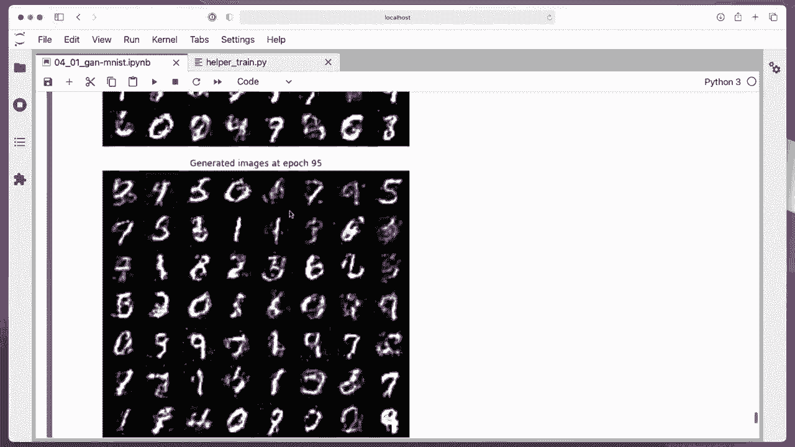

本节课中，我们一起学习了如何在 PyTorch 中实现一个基本的生成对抗网络。我们完成了以下工作：

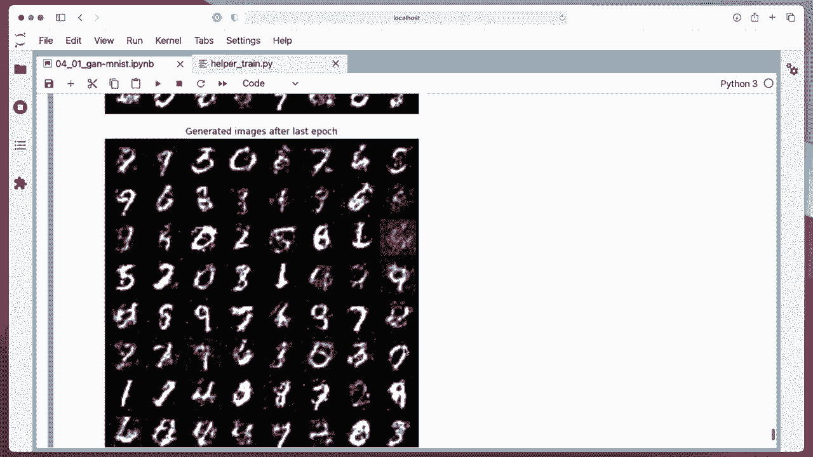

1.  **准备数据**：加载并归一化 MNIST 数据集。
2.  **构建模型**：定义了全连接结构的生成器和判别器。
3.  **设置训练**：为两个模型分别初始化了优化器，并解释了交替训练的策略。
4.  **实现训练循环**：详细编码了判别器和生成器交替更新的步骤，包括梯度清零、损失计算、反向传播和参数更新。
5.  **监控进度**：通过使用固定噪声生成图像序列，直观地展示了 GAN 的学习过程。

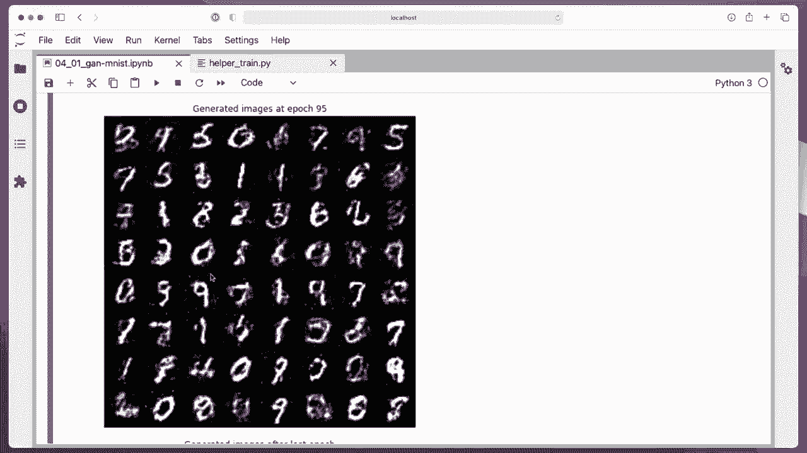

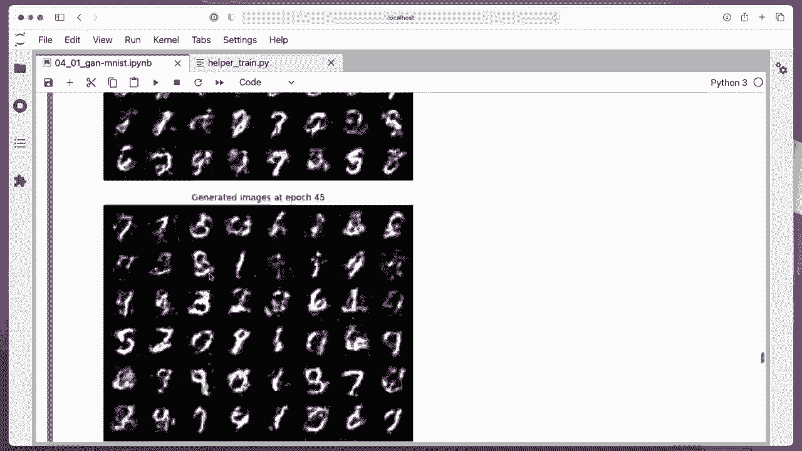

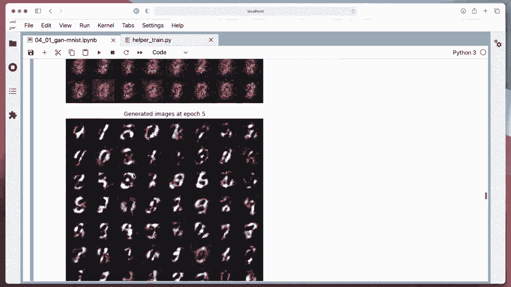

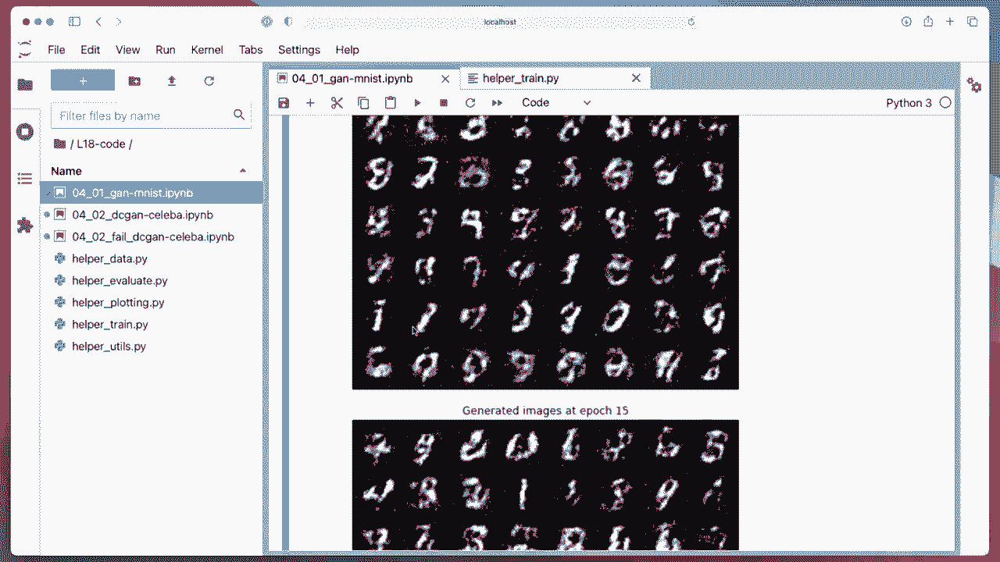

这个简单的 GAN 证明了通过对抗训练，神经网络能够学习并生成逼真的手写数字图像。然而，GAN 的训练过程不稳定且需要精心调参。在下一节课中，我们将探讨一些训练 GAN 的实用技巧和策略。