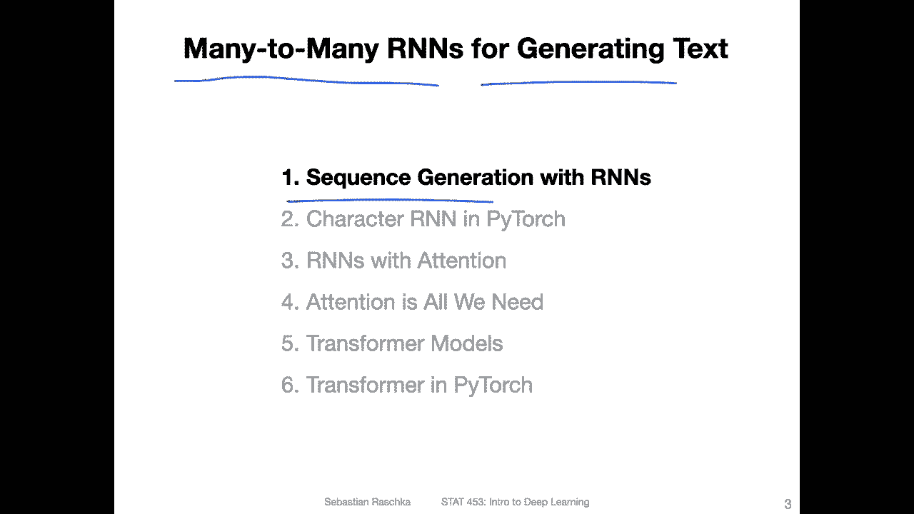
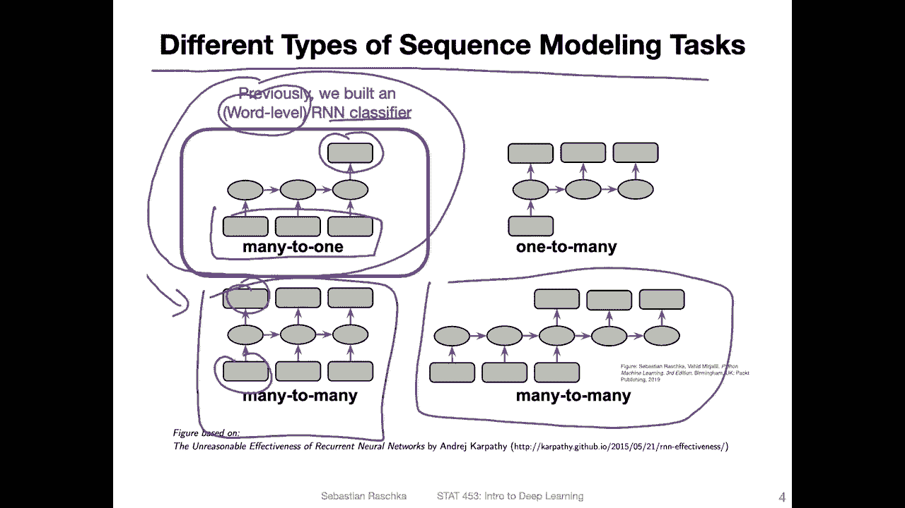
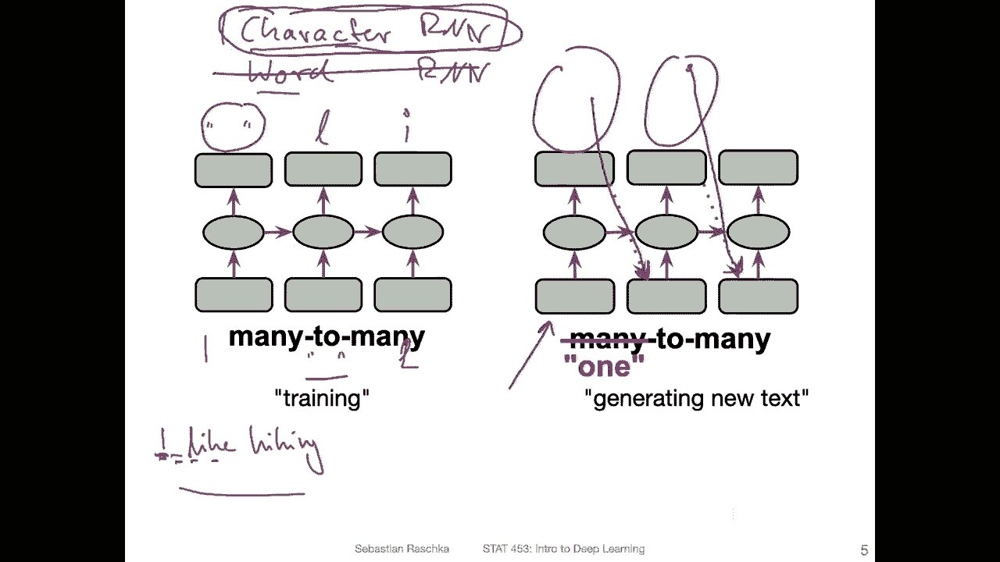
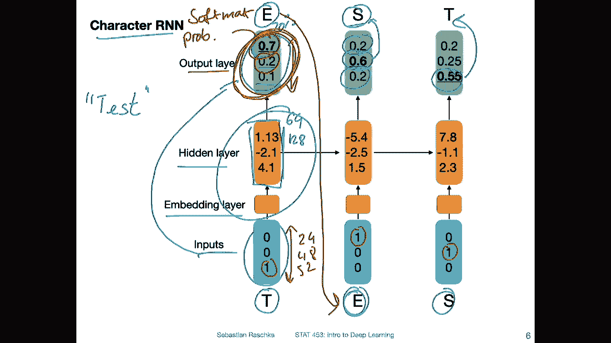
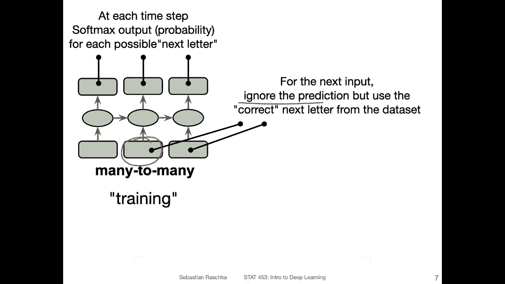
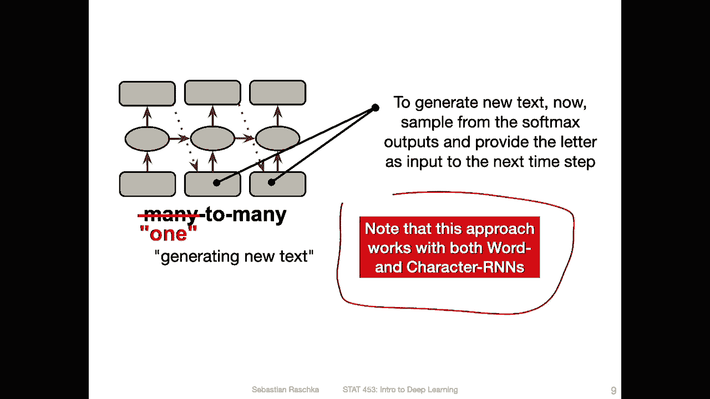
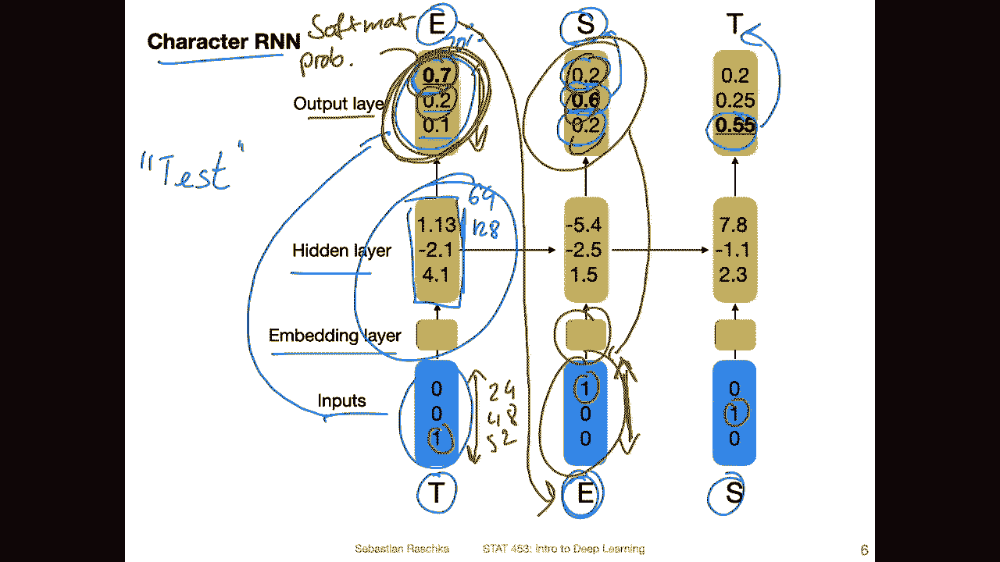
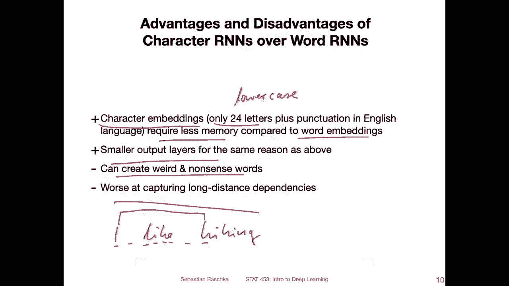
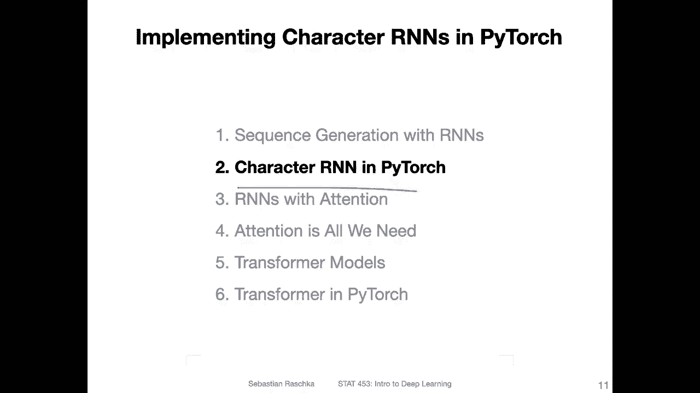

# 154：L19.1 - 使用单词和字符 RNN 生成序列 📝



在本节课中，我们将学习如何使用循环神经网络（RNN）进行序列生成。我们将重点讨论用于文本生成的“多对多”RNN架构，并比较字符级RNN与单词级RNN的异同。



## 概述 🎯

在之前的课程中，我们讨论了用于文本分类的RNN，那是一种“多对一”的架构。本节课，我们将转向“多对多”架构，它能够接收一个输入序列并生成一个输出序列，非常适合文本生成任务。

## 文本生成的两种主要方法

生成文本的RNN主要有两种方法：**字符级RNN**和**单词级RNN**。两者的核心区别在于输入和输出的基本单元（token）不同。

### 字符级RNN

在字符级RNN中，每个输入和输出单元是一个**字符**。例如，对于句子“I like hiking”，输入序列是 `[‘I’, ‘ ‘, ‘l’, ‘i’, ‘k’, ‘e’, ‘ ‘, …]`。网络的任务是预测序列中的下一个字符。

以下是其工作原理的简化表示：
```python
# 输入：当前字符（如 ‘I’）
# 输出：下一个字符的概率分布（如 ‘ ‘ 的概率最高）
# 训练目标：最小化预测字符与真实下一个字符之间的交叉熵损失
```

### 单词级RNN

在单词级RNN中，每个输入和输出单元是一个**单词**。对于同样的句子“I like hiking”，输入序列是 `[‘I’, ‘like’, ‘hiking’]`。网络的任务是预测序列中的下一个单词。



## 训练过程详解

上一节我们介绍了两种RNN的基本概念，本节中我们来看看它们是如何被训练的。

无论是字符级还是单词级RNN，其训练都遵循**自监督学习**的模式。我们不需要额外的人工标注标签，因为标签就是输入序列本身的下一个单元。

### 训练阶段

在训练时，我们向网络提供一个序列单元（字符或单词），并让它预测下一个单元。损失函数（如交叉熵损失）通过比较预测概率分布和真实的下一个单元（即“标签”）来计算。

例如，对于字符级RNN和句子“test”：
*   输入 `‘t’`，网络应学会输出高概率给 `‘e’`。
*   输入 `‘e’`，网络应学会输出高概率给 `‘s’`。
*   输入 `‘s’`，网络应学会输出高概率给 `‘t’`。

这个过程可以用以下示意图概括：


### 推理/生成阶段

训练完成后，我们如何用模型生成全新的文本呢？方法与训练时不同。

1.  我们提供一个**随机的起始单元**（如一个字符或一个特殊的起始词）。
2.  模型根据当前输入，输出一个**下一个单元的概率分布**。
3.  我们并不总是选择概率最高的单元，而是根据这个概率分布进行**采样**。这引入了随机性，使得生成的文本具有多样性。
4.  将采样得到的单元作为下一个时间步的输入。
5.  重复步骤2-4，直到生成长度满意的序列或遇到停止符。





## 字符级与单词级RNN的对比



了解了基本流程后，我们来系统比较一下这两种方法的优缺点。

以下是两种方法的主要特点：

*   **字符级RNN**
    *   **优点**：
        *   **词汇表小**：通常只包含字母、数字、标点等（如 ~100个字符），模型输出层维度小，计算效率高。
        *   **内存占用少**：嵌入层和输出层的参数量远小于单词级RNN。
        *   **能处理任何单词**：可以拼写出训练数据中未出现过的单词。
    *   **缺点**：
        *   **序列更长**：处理同样长度的文本，需要处理的序列步数更多。
        *   **更难捕捉长期依赖**：由于序列更长，单词开头和结尾之间的信息更容易丢失。
        *   **可能生成无意义词**：可能组合出不符合拼写规则的字符序列。



*   **单词级RNN**
    *   **优点**：
        *   **序列更短**：每个时间步包含更多语义信息。
        *   **更容易捕捉语义和句法**：直接在单词层面进行建模。
        *   **不会出现拼写错误**：生成的每个单元都是词典中的合法单词。
    *   **缺点**：
        *   **词汇表大**：通常需要上万甚至数十万的词汇量，导致嵌入层和输出层非常庞大。
        *   **无法处理未登录词**：对于不在训练词汇表中的单词，模型无法处理。
        *   **输出层计算昂贵**：在数万词汇上计算Softmax概率分布开销较大。

## 总结 📚

本节课中，我们一起学习了使用RNN进行序列生成的核心概念。

我们首先回顾了“多对多”RNN架构，然后详细介绍了**字符级RNN**和**单词级RNN**两种文本生成方法。我们探讨了它们的**训练过程**（一种自监督学习范式）和**文本生成过程**（基于采样的迭代生成）。最后，我们系统对比了两种方法的优缺点，为实际应用中的选择提供了依据。





在接下来的课程中，我们将深入代码层面，学习如何在PyTorch中实现一个字符级RNN来实际生成文本。