# 157：L19.3 - 带注意力机制的 RNN 🧠

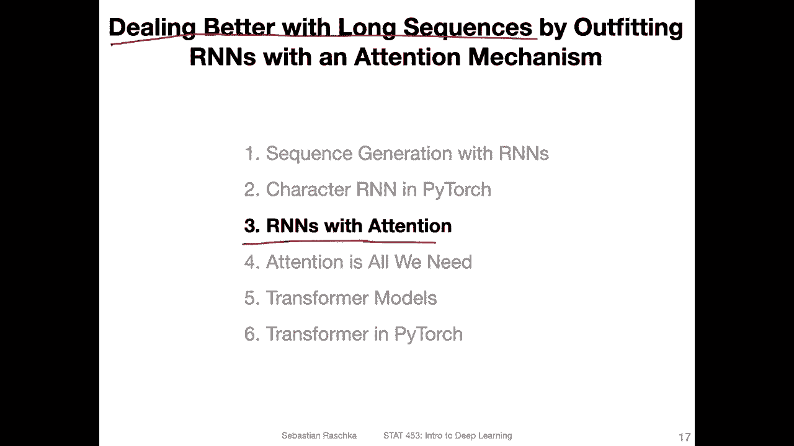

在本节课中，我们将学习循环神经网络（RNN）中的一种重要增强技术——注意力机制。该机制旨在解决传统RNN在处理长序列（如长句子翻译）时，因需要将所有信息压缩到单一隐藏状态而导致性能下降的问题。

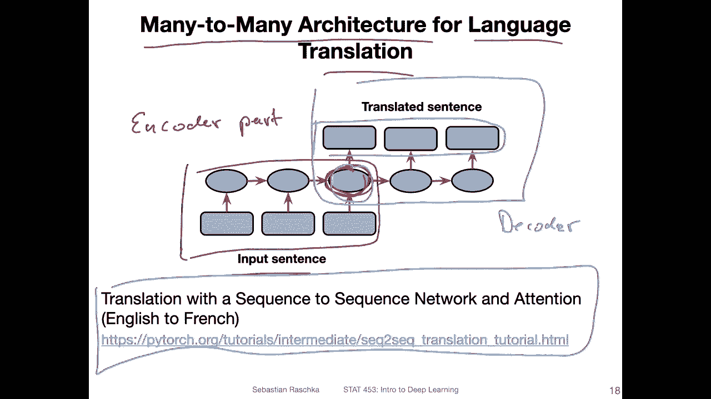

---

上一节我们介绍了用于语言翻译的经典编码器-解码器架构。本节中，我们来看看这种架构在处理长句子时面临的挑战。

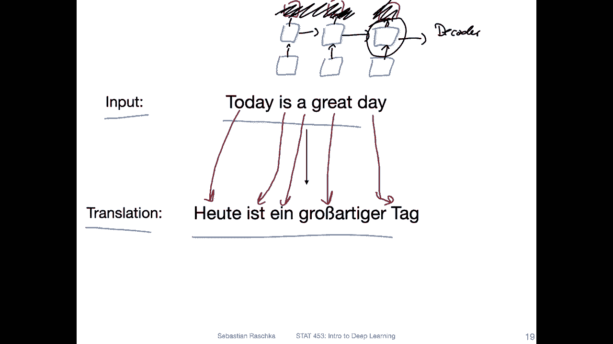

传统编码器-解码器架构将整个输入句子编码为一个最终的隐藏状态，然后解码器仅基于此状态生成翻译。对于长句子，网络很难在单个隐藏状态中记住所有必要信息。

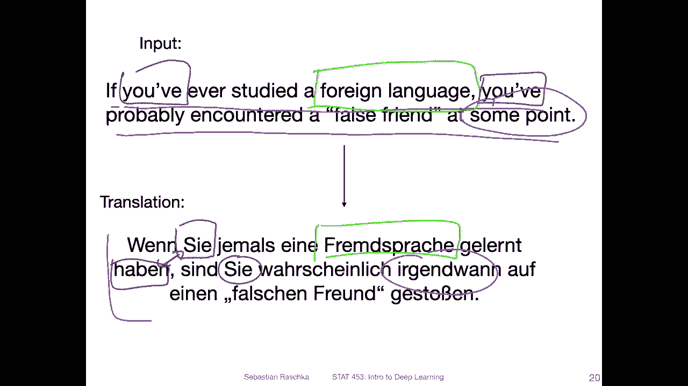

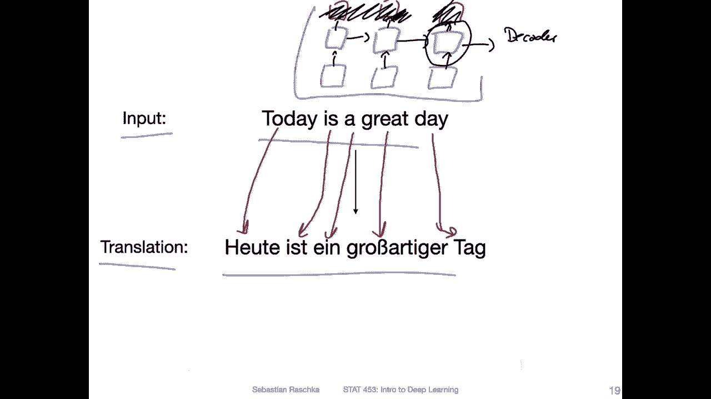

为了更直观地理解，请看以下翻译示例：
> 输入句子：“Today is a great day.”
> 输出翻译：“Hotaist and Goar attack.”（此为示例语言）

在某些句子中，输入与输出单词存在近似一一对应的关系。然而，更多时候情况并非如此。

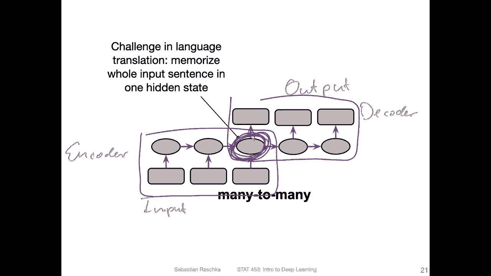

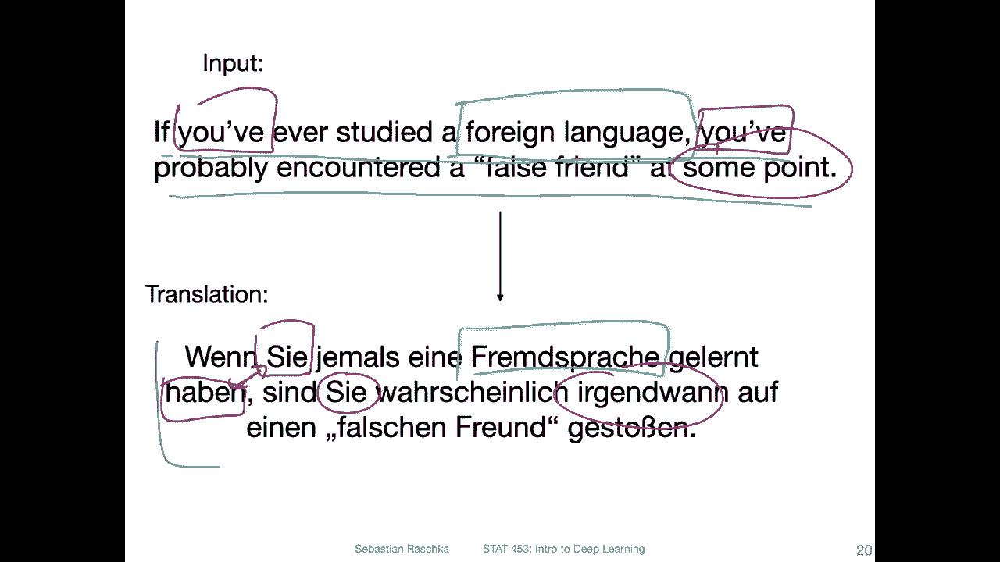

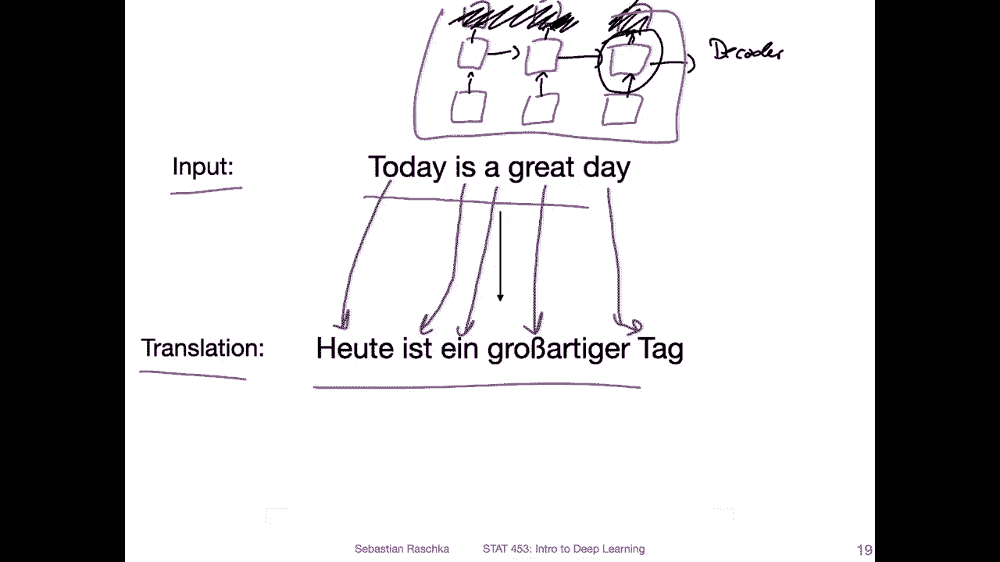

请看另一个更复杂的例子：
> 输入句子：“If you have ever studied a foreign language, you have probably encountered a false friend at some point.”
> 输出翻译：（对应译文，此处展示单词对应关系）

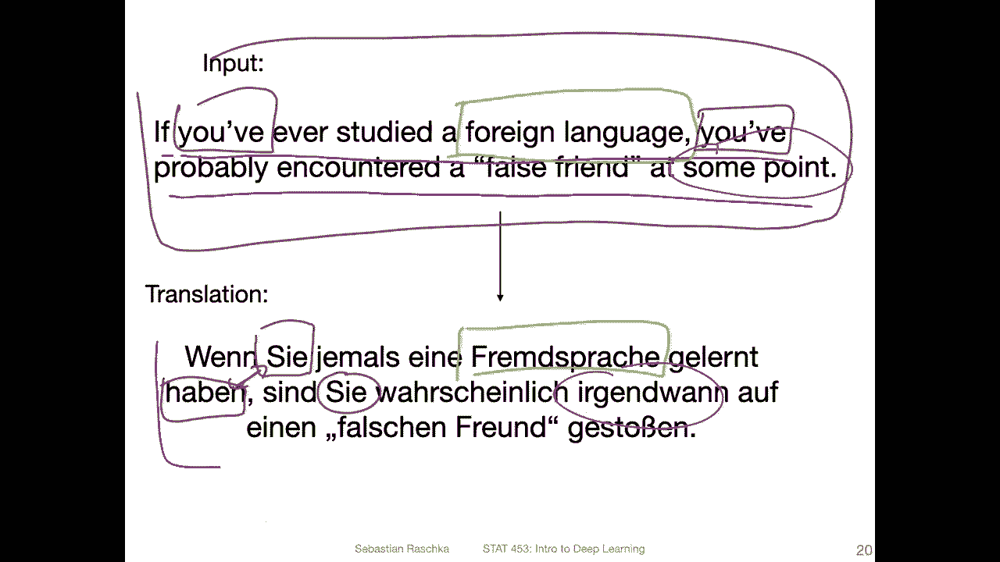

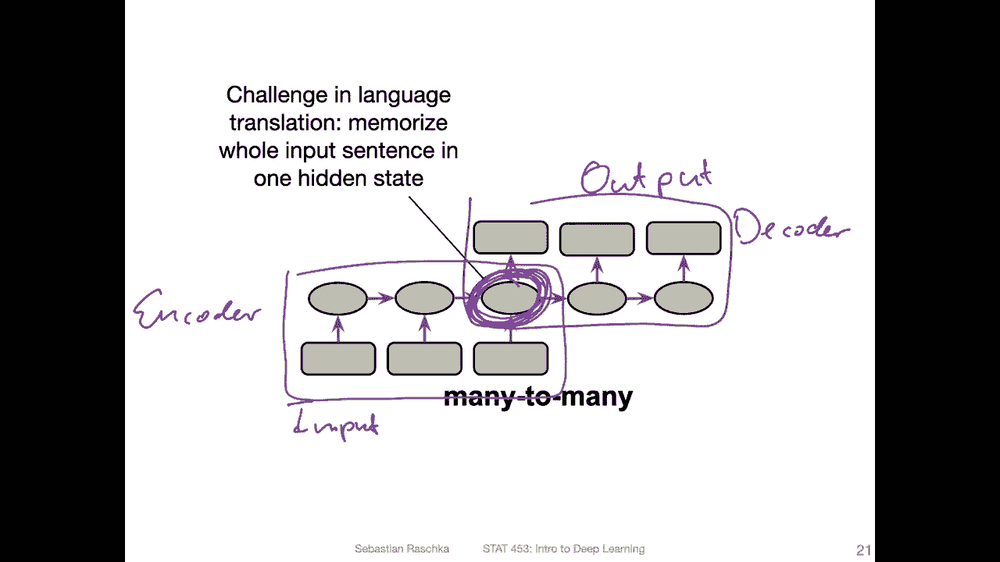

在这个例子中：
*   两个输入单词可能合并为一个输出单词。
*   一个输出单词可能对应多个相距较远的输入单词。
*   某些输入单词在输出中没有直接对应项。

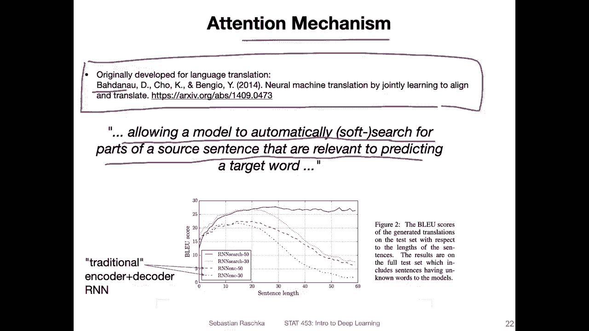

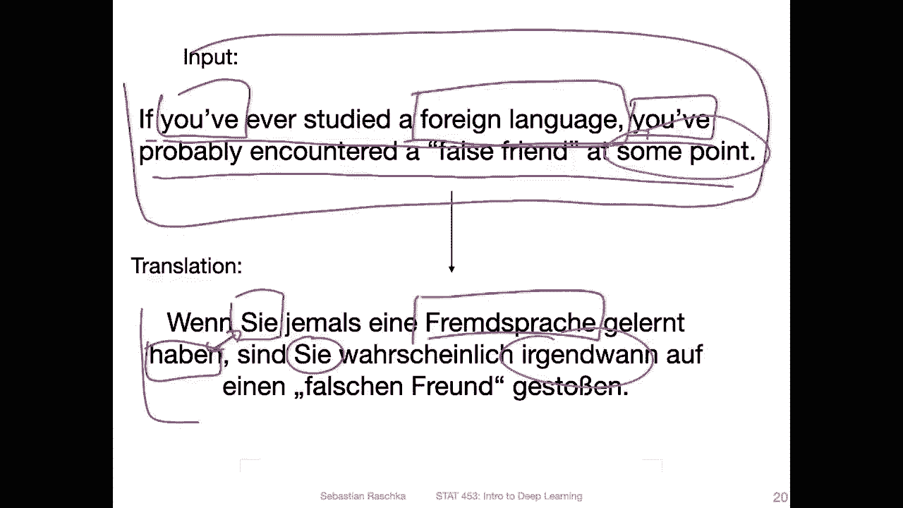

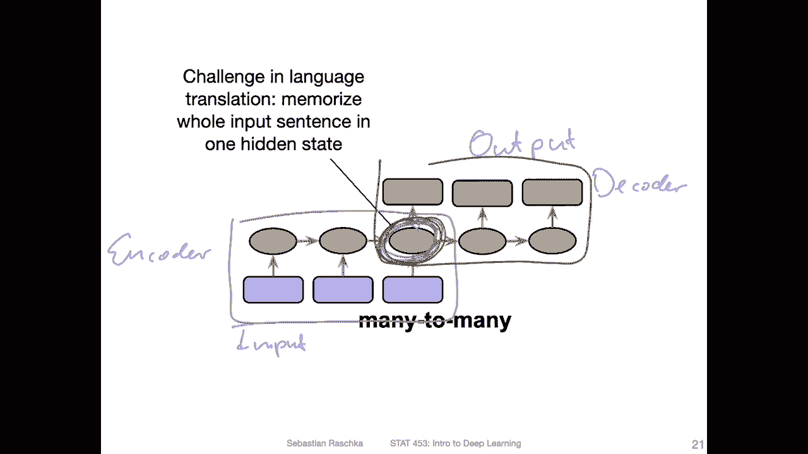

这种非对齐的特性使得简单的、逐词映射的“多对多”RNN架构难以胜任。因此，我们需要编码器-解码器架构。但随之而来的核心问题是：**解码器如何仅从一个最终的隐藏状态获取翻译长句子所需的全部细节信息？**

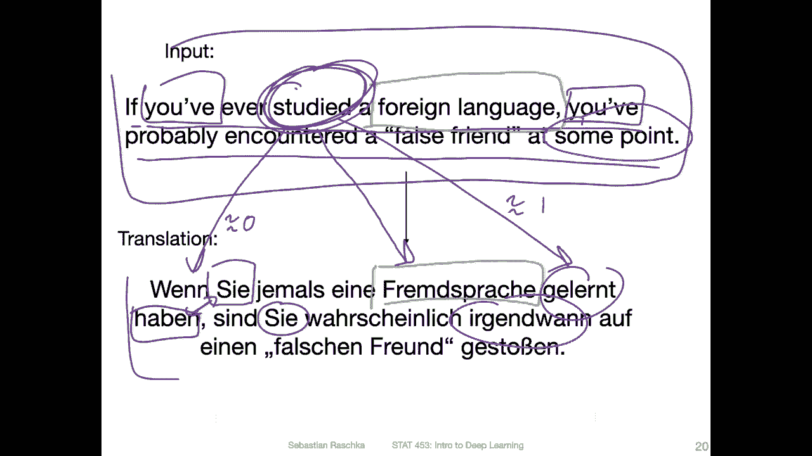

---

为了解决长序列信息压缩的难题，研究人员提出了**注意力机制**。其核心思想是：在解码器生成每一个输出单词时，允许它“回顾”整个输入序列，并动态地决定需要“关注”输入句子的哪些部分。

以下是该机制的关键优势：
*   **缓解记忆负担**：解码器无需将所有信息塞进一个固定长度的向量。
*   **动态对齐**：模型自动学习输入与输出单词之间的软对齐关系，即使顺序不一致。
*   **提升长句性能**：如下方的BLEU评分图所示，引入注意力机制后（橙色线），模型在处理长句子时的翻译质量下降幅度远小于传统模型（蓝色与绿色线）。

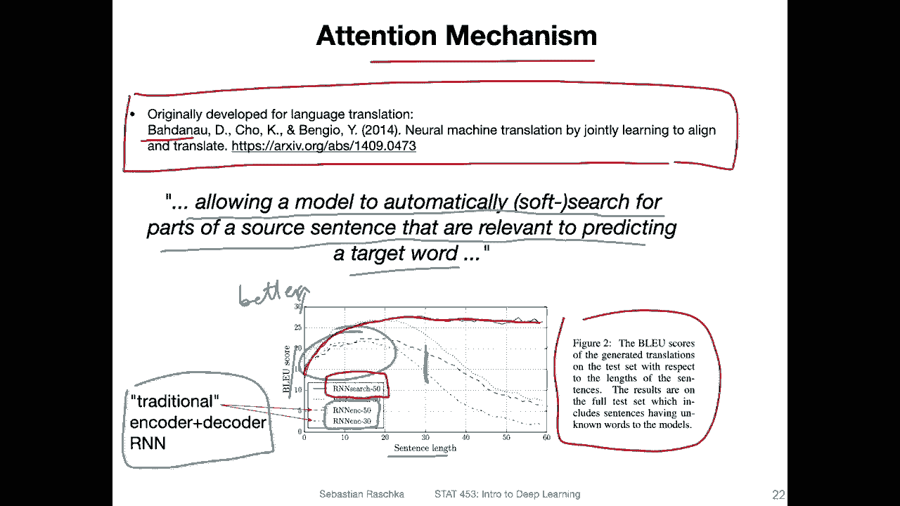


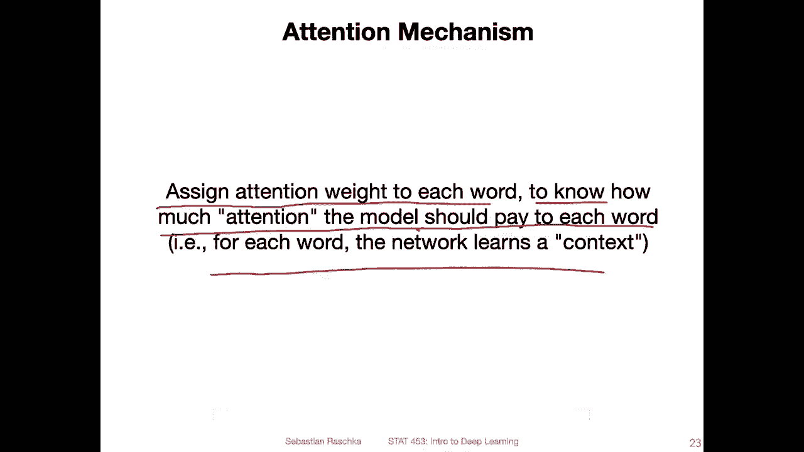

---

上一节我们了解了注意力机制的目的。本节中，我们来深入看看它的具体架构是如何工作的。

一个典型的带注意力机制的RNN翻译模型包含两个主要部分：

1.  **双向RNN编码器**：用于处理输入句子。它由两个RNN组成，一个按顺序（前向）读取句子，另一个按逆序（反向）读取句子。我们将每个时间步的前向隐藏状态（例如 `h_f1`）和反向隐藏状态（例如 `h_b1`）连接（concatenate）起来，得到该时间步的完整隐藏状态 `h1 = [h_f1, h_b1]`。这样，`h1` 就包含了关于第1个单词及其上下文的信息。
    ```python
    # 概念性代码：获取双向隐藏状态
    hidden_state = concatenate(forward_rnn(input), backward_rnn(reverse(input)))
    ```

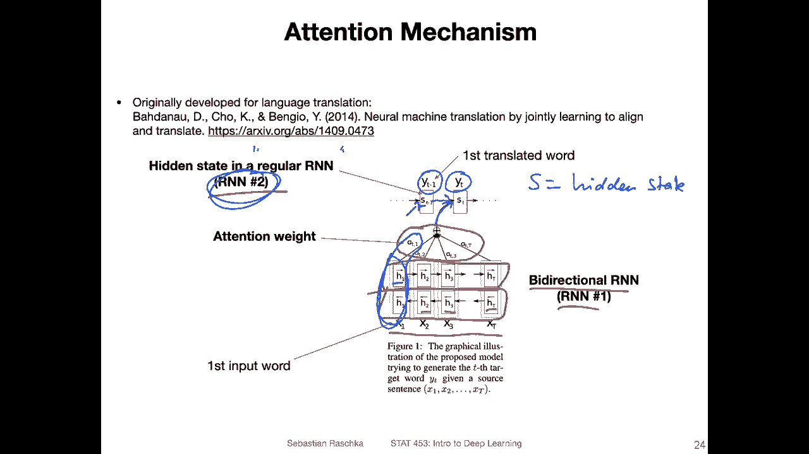

2.  **带注意力机制的解码器RNN**：用于生成翻译。在解码器的每一个时间步 `i`，它不仅仅依赖自己上一个时间步的隐藏状态 `s_{i-1}`，还会计算一个**上下文向量（Context Vector）`c_i`**。

**上下文向量 `c_i` 的计算是注意力机制的核心**：
*   首先，解码器通过一个小型神经网络（如多层感知机），评估编码器**每一个**隐藏状态 `h_j` 与当前解码状态 `s_{i-1}` 的相关性，得到一个未归一化的分数 `e_{ij}`。
    ```python
    # 概念性公式：计算相关性分数
    e_{ij} = score(s_{i-1}, h_j)
    ```
*   然后，对所有 `j` 的分数 `e_{ij}` 应用 Softmax 函数，得到归一化的**注意力权重 `α_{ij}`**。所有权重之和为1。
    ```python
    # 概念性公式：计算注意力权重
    α_{ij} = softmax(e_{ij}) = exp(e_{ij}) / Σ_k(exp(e_{ik}))
    ```
*   最后，上下文向量 `c_i` 是所有编码器隐藏状态 `h_j` 的加权和，权重即为 `α_{ij}`。
    ```python
    # 核心公式：计算上下文向量
    c_i = Σ_j (α_{ij} * h_j)
    ```

解码器在时间步 `i` 的最终输入，是上下文向量 `c_i` 与上一个输出单词嵌入（或上一个时间步的隐藏状态）的结合。然后，解码器RNN据此更新自己的隐藏状态 `s_i`，并预测当前输出单词 `y_i`。

---

注意力权重 `α_{ij}` 的可视化能让我们直观理解模型的工作方式。下图展示了一个英语到法语的翻译示例中，注意力权重的热力图。

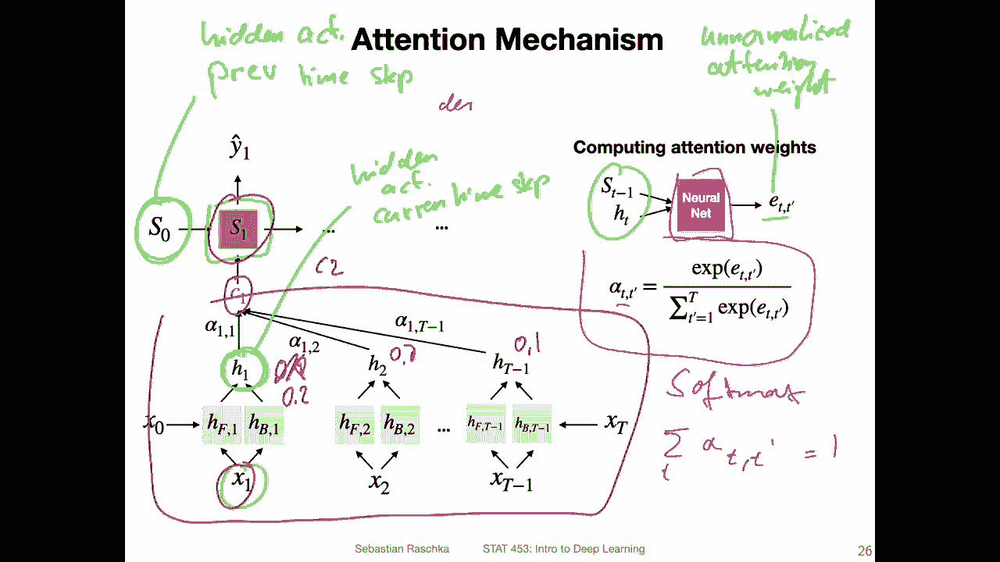

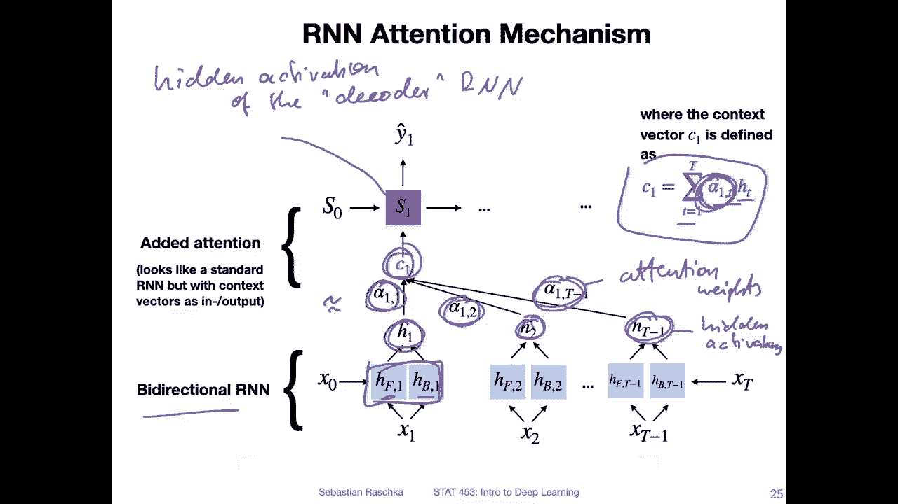

图中，行代表输出（法语）单词，列代表输入（英语）单词。亮色（白色）表示高注意力权重（接近1），暗色（黑色）表示低注意力权重（接近0）。

我们可以观察到：
*   对角线上的亮色区域表明，许多单词存在近似一对一的翻译关系。
*   同时，也存在非对角线的亮色区域。例如，输出单词“L'”同时关注了输入单词“The”和“s”。
*   特别明显的是，输出数字“1992”几乎只专注于输入数字“1992”，这完全符合直觉。

这种可视化证明了注意力机制成功地让模型学会了在翻译时动态地、有选择地聚焦于输入句子的相关部分。


---

本节课中，我们一起学习了带注意力机制的RNN。我们首先探讨了传统编码器-解码器模型在处理长序列时的局限性，然后引入了注意力机制作为解决方案。我们详细剖析了该机制的架构，包括双向RNN编码器和计算上下文向量的过程，其核心公式为 **`c_i = Σ_j (α_{ij} * h_j)`**。最后，我们通过注意力权重可视化，看到了模型如何学会在输入和输出之间建立动态的软对齐。

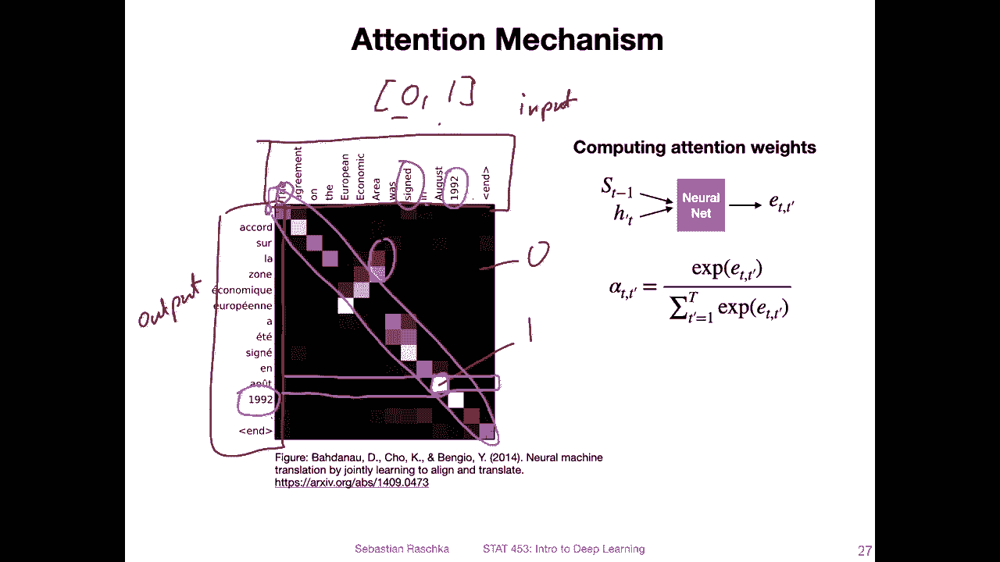

注意力机制极大地提升了RNN在长序列任务（如机器翻译）上的性能。然而，故事并未结束。在接下来的课程中，我们将看到一项更革命性的思想：**我们是否可以完全摒弃RNN结构，仅依靠注意力机制来构建模型？** 这引出了Transformer架构的诞生。