# 160：L19.4.3 - 多头注意力机制 🧠

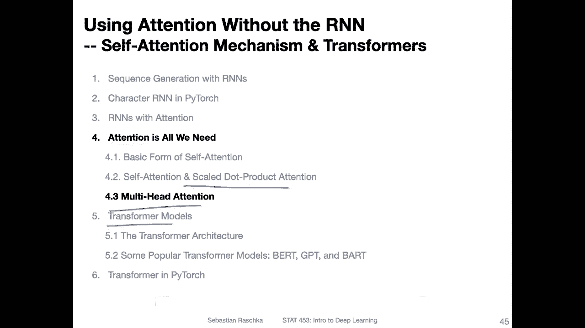

在本节课中，我们将要学习**多头注意力**机制。这是Transformer模型的核心组件之一。我们将基于上一节介绍的缩放点积注意力，理解如何将其并行扩展多次，以捕捉序列中不同类型的信息。

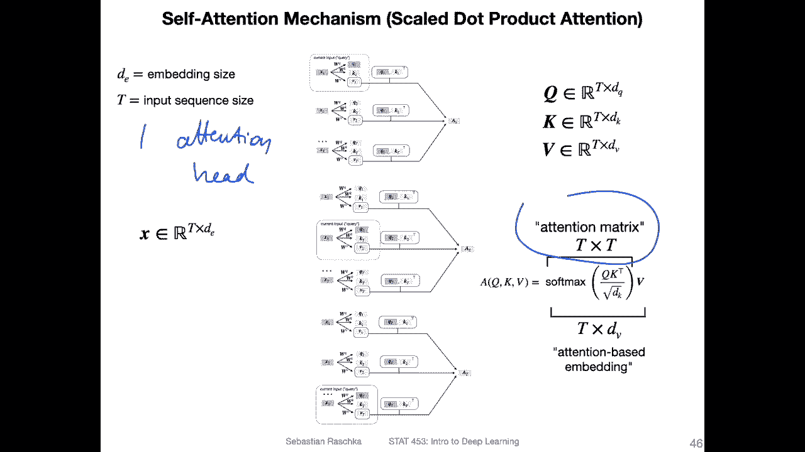

上一节我们详细介绍了缩放点积注意力机制。本节中，我们来看看如何将其扩展为更强大的多头注意力。

## 核心概念：并行注意力

多头注意力的核心思想是并行运行多个缩放点积注意力机制。这类似于卷积神经网络中使用多个卷积核来提取不同特征。每个注意力“头”使用不同的权重矩阵，从而可以关注输入序列的不同方面。

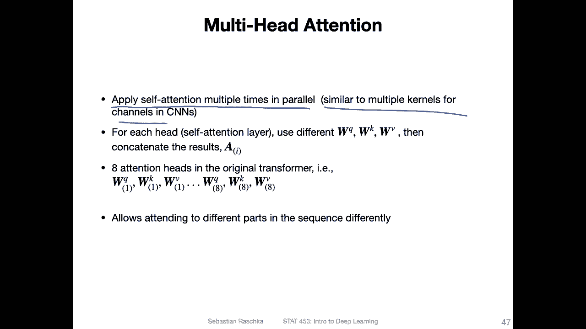

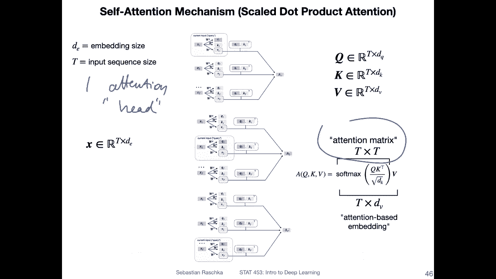

以下是多头注意力的主要步骤：

1.  **线性投影**：对于每个注意力头，使用独立的权重矩阵将输入序列分别投影为查询、键和值。
2.  **并行计算**：每个头独立计算其缩放点积注意力。
3.  **拼接结果**：将所有头的输出在特征维度上进行拼接。
4.  **最终线性变换**：将拼接后的结果通过一个线性层，映射回期望的输出维度。

## 多头注意力结构详解

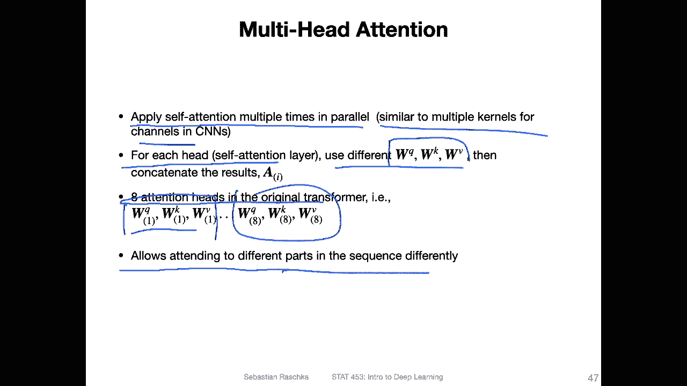

让我们结合原论文中的图示来理解这个过程。

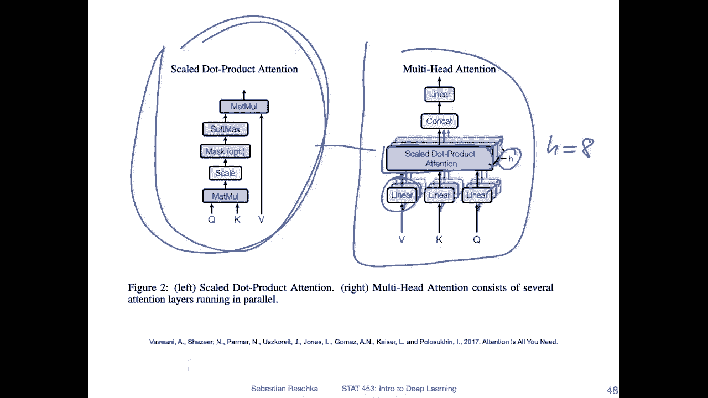


上图展示了多头注意力的完整流程。中间的“Scaled Dot-Product Attention”模块就是我们在上一节学习的内容。这个模块被重复了H次（例如，在原论文中H=8）。

以下是流程中关键部分的说明：

*   **输入**：输入序列的维度为 `T x D_model`，其中T是序列长度，D_model是模型维度（例如512）。
*   **多头拆分**：对于每个头，我们使用不同的权重矩阵 `W_Q^i`, `W_K^i`, `W_V^i` 将输入投影到较低的维度 `D_k`, `D_k`, `D_v`。通常，`D_v = D_model / H`。例如，当 `D_model=512`, `H=8` 时，`D_v = 64`。
*   **注意力计算**：每个头独立计算注意力，得到一个 `T x D_v` 的输出。
*   **拼接**：将H个头的输出（每个 `T x D_v`）在最后一个维度拼接，得到 `T x (H * D_v)` 的张量，即 `T x D_model`。
*   **输出线性层**：拼接后的结果通过一个可学习的线性层 `W_O`（维度为 `D_model x D_model`），最终输出维度仍为 `T x D_model`。

这个过程可以用伪代码概括如下：

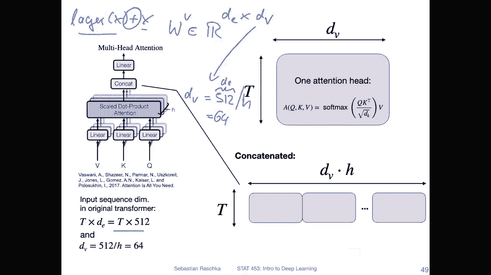

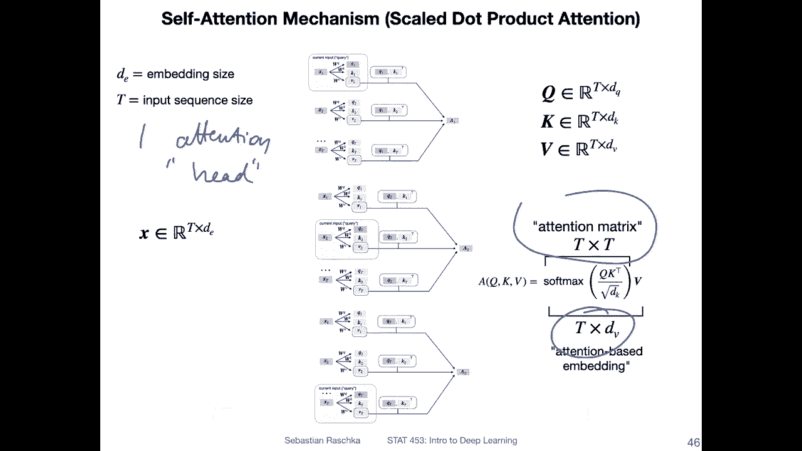

```python
# 假设输入 x 的维度为 (batch_size, seq_len, d_model)
# 定义多头注意力层
class MultiHeadAttention(nn.Module):
    def __init__(self, d_model, num_heads):
        super().__init__()
        self.d_model = d_model
        self.num_heads = num_heads
        self.d_k = d_model // num_heads

        # 为每个头定义Q, K, V的投影矩阵
        self.W_q = nn.Linear(d_model, d_model)
        self.W_k = nn.Linear(d_model, d_model)
        self.W_v = nn.Linear(d_model, d_model)
        # 最终的输出投影矩阵
        self.W_o = nn.Linear(d_model, d_model)

    def forward(self, x):
        batch_size, seq_len, _ = x.shape

        # 1. 线性投影并分割成多头
        Q = self.W_q(x).view(batch_size, seq_len, self.num_heads, self.d_k).transpose(1, 2)
        K = self.W_k(x).view(batch_size, seq_len, self.num_heads, self.d_k).transpose(1, 2)
        V = self.W_v(x).view(batch_size, seq_len, self.num_heads, self.d_k).transpose(1, 2)

        # 2. 对每个头应用缩放点积注意力 (scaled_dot_product_attention)
        # 此处省略具体实现细节，输出 attn_output 维度为 (batch_size, num_heads, seq_len, d_k)
        attn_output = scaled_dot_product_attention(Q, K, V)

        # 3. 将多头输出拼接
        attn_output = attn_output.transpose(1, 2).contiguous().view(batch_size, seq_len, self.d_model)

        # 4. 通过输出线性层
        output = self.W_o(attn_output)
        return output
```

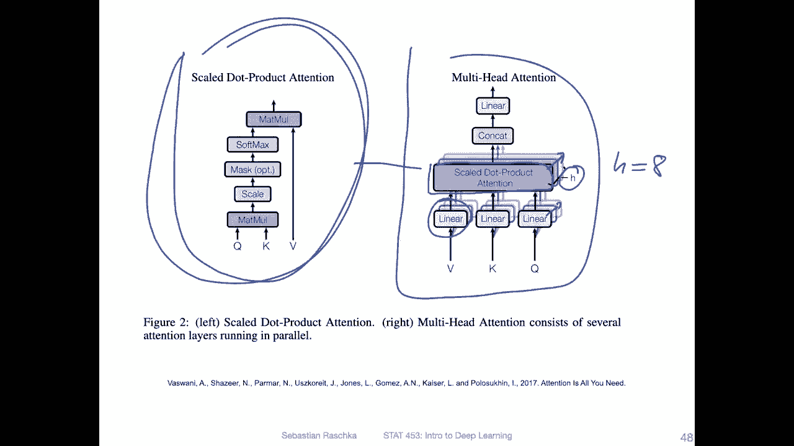

## 设计动机与优势

多头注意力机制的设计主要有两个目的：

1.  **增强模型容量**：通过使用多组权重矩阵，模型可以学习到更丰富、更复杂的表示。
2.  **并行关注不同信息**：不同的注意力头可以学会关注序列中不同位置或不同特征模式的信息。例如，一个头可能关注局部语法结构，另一个头可能关注长距离的语义依赖。

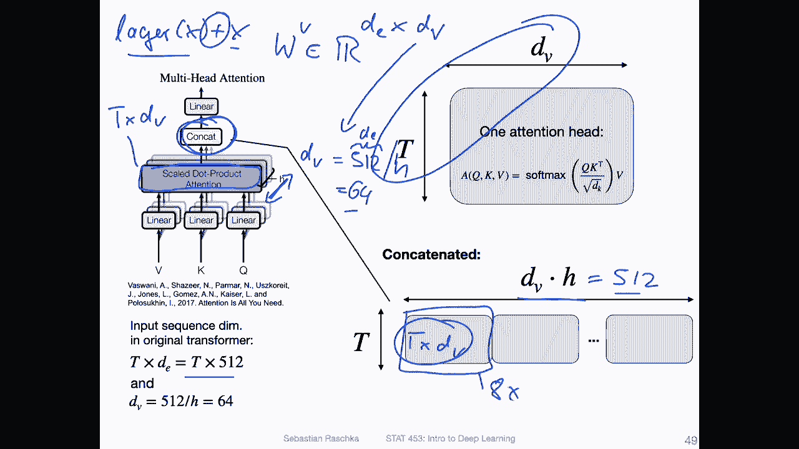

这种设计使得模型能够更灵活、更强大地处理序列数据。

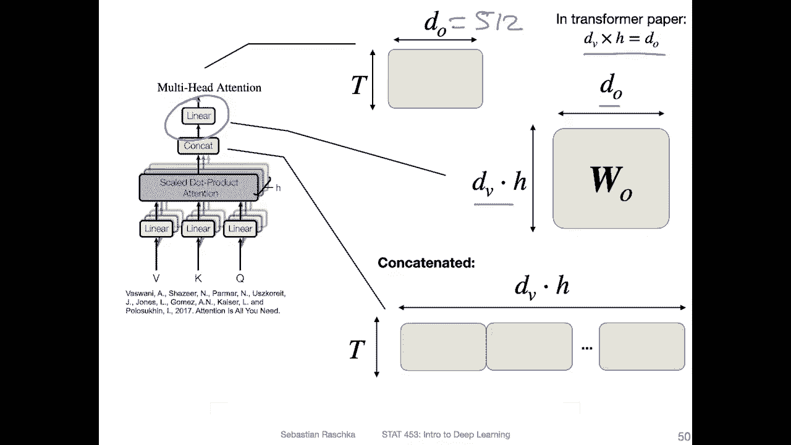

## 总结

本节课中我们一起学习了多头注意力机制。我们了解到，它本质上是将缩放点积注意力机制并行应用多次，每次使用不同的参数。每个头独立计算注意力，然后将所有头的输出拼接起来，最后通过一个线性变换层得到最终输出。这种结构允许模型同时从输入序列的不同子空间捕获信息，是Transformer架构取得成功的关键因素之一。

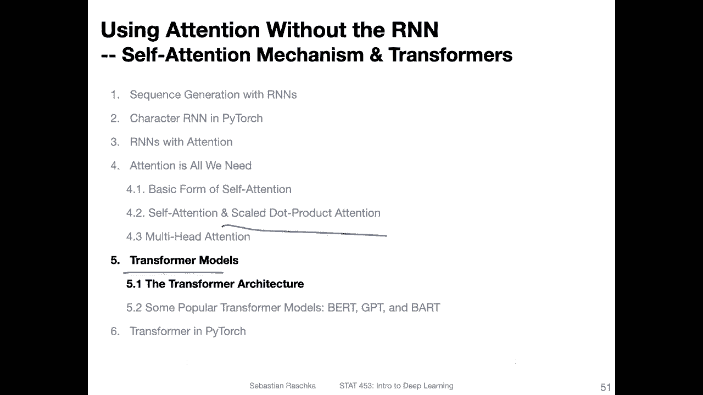

现在我们已经掌握了自注意力、缩放点积注意力和多头注意力这些核心概念。在下一节课中，我们将看到这些组件如何组合在一起，构成完整的Transformer模型。