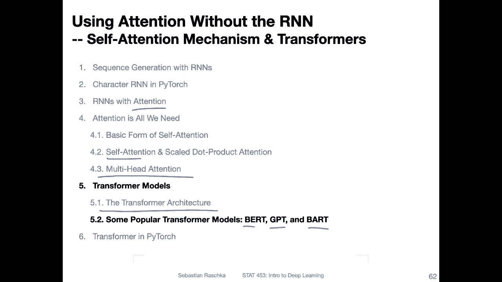
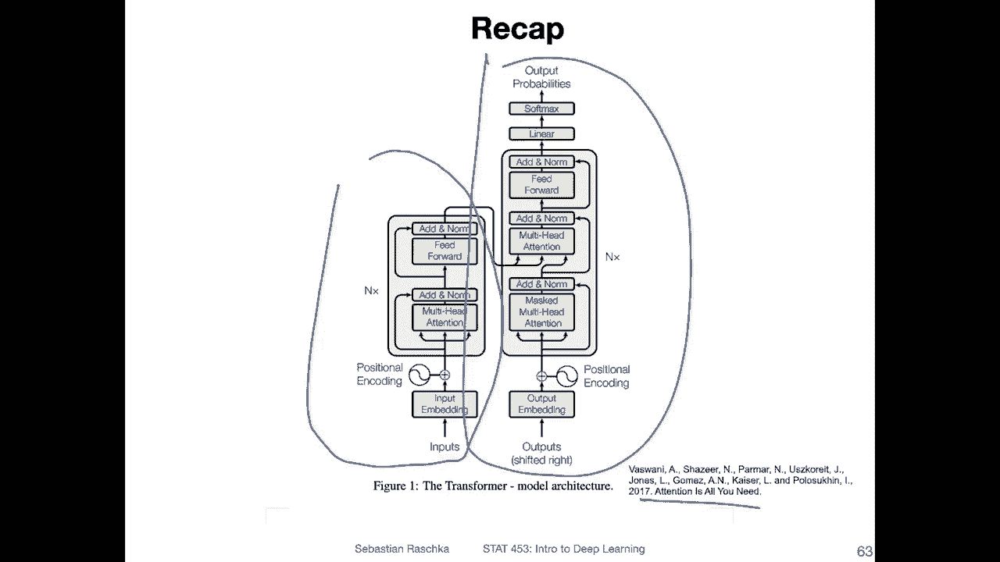
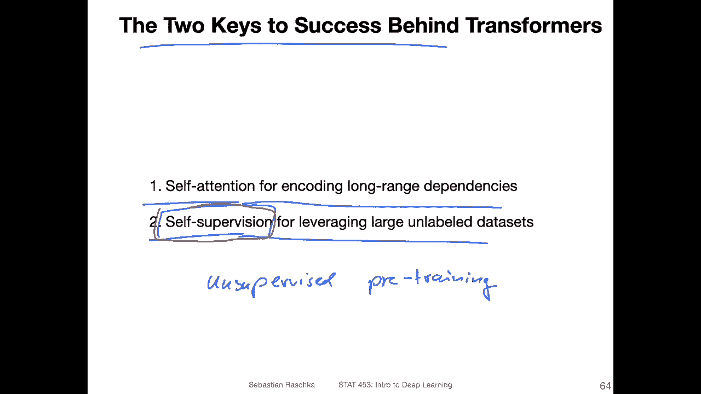
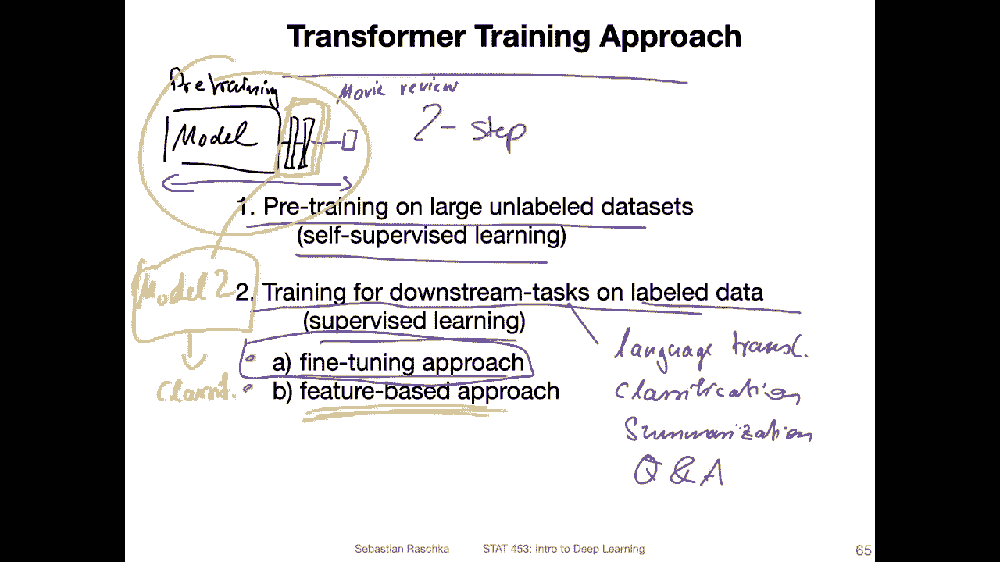
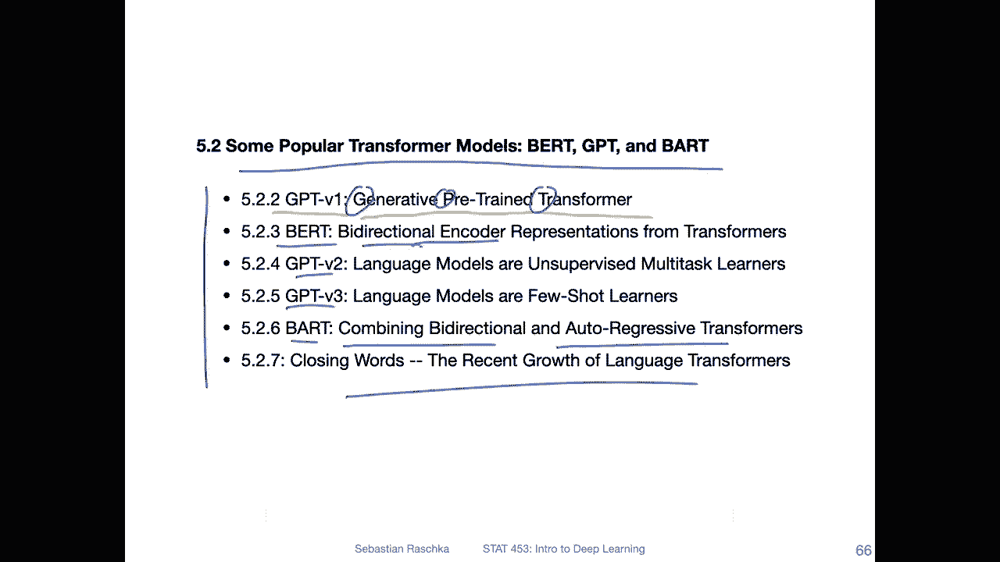

# 162：L19.5.2.1 - 一些流行的Transformer模型：BERT、GPT与BART【概述】 🧠

在本节课中，我们将学习基于Transformer架构的几种流行模型，包括BERT、GPT和BART。我们将了解它们的基本思想、核心差异以及它们如何利用自注意力和自监督学习来取得成功。

---

我们已经学习了注意力机制、自注意力、多头注意力，以及它们如何共同构成Transformer架构。现在，让我们来看看基于这一架构的一些流行方法。例如，有BERT模型、不同类型的GPT模型（版本1、2和3），以及结合了BERT和GPT思想的BART模型。

这些模型本身的想法很有趣，但它们的结构并不非常复杂。它们本质上是对原始Transformer的一些小修改。由于这些模型非常流行，经常出现在新闻和讨论中，因此简要了解它们以及它们之间的区别是很有意义的。

## 🔄 Transformer架构回顾

首先，让我们简要回顾一下。下图展示的是《Attention Is All You Need》论文中的原始Transformer架构。我们将要讨论的BERT、GPT等方法都基于这一基本架构。当然，它们会进行一些修改，但从根本上说，BERT借鉴了编码器部分，而GPT借鉴了解码器部分。在接下来的视频中，我们将看到这些模型与这个基础模型的关系。

总的来说，我认为所有这些Transformer模型成功的关键有两点：
1.  **自注意力机制**：用于编码长距离依赖或上下文信息。
2.  **自监督学习**：用于利用大规模、未标记的数据集。

自监督学习有时也被称为无监督预训练。如今，“自监督学习”这个词变得更流行。我们在之前的课程中简单讨论过，其核心思想是：从一个大型未标记数据集中，根据数据自身的结构来构建标签，而不是依赖人工手动标注每个训练样本（这非常昂贵）。

例如，我们在Transformer模型中见过的一个任务是**预测下一个词**。这仍然是一种监督方法，因为我们使用分类损失来预测下一个词。但与常规监督学习相比，我们是从文本本身提取这个标签（即下一个词）。这就是为什么它被称为“自监督”学习——在某种意义上，是模型自己创建了标签，而不是由人类或其他过程创建的。

## 🚀 Transformer的训练范式

Transformer模型的训练方法通常可以分为两个步骤：
1.  **预训练**：在大型未标记数据集上以自监督方式训练模型。
2.  **下游任务训练**：在通常较小的、有标签的数据集上，针对特定下游任务训练模型。

下游任务可以是语言翻译、文本分类、文本摘要、问答等等。你可以为语言模型设计许多可能的下游任务。为此，你需要一个较小的、有标签的数据集进行监督学习。

例如，可以想象我们之前用过的电影评论数据集。预训练阶段可以在数千本书籍上以自监督方式进行。然后，我们可以使用仅包含10万条评论的小型电影评论数据集来训练模型。这有点类似于我们之前讨论过的迁移学习。

针对下游任务的训练，主要有两种方法：

以下是两种主要方法：

*   **基于微调的方法**：更新整个模型的参数。设想一下，你有一个通过自监督学习预训练好的模型（通常模型末端也有一些全连接层）。对于微调，假设你有一个分类任务（如电影评论分类），你会在模型上添加一个分类层，然后在这个有标签的数据集上训练模型，并更新**所有**参数。
*   **基于特征的方法**：这种方法与微调相关，但不同之处在于，你不更新整个预训练模型。相反，你从模型的最后几层（可能是最后一层或最后四层等，具体方法不同）提取**嵌入表示**。这些是上下文嵌入，它们比普通的词嵌入更好，因为它们包含了句子的上下文信息。你生成这些嵌入后，将其视为固定的特征输入，然后训练一个**新的**模型（可以是一个简单模型，如在BERT论文中，他们甚至使用了LSTM）来完成分类等任务。预训练模型本身保持不变。

当我们讨论BERT模型时，会进一步探讨基于特征的方法。这里只是一个概述。

## 📺 后续内容预告

在接下来的视频中，我将讨论这些不同类型的模型。我原本想在一个视频中涵盖所有内容，但发现材料有点多。当然，这部分是可选内容，你可以自行决定是否观看。

我将在接下来的视频中涵盖的主题包括：
1.  原始的GPT模型（生成式预训练Transformer）。
2.  BERT模型（双向编码器表示）。
3.  GPT-2和GPT-3版本。

GPT模型是单向的（基于下一个词预测），而BERT是双向的，这是它们的主要区别。BART模型则结合了BERT的双向特性和GPT的单向自回归行为。

之后，我还会再谈谈Transformer的现状、计算效率等方面。在那之后，我们会看一个代码示例。关于这些流行Transformer模型（BERT, GPT, BART）的讨论，我们总共有六个视频。

---

**总结**：本节课我们一起学习了Transformer架构的几种重要衍生模型：BERT、GPT和BART。我们回顾了Transformer的核心——自注意力机制和自监督学习，并了解了模型训练的两阶段范式（预训练与下游任务微调）以及两种主要的下游任务适应方法（微调与特征提取）。这些模型通过不同的方式利用Transformer的编码器或解码器部分，在自然语言处理领域取得了巨大成功。