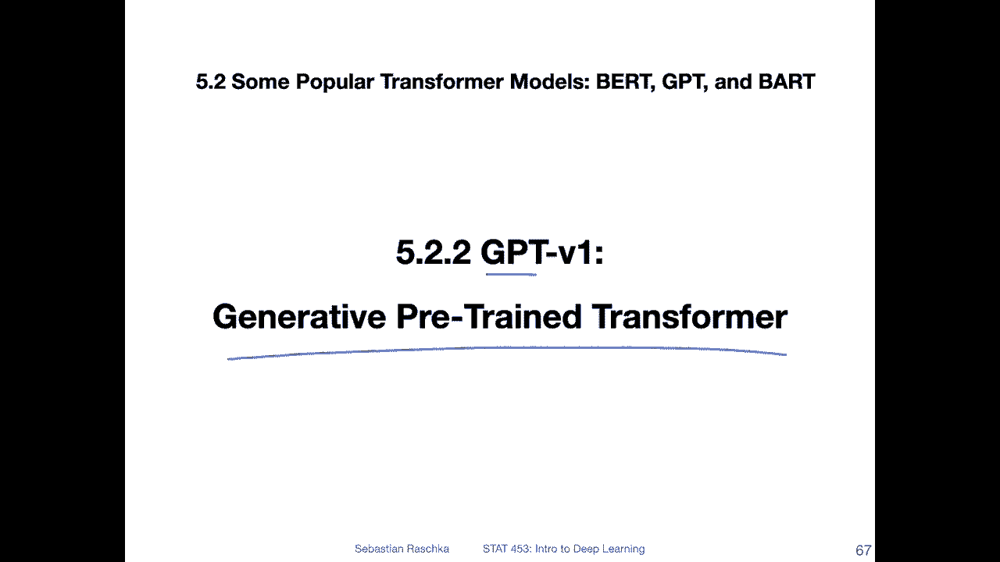
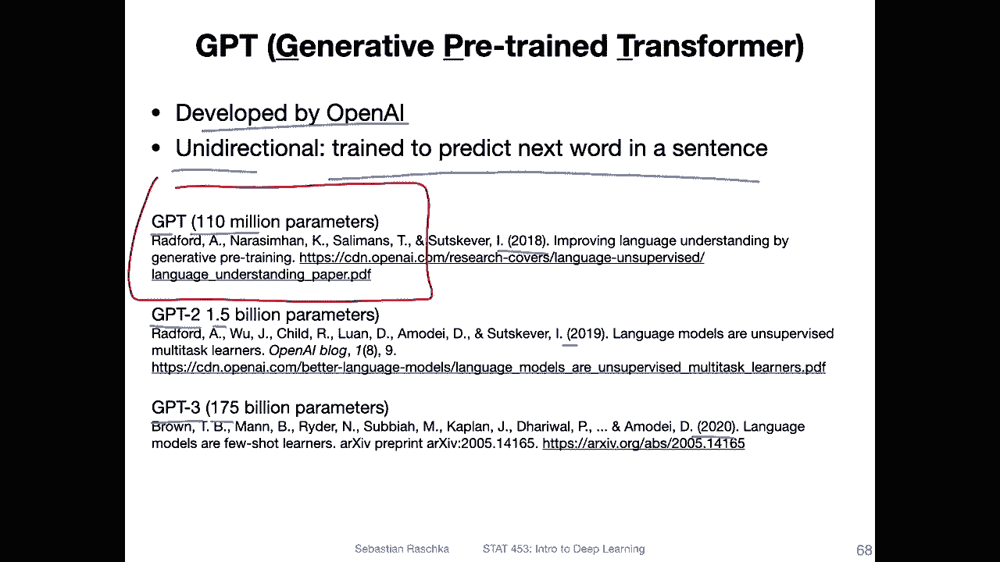
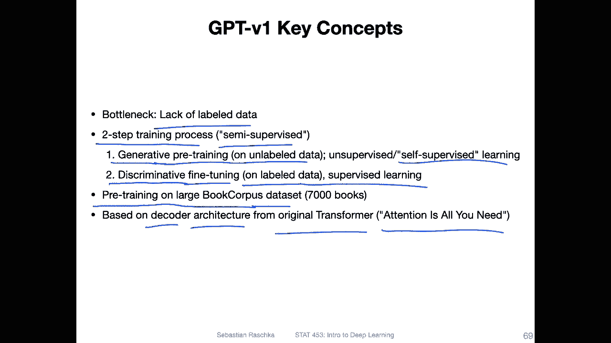
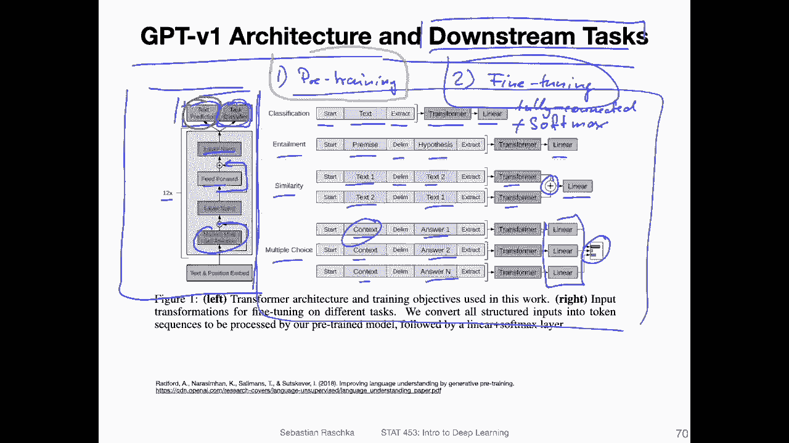
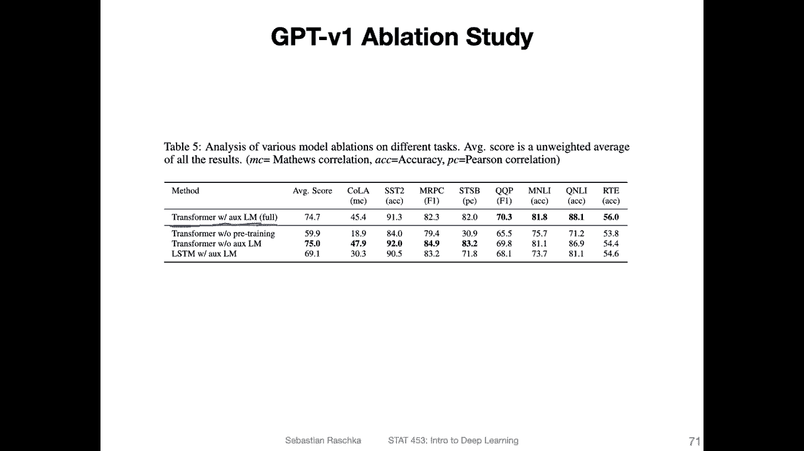
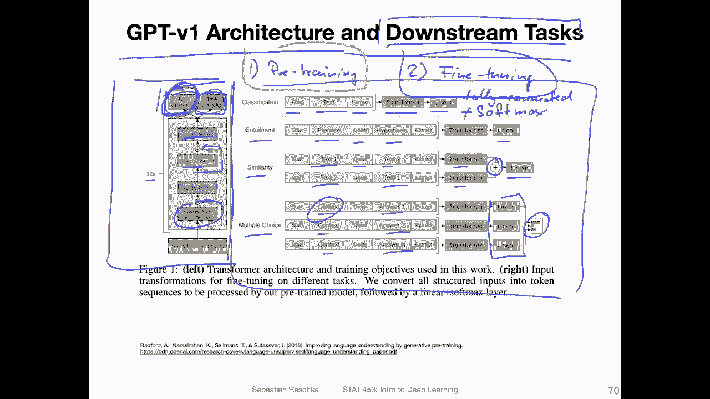
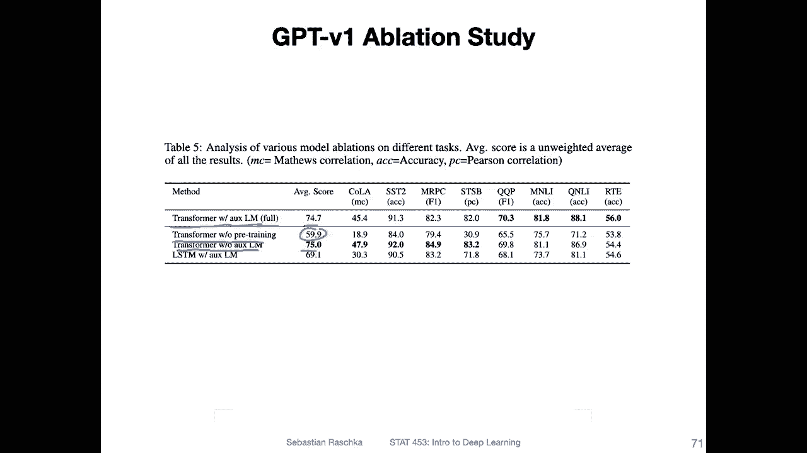
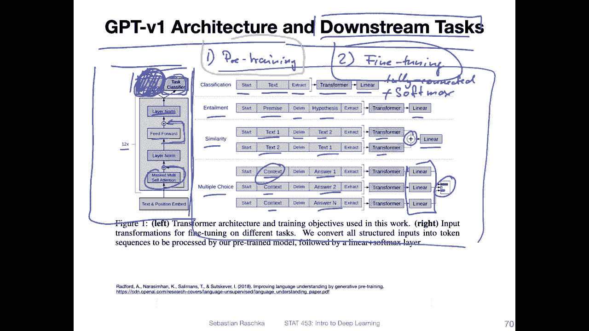
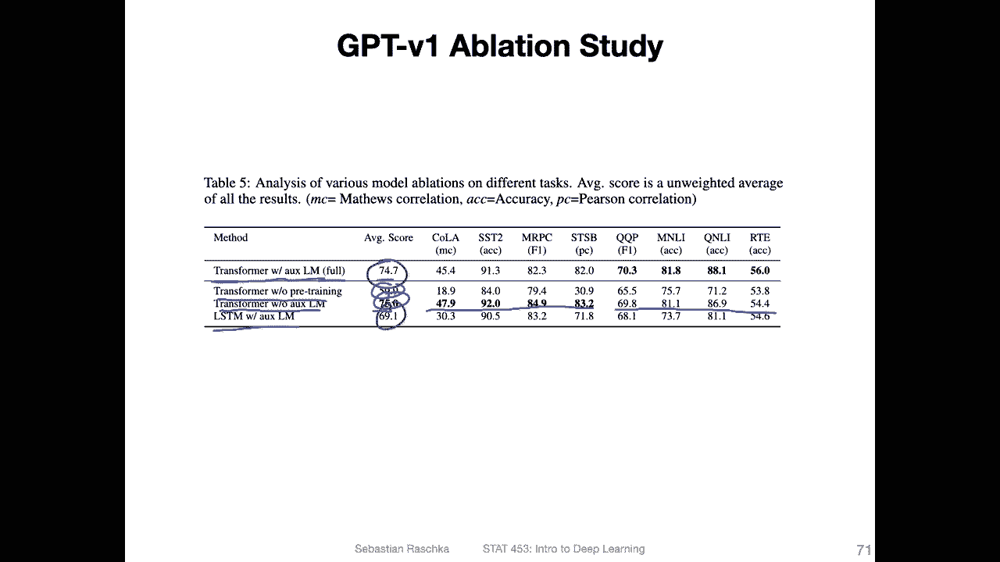
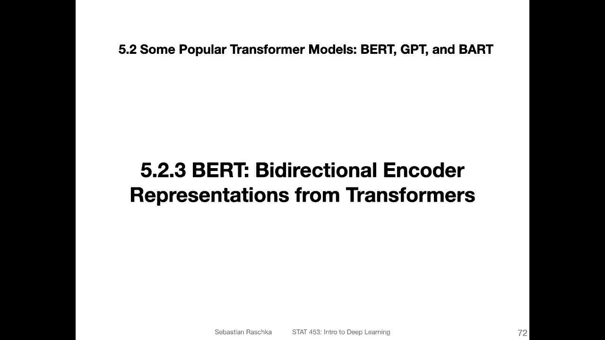

# 163：L19.5.2.2 - GPT-v1：生成式预训练Transformer 🧠

在本节课中，我们将学习生成式预训练Transformer模型，即GPT-v1。我们将了解其核心思想、两阶段训练过程、模型架构以及它在不同下游任务上的应用。

---

## 🏗️ 模型概述与核心思想

GPT模型由OpenAI开发，其共同特点是它们都是单向的。这些模型主要被训练来预测句子中的下一个词。

截至目前，共有三个版本：GPT-1于2018年发布，拥有1.1亿参数；GPT-2于2019年发布，拥有15亿参数；GPT-3于2020年发布，拥有1750亿参数。本视频将重点介绍GPT版本1。

GPT模型背后的一个主要假设是，缺乏标注数据是限制大型语言模型性能提升的主要瓶颈之一。

因此，论文中提出了一个两阶段的训练过程，他们总体上称之为半监督学习。半监督学习本质上意味着利用有标签和无标签的数据。

这里的半监督过程就是我在上一个视频中简要概述的两步过程：第一步是预训练，第二步是微调。预训练阶段他们使用一个大型的无标签数据集来训练Transformer模型，如今这也被称为自监督学习。第二步是判别式微调，他们使用一个针对你感兴趣的任务（例如电影评论分类）的较小标签数据集，这本质上是迁移学习的一种形式。

预训练本身发生在一个他们收集的数据集上，他们称之为书籍语料库数据，包含7000本未出版的书籍。他们使用的架构基于我们讨论过的原始Transformer模型的解码器架构，即“Attention is All You Need”论文中提出的那个。

---

## 🔧 模型架构与任务适配

以下是GPT架构及其用于微调的不同下游任务的可视化。让我们先从架构开始。

在左侧，你可以看到这看起来就像原始Transformer论文中的架构。这里有跳跃连接、层归一化、前馈层、掩码多头自注意力层等等。因此，在这方面，它只是原始Transformer论文中的解码器。

不同之处在于，这里有12个Transformer块，而不是“Attention is All You Need”论文中的6个。

另一个需要注意的是，输出端有两个框。一个称为文本预测，另一个是任务分类器。

同样，首先进行的是下一个词预测的预训练。预训练完成后，再针对不同的下游任务进行微调。

在微调期间，即在预训练完成后，你可以保留文本预测部分，并同时训练两者。这意味着你可以在更新模型以进行任务预测的同时，也保留用于预测下一个词的损失函数。

这里有两个不同的线性层：一个用于下一个词预测，另一个用于任务预测。他们实验了这样做是好是坏，我将在下一张幻灯片中展示结果。

现在，让我们专注于不同的任务。假设我们已经完成了下一个词预测的预训练，现在开始针对不同任务进行微调。

右侧是不同任务的可视化，展示了输入应如何格式化。

*   **分类任务**：他们提供一个起始标记、主要文本和一个提取标记（类似于结束标记或序列结束标记）。然后将其输入Transformer，并通过一个额外的线性输出层。这本质上就像一个分类器，最后可以使用Softmax激活和交叉熵损失进行训练。
*   **蕴含任务**：这类似于逻辑蕴含。提供一个前提分隔符和假设，本质上也是一个真/假分类任务。
*   **相似性任务**：比较两段文本是否相似或相似度如何。他们提供文本1、分隔符和文本2。为了保持对称性，可能还会将文本2放在文本1之前。将两者通过同一个Transformer，汇总嵌入表示，然后通过一个全连接层。他们可能会使用像L2距离这样的度量，来最小化相似文本之间的距离，最大化不同文本之间的距离。
*   **多项选择任务**：提供上下文和一个可能的答案，然后是上下文和另一个答案，依此类推。本质上这也是一个分类任务，从N个可能的答案中选择最可能是该上下文答案的那个。

主要思想仍然是两步：第一步是预训练，训练模型预测下一个词；第二步是微调，针对这些下游任务进行微调。

---

## 📊 消融实验与性能分析

他们进行了一项消融研究，探讨在微调时移除下一个词预测任务是否会使性能变得更好或更差。

在这里，他们将带有辅助语言模型的Transformer称为完整模型。辅助语言模型本质上就是这里的文本预测部分。

他们得到了相当不错的性能，计算出的分数为74.7。

然后，他们测试了没有预训练的Transformer，即仅进行微调而不进行预训练。可以看到，没有预训练的Transformer模型性能显著或大幅下降。因此，预训练确实有帮助。

接着，他们测试了没有辅助语言模型的Transformer，可以看到性能甚至更好一点。

本质上，如果你在下一个词预测上预训练模型，然后在微调时去掉这个部分，只专注于微调，可以看到性能在某些任务上甚至更好一点，但并非所有任务。

为了比较，他们还测试了常规的LSTM模型。可以看到LSTM在这里的表现比完整模型更差。

---

## 🎯 课程总结

本节课我们一起学习了GPT版本1模型。按照今天的标准，这已经是一个非常旧的模型，因为已经有了GPT版本2和3。但它是一个很好的起点。

我们了解了GPT-v1的核心思想是利用两阶段（预训练和微调）的半监督学习方法来克服标注数据不足的瓶颈。其架构基于Transformer解码器，并针对分类、蕴含、相似性、多项选择等多种下游任务设计了特定的输入格式和微调方法。实验表明，预训练阶段对最终性能提升至关重要，而在微调阶段是否保留语言模型辅助目标则需根据具体任务权衡。

在下一个视频中，在介绍其他GPT模型之前，我们将讨论BERT模型，它使用Transformer的方式略有不同。我之所以在介绍其他GPT版本之前先介绍这个，是因为在BERT论文中，他们特别将他们的模型与GPT-1进行了比较。从某种程度上说，这是按时间顺序排列的：我们有GPT版本1、BERT、GPT版本2和3。