# 165：L19.5.2.4 - GPT-v2：语言模型是无监督的多任务学习者 🧠

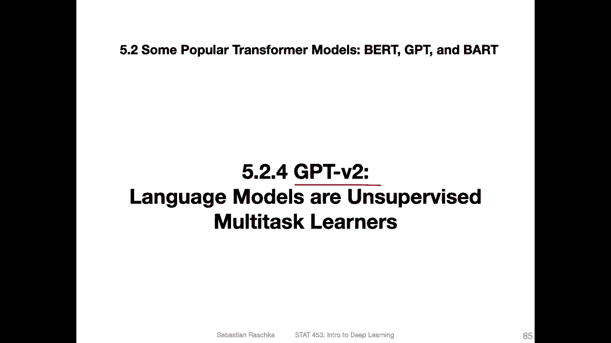

在本节课中，我们将要学习GPT的第二代版本（GPT-2）。我们将了解它与第一代GPT的主要区别，其核心架构的改进，以及它如何通过“零样本迁移”技术，在不进行下游任务微调的情况下，直接完成多种自然语言处理任务。

---

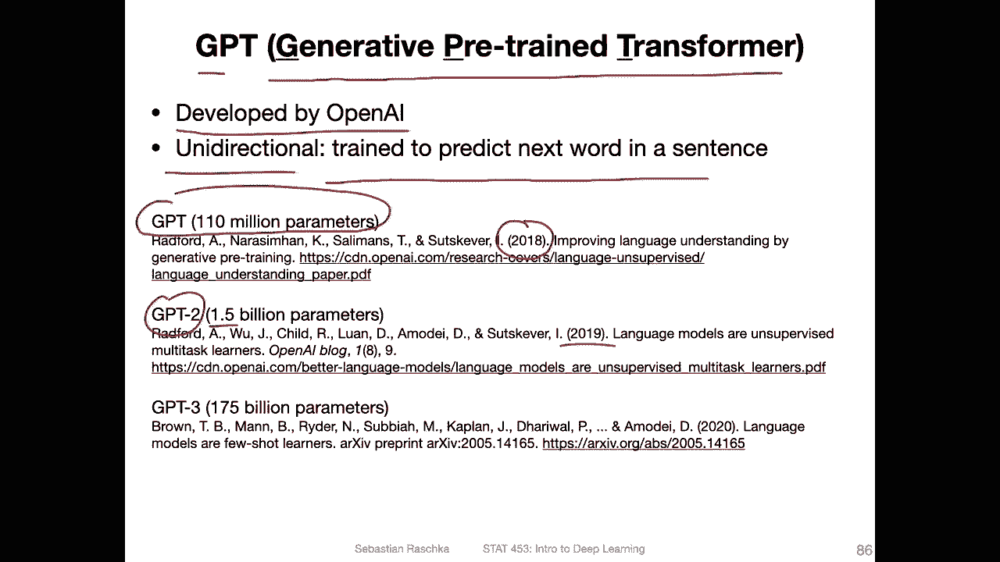

现在，我们来谈谈GPT的第二代版本。

首先，我们来回顾一下之前讲过的GPT第一代版本。GPT代表“生成式预训练Transformer”，是由OpenAI开发的模型。它的一个基本特性是**单向模型**，训练目标是预测句子或序列中的下一个词。这与BERT模型的双向语言建模方法形成对比。

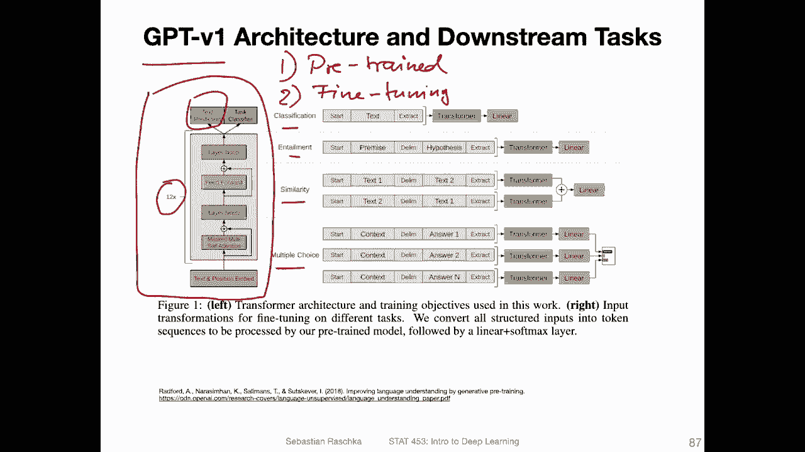

之前我们讨论的GPT-1版本是一个拥有1.1亿参数的模型，于2018年发布。现在，我们将讨论一年后发布的第二代版本。GPT-2拥有**15亿参数**，规模显著增大，是前代的十倍以上。我们不会深入探讨这个模型的所有细节，但如果你有兴趣，这里有一个原始论文的链接，供你在观看本视频后进一步学习。

好的，再次回顾一下GPT-1的架构。GPT-1包含一个具有12个Transformer块的解码器。训练分为两步：首先是**预训练**，进行下一个词的预测；然后是**微调**，针对下游任务（如分类、蕴含、相似性和多项选择）在带标签的数据集上进行。预训练则是在大规模无标签数据集上进行的。

我之所以回顾这些，是因为GPT-2对这个流程做了一个不小的改变。GPT-2背后的关键概念是：首先，它与GPT-1相似，也是单向的，进行下一个词的预测。

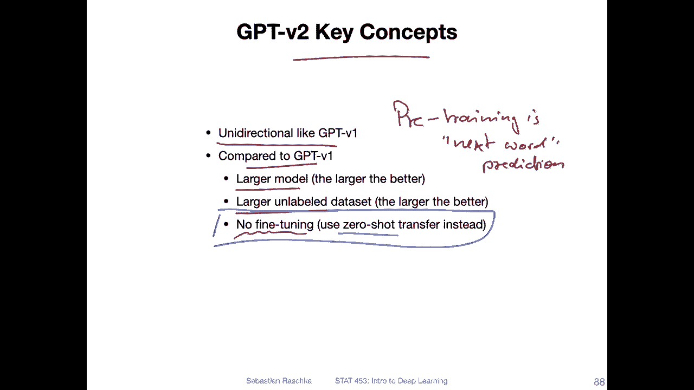

然而，与GPT-1相比，GPT-2模型规模显著更大。他们的论点是**模型越大越好**。他们通过实验图表表明，参数越多，性能越好。同时，更大的数据集也有助于提升模型性能。

但关键的不同点在于，GPT-2不再进行微调，而是使用了所谓的**零样本迁移**。这与零样本学习有些关联，但并不完全相同。这里的核心思想是，通过为模型提供一些上下文和输入，让它直接执行任务。稍后我会展示一个例子。这里需要强调的一点是，他们去掉了微调步骤。

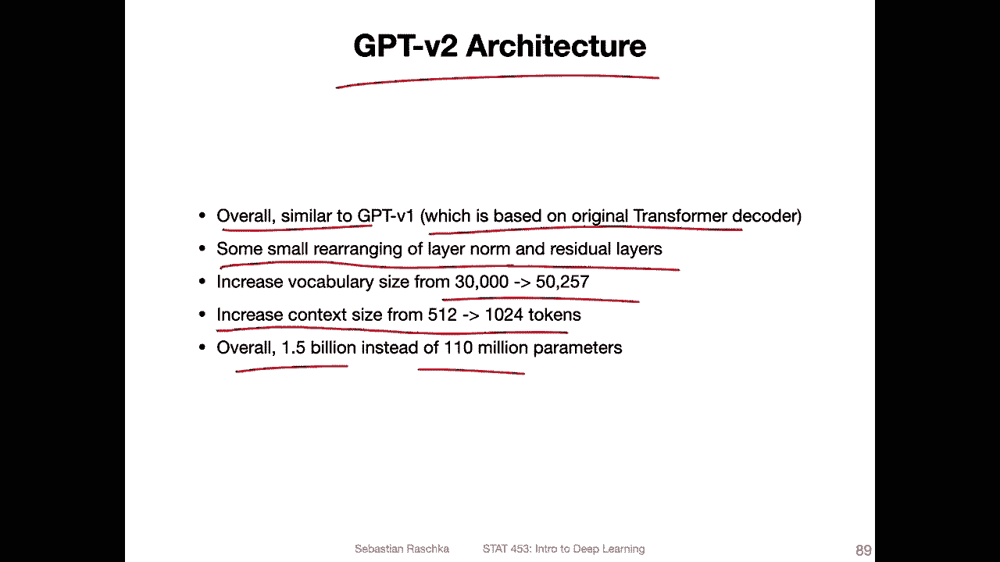

GPT-2的架构本身总体上与GPT-1相似，当然规模更大，但仍然是基于原始的Transformer解码器。他们对层归一化和残差层做了一些小的重新排列，但这些是次要的实现细节。他们还**增大了词汇表**，几乎是原来的两倍。另一个细节是，他们将**上下文长度增加了一倍**，从512个输入词元增加到1024个，从而能捕获更多上下文信息。考虑到零样本迁移需要将任务描述与输入一起提供，我认为这也是他们增大上下文长度的原因之一。总的来说，这些改动使得模型达到了15亿参数，而原始模型已经是拥有1.1亿参数的大型模型。

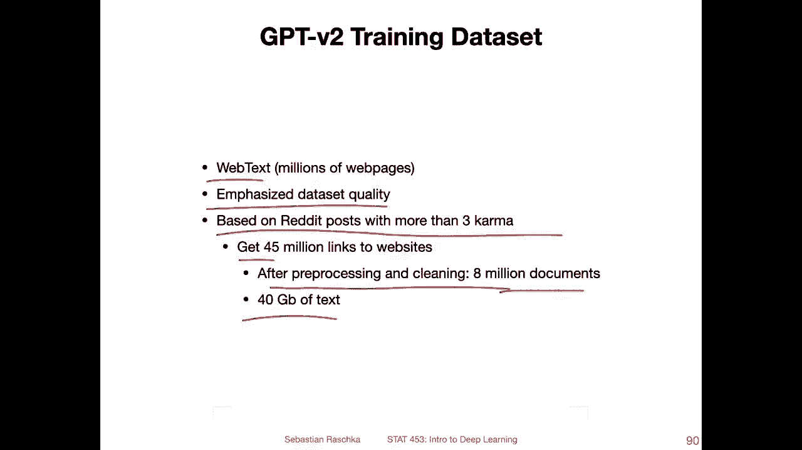

接下来看看他们使用的数据集。如前所述，他们使用了更大的数据集，即所谓的“网络文本”数据集，包含数百万个网页。他们同时强调提高数据质量很重要。那么他们是如何提高质量的呢？这些网页基于Reddit帖子，他们收集了“karma”值大于等于3的帖子，认为这能链接到质量尚可的网站，而非垃圾帖子。之后，他们进行了去重和其他网站预处理、清洗等工作。最终，他们从Reddit获得了4500万个网站链接，经过预处理和清洗后，得到了800万份文档，总计约40GB的文本。

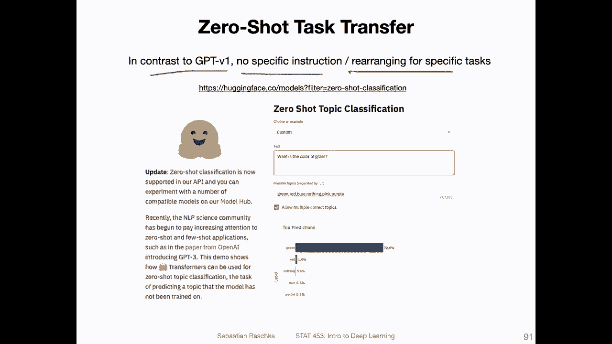

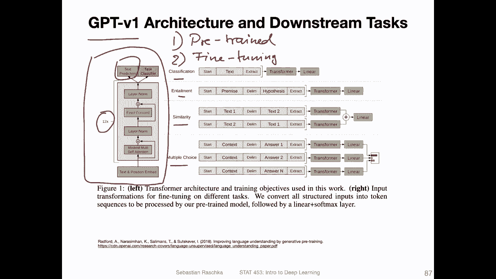

这里有一个我之前提到的零样本任务迁移的例子。与GPT-1不同，GPT-2没有针对特定任务的指令或结构调整。我之前展示的是GPT-1需要进行微调和结构调整。现在，他们不再进行任何微调。不过，我很难找到一个非常具体的例子。说实话，我不太确定具体是如何操作的。我在Hugging Face的代码库中找到了一个零样本主题分类的例子。

Hugging Face是一家专注于语言模型，特别是基于Transformer的语言模型的公司。我想我也会展示一个BERT模型的例子和代码示例，就像上一个视频那样。这里，他们有一个很好的在线界面，可以尝试零样本主题分类。你可以提供一些输入，然后提供你自己的标签。这些标签是模型之前未必见过的，因为它只训练过预测下一个词。之后，你提供用逗号分隔的可能主题。这里我提了一个随机问题：“割下来的草是什么颜色？”，并提供了可能的标签：绿色、红色、蓝色、无色、粉色、紫色。模型在这里回答正确了。

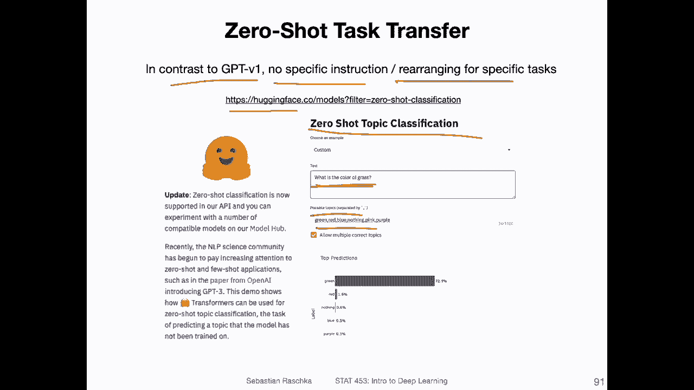

这很酷。接下来是论文中关于模型规模的一些结果。本质上，在所有四个图表中（顶部三个），Y轴是某些评估标准（数值越大越好），X轴是语言模型的参数数量。蓝线代表他们的GPT模型。可以看到，在所有情况下，曲线都是上升的，基本上说明**参数越多，性能越好**。但也可以看到，这些是针对不同任务的：阅读理解、翻译、摘要和问答。GPT-2并非在所有任务上都达到了其他更专门方法的性能。但这也不一定是重点。论文旨在展示，即使没有微调，这些方法也能自动学会理解文本，这实际上相当令人印象深刻。

这里还有一些其他任务的结果。在这种情况下，GPT-2表现得相当好。加粗的数字是他们的性能表现，可以看到他们在许多任务上超越了其他模型。除了一个任务（BW任务），论文中的解释是，在这个BW数据集中，句子被打乱了顺序。由于Transformer模型的一个优势就是能够考虑上下文，而打乱句子顺序破坏了这种上下文，这可能是GPT-2在该任务上表现不佳的一个可能原因。

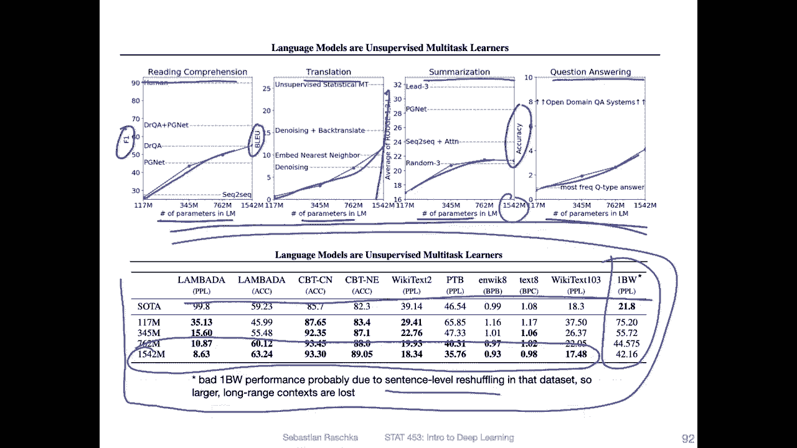

好的，以上就是关于GPT-2的简短介绍。接下来还有一个关于GPT-3的短视频。

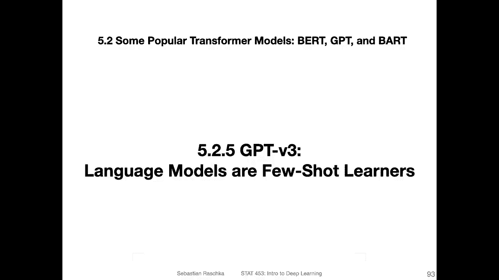

---

本节课中，我们一起学习了GPT-2的核心内容。我们了解到GPT-2是一个规模显著增大的单向语言模型，其关键创新在于**摒弃了针对下游任务的微调**，转而采用**零样本迁移**的方法。通过提供任务描述作为上下文，模型能够直接执行多种NLP任务。同时，我们也看到了更大规模的模型和更高质量的数据集对性能提升的重要性。