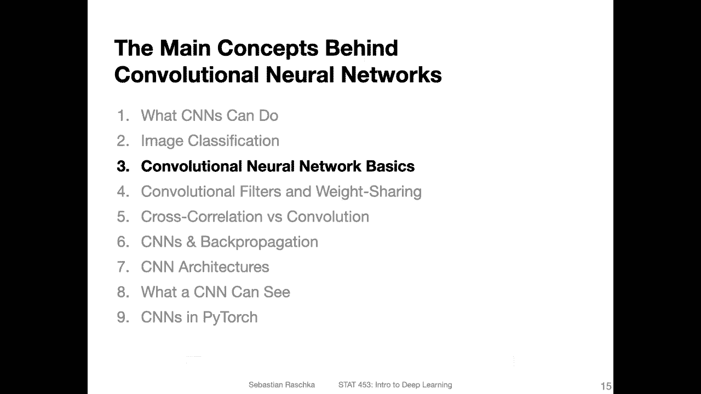
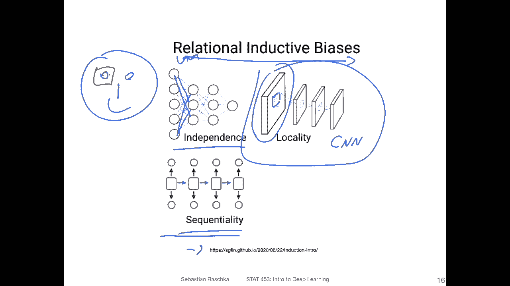
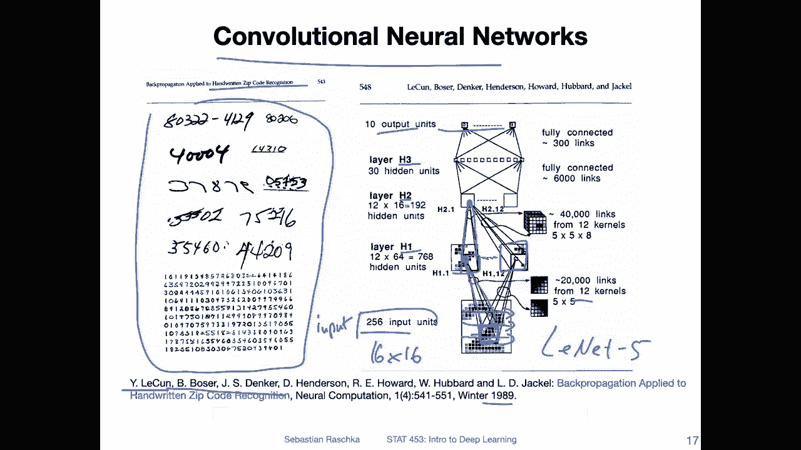
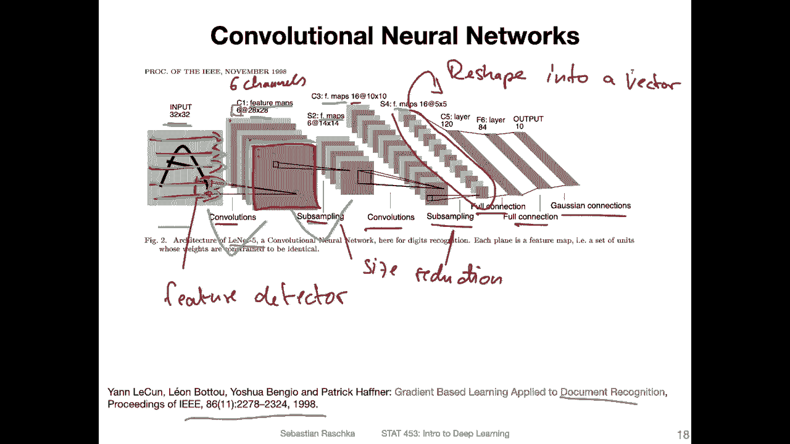
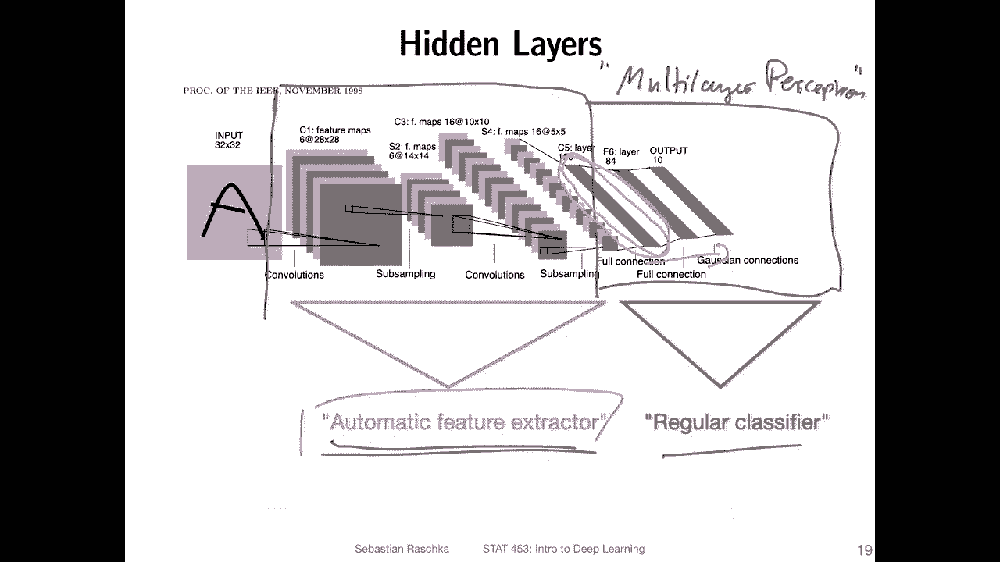
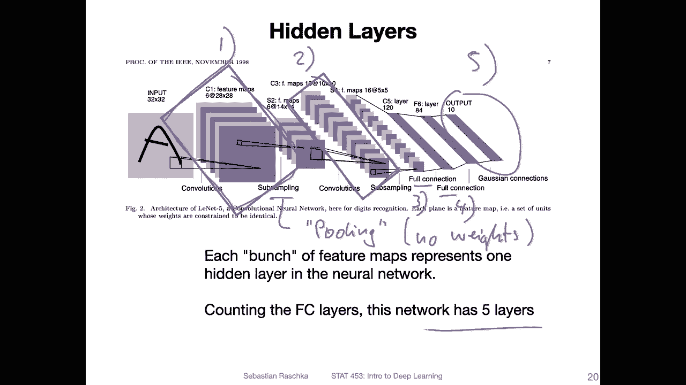
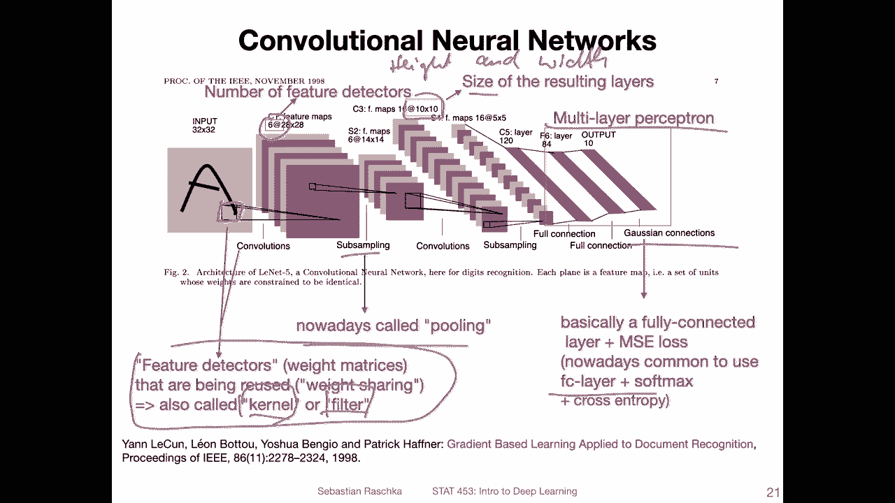
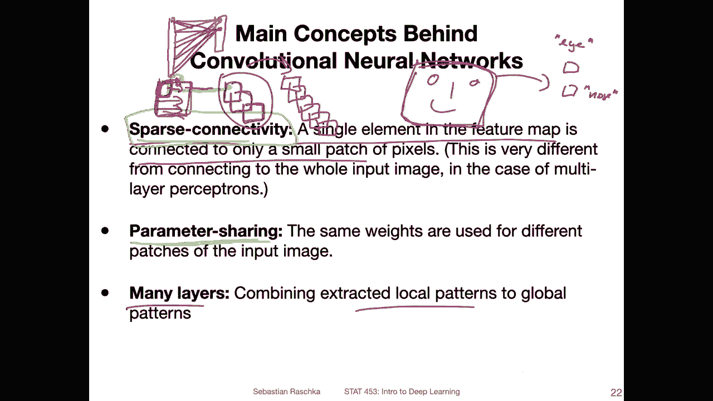
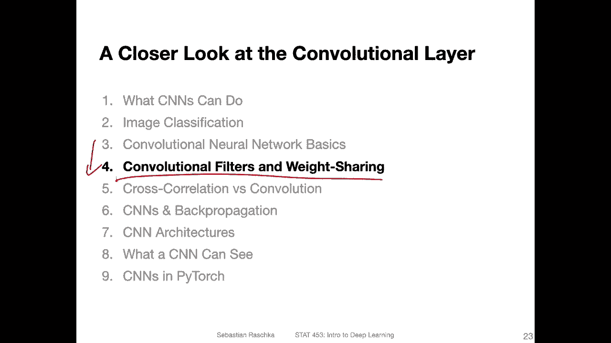

# P100：L13.3- 卷积神经网络基础 🧠

在本节课中，我们将要学习卷积神经网络（CNN）的基本概念。这是一种专门用于处理图像等具有空间结构数据的神经网络，其核心思想是捕捉数据的局部相关性。

## 概述：卷积神经网络的基本假设

上一节我们介绍了多层感知机（MLP）等网络结构。本节中我们来看看卷积神经网络。

卷积神经网络基于一个核心假设：**局部性**。这意味着数据中相邻的元素（如图像中的像素）是相互关联的，而非完全独立的。例如，在一张人脸图片中，构成眼睛的所有像素点之间存在紧密的联系。CNN正是为了捕捉这种局部依赖关系而设计的。

## 早期CNN架构：LeNet-5

为了更好地理解CNN，让我们来看一个经典的早期架构——LeNet-5。这个网络由Yann LeCun等人在1989年提出，至今其核心思想仍然适用。

该网络最初用于手写数字识别，输入图像尺寸为16x16（或论文中提到的32x32）。其核心操作是分析图像中的局部“补丁”（patch），并将这些补丁的信息传递到下一层。

以下是LeNet-5架构的另一个更清晰的图示，它展示了网络如何处理32x32的输入图像：

## CNN的核心工作流程

现在，我们来详细拆解CNN的工作流程。整个过程可以概括为：**卷积 -> 池化（下采样） -> 展平 -> 全连接分类**。

1.  **卷积操作**：网络使用称为“卷积核”或“滤波器”的小窗口（例如5x5）在输入图像上滑动。在每个位置，卷积核与图像局部区域进行点积运算，生成一个数值，最终形成一张“特征图”。一个卷积层通常包含多个不同的卷积核，从而生成多张特征图（例如第一层的6张）。
    *   **公式示意**：`特征图[i, j] = sum(图像局部区域 * 卷积核权重) + 偏置`
2.  **池化操作**：在卷积之后，通常会进行“池化”（也称为“下采样”），例如最大池化。其目的是降低特征图的空间尺寸（例如从28x28降到14x14），增强特征的鲁棒性并减少计算量。
3.  **重复堆叠**：上述“卷积+池化”的过程会重复多次。随着网络加深，特征图的通道数（即特征数量）通常会增加（例如从6个到16个），而空间尺寸会减小。这允许网络从低级特征（如边缘、纹理）逐步组合出高级特征（如眼睛、鼻子）。
4.  **展平与分类**：经过若干次卷积和池化后，得到的三维特征张量会被**展平**成一个一维向量。这个向量随后被送入一个或多个**全连接层**（即传统的多层感知机部分），最终通过输出层（如Softmax）得到分类结果。

## CNN的三大核心特性

理解了工作流程后，我们总结一下CNN区别于全连接网络的三个关键特性：

1.  **稀疏连接**：在CNN中，特征图上的一个神经元只与输入图像的一个小局部区域（感受野）相连。这与全连接网络中每个神经元都与上一层所有神经元相连形成鲜明对比。
2.  **参数共享**：同一个卷积核会被滑动应用于整张输入图像的不同位置。这意味着我们使用同一组参数（权重）来检测图像中任何位置可能出现的特定模式（如垂直边缘），极大地减少了模型参数数量。
3.  **层级特征提取**：通过堆叠多个卷积层，CNN能够自动学习从低级到高级的层次化特征表示。浅层网络学习简单特征（如边缘、角点），深层网络则将这些简单特征组合成更复杂的结构（如物体部件）。

## 总结与后续

本节课中我们一起学习了卷积神经网络的基础知识。我们了解了CNN基于局部性假设，通过卷积、池化等操作自动提取图像特征，并利用稀疏连接、参数共享和层级结构来高效处理图像数据。

如果本节课的内容让你感到有些抽象，请不要担心。在接下来的课程中，我们将深入探讨卷积核的具体计算方式、步长、填充等细节，并通过代码实践来巩固理解。建议你先继续学习下一节内容，许多疑问将会得到解答。

